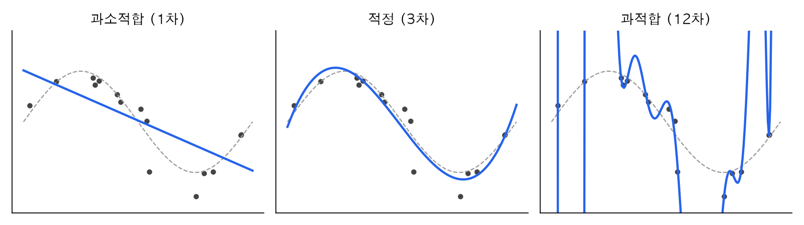
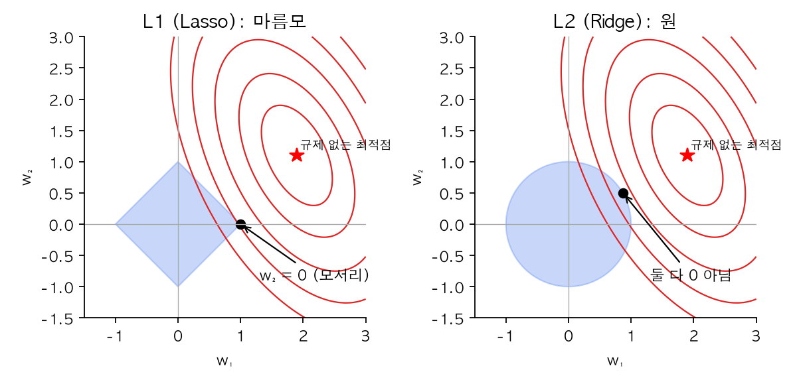
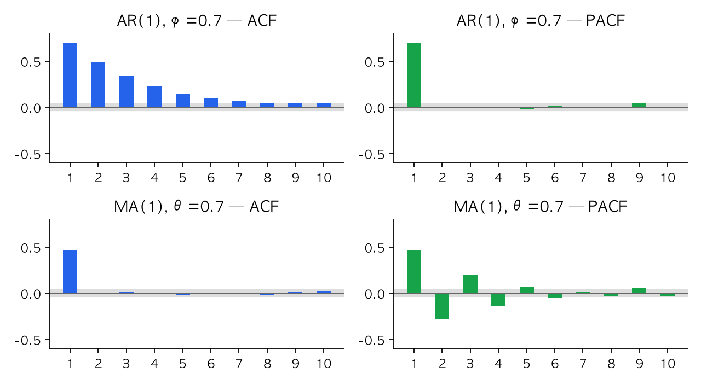
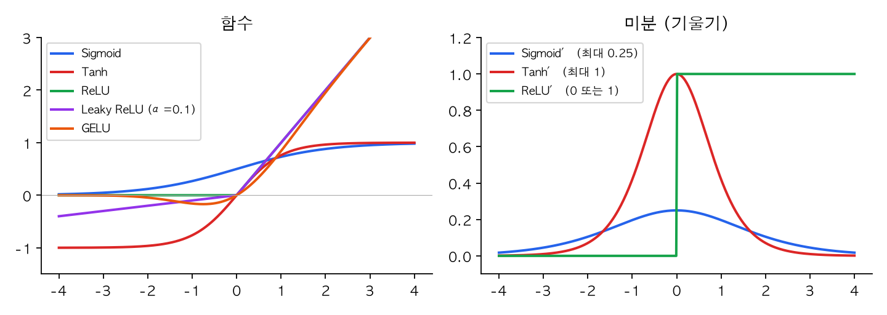
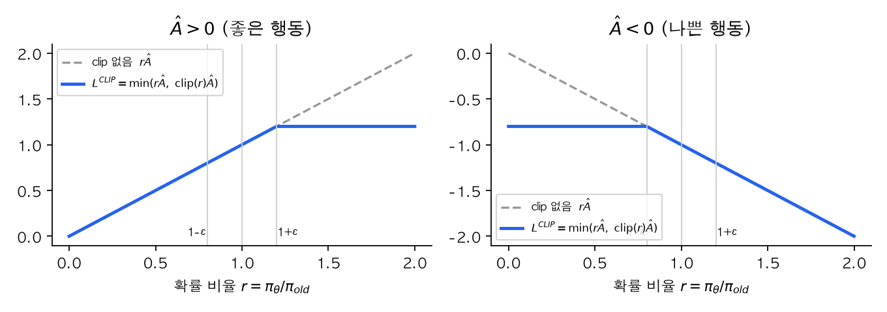
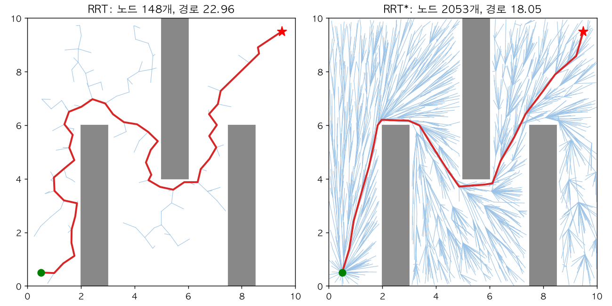

# 시험 전날 쉬운 설명본 (1교시 공통 · 2교시 Physical AI)

> **이 개념을 처음 보는 사람**도 읽을 수 있게 썼다. 처음부터 순서대로 읽으면 된다.
> 개념마다 같은 순서: **한 줄**(무엇인지) → **쉽게 풀면**(어떻게 하는지 순서대로, 작은 숫자 예) → **용어·식**(기호마다 뜻) → **시험 포인트** → **헷갈리는 짝**.
> **1·2교시는 이 설명본 하나로 대비하도록 만들었다.** 구성: 개념(0장 ~ 2교시 F) → 서술형 답안 쓰는 법과 코드(A: 1교시, B: 2교시) → 주관식 예상문제와 모범답안 → 계산 문제 20개 → 가리고 답하기 78문항 → 헷갈리는 짝 한 장.

### 오늘 저녁 순서
1. 개념 부분(0장 ~ 2교시 F)을 처음부터 끝까지 한 번
2. 서술형 코드 A·B를 읽고, 그중 **E1·E2·E4·E10, R1·R3·R5·R6·R8·R11**은 메모장(자동완성 없는 곳)에 직접 쳐 보기
3. 주관식 예상문제: 답을 가리고 항목만이라도 먼저 써 본 뒤 모범답안과 비교
4. 계산 문제 20개 → 가리고 답하기 78문항. 틀린 번호 표시
5. 내일 아침: 틀린 번호만 다시 + 헷갈리는 짝 한 장

---

## 0. 기초 중의 기초 (이것부터)

### 0-1. 머신러닝이 하는 일
**한 줄**: 예시 데이터를 보고 규칙을 스스로 찾아서, 처음 보는 데이터의 답을 맞히는 방법.

**쉽게 풀면**
1. 집 100채의 넓이·방 개수와 실제 가격을 컴퓨터에 보여 준다.
2. 컴퓨터는 "넓이가 크면 비싸다" 같은 규칙을 숫자로 찾아낸다.
3. 그 규칙으로 처음 보는 집의 가격을 예측한다.

**용어**
- **데이터**: 보통 표 모양. 한 줄(행) = 집 한 채 = **샘플**. 한 칸 종류(열) = 넓이·방 개수 같은 입력 정보 = **특성**(feature). 맞히려는 값(가격) = **정답**(label, target).
- **모델**: 입력을 넣으면 예측을 내는 계산식.
- **가중치**(weight, 파라미터): 모델 안의 숫자들. 예: "가격 = 넓이 × **300만** + **5천만**"에서 300만과 5천만. 학습 = 이 숫자를 좋은 값으로 맞추는 것.

### 0-2. 회귀와 분류
**한 줄**: 숫자를 맞히면 회귀, 종류를 맞히면 분류.

**쉽게 풀면**
- **회귀**(regression): 집값 3억 2천만 원처럼 **숫자**를 예측.
- **분류**(classification): "불량/정상"처럼 정해진 **종류**(클래스) 중 하나를 고르기. 종류가 2개면 **이진 분류**, 3개 이상이면 **다중 분류**.

**헷갈리는 짝**: 로지스틱 "회귀"는 이름만 회귀이고 실제로는 **분류** 모델이다(1-9).

### 0-3. 손실 (loss)
**한 줄**: 예측이 얼마나 틀렸는지를 숫자 하나로 나타낸 것. 학습은 이 숫자를 줄이는 일.

**쉽게 풀면**
- 정답 10, 예측 7이면 3만큼 틀렸다. 이런 틀림을 모든 샘플에서 모아 점수 하나로 만든 게 손실.
- 손실이 작을수록 좋은 모델.

**용어·식**
- **MSE**(평균 제곱 오차, 회귀용) = (정답 − 예측)²의 평균. 예: 틀림이 3과 1이면 (9 + 1) ÷ 2 = 5.
- **교차엔트로피**(cross-entropy, 분류용) = 모델이 **정답 클래스에 준 확률**이 낮을수록 큰 벌점. 정답에 확률 0.9를 줬으면 벌점 −log 0.9 ≈ 0.1(작음), 0.1을 줬으면 −log 0.1 ≈ 2.3(큼).

### 0-4. 학습 = 경사하강법 (gradient descent)
**한 줄**: 손실이 줄어드는 방향으로 가중치를 조금씩 고치기를 반복하는 방법.

**쉽게 풀면**
1. 가중치를 아무 값으로 시작한다.
2. 가중치를 아주 조금 키우면 손실이 늘어나는지 줄어드는지 계산한다. 이 값이 **기울기**(gradient).
3. 손실이 줄어드는 쪽(기울기의 **반대** 방향)으로 가중치를 조금 옮긴다.
4. 손실이 더 안 줄어들 때까지 2~3을 반복한다.
- 예: w를 키우면 손실이 커진다(기울기 = +4). 학습률 0.1이면 w ← w − 0.1 × 4, 즉 w를 0.4 줄인다.

**용어·식**: `가중치 ← 가중치 − 학습률 × 기울기`. **학습률**(learning rate) = 한 번에 얼마나 옮길지. 너무 크면 가장 낮은 점을 지나쳐 왔다 갔다 하거나 값이 폭주(발산)하고, 너무 작으면 오래 걸린다.

**시험 포인트**: 식에 마이너스가 붙는 이유 = 손실을 줄이려면 기울기 반대로 가야 해서.

### 0-5. 학습·검증·테스트 데이터
**한 줄**: 데이터를 세 덩어리로 나눠 배우기·고르기·최종 확인에 따로 쓴다.

**쉽게 풀면**
- **학습 데이터**: 모델이 가중치를 배우는 데 쓴다(보통 가장 큰 덩어리).
- **검증 데이터**: 설정(학습률, 모델 크기 등)을 고르고, 학습을 언제 멈출지 정하는 데 쓴다.
- **테스트 데이터**: 마지막에 딱 한 번, 처음 보는 데이터에서 성능을 잰다.

**시험 포인트**: 테스트 점수를 보고 모델을 고치면 테스트 데이터도 "이미 본 데이터"가 되어 실력을 실제보다 좋게 평가하게 된다.

### 0-6. 과적합과 과소적합
**한 줄**: 과적합 = 학습 데이터에만 너무 잘 맞고 새 데이터에 약함. 과소적합 = 학습 데이터도 제대로 못 맞춤.

**쉽게 풀면**
- **과적합**(overfitting): 모델이 학습 데이터의 우연한 잡음까지 외운 상태. 학습 데이터 오차는 아주 작은데 검증 데이터 오차는 크다.
- **과소적합**(underfitting): 모델이 너무 단순해 패턴을 못 잡은 상태. 학습·검증 오차가 둘 다 크다.
- 아래 그림: 점선이 진짜 패턴. 왼쪽(직선)은 너무 단순, 가운데가 적당, 오른쪽(12차 곡선)은 점마다 억지로 맞춰 들쭉날쭉.



**시험 포인트** (자주 나옴): "학습 손실은 계속 줄고 검증 손실은 오른다" → 과적합. 처방: 데이터 늘리기, 규제(1-7), Dropout·조기 종료(1-27), 모델 줄이기.

### 0-7. 파라미터와 하이퍼파라미터
**한 줄**: 학습으로 정해지는 숫자 = 파라미터, 사람이 미리 정하는 설정 = 하이퍼파라미터.

**쉽게 풀면**
- **파라미터**(가중치): 학습하면서 자동으로 바뀐다.
- **하이퍼파라미터**: 학습률, 트리 깊이, 규제 세기 λ, 층 개수처럼 학습 전에 사람이 정한다. 여러 값을 해 보고 **검증 데이터 점수**가 가장 좋은 것을 고른다.

---

## 1교시: 머신러닝·딥러닝 기초

## A. 데이터 다루기

### 1-1. 교차검증 (cross-validation, K-fold)
**한 줄**: 데이터를 K조각으로 나눠 검증을 K번 돌리고 평균을 내서, 점수를 더 믿을 만하게 만드는 방법.

**쉽게 풀면** (K = 5일 때)
1. 데이터를 5조각으로 나눈다.
2. 1번 조각으로 검증, 나머지 4조각으로 학습해 점수를 잰다.
3. 2번 조각으로 검증, 나머지로 학습 … 5번 조각까지 반복한다.
4. 점수 5개의 평균이 최종 점수.
- 검증을 한 번만 하면 어떤 데이터가 검증에 걸렸느냐에 따라 점수가 운에 좌우된다. 이걸 줄여 준다. 데이터가 적을 때 특히 유용.

**시험 포인트**
- **Stratified K-fold**: 조각마다 클래스 비율(예: 불량 5%)을 원래와 똑같이 유지. 불균형 데이터에 쓴다.
- **시계열은 섞지 않는다**: 과거로 학습하고 미래로 검증해야 한다. 미래 데이터로 학습하면 실제로는 불가능한 반칙이다.

### 1-2. 데이터 누수 (data leakage)
**한 줄**: 학습할 때 원래는 알 수 없는 정보가 학습에 섞여, 점수가 실제보다 좋게 나오는 실수.

**쉽게 풀면**
- 예: 표준화(1-4)할 때 평균·표준편차를 **전체 데이터**(테스트 포함)로 계산하면, 테스트 데이터 정보가 학습에 새어 들어간다.
- 올바른 순서:
  1. 먼저 학습/테스트로 나눈다.
  2. 평균·표준편차는 **학습 데이터로만** 계산해 저장한다(**fit**).
  3. 저장한 값으로 학습·테스트 데이터를 둘 다 변환한다(**transform**).
- 다른 예: 시계열에서 "내일 값"을 특성으로 쓰기, 오버샘플링(1-15)을 테스트 데이터까지 하기.

**시험 포인트**: "전체 데이터로 스케일러를 fit한 뒤 나누기" = 누수 (단골).

### 1-3. 편향과 분산 (bias-variance)
**한 줄**: 모델의 오차를 "모델이 너무 단순해서 생기는 오차(편향)"와 "학습 데이터에 따라 흔들려서 생기는 오차(분산)"로 나눈 것.

**쉽게 풀면**
- **편향**(bias)이 크다: 모델이 너무 단순해서, 데이터를 바꿔 학습시켜도 늘 비슷하게 틀린다. 예: 곡선 모양 데이터에 직선만 쓰는 경우 → 과소적합.
- **분산**(variance)이 크다: 학습 데이터가 조금만 바뀌어도 모델 모양이 크게 달라진다. 예: 0-6 그림의 12차 곡선 → 과적합.
- 모델을 복잡하게 할수록 편향은 줄고 분산은 는다. 그 사이 적당한 지점이 가장 좋다.

**식**: 새 데이터에서의 오차 = 편향² + 분산 + 줄일 수 없는 잡음.

**시험 포인트**: 규제를 세게 하면 모델이 단순해져 편향↑ 분산↓.

### 1-4. 피처 엔지니어링 (feature engineering)
**한 줄**: 모델이 잘 배우도록 입력 데이터를 다듬고, 쓸모 있는 입력을 새로 만드는 일.

**쉽게 풀면** (자주 하는 것)
- **표준화**(스케일링): 넓이(30~100)와 소득(수천만)처럼 크기가 다른 특성을 같은 기준으로 맞춘다. (값 − 평균) ÷ 표준편차 → 평균 0, 표준편차 1. (**표준편차** = 값들이 평균에서 평균적으로 얼마나 떨어져 있나)
- **원-핫 인코딩**: "서울/부산/대구" 같은 글자를 숫자로 바꾼다. 서울 = [1,0,0], 부산 = [0,1,0], 대구 = [0,0,1]. 그냥 1, 2, 3으로 바꾸면 "대구가 서울의 3배" 같은 엉뚱한 크기 관계가 생기기 때문.
- **결측값 채우기**: 빈칸을 평균이나 중앙값으로 채운다.
- **로그 변환**: 금액처럼 대부분 작은데 몇 개만 엄청 큰 값을 고르게 펴 준다.
- **파생 특성**: 날짜 → 요일, 불량 수 ÷ 생산 수 → 불량률처럼 새 특성을 만든다.

**시험 포인트**: 트리 모델은 "넓이 > 30?"처럼 크기 비교만 해서 **표준화가 필요 없다**. 선형 모델·신경망·거리 기반(k-NN)은 필요하다.

### 1-5. 모델 선택 (model selection)
**한 줄**: 여러 모델과 설정 중에서 검증 점수가 가장 좋은 것을 고르는 일.

**쉽게 풀면**
1. 후보를 정한다. 예: 선형 회귀, Random Forest, XGBoost / 트리 깊이 3, 5, 7.
2. 각각 학습시키고 교차검증 점수를 비교한다. 설정 조합을 다 해 보면 **그리드 서치**, 무작위로 일부만 해 보면 **랜덤 서치**.
3. 점수가 비슷하면 더 단순한 모델을 고른다(이해·관리가 쉽고 과적합 위험이 적음).

**시험 포인트**: 학습 점수로 고르면 과적합된 모델을 고르게 된다. 통계 모델 비교 지표 **AIC·BIC**는 작을수록 좋다(데이터를 잘 설명할수록 작아지고, 파라미터가 많으면 벌점. BIC가 벌점이 더 큼).

## B. 선형 모델

### 1-6. 선형 회귀 (linear regression)
**한 줄**: 입력 특성들에 가중치를 곱해 더한 값으로 숫자를 예측하는 가장 기본 모델.

**쉽게 풀면**
- 예측 = w₁ × 넓이 + w₂ × 방 개수 + b. 예: 가격 = 300만 × 넓이 + 1000만 × 방 개수 + 5000만.
- 학습 = 모든 집에서 (정답 − 예측)²의 평균(MSE)이 가장 작아지는 w와 b를 찾는 것. 그래프로 보면 점들 사이를 가장 잘 지나가는 직선 찾기(특성이 여러 개면 평면).
- 찾는 방법 두 가지:
  1. **정규방정식**: 공식 한 번으로 바로 계산. w = (XᵀX)⁻¹Xᵀy. 특성이 아주 많으면 계산이 무거워진다.
  2. **경사하강법**(0-4): 조금씩 고쳐 가며 찾는다.

**용어**
- X = 특성 표, y = 정답들, Xᵀ = 행과 열을 뒤바꾼 행렬, ⁻¹ = 역행렬(곱하면 1이 되는 행렬).
- **절편** b = 모든 특성이 0일 때의 예측값(직선이 세로축과 만나는 높이).
- **다중공선성**: 키(cm)와 키(inch)처럼 거의 같은 정보를 가진 특성이 함께 있으면 가중치가 불안정하게 크게 출렁이는 문제 → Ridge(1-8)로 완화.

**시험 포인트**: MSE의 기울기 = (2/n) × Xᵀ(예측 − 정답) (n = 샘플 수). **[서술형: E2]**

### 1-7. 규제 (regularization)
**한 줄**: 가중치가 너무 커지지 않도록 손실에 벌점을 더해 과적합을 막는 방법.

**쉽게 풀면**
- 과적합된 모델은 가중치가 아주 큰 경우가 많다. 그러면 입력이 조금만 바뀌어도 예측이 크게 출렁인다.
- 그래서 학습할 때 "손실 + λ × (가중치 크기)"를 줄이게 한다. 데이터도 잘 맞추면서 가중치도 작게 유지하라는 뜻.
- **λ**(람다, sklearn에서는 alpha) = 벌점 세기. 0이면 규제 없음, 크면 가중치가 더 작아지고 모델이 단순해진다(편향↑ 분산↓).

**시험 포인트**: 규제 전에 **표준화 필수**. 단위가 다르면(원 vs 억 원) 같은 영향이라도 가중치 크기가 달라져서 벌점이 불공평해진다.

### 1-8. Ridge(L2)와 Lasso(L1)
**한 줄**: 가중치 벌점을 제곱으로 주면 Ridge, 절댓값으로 주면 Lasso.

**쉽게 풀면**
- **Ridge**(L2 규제): 벌점 = λ × (w₁² + w₂² + …). 모든 가중치를 고르게 작게 만든다. 하지만 정확히 0까지는 거의 안 간다.
- **Lasso**(L1 규제): 벌점 = λ × (|w₁| + |w₂| + …). 쓸모없는 특성의 가중치를 **정확히 0**으로 만든다 → 그 특성은 아예 안 쓰는 셈 = **특성 선택**.
- 왜 Lasso만 0이 되나(그림): 규제는 "가중치가 이 영역 안에 있어야 한다"는 조건과 같다. 영역 모양이 L1은 마름모, L2는 원이다. 손실이 같은 점을 이은 선(빨간 타원, 등고선)이 이 영역에 처음 닿는 곳이 답인데, 마름모는 **꼭짓점(가중치 하나가 0인 점)**에서 닿기 쉽다.



**시험 포인트**: "계수를 정확히 0으로 만들어 특성 선택" = **Lasso**. Ridge는 공식으로 바로 풀리고(w = (XᵀX + λI)⁻¹Xᵀy, I = 대각선만 1인 행렬), Lasso는 반복 계산으로 푼다.

**헷갈리는 짝**: **L1 = Lasso = 절댓값 = 0 만듦** / **L2 = Ridge = 제곱 = 작게만**. 둘 다 쓰면 Elastic Net.

### 1-9. 로지스틱 회귀 (logistic regression)
**한 줄**: 선형 회귀처럼 점수를 계산한 뒤, 그 점수를 0~1 확률로 바꿔 분류하는 모델.

**쉽게 풀면**
1. 점수 z = w·x + b를 계산한다(선형 회귀와 같다).
2. z를 **시그모이드** 함수 1/(1 + e^(−z))에 넣으면 0~1 사이 값이 나온다. z가 크면 1에 가깝고, 작으면 0에 가깝고, z = 0이면 0.5.
3. 이 값을 "양성(예: 불량)일 확률"로 보고, 0.5보다 크면 양성으로 판정한다.
- 학습: 정답이 1인데 확률을 낮게 줬거나, 정답이 0인데 높게 줬으면 큰 벌점을 받는다(**이진 교차엔트로피**, BCE).

**시험 포인트**: 이름은 회귀지만 **분류** 모델. 기울기 = Xᵀ(확률 − 정답) ÷ n (선형 회귀와 같은 모양). **[서술형: E3]**

## C. 트리 모델

### 1-10. 결정트리 (decision tree)와 지니 불순도
**한 줄**: "예/아니오" 질문을 반복해 데이터를 나누고, 끝에서 답을 내는 모델.

**쉽게 풀면**
1. 모든 특성과 기준값으로 질문을 만들어 본다. 예: "넓이 > 30?", "역까지 10분 이내?"
2. 질문으로 나눈 뒤 양쪽이 **한 종류로 잘 모이는** 질문을 고른다. 예: 불량 50·정상 50을 나눴더니 한쪽은 불량 45·정상 5, 다른 쪽은 불량 5·정상 45 → 좋은 질문.
3. 나뉜 쪽마다 1~2를 반복한다.
4. 더 나눌 필요가 없거나 깊이 제한에 걸리면 멈추고, 맨 끝(**잎**, leaf)에서 다수결(분류)이나 평균(회귀)으로 답한다.

**용어·식**
- **지니 불순도** = 1 − (각 클래스 비율의 제곱을 모두 더한 값). 섞인 정도를 나타낸다.
  - 한 종류만 있으면 1 − 1 = 0(깨끗). 반반이면 1 − (0.5² + 0.5²) = 0.5.
  - 불량 45·정상 5면 비율 0.9·0.1 → 1 − (0.81 + 0.01) = 0.18.
- **엔트로피** = 섞인 정도를 재는 또 다른 기준(반반이면 1, 한 종류면 0).
- 질문 고르는 기준: 나눈 뒤 양쪽 지니를 **샘플 수 비율로 가중 평균**한 값이 가장 작은 질문.

**시험 포인트**: 너무 깊게 키우면 과적합 → 최대 깊이·잎의 최소 샘플 수를 제한. 표준화 불필요. **[서술형: E6]**

### 1-11. 앙상블 · 배깅 · Random Forest
**한 줄**: 여러 모델의 예측을 모아 평균·다수결을 내면 하나일 때보다 덜 틀린다는 원리를 쓴 방법들.

**쉽게 풀면**
- **앙상블**(ensemble) = 여러 모델을 합쳐 쓰는 것.
- **배깅**(bagging):
  1. 원래 데이터에서 같은 개수만큼 **중복을 허용해** 무작위로 뽑아 새 데이터를 여러 벌 만든다(**부트스트랩**). 어떤 샘플은 두 번 뽑히고 어떤 샘플은 안 뽑힌다.
  2. 데이터 한 벌마다 나무(결정트리)를 하나씩 학습시킨다.
  3. 예측할 때 모든 나무의 답을 평균(회귀)하거나 다수결(분류)한다.
- **Random Forest** = 배깅 + 나무를 만들며 **분할(노드)마다** 후보 특성 중 일부만 무작위로 보게 한다(분류는 보통 √특성 수 개). 강한 특성 하나가 모든 나무를 똑같이 만드는 걸 막아 나무들이 서로 덜 닮는다.
- 서로 다르게 틀리는 나무들을 평균하면 틀림이 상쇄되어 **분산이 줄어든다**.

**시험 포인트**
- 나무들을 **동시에(병렬로)** 만든다. 나무 수를 늘려도 과적합이 심해지지 않는다(계산만 늘어남).
- 부트스트랩에서 한 샘플이 안 뽑힐 확률은 약 **36.8%**. 안 뽑힌 샘플로 따로 검증할 수 있다 = **OOB**(Out-of-Bag) 오차.

### 1-12. 부스팅 · 그래디언트 부스팅 · XGBoost
**한 줄**: 모델을 하나씩 차례로 추가하면서, 새 모델이 앞 모델들이 틀린 부분을 보완하게 하는 방법.

**쉽게 풀면** (그래디언트 부스팅, 집값 예)
1. 처음 예측 = 모든 집의 평균 가격(예: 3억).
2. 집마다 **잔차** = 정답 − 예측을 구한다(예: 실제 3억 5천이면 +5천만).
3. 작은 나무 하나가 이 잔차를 맞추도록 학습한다.
4. 예측 ← 예측 + 학습률(예: 0.1) × 그 나무의 예측. 조금씩만 반영해야 과적합이 덜하다.
5. 새 잔차를 구해 3~4를 수백 번 반복한다.
- **AdaBoost**라는 다른 부스팅은 잔차 대신 **틀린 샘플의 가중치를 올려** 다음 모델이 그 샘플을 더 신경 쓰게 한다.
- "그래디언트"라는 이름: 제곱 오차에서는 잔차가 곧 손실의 음의 기울기라서. 다른 손실을 쓰면 그 손실의 음의 기울기를 맞춘다.
- **XGBoost** = 그래디언트 부스팅 + 나무가 너무 복잡해지지 않게 하는 벌점(잎 개수 벌점 γ, 잎 값 크기 벌점 λ) + 빈칸(결측값) 자동 처리 + 빠른 계산.

**용어·식** (계산 문제용)
- 잎 하나의 출력값 `w* = −G/(H + λ)`. G = 그 잎에 들어온 샘플들의 g 합, H = h 합. g = 1차 미분(기울기), h = 2차 미분(기울기가 얼마나 빨리 변하나). 제곱 오차면 g = 예측 − 정답, h = 1.
- 분할 이득 `Gain = ½[G_L²/(H_L+λ) + G_R²/(H_R+λ) − (G_L+G_R)²/(H_L+H_R+λ)] − γ` (L = 왼쪽, R = 오른쪽). 0보다 작으면 나누지 않는다. 숫자 예는 계산 문제 8·9번.

**시험 포인트**: 주로 **편향을 줄인다**. 나무를 차례로 만든다. 나무 수를 너무 늘리면 과적합 → 검증 점수가 나빠지면 멈춘다(조기 종료). 주요 설정: learning_rate(eta), max_depth(기본 6), subsample, colsample_bytree.

**헷갈리는 짝**: **배깅/Random Forest** = 동시에, 독립, **분산↓** / **부스팅/XGBoost** = 차례로, 앞 모델 오답 보완, **편향↓**.

## D. 평가 지표

### 1-13. MAE · MSE · RMSE (회귀 지표)
**한 줄**: 회귀 예측이 평균적으로 얼마나 틀렸는지 재는 지표들.

**쉽게 풀면** (오차 = 정답 − 예측. 예: 오차가 1, 1, 1, 9)
- **MAE** = 오차 크기의 평균 = (1 + 1 + 1 + 9) ÷ 4 = **3**.
- **MSE** = 오차 제곱의 평균 = (1 + 1 + 1 + 81) ÷ 4 = **21**.
- **RMSE** = MSE의 제곱근 = √21 ≈ **4.58**. 단위가 원래 값과 같아진다.
- 큰 오차(9) 하나 때문에 RMSE가 MAE보다 훨씬 커졌다. 제곱하면 큰 오차가 더 크게 반영되기 때문.

**시험 포인트**: 항상 RMSE ≥ MAE. 이상치가 많으면 MAE가 덜 흔들린다. 큰 실수가 치명적이면(설비 고장) RMSE로 평가.

**그 밖에**: **R²**(결정계수) = 1 − (모델의 오차 제곱합 ÷ 평균값으로만 찍었을 때의 오차 제곱합). 1이면 완벽, 0이면 평균으로 찍은 것과 같고, 테스트 데이터에선 음수도 가능. **MAPE** = 오차를 정답 대비 %로 낸 평균(정답이 0에 가까우면 값이 폭발).

### 1-14. 혼동행렬 · 정확도 · 정밀도 · 재현율 · F1 (분류 지표)
**한 줄**: 분류 결과를 맞음·틀림 네 칸으로 세고, 그걸로 여러 지표를 계산한다.

**쉽게 풀면** (불량 검출, 양성 = 불량)
- **혼동행렬** 네 칸:
  - **TP**: 불량을 불량이라고 맞힘
  - **FP**: 정상을 불량이라고 함(거짓 경보)
  - **FN**: 불량을 정상이라고 함(놓침)
  - **TN**: 정상을 정상이라고 맞힘
- **정확도** = 맞힌 것 ÷ 전체 = (TP + TN) ÷ 전체
- **정밀도** = TP ÷ (TP + FP) = 불량이라고 한 것 중 진짜 불량 비율 → 거짓 경보가 적을수록 높다
- **재현율** = TP ÷ (TP + FN) = 진짜 불량 중 잡아낸 비율 → 놓친 게 적을수록 높다
- **F1** = 2 × 정밀도 × 재현율 ÷ (정밀도 + 재현율) → 둘 중 하나라도 낮으면 F1도 낮다(조화평균)
- 예: TP 40, FP 10, FN 20, TN 930 → 정확도 970/1000 = 0.97, 정밀도 40/50 = 0.8, 재현율 40/60 ≈ 0.667, F1 ≈ 0.727.

**시험 포인트**
- **불균형 데이터에서 정확도는 속인다**: 불량이 1%뿐이면 "전부 정상"이라고만 해도 정확도 99%인데 재현율은 0.
- 양성으로 판정하는 기준(**임계값**)을 낮추면 더 많이 잡아서 재현율↑, 대신 거짓 경보가 늘어 정밀도↓.
- 놓치면 큰일(불량·질병) → 재현율 중시 / 거짓 경보가 비쌈(정상 메일을 스팸 처리) → 정밀도 중시.
- **ROC 곡선** = 판정 기준을 바꿔 가며 (거짓 경보 비율, 재현율)을 이은 선. **AUC** = 그 아래 넓이(0.5 = 찍기 수준, 1 = 완벽). 양성이 아주 드물면 **PR 곡선**(정밀도-재현율)이 차이를 더 잘 보여 준다.
- 다중 분류 F1: **macro** = 클래스별 F1의 단순 평균(작은 클래스도 똑같이 중요) / **micro** = 전체 개수를 합쳐 계산(샘플 하나에 라벨 하나면 정확도와 같음).
- **[서술형: E1]**

### 1-15. 불균형 데이터 대처
**한 줄**: 한 클래스가 아주 적을 때(불량 2%) 모델이 그 클래스를 무시하지 않게 하는 방법들.

**쉽게 풀면**
1. 지표를 정확도 대신 F1·재현율로 본다.
2. 데이터를 나눌 때 Stratified(1-1)로 비율을 유지한다.
3. **클래스 가중치**: 적은 클래스를 틀리면 손실에 더 큰 벌점을 준다.
4. **리샘플링**: 적은 클래스를 늘리거나(복제, 또는 **SMOTE** = 가까운 두 샘플 사이 지점에 새 샘플을 만들어 넣기), 많은 클래스를 줄인다.
5. 양성 판정 기준(임계값)을 조정한다.

**시험 포인트**: 리샘플링은 **학습 데이터에만**. 검증·테스트까지 바꾸면 점수가 부풀려진다(누수). **[서술형: E7 표준화도 같은 원칙]**

## E. 시계열

### 1-16. 시계열과 정상성 (stationarity)
**한 줄**: 정상성 = 시계열의 평균 높이와 흔들리는 폭이 시간이 지나도 변하지 않는 성질.

**쉽게 풀면**
- **시계열**: 시간 순서대로 쌓인 데이터(월별 판매량, 시간별 온도).
- **정상**인 예: 매달 판매량이 100 근처에서 ±10 정도로 오르내린다. 어느 구간을 잘라 봐도 비슷하다.
- **비정상**인 예:
  - **추세**: 해마다 판매량이 10씩 늘어난다 → 평균이 시간에 따라 변함.
  - **계절성**: 여름마다 치솟는다 → 시기에 따라 평균이 달라짐.
  - 흔들림이 커짐: 값이 커질수록 오르내림 폭도 커짐 → 분산이 변함.
- 정확한 조건 3개: ① 평균이 일정 ② 분산(흔들림 폭)이 일정 ③ 두 시점의 관계가 "언제냐"가 아니라 "몇 칸 떨어져 있냐"에만 달려 있음.

**시험 포인트**: ARIMA의 AR·MA 부분은 정상 시계열을 가정한다. 비정상이면 바꾼다: 추세 → **차분**, 계절 → **계절 차분**, 흔들림이 커짐 → **로그**. "값이 정규분포를 따른다"는 정상성 조건이 **아니다**.

### 1-17. 차분 (differencing) — ARIMA의 I
**한 줄**: 값 자체 대신 "직전보다 얼마나 변했나"로 바꾸는 것.

**쉽게 풀면**
- 원래 값: 100, 110, 120, 130 (계속 오르는 추세 → 비정상)
- 1차 차분: 110−100, 120−110, 130−120 = 10, 10, 10 → 일정해짐(정상).
- **계절 차분**: 이번 달 − 작년 같은 달(월별이면 12칸 전). 매년 반복되는 패턴을 없앤다.
- 차분을 몇 번 했는지가 ARIMA의 **d**.

**시험 포인트**: **랜덤워크**(오늘 값 = 어제 값 + 무작위 변화)는 비정상인데 한 번 차분하면 무작위 변화만 남아 정상 → ARIMA(0,1,0). 월별 계절 차분 = y_t − y_(t−12). **[서술형: E8]**

### 1-18. AR · MA · ARIMA
**한 줄**: AR은 과거 **값**으로, MA는 과거의 **예상 밖 변화(오차)**로 오늘 값을 설명하고, ARIMA는 차분 + AR + MA를 합친 모델.

**쉽게 풀면**
- **AR(p)** (자기회귀): 오늘 값 = 상수 + (가중치 × 어제 값) + … + (가중치 × p일 전 값) + 잡음. 예: AR(1)에서 가중치 0.7이면, 어제 평소보다 높았던 만큼의 70%가 오늘에도 이어진다.
- **MA(q)** (이동평균): 오늘 값 = 평균 + 오늘 잡음 + (가중치 × 어제의 예상 밖 변화) + … + (가중치 × q일 전의 예상 밖 변화). 예: 어제 갑자기 판매가 튀었다면 그 영향이 오늘까지 조금 남는다.
- **ARIMA(p, d, q)**: d번 차분해서 정상으로 만든 뒤 AR(p)와 MA(q)를 함께 써서 예측. 예측 후 차분을 되돌려(더해서) 원래 단위로 바꾼다.

**시험 포인트**: MA는 이름과 달리 "최근 값 평균 내기"가 **아니다**(과거 오차의 가중합). statsmodels(파이썬 통계 라이브러리)의 `ARIMA`로 차분 없이 맞추면 결과의 const는 절편이 아니라 **평균**이다(절편 = 평균 × (1 − φ들의 합), φ = AR 가중치). `AutoReg`는 const가 절편 그대로라 어느 클래스인지 확인.

### 1-19. ACF · PACF — 차수 고르기
**한 줄**: 오늘 값과 며칠 전 값이 얼마나 관련 있는지 그린 막대그래프. 모양을 보고 AR·MA의 p, q를 고른다.

**쉽게 풀면**
- **ACF**(자기상관 함수): 오늘과 k일 전이 얼마나 같이 움직이나(−1~1). 중간 날들을 거쳐 이어진 영향까지 다 포함된다. 예: 오늘이 어제를 닮고 어제가 그제를 닮으면, 오늘과 그제도 간접적으로 닮아 보인다.
- **PACF**(편자기상관 함수): 중간 날들의 영향을 빼고 오늘과 k일 전의 **직접적인** 관계만.



- 그림 읽기: AR(1)은 ACF가 천천히 줄어들고 PACF는 1칸 다음에 뚝 끊긴다. MA(1)은 반대로 ACF가 1칸 다음에 뚝 끊긴다. 회색 띠 안의 막대는 0과 다르다고 보기 어렵다(사실상 0).

**시험 포인트** (단골): AR(p) → **PACF가 p칸 다음에 끊김** / MA(q) → **ACF가 q칸 다음에 끊김** / 둘 다 서서히 줄면 ARMA. ACF가 아주 천천히 줄면 비정상 → 차분 먼저.

**외우는 법**: "**AR은 P**, **MA는 A**" (AR–PACF, MA–ACF).

### 1-20. 계절성 · SARIMA · 정상성 검정
**한 줄**: 정해진 주기로 반복되는 패턴이 계절성이고, 이를 다루는 모델이 SARIMA. 정상인지 숫자로 확인하는 게 검정.

**쉽게 풀면**
- **계절성**: 고정된 주기(요일, 월)로 반복. 주기가 일정하지 않은 경기 순환은 계절성이 아니다.
- **SARIMA(p,d,q)(P,D,Q)_s**: ARIMA에 "s칸 전"(월별이면 12개월 전)과의 관계를 따로 더한 모델. 대문자 P·D·Q가 계절 부분.
- **검정 읽는 법**: 검정마다 "기본 가정(귀무가설)"이 있고, **p값**이 0.05보다 작으면 그 기본 가정을 버린다(기각). (p값 = 기본 가정이 맞다면 이런 데이터가 나올 확률)
  - **ADF 검정**: 기본 가정 = "비정상이다". p < 0.05 → 비정상이 아니다 → **정상**.
  - **KPSS 검정**: 기본 가정 = "정상이다". p < 0.05 → **비정상**.
  - **Ljung-Box 검정**: 모델의 남은 오차(잔차)에 패턴이 남았는지 확인. 패턴 없는 잡음(**백색잡음**)이면 모델이 뽑을 것을 다 뽑은 것.

**헷갈리는 짝** (함정 1순위): **ADF와 KPSS는 기본 가정이 반대**.

## F. 딥러닝

### 1-21. 신경망 · DNN
**한 줄**: "입력에 가중치를 곱해 더하고 비틀기"를 여러 단계 쌓아 복잡한 관계를 배우는 모델.

**쉽게 풀면**
- **뉴런** 하나가 하는 일: (입력1 × 가중치1 + 입력2 × 가중치2 + … + 편향)을 계산하고, 활성화 함수(1-22)로 비틀어 출력한다.
- 뉴런 여러 개를 나란히 놓으면 **층**, 층을 여러 개 쌓으면 **심층 신경망**(DNN, MLP). 앞 층의 모든 출력이 다음 층의 모든 뉴런에 들어가서 "완전연결"이라고도 한다.
- 층을 지날수록 단순한 특징을 조합해 복잡한 특징을 만든다.

**시험 포인트**
- 활성화 함수가 **없으면** 층을 아무리 쌓아도 곱하고 더하기만 반복이라 결국 선형 모델 하나와 같다 → 비선형 활성화가 꼭 필요.
- 완전연결층 파라미터 수 = (입력 수 + 1) × 출력 수 (+1 = 출력마다 편향 하나). 예: 784 → 128이면 785 × 128 = 100,480개.
- **가중치 초기화**: 전부 0으로 시작하면 모든 뉴런이 똑같이 배워 의미가 없다 → 무작위로 시작. **Xavier**(sigmoid·tanh용, 분산 2/(입력 수 + 출력 수)), **He**(ReLU용, 분산 2/입력 수).

### 1-22. 활성화 함수 (activation function)
**한 줄**: 뉴런의 출력을 비틀어 주는 함수. 이게 있어야 신경망이 곡선 같은 복잡한 관계를 배운다.



**쉽게 풀면** (주요 4개)
- **Sigmoid**: 어떤 값이든 0~1로 눌러 준다. 확률을 낼 때 쓴다. 아주 크거나 작은 입력에서는 거의 평평해 기울기가 0에 가깝다.
- **Tanh**: −1~1로 눌러 준다. 0을 중심으로 대칭.
- **ReLU**: 음수면 0, 양수면 그대로(max(0, x)). 계산이 빠르고, 양수 쪽 기울기가 항상 1이라 깊은 망에서도 잘 배운다. 약점: 입력이 계속 음수면 출력·기울기가 0이라 영영 안 배우는 **죽은 ReLU**.
- **Softmax**: 점수 여러 개를 합이 1인 확률들로 바꾼다. 예: 점수 [2, 1, 0] → 약 [0.67, 0.24, 0.09]. 다중 분류의 마지막 층에 쓴다.

**시험 포인트**
- Sigmoid 기울기의 최댓값은 **0.25**. 층마다 이 이하의 값이 곱해지면 앞쪽 층으로 갈수록 기울기가 사라진다(**기울기 소실**).
- 마지막 층 짝: 회귀 = 활성화 없음 + MSE / 이진 분류 = Sigmoid + BCE / 다중 분류 = Softmax + 교차엔트로피.
- PyTorch `nn.CrossEntropyLoss`는 softmax가 **안에 들어 있다** → 모델 끝에 softmax를 또 넣지 않는다. 이진 분류용 `nn.BCEWithLogitsLoss`도 sigmoid가 안에 들어 있다.
- 그 밖에: **Leaky ReLU** = 음수 쪽도 아주 조금(예: 0.01배) 통과시켜 죽은 ReLU를 막음. **GELU** = 부드러운 ReLU(Transformer 계열 기본).

### 1-23. 역전파 (backpropagation)
**한 줄**: 손실을 줄이려면 각 가중치를 어느 쪽으로 얼마나 바꿔야 하는지(기울기)를, 출력 쪽부터 거꾸로 한 번에 계산하는 방법.

**쉽게 풀면**
1. **순전파**: 입력을 층 순서대로 통과시켜 예측과 손실을 계산한다.
2. 마지막 층에서 "이 출력을 조금 바꾸면 손실이 얼마나 바뀌나"를 구한다.
3. 그 값을 바로 앞 층으로 넘기며 "그럼 이 층의 가중치를 조금 바꾸면?"을 계산한다. 앞 층으로 갈 때마다 각 단계의 기울기를 곱해 나간다(**연쇄법칙**: 여러 단계가 이어진 계산의 기울기 = 단계별 기울기의 곱).
4. 맨 앞 층까지 가면 모든 가중치의 기울기가 나오고, 경사하강법으로 한꺼번에 고친다.

**시험 포인트**: softmax + 교차엔트로피에서 마지막 층의 기울기 = **예측 확률 − 정답(원-핫)**. 기울기의 모양은 항상 그 가중치와 같은 모양. **[서술형: E9]**

### 1-24. CNN (합성곱 신경망)
**한 줄**: 작은 필터를 이미지 위로 밀며 무늬를 찾는 신경망. 이미지에 강하다.

**쉽게 풀면**
- **필터**: 3×3 같은 작은 숫자판. 이미지의 한 부분(3×3칸)과 칸끼리 곱해 더하면 숫자 하나가 나온다. 필터를 한 칸씩 옮기며 이미지 전체에 반복하면 새 그림(특징 지도)이 생긴다. 이게 **합성곱**(convolution).
- 필터 하나 = 무늬 하나(가로선, 세로선, 모서리…)를 찾는 탐지기. 필터 값은 학습으로 정해진다.
- **가중치 공유**: 같은 필터를 이미지 모든 위치에 쓴다 → 파라미터가 적고, 물체가 어디 있든 같은 무늬를 찾는다.
- **풀링**(pooling): 2×2칸 중 가장 큰 값만 남겨 크기를 반으로 줄인다. 학습할 가중치가 없다.
- 층이 깊어질수록 한 칸이 보는 범위(**수용 영역**)가 넓어져 선 → 무늬 → 부품 → 물체 순으로 큰 특징을 본다.

**용어·식** (계산 단골)
- **패딩** = 가장자리에 0을 둘러 크기를 유지. **스트라이드** = 필터를 한 번에 몇 칸씩 옮기나.
- 출력 크기 = ⌊(입력 − 필터 + 2 × 패딩) ÷ 스트라이드⌋ + 1 (⌊ ⌋ = 소수점 버림).
  - 예 1: 입력 32, 필터 3, 패딩 1, 스트라이드 1 → 32 (크기 유지).
  - 예 2: 입력 32, 필터 3, 패딩 0, 스트라이드 2 → ⌊29/2⌋ + 1 = 15.
- 파라미터 수 = (필터 가로 × 세로 × 입력 채널 + 1) × 출력 채널(= 필터 개수). 예: 3×3 필터, 컬러 3채널 → 64개 = (27 + 1) × 64 = 1,792 (+1 = 필터마다 편향 하나).

### 1-25. RNN · LSTM · GRU
**한 줄**: 순서가 있는 데이터를 한 칸씩 읽으며 "지금까지 내용 요약"을 계속 갱신하는 신경망.

**쉽게 풀면**
- **RNN**(순환 신경망): 매 시점마다 (이번 입력 + 지금까지의 요약)을 받아 새 요약을 만든다. 이 요약이 **은닉 상태**. 모든 시점에서 같은 가중치를 쓴다.
- 문제: 순서가 길면 앞부분 정보가 흐려진다. 학습할 때도 기울기가 시점마다 곱해지면서 0에 가까워져(**기울기 소실**) 먼 과거와의 관계를 못 배운다. 반대로 너무 커지면 **기울기 폭발**.
- **LSTM**: 따로 길게 이어지는 기억 통로(**셀 상태**)를 두고, 문(게이트) 세 개로 조절한다 — 무엇을 지울지(망각 게이트), 무엇을 새로 적을지(입력 게이트), 무엇을 꺼낼지(출력 게이트). 기억이 곱셈이 아니라 **덧셈**으로 이어져 기울기가 덜 사라진다.
- **GRU**: 문을 두 개로 줄인 가벼운 LSTM. 성능은 비슷한 경우가 많다.

**시험 포인트**: 기울기 폭발 → **기울기 클리핑**(크기가 상한을 넘으면 잘라 줄임). 기울기 소실 → LSTM·GRU, ReLU, 좋은 초기화, **잔차 연결**(층 출력 = 입력 + 그 층이 계산한 변화량. ResNet. 더하기 길로 기울기가 그대로 전달됨).

### 1-26. 데이터 형태별 모델 고르기
| 데이터 | 1순위 | 이유 |
|---|---|---|
| **정형(표)** 데이터 | 트리 앙상블(XGBoost·RF), DNN | 열마다 뜻이 다르고 순서가 없음. 트리가 강한 기준선 |
| **이미지** | **CNN** | 가까운 픽셀끼리 관련 있고, 물체가 어디 있든 같은 물체 |
| **시계열·순서** | **RNN·LSTM·GRU**, ARIMA | 순서가 의미 있고 앞이 뒤에 영향 |

**헷갈리는 짝**: CNN = **공간**에서 가중치 공유 / RNN = **시간**에서 가중치 공유.

### 1-27. 과적합 방지 (Dropout · 규제 · 조기 종료 등)
**한 줄**: 모델이 학습 데이터를 외우지 않고 일반적인 규칙을 배우게 하는 방법들.

**쉽게 풀면**
- **Dropout**: 학습할 때 매번 뉴런 일부(확률 p, 예: 20%)를 무작위로 꺼 둔다. 특정 뉴런 몇 개에만 기대지 못하게 되어 과적합이 준다. **평가할 때는 끄지 않는다**(PyTorch는 학습 때 남은 값을 1/(1−p)배 키워 크기를 맞춰 둠) → 평가 전 `model.eval()` 필수.
- **L2 규제 / weight decay**: 가중치가 커지면 벌점(1-7). weight decay(가중치 감쇠) = 매 스텝 가중치를 조금씩 0 쪽으로 줄이는 것. Adam에서는 둘이 다르게 작동해서, 둘을 분리한 **AdamW**를 쓴다.
- **조기 종료**(early stopping): 검증 손실이 몇 번 연속 나빠지면 학습을 멈추고 가장 좋았던 때의 가중치로 되돌린다.
- **데이터 증강**: 이미지를 뒤집기·자르기·밝기 바꾸기로 데이터를 늘린 효과.
- **배치 정규화**(batch normalization): 층에 들어가는 값을 미니배치마다 평균 0·분산 1로 맞춰 학습을 안정시킨다(과적합 방지는 덤). 평가 때는 학습 중 모아 둔 평균을 쓰므로 이것도 `model.eval()` 필요. **층 정규화**(LayerNorm)는 배치가 아니라 샘플 하나 안에서 맞춘다(RNN·Transformer).

**시험 포인트**: "Dropout은 평가 때도 같은 확률로 끈다" → **틀린 말**.

### 1-28. 최적화: SGD · Momentum · Adam
**한 줄**: 경사하강법(0-4)으로 가중치를 고칠 때 한 걸음을 어떻게 정할지에 대한 방법들.

**쉽게 풀면**
- 한 걸음에 쓰는 데이터 양:
  - **배치 경사하강법** = 전체 데이터(정확하지만 느림)
  - **SGD** = 샘플 1개(빠르지만 방향이 들쭉날쭉)
  - **미니배치** = 32~256개 묶음(실제로 가장 많이 씀, 보통 이것도 SGD라 부름)
- **Momentum**: 지난 걸음들의 방향을 기억해 이어 간다. 같은 방향이 계속되면 점점 빨라지고, 방향이 왔다 갔다 하면 서로 상쇄돼 덜 흔들린다.
- **Adam**: Momentum처럼 기울기 방향의 평균(m)을 쓰고, 동시에 기울기 크기의 평균(v)으로 **가중치마다 보폭을 자동 조절**한다(기울기가 크게 흔들리는 가중치는 작게, 작은 것은 크게). m과 v는 **이동평균**(옛 값은 조금씩 잊고 최근 값에 무게를 둔 평균).
  - **편향 보정**: m, v가 0에서 시작해서 처음 몇 스텝은 실제보다 작게 나온다 → 나눠서 키워 준다.
  - 기본값: 학습률 0.001, β₁ 0.9, β₂ 0.999.
- **Adagrad**: 기울기 제곱을 계속 누적해서 보폭을 줄인다 → 오래 학습하면 보폭이 0에 가까워져 멈춤 → **RMSProp**이 누적 대신 이동평균을 써서 고침.

**시험 포인트**: Adam 편향 보정의 이유, AdamW = weight decay 분리, 학습률이 너무 크면 손실이 NaN(숫자가 아님, 발산). **[서술형: E5]**
- **학습률 스케줄**: 처음엔 크게, 점점 작게(계단식·코사인). 처음 몇 스텝만 작게 시작해 키우는 **워밍업**.

### 1-29. PyTorch 학습 루프 — 서술형 단골
**한 줄**: PyTorch로 신경망을 학습시키는 정해진 순서.

**쉽게 풀면** (미니배치마다 네 줄을 이 순서로)
1. `opt.zero_grad()` — 지난번 기울기 지우기 (PyTorch는 기울기를 **더해서 쌓기** 때문)
2. `loss = loss_fn(model(x), y)` — 예측하고 손실 계산
3. `loss.backward()` — 역전파로 기울기 계산
4. `opt.step()` — 가중치 업데이트
- 평가할 때는 두 가지: `model.eval()`(Dropout·배치 정규화를 평가 모드로) + `with torch.no_grad():`(기울기 계산 끄기).
- 데이터를 묶음으로 나눠 주는 것: `DataLoader(TensorDataset(X, y), batch_size=32, shuffle=True)`.

**[서술형: E10을 그대로 한 번 쳐 보기]**

### 1-30. 그 밖에 "등"에 들어갈 수 있는 모델 (한 줄씩)
| 모델 | 한 줄 | 시험 포인트 |
|---|---|---|
| **k-NN** | 가장 가까운 이웃 k개의 다수결·평균으로 예측 | 학습이 거의 없음(저장만), **스케일링 필수**, k가 작으면 과적합 |
| **SVM** | 두 무리 사이에 가장 넓은 빈 길(여백, margin)을 내는 경계를 찾음 | **커널**(데이터를 다른 공간으로 옮겨 곡선 경계를 직선처럼 다루는 기법)로 곡선 경계, C가 크면 여백 좁고 과적합 쪽 |
| **나이브 베이즈** | 특성들이 서로 독립이라고 단순하게 가정한 확률 계산 | 텍스트 분류 기준선 |
| **k-means** | 데이터를 가까운 것끼리 k개 무리로(정답 없이) | **비지도 학습**(정답 없이 데이터 구조만 찾기), k를 미리 정함, 시작점에 민감 |
| **PCA** | 데이터가 가장 넓게 퍼진 방향으로 축을 바꿔 차원(특성 개수) 줄이기 | 비지도, 스케일링 필수 |

---

## 2교시: Physical AI (강화학습 중심)

## A. 강화학습 기본

### 2-1. 강화학습이란 (reinforcement learning)
**한 줄**: 정답 없이, 직접 행동해 보고 받는 점수(보상)를 보며 좋은 행동 규칙을 스스로 찾는 학습.

**쉽게 풀면**
1. 로봇(**에이전트**, agent)이 지금 상황(**상태**, state)을 본다. 예: 관절 각도, 물체 위치.
2. 할 일(**행동**, action)을 하나 고른다. 예: 팔을 왼쪽으로.
3. 세상(**환경**, environment = 시뮬레이터나 공장)이 바뀌고, 로봇은 다음 상태와 점수(**보상**, reward)를 받는다. 예: 물체에 가까워지면 +1.
4. 이걸 계속 반복하며 "어떤 상태에서 어떤 행동을 하면 보상을 많이 받나"를 배운다.
- 배우는 대상 = **정책**(policy, π): "이 상태에서는 이 행동"이라는 규칙. 목표 = 앞으로 받을 보상의 합이 최대가 되는 정책.


**시험 포인트** (**지도학습** = 1교시처럼 정답이 있는 데이터로 배우는 방식과 다른 점)
1. 정답 대신 보상만 있다.
2. 보상이 늦게 올 수 있다(100스텝 전 행동 덕분일 수도 있음).
3. 내 정책이 데이터를 만든다(정책이 바뀌면 보는 데이터도 바뀜).
4. 연속된 스텝은 서로 비슷해서 독립이 아니다.
5. 탐험-활용 문제가 있다(2-6).

### 2-2. MDP와 마르코프 성질
**한 줄**: MDP = 강화학습 문제를 다섯 가지 요소로 정리한 틀. 마르코프 성질 = 다음 상태는 지금 상태와 행동만 알면 정해진다는 가정.

**쉽게 풀면**
- **MDP**(Markov Decision Process) 다섯 요소:
  - **S**: 가능한 상태들
  - **A**: 가능한 행동들
  - **P**: **전이 확률** = 상태 s에서 행동 a를 하면 다음에 상태 s′가 될 확률. 예: 미끄러운 바닥에서 "오른쪽"을 누르면 1/3은 오른쪽으로, 1/3씩은 위·아래로 미끄러짐.
  - **R**: 보상
  - **γ**: 할인율(2-3)
- **마르코프 성질**: 체스처럼 지금 판만 보면 되고, 어떤 순서로 여기까지 왔는지는 몰라도 된다.

**시험 포인트**: 마르코프가 깨지는 예 = 막대 각도만 보고 각속도는 모를 때(같은 각도라도 넘어지는 중인지 서는 중인지 모름) → 관측(화면) 여러 장을 쌓아 넣거나 RNN을 쓴다. 센서가 상태 일부만 보여 주는 경우 = **POMDP**(부분 관측 MDP).

### 2-3. 리턴과 할인율 γ
**한 줄**: 리턴 = 앞으로 받을 보상의 합. 먼 미래 보상은 γ를 곱해 조금씩 깎아서 더한다.

**쉽게 풀면**
- G = r₁ + γ·r₂ + γ²·r₃ + … (r₁ = 바로 다음 보상)
- 예: 보상이 매번 1, γ = 0.9 → 1 + 0.9 + 0.81 + … (멀수록 작게 반영).
- 깎는 이유: 먼 미래는 불확실하고, 끝없이 이어지는 과제에서도 합이 무한대가 되지 않게 하려고.

**시험 포인트**: γ = 0이면 바로 다음 보상만, 1에 가까우면 먼 미래까지 중시. 대략 1/(1−γ) 스텝 앞까지 본다(γ = 0.99 → 약 100스텝, 0.9 → 약 10스텝).

### 2-4. 가치 함수 V · Q · 이점 A
**한 줄**: "여기서부터 앞으로 보상을 평균 얼마나 받을까"를 숫자로 나타낸 것.

**쉽게 풀면**
- **V(s)** (상태 가치): 상태 s에서 지금 정책대로 계속하면 받을 리턴의 평균. 예: 미로에서 출구 근처 칸은 V가 높고 막다른 곳은 낮다.
- **Q(s, a)** (행동 가치): 상태 s에서 **행동 a를 먼저 한 번** 하고, 그 뒤 정책대로 할 때의 리턴 평균.
- **이점 A(s, a) = Q(s, a) − V(s)**: 그 행동이 평소(평균)보다 얼마나 좋은가. A > 0이면 평균보다 좋은 행동.

**시험 포인트**: Q를 알면 각 상태에서 Q가 가장 큰 행동만 고르면 된다(가치 기반 방법의 핵심: Q-learning, DQN).

### 2-5. 벨만 방정식 (Bellman equation)
**한 줄**: "지금 가치 = 바로 받는 보상 + γ × 다음 상태의 가치". 가치를 한 걸음짜리 관계로 쪼갠 식.

**쉽게 풀면**
- 예: 지금 칸에서 오른쪽으로 가면 보상 1을 받고 가치 10인 칸에 도착한다(γ = 0.9) → 지금 칸에서 오른쪽으로 가는 가치 = 1 + 0.9 × 10 = 10.
- 다음 상태가 확률적이면, 가능한 경우마다 (확률 × (보상 + γ × 다음 가치))를 더한다.
- 두 종류:
  - **벨만 기대 방정식**: 지금 정책을 평가할 때. 다음 행동을 정책 확률대로 **평균**.
  - **벨만 최적 방정식**: 가장 좋은 가치를 구할 때. 다음 행동 중 **가장 좋은 것(max)**. `Q*(s,a) = 평균[r + γ × max Q*(s′,a′)]` (별표 * = 최적).

**헷갈리는 짝**: **기대 = 평균(정책 평가)** / **최적 = max(최적 정책)**.

### 2-6. 탐험과 활용 (exploration vs exploitation)
**한 줄**: 지금까지 가장 좋았던 행동만 할지(활용), 더 좋은 게 있는지 다른 행동도 해 볼지(탐험)의 균형 문제.

**쉽게 풀면**
- 활용만 하면: 처음에 운 좋게 괜찮았던 행동에 갇혀 더 좋은 행동을 영영 모른다.
- 탐험만 하면: 배운 것을 써먹지 못해 보상이 낮다.
- 대표 방법:
  - **ε-greedy**: 확률 ε(예: 10%)로 아무 행동이나, 나머지 90%는 가장 좋아 보이는 행동. 학습하며 ε를 1에서 점점 줄인다(원 논문 DQN: 1.0 → 0.1로 100만 프레임에 걸쳐, 평가 때는 0.05).
  - **UCB**: 덜 해 본 행동에 가산점을 줘서 고른다. 점수 = Q(a) + c × √(ln t ÷ N(a)) (N = 그 행동을 해 본 횟수, t = 전체 횟수, ln = 자연로그). N이 작을수록 가산점이 크다.
  - **엔트로피 보너스**(PPO·SAC): 정책이 너무 빨리 한 행동으로 굳지 않게, 행동을 골고루 고르는 정도(**엔트로피**: 골고루면 크고, 한 행동만 고르면 0)에 점수를 준다.

**시험 포인트**: **밴딧**(슬롯머신 여러 대 중 어느 것을 당길지 고르는, 상태가 없는 가장 단순한 강화학습) 직접 실험에서 가장 좋은 슬롯을 고른 비율: greedy(탐험 없음) 30%, ε = 0.1은 78%, UCB 85%. **[서술형: R1 ε-greedy, R9 UCB]**

## B. 표로 푸는 방법

### 2-7. 동적 계획법 (DP): 가치 반복 · 정책 반복
**한 줄**: 환경의 전이 확률을 다 알 때, 직접 해 보지 않고 계산만으로 최적 정책을 구하는 방법.

**쉽게 풀면**
- **가치 반복**:
  1. 모든 상태의 V를 0으로 시작한다.
  2. 각 상태에서 행동마다 (보상 + γ × 다음 상태 V)의 평균을 계산하고, 가장 큰 값으로 V를 바꾼다.
  3. V가 거의 안 바뀔 때까지 2를 반복한다.
  4. 마지막에 각 상태에서 그 값이 가장 컸던 행동을 고르면 최적 정책.
- **정책 반복**:
  1. 아무 정책에서 시작한다.
  2. **평가**: 지금 정책대로 했을 때의 V를 계산한다.
  3. **개선**: 그 V를 보고 각 상태에서 더 좋은 행동으로 정책을 바꾼다.
  4. 정책이 더 안 바뀌면 그게 최적.

**시험 포인트**: 둘 다 **모델**이 필요하고 같은 최적 가치에 도달한다. (여기서 **모델** = 환경의 전이 확률 P를 안다는 뜻. 0-1의 예측 모델과 다른 뜻) 가치 반복 = 최적 방정식(max), 정책 반복의 평가 = 기대 방정식. 한계: 상태가 아주 많으면 계산이 폭발한다. **[서술형: R8]**

### 2-8. MC와 TD
**한 줄**: 모델 없이 직접 해 보며 V를 배우는 두 방식. MC는 한 판이 끝나야, TD는 한 스텝마다 고친다.

**쉽게 풀면**
- **MC**(몬테카를로): 한 판을 끝까지 해 본 뒤, 실제로 받은 리턴 G로 V를 고친다. 예: 그 칸에서 시작해 실제로 총 7점을 받았으면 V를 7 쪽으로 조금 옮긴다.
- **TD**(시간차): 한 스텝만 가 본 뒤, (받은 보상 + γ × 다음 상태의 **현재 추정** V)로 V를 고친다. 끝까지 기다리지 않는다.
  - **TD 오차** δ = r + γV(s′) − V(s) = "예상보다 얼마나 좋았나". 갱신: V ← V + α × δ (α = 학습률).
  - 추정값으로 추정값을 고치는 것을 **부트스트랩**이라고 한다(1-11 배깅의 부트스트랩(중복 뽑기)과는 **다른 뜻**).

**헷갈리는 짝**
- **MC** = 실제 결과라 편향 없음. 하지만 한 판 전체의 운이 섞여 분산 큼. 판이 끝나야 배움.
- **TD** = 추정값이 틀릴 수 있어 편향 있음. 한 스텝의 운만 섞여 분산 작음. 매 스텝 배움.

### 2-9. SARSA와 Q-learning
**한 줄**: 둘 다 Q 표를 TD로 배우는데, 다음 상태의 가치를 "실제로 할 행동"으로 보느냐(SARSA) "가장 좋은 행동"으로 보느냐(Q-learning)가 다르다.

**쉽게 풀면**
- 공통 갱신: Q(s, a) ← Q(s, a) + α × (목표 − Q(s, a)).
- **SARSA** 목표 = r + γ × Q(s′, **실제로 다음에 할 행동 a′**). ε-greedy로 가끔 엉뚱한 행동을 하는 것까지 반영된다.
- **Q-learning** 목표 = r + γ × **max** Q(s′, ·). 다음엔 늘 최선을 한다고 가정한다.
- 예(절벽 걷기, Sutton & Barto 예제 6.6): 절벽 바로 옆이 최단 길이다.
  - Q-learning은 "실수 안 한다"고 보고 **절벽 옆 최단 길**을 배운다.
  - SARSA는 "가끔 무작위로 움직이다 떨어진다"는 걸 반영해 **한 줄 떨어진 안전한 길**을 배운다.
  - 학습 중 실제로 받은 보상은 SARSA가 더 좋다(직접 실험: SARSA −21.8, Q-learning −50.5).

**헷갈리는 짝**: **SARSA = on-policy, 안전한 길** / **Q-learning = off-policy, 최단 길**. **[서술형: R1]**

### 2-10. on-policy와 off-policy
**한 줄**: 지금 정책으로 모은 데이터로만 배우면 on-policy, 다른 정책(과거의 나 포함)이 모은 데이터도 쓰면 off-policy.

**쉽게 풀면**
- **on-policy**: 정책을 고치면 예전 데이터는 버리고 새로 모은다. 안정적이지만 데이터가 많이 필요하다.
- **off-policy**: 과거 경험을 창고(**리플레이 버퍼**)에 모아 두고 계속 재사용한다. 데이터를 아끼지만 불안정해지기 쉽다.

**시험 포인트**: on = SARSA, REINFORCE, **PPO** / off = Q-learning, **DQN**, **SAC**. 데이터 효율 직접 실험: 같은 진자 과제(Pendulum: 매달린 막대를 흔들어 거꾸로 세우기)에서 SAC 약 6천 스텝, PPO 약 6만 스텝. 실제 로봇처럼 데이터가 비싸면 off-policy가 유리하다.

## C. 딥 강화학습 (신경망을 쓰는 방법)

### 2-11. DQN (Deep Q-Network)
**한 줄**: Q-learning의 Q 표를 신경망으로 바꾸고, 학습이 불안정해지지 않게 장치 두 개를 더한 방법.

**쉽게 풀면**
- 상태가 화면 이미지처럼 너무 많으면 표를 만들 수 없다 → 상태를 넣으면 행동마다 Q 값을 내는 신경망을 쓴다.
- 그대로 하면 불안정해서 두 장치를 쓴다:
  1. **경험 재생 버퍼**(replay buffer): 겪은 일 (상태, 행동, 보상, 다음 상태, 끝났나)을 창고에 쌓고, 학습할 때 **무작위로 섞어** 꺼낸다. 연달아 일어난 비슷한 경험만 몰아서 배우는 걸 막고, 한 경험을 여러 번 쓴다.
  2. **타깃 네트워크**(target network): 목표값을 계산하는 신경망 복사본을 따로 두고, 일정 스텝마다만 원본을 복사해 갱신한다(원 논문은 1만 번 업데이트마다, 내 CartPole 실험은 500스텝마다). 목표(정답)가 매 스텝 같이 움직이면 쫓아가다 발산하기 때문.
- 목표값 y = r + γ × (끝났으면 0) × max Q_타깃(s′, ·). 손실 = (y − Q(s, a))² (실제로는 큰 오차에 덜 민감한 Huber 손실).

**시험 포인트**
- 행동이 몇 개로 정해진 **이산 행동만** 가능(연속 행동이면 max를 구하기 어려움).
- 직접 실험(CartPole: 카트 위 막대 세우기, 최대 500점): 타깃망을 끄면 3번 모두 9.8점으로 학습이 붕괴.
- **Double DQN**: 다음 행동을 **고르는 것**은 지금 망, 그 행동의 값을 **매기는 것**은 타깃망으로 나눠, Q를 부풀려 보는 **과대평가**를 줄인다. **[서술형: R3]**
- 그 밖의 개선: **Dueling DQN**(Q를 V + 행동별 이점으로 나눠 배움), **PER**(오차가 큰 경험을 더 자주 꺼냄), **Rainbow**(여러 개선을 합침).
- 원 논문(Atari 게임): 화면 4장을 쌓아 입력(움직임을 알려고), 보상을 [−1, 1]로 자름.
- **치명적 삼총사**(deadly triad): 함수 근사(신경망) + 부트스트랩 + off-policy가 함께 있으면 불안정해질 수 있다. DQN이 셋을 다 가져서 위 장치가 필요하다.

### 2-12. 정책 경사 · REINFORCE · 기준선
**한 줄**: Q를 거치지 않고 정책(행동 확률)을 직접 신경망으로 배우는 방법. 결과가 좋았던 행동의 확률을 올린다.

**쉽게 풀면** (REINFORCE)
1. 지금 정책으로 한 판을 끝까지 한다.
2. 각 시점부터 받은 리턴 G를 계산한다.
3. 각 행동의 확률을 G가 클수록 많이 올린다(G가 작거나 음수면 내린다).
- 문제: 리턴은 운에 따라 크게 출렁여서 학습이 들쭉날쭉하다(분산이 큼).
- **기준선**(baseline): G에서 평균 같은 값을 빼고 쓴다 → "평균보다 나았나"로 판단. 방향(기댓값)은 그대로이고 출렁임(분산)만 줄어든다.

**시험 포인트**: 정책이 확률분포를 바로 내므로 연속 행동에도 쓸 수 있다. **[서술형: R2]**

### 2-13. Actor-Critic
**한 줄**: 행동하는 신경망(Actor)과, 그 행동이 평소보다 좋았는지 채점하는 신경망(Critic)을 함께 학습하는 방법.

**쉽게 풀면**
1. **Actor**(정책)가 행동한다.
2. **Critic**(V를 배우는 망)이 TD 오차 δ = r + γV(s′) − V(s)로 "예상보다 좋았나"를 계산한다.
3. δ > 0이면 그 행동 확률을 올리고, δ < 0이면 내린다.
4. Critic도 V(s)가 r + γV(s′)에 가까워지도록 배운다.
- REINFORCE와 달리 한 판이 끝날 때까지 안 기다리고 매 스텝 배우며 분산도 작다. 대신 Critic이 틀리면 Actor도 잘못 배울 수 있다(편향).

**시험 포인트**: PPO와 SAC 모두 이 틀 위에 있다. 여러 환경을 병렬로 돌리는 버전: **A3C**(비동기, Mnih 외 2016), **A2C**(그 동기 버전). **[서술형: R4]**

### 2-14. PPO (Proximal Policy Optimization)
**한 줄**: 정책을 조금씩 고쳐 나가되, **한 번에 너무 많이 고치지 않게 막는 장치**가 있는 Actor-Critic 방법.

**쉽게 풀면**
1. 지금 정책으로 여러 스텝(예: 2048) 행동해 데이터를 모은다.
2. 각 행동이 평소보다 좋았는지 이점을 계산한다(아래 GAE).
3. 좋았던 행동은 더 자주, 나빴던 행동은 덜 하도록 정책을 고친다.
4. 이때 어떤 행동의 확률이 이전보다 20% 넘게 바뀌면, **더 바꿔도 점수가 오르지 않게** 만든다 → 사실상 그 범위 안에서만 바뀐다. 예: 확률 0.5였던 행동은 이번 수정에서 0.4~0.6 사이에서만 의미 있게 바뀐다.
5. 조금씩만 고치니까 같은 데이터로 여러 번(예: 10번) 고쳐도 정책이 망가지지 않는다. 다 쓰면 데이터를 버리고 1로 돌아간다(on-policy).

**용어·식**
- **비율** r = 새 정책 확률 ÷ 옛 정책 확률 (1이면 그대로). **ε** = 허용 범위(보통 0.2 → 0.8~1.2). 범위로 자르기 = **clip**.
- 목표(최대화) = min(r × 이점, clip(r) × 이점).



**시험 포인트** (그림 해석)
- **좋은 행동(이점 > 0)**: r이 1.2를 넘으면 그래프가 평평 → 더 올려도 이득 없음.
- **나쁜 행동(이점 < 0)**: r이 0.8 아래로 가면 평평 → 더 내려도 이득 없음.
- **min을 쓰는 이유**: 두 값 중 작은(비관적인) 쪽을 택해서, 정책이 **나빠지는 쪽**으로 바뀐 경우는 자르지 않고 그대로 벌을 준다.
- 논문 실험에서 ε = 0.2가 가장 좋았다. 전체 목적(최대화) = clip 목적 − c₁ × 가치 손실 + c₂ × 엔트로피(c₁, c₂ = 섞는 비율). 코드에서는 부호를 바꿔 손실로 최소화.
- **GAE**(PPO가 이점을 구하는 법): 한 스텝 TD 오차만 보면 편향이 크고, 판 끝까지의 리턴을 보면 분산이 크다. 그래서 여러 스텝의 TD 오차를 (γλ)씩 깎아 더해 그 중간을 택한다. **λ = 0이면 1스텝 TD**(편향↑ 분산↓), **λ = 1이면 MC**(편향↓ 분산↑), 보통 0.95. **[서술형: R5, R6]**
- **TRPO**(PPO의 선배): "옛 정책과의 차이(**KL 발산** = 두 확률분포가 얼마나 다른지 재는 값) ≤ δ"라는 제약으로 보폭을 막는다. 정확하지만 계산이 복잡해서 PPO가 clip으로 단순화했다. PPO 논문에는 KL 벌점 버전도 있다(차이가 목표의 1.5배보다 크면 벌점 계수 β를 2배, 목표의 1/1.5보다 작으면 절반, 그 사이면 그대로).
- **PPO 대표 설정**(논문의 MuJoCo = 로봇 몸 움직임 시뮬레이터 실험): 모으는 스텝 2048, 학습률 3×10⁻⁴, 같은 데이터 10번, 미니배치 64, γ 0.99, λ 0.95, ε 0.2, 은닉층 64×2(tanh).
- **로그 읽기**: **근사 KL** = 한 번에 정책이 얼마나 바뀌었나(작게 유지) / **clip 비율** = 잘린 샘플 비율(크면 너무 많이 고치는 중) / **설명 분산** = Critic이 리턴을 얼마나 맞히나(1에 가까울수록 좋음).

### 2-15. SAC (Soft Actor-Critic)
**한 줄**: 보상을 최대로 하면서 동시에 행동을 골고루(무작위하게) 하도록 학습하는 off-policy Actor-Critic. 주로 연속 행동용.

**쉽게 풀면**
- 목표 = 보상 + **α × 엔트로피**(행동이 얼마나 골고루 무작위한지). **α**(온도) = 무작위함을 얼마나 중시할지. (R1의 학습률 α와 **다른 뜻**)
- 왜 무작위함까지 챙기나: 탐험이 저절로 되고, 좋은 방법이 여러 개면 하나로 성급하게 굳지 않아 안정적이다.
- 구성:
  1. 경험을 리플레이 버퍼에 쌓아 재사용한다(off-policy → 데이터 효율 높음).
  2. **Q 신경망 두 개**를 따로 학습하고, 목표를 계산할 때 둘 중 **작은 값**을 쓴다 → Q를 부풀려 보는 과대평가를 줄인다.
  3. 정책은 행동을 **"평균 + 표준편차 × 무작위 수"**로 뽑는다(**재매개변수화**). 무작위 부분을 따로 떼어 내야 Q의 기울기가 행동을 거쳐 정책까지 전달된다.
  4. 행동 범위(예: −2~2)를 넘지 않게 tanh(−1~1로 누르는 함수)를 씌우고, 그에 맞춰 확률을 보정한다.

**시험 포인트**
- 주로 **연속 행동**(관절 토크 = 관절을 돌리는 힘처럼 숫자로 정하는 행동).
- 원 논문(2018): V 신경망 + 타깃 V를 따로 두고, α 대신 **보상 크기**를 조절했다(보상 크기에 특히 민감하다고 밝힘). 설정: 학습률 3×10⁻⁴, γ 0.99, 버퍼 10⁶, 은닉층 256×2, 배치 256, τ 0.005(타깃망이 지금 망을 따라가는 속도, 작을수록 천천히). 평가는 무작위 없이 평균 행동으로.
- 후속판(요즘 구현): V 없이 타깃 Q 두 개 + **α 자동 조절**(목표 엔트로피 = −행동 차원 수). **[서술형: R7]**
- 참고 — **DDPG·TD3**: 무작위 없이 행동 하나를 내는(결정적) 정책 + Q로 연속 행동을 배우는 off-policy 방법. 탐험은 행동에 잡음을 더해서 한다. TD3 = DDPG + Q 두 개 중 작은 값 + 정책을 덜 자주 업데이트 + 타깃 행동에 잡음.

**헷갈리는 짝 (PPO vs SAC)**

| | PPO | SAC |
|---|---|---|
| 데이터 | on-policy (모으고 버림) | off-policy (버퍼 재사용) |
| 안정 장치 | 비율 clip | Q 두 개 min, 타깃망, 엔트로피 |
| 행동 | 이산·연속 | 주로 연속 |
| 잘 맞는 곳 | 빠른 시뮬레이터로 데이터 대량 | 데이터가 비싼 실제 로봇 |

### 2-16. 알고리즘 한눈에
| 알고리즘 | 무엇을 배우나 | on/off | 행동 | 핵심 장치 |
|---|---|---|---|---|
| Q-learning | Q 표 | off | 이산 | max 목표 |
| **DQN** | Q 신경망 | off | **이산만** | 리플레이 버퍼, 타깃망 |
| REINFORCE | 정책 | on | 둘 다 | 실제 리턴 G |
| **Actor-Critic** | 정책 + V | on | 둘 다 | Critic이 채점(δ) |
| **PPO** | 정책 + V | on | 둘 다 | clip, GAE |
| **SAC** | 정책 + Q 두 개 | off | 주로 연속 | 엔트로피, min Q |

## D. 보상 설계와 학습 안정성

### 2-17. 희소 보상 · 보상 성형 · 잠재 기반 성형
**한 줄**: 무엇에 보상을 줄지 정하는 일. 잘못 주면 엉뚱한 행동을 배운다.

**쉽게 풀면**
- **희소 보상**(sparse): 성공했을 때만 +1. 의도는 정확하지만, 우연히 성공하기 전까지는 배울 신호가 하나도 없다.
- **보상 성형**(shaping): 중간 진척에도 작은 보상을 준다(예: 목표에 가까워지면 +). 빨리 배우지만, 잘못 설계하면 진척 보상만 챙기는 버릇이 든다(2-18).
- **잠재 기반 성형**(potential-based shaping, 안전한 성형법):
  1. 상태마다 "잠재 점수 Φ"를 정한다. 예: Φ = −(목표까지 거리).
  2. 원래 보상에 **γ × Φ(다음 상태) − Φ(지금 상태)**를 더한다. 목표 쪽으로 가면 +, 멀어지면 −.
  3. 끝난 상태의 Φ는 0으로 둔다.
  - 이 형태로만 더하면 **최적 정책이 바뀌지 않는다**(Ng 외 1999). 한 판 동안 더해진 성형 보상이 거의 서로 상쇄되어, 어떤 행동이 최선인지는 그대로이고 배우는 속도만 도움을 받는다.

**시험 포인트**
- 원하는 **결과**(도착, 성공)에 보상을 주고 **방법**(오른쪽으로 가기)에는 주지 않는다.
- 학습은 설계한 보상으로 해도 **평가는 원래 목표**(성공률·도착 시간)로. **[서술형: R10]**
- 희소 보상이 너무 어려우면: **커리큘럼**(쉬운 목표부터), **시연 데이터**(모방학습으로 시작), **HER**(실패한 판에서 실제로 도착한 곳을 "원래 목표였다"고 바꿔 다시 학습).
- 보상 항이 여러 개면(진척 + 에너지 절약 + 충돌 벌점) 항끼리 크기를 맞춘다(한 항이 너무 크면 나머지는 무시됨). 보상이 너무 크면 정규화하거나 자른다.

### 2-18. 보상 해킹 (reward hacking)
**한 줄**: 보상 식의 빈틈을 이용해, 점수는 높은데 원래 의도한 일은 하지 않는 것.

**쉽게 풀면**
- 직접 실험: 미로에서 "목표 1칸 이내에 있으면 매 스텝 +0.1"을 줬더니, 로봇이 **목표에 들어가지 않고 근처에서 맴돌았다**. 목표에 들어가면 +1을 받고 판이 끝나지만, 근처에 머물면 0.1씩 계속 받을 수 있어서 그게 더 이득이었다.
- 흔한 함정 두 가지:
  - 매 스텝 −1 벌점인데 실패하면 판이 끝난다 → 일부러 빨리 실패하는 게 이득이 될 수 있다(실패 벌점을 더 크게).
  - 매 스텝 살아 있기만 하면 +1 → 아무것도 안 하고 버티기만 한다(진척 보상과 함께 써야 함).

**시험 포인트**: 점수(설계 보상)는 오르는데 원래 목표(성공률)가 그대로면 해킹을 의심한다 → 원래 지표로 평가하고 보상을 다시 설계.

### 2-19. 끝남(terminated)과 잘림(truncated)
**한 줄**: 판이 끝난 이유가 "진짜 끝"인지 "시간 제한으로 잘린 것"인지 구분해야 한다.

**쉽게 풀면**
- **terminated**: 목표 도착, 넘어짐 같은 진짜 끝 → 그 뒤 받을 보상이 없으니 미래 가치 = 0.
- **truncated**: 최대 스텝(예: 500)에 걸려 중간에 멈춤 → 계속했다면 보상을 더 받았을 수 있으니 미래 가치를 추정해서 더한다.

**시험 포인트**: 잘림을 진짜 끝처럼 처리하면 오래 버틴 상태의 가치를 낮게 배운다. gymnasium의 `step`은 이 둘을 따로 돌려준다(반환값 5개: 관측, 보상, terminated, truncated, info).

### 2-20. 학습 안정성 해석 (증상 → 원인 → 처방)
**한 줄**: 학습 곡선과 지표를 보고, 학습이 왜 잘 안 되는지 원인을 찾아 고치는 일.

**쉽게 풀면** (볼 지표)
- **리턴**(판마다 받은 보상 합): 여러 **시드**(난수 시작값. 바꿔 가며 여러 번 돌려 운의 영향을 평균)로 평균을 본다.
- **가치 손실·Q 값 크기**: 계속 커지면 발산을 의심한다.
- **정책 엔트로피**: 너무 빨리 0이 되면 탐험이 멈춘 것.
- **PPO의 근사 KL·clip 비율**: 크면 한 번에 너무 많이 고치는 중.

| 증상 | 흔한 원인 | 처방 |
|---|---|---|
| 전혀 안 오름 | 보상이 너무 희소, 탐험 부족 | 잠재 기반 성형, ε·엔트로피↑ |
| 올랐다가 **급락** | 학습률 과다, 타깃망 없음, PPO 업데이트 과다 | 학습률↓, 타깃망, clip ε↓ |
| 계속 출렁임 | 분산 큰 추정(REINFORCE) | 기준선·GAE, 배치↑ |
| Q 값이 끝없이 커짐 | 과대평가 | Double DQN, Q 두 개 min |
| 엔트로피가 금방 0 | 너무 일찍 한 행동으로 굳음 | 엔트로피 계수↑ |
| 점수는 높은데 실제 목표 미달 | **보상 해킹** | 원래 지표로 평가, 보상 다시 설계 |
| 시드마다 결과 다름 | 강화학습은 원래 편차가 큼 | 시드 3~5개 평균 ± 표준편차 |

**시험 포인트**: PPO에서 KL·clip 비율이 갑자기 커지고 점수가 급락 → **학습률과 epoch(같은 데이터 반복 횟수)를 줄인다**.

## E. 경로 탐색

### 2-21. 구성 공간 (C-space)
**한 줄**: 로봇의 자세 하나를 점 하나로 나타낸 공간. 경로 찾기를 "점이 장애물을 피해 움직이는 문제"로 바꿔 준다.

**쉽게 풀면**
- 바닥을 움직이는 로봇이면 자세 = (x, y) 위치 → 2차원 평면의 점.
- 관절 6개 로봇 팔이면 자세 = 관절 각도 6개 → 6차원 공간의 점.
- 장애물과 부딪히는 자세들의 영역 = **C_obs**, 안전한 자세들 = **C_free**. 경로 계획 = C_free 안에서 출발 점과 목표 점을 잇는 길 찾기.

### 2-22. Dijkstra와 A*
**한 줄**: 지도(격자·그래프)에서 최단 경로를 찾는 방법. A*는 목표 방향 추정을 더해 더 빨리 찾는다.

**쉽게 풀면**
- **Dijkstra**: 출발점에서 가까운 칸부터 차례로 "여기까지 최단 거리"를 확정해 나간다. 목표 칸이 확정되면 끝.
- **A***: 다음에 볼 칸을 고를 때 **f = g + h**가 가장 작은 칸을 고른다.
  - g = 출발점에서 그 칸까지 실제로 온 거리
  - h = 그 칸에서 목표까지 남은 거리의 **추정**(휴리스틱). 격자 상하좌우 이동이면 |가로 차이| + |세로 차이|(맨해튼 거리).
  - 목표 쪽 칸을 먼저 보니까 덜 둘러보고 찾는다.

**시험 포인트**: h가 실제 남은 거리보다 **크지 않으면**(admissible) A*는 최단 경로를 보장한다. h = 0이면 Dijkstra와 같다. 차원이 높으면(로봇 팔 6~7관절) 격자 칸 수가 폭발 → 샘플링 방법(RRT). **[서술형: R12]**

### 2-23. RRT · RRT* · PRM
**한 줄**: 공간에 무작위로 점을 찍어 가며, 출발점에서 나무(트리) 모양으로 길을 넓혀 목표까지 닿는 경로 찾기 방법.

**쉽게 풀면** (순서, 서술형 단골)
1. 공간에서 무작위로 점 하나를 찍는다. 가끔(5~10%)은 목표점 자체를 찍는다(**goal bias**: 목표 쪽으로 끌어당김).
2. 지금까지 만든 트리의 점들 중 그 점과 가장 가까운 점을 찾는다.
3. 그 가까운 점에서 찍은 점 쪽으로 한 걸음(정해 둔 거리 η)만 이동해 새 점을 만든다(**steer**).
4. 두 점을 잇는 **선분**이 장애물과 부딪히지 않으면 새 점을 트리에 추가한다(부모 = 가까운 점).
5. 새 점이 목표 근처면, 부모를 따라 거꾸로 출발점까지 올라가 경로를 만든다.



**시험 포인트**
- **확률적 완전성**: 길이 있으면 반복할수록 찾을 확률이 1에 가까워진다. 하지만 최단 경로는 보장하지 않는다(그림 왼쪽처럼 지그재그).
- **RRT***: 새 점을 넣을 때 ① 주변 점들 중 **출발점부터의 비용이 가장 싸게 이어지는 점**을 부모로 고르고 ② 주변 점들이 새 점을 거쳐 가는 게 더 싸면 연결을 바꾼다(**rewire**) → 반복할수록 최단 경로에 가까워진다(**점근적 최적**). 그림 오른쪽처럼 짧고 매끈.
- **보로노이 편향**: 무작위 점은 넓은 빈 공간 옆의 점과 가장 가깝게 잡히기 쉬워서, 트리가 아직 안 가 본 넓은 곳으로 저절로 뻗는다.
- **PRM**: 공간 전체에 점을 미리 뿌려 길 지도를 만들어 두고 여러 번 재사용한다. RRT는 질문(출발-목표) 하나마다 트리를 새로 키운다.
- 걸음이 크면 빠르지만 좁은 통로를 못 지나고, 작으면 느리다.
- 그 밖에: **RRT-Connect**(출발·목표 양쪽에서 트리를 키워 연결), **Kinodynamic RRT**(속도·가속도 제약이 있으면 직선 대신 실제로 움직여 본 궤적으로 뻗음), 경로 다듬기(두 점을 직선으로 이어도 충돌이 없으면 중간 점을 지움).

**헷갈리는 짝**: **RRT = 빠름, 최적 아님** / **RRT* = 느림, 점근적 최적**. **[서술형: R11]**

## F. Physical AI와 최신 논문 (객관식 대비)

### 2-24. 기본 말
- **Physical AI**: 실제 물리 세계에서 보고(센서) 움직이는(로봇·차량) AI를 넓게 부르는 말.
- **sim-to-real 격차**: 시뮬레이터에서 배운 정책이 실제 로봇에선 마찰·지연·센서 잡음 차이 때문에 잘 안 되는 문제. 대표 처방 = **도메인 무작위화**(시뮬레이터의 마찰·무게·조명 같은 값을 일부러 무작위로 바꿔 가며 학습해, 실제 세계도 "그중 하나"처럼 느끼게 함).
- **모방학습**(imitation learning): 사람이 직접 조종해서 보여 준 동작(시연)을 따라 배운다. 가장 단순한 방식인 **행동 복제**(behavior cloning)는 "이 상태에서 사람은 이 행동"을 1교시식 지도학습으로 배운다. 약점: 시연에서 조금만 벗어나도 처음 보는 상황이라 실수가 쌓인다.
- **VLA**(Vision-Language-Action): 카메라 이미지(Vision)와 말로 된 지시(Language, 예: "컵을 집어서 선반에 올려")를 받아 로봇 행동(Action)을 내는 모델. 보통 이미지와 글을 함께 이해하는 큰 모델 위에 행동 출력을 붙인다. 한 번에 여러 스텝의 행동을 묶어 내는 **행동 청크**(action chunk)가 흔하다.

### 2-25. 최신 논문 3편
| 논문 | 무엇인가 | 외울 키워드 |
|---|---|---|
| **π0.5** (2025) | 처음 보는 집에서도 부엌·침실 청소 같은 10~15분짜리 일을 하는 VLA | **이종 데이터 공동학습**(여러 로봇의 데이터와 웹 데이터를 한 모델에서 함께 학습), **하위 작업을 글로 먼저 예측**(예: "접시를 집어") **→ 그다음 그 하위 작업에 맞는 행동**, 주된 학습은 모방(강화학습 논문이 아님) |
| **Agentic-VLA** (2026) | 배포된 뒤 직접 해 보며 스스로 적응하는(온라인 적응) VLA | **보상 합성**(과제를 하위 목표로 나누고, 아직 못하는 하위 목표에 보상 가중치↑: w = 1 − 숙련도), **언어 안내 탐험**(무작위 탐험 대신 짧은 글 조언을 붙여 탐험), **경험 메모리**(비슷한 과제의 가중치로 시작), **GRPO**(같은 과제를 여러 번 시도해 그룹 평균보다 나았나로 학습, Critic 없음) |
| **LeRobot** (2026) | Hugging Face의 오픈소스 로봇 학습 라이브러리(새 알고리즘 논문이 아님) | 데이터 수집(사람이 원격조작으로 시연)부터 학습, **비동기 추론**(다음 행동 청크를 계산하는 동안 로봇은 앞 청크를 실행해 멈추지 않음)까지 한 번에 |

<div style="page-break-before: always"></div>

## 서술형 답안 쓰는 법 (1·2교시 공통)
> 서술형은 "간단한 코딩 또는 Pseudo Code" 형태를 가정했다. 답은 입력란에 직접 타이핑한다고 보고 썼다.

1. **첫 줄에 결론**: "과적합입니다. 처방은 세 가지입니다."처럼.
2. **항목별로**: ① ② ③ 번호를 붙여 조건·요구사항마다 한 항목.
3. **식은 영어 글자로**: 그리스 문자가 안 쳐지면 `gamma`, `alpha`, `lambda`, `sqrt()`, `sum_t`, `max_a`처럼. 예: `y = r + gamma * (1 - done) * max_a Q_target(s', a)`
4. **코드는 핵심 줄만 정확히**: 함수 이름·반복문·업데이트 식이 맞으면 된다. import·print는 생략 가능하다고 한 줄 적어도 됨.
5. **의사코드(Pseudo Code)**: 파이썬처럼 들여쓰기 + 한국어 설명 섞어도 된다. 예: `for 각 특성 j: for 각 임계값 t: ...`

아래 코드는 모두 `실습코드/easy_snippets.py`를 그대로 실은 것이고, `easy_snippets_check.py`로 손계산·PyTorch·이미 검증한 코드와 비교해 **26개 항목 모두 통과**했다.

## 서술형 코드 A. 1교시 (공통)

### E0. 첫머리 (불러오기)

▸ `easy_snippets.py` 1–10줄
```python
"""쉬운 설명본(00)의 서술형 대비 코드 — 외우기 쉬운 짧은 형태. 설명본에 이 파일이 그대로 실린다.
검증: python easy_snippets_check.py
"""
import heapq
import numpy as np
import torch
import torch.nn as nn
import torch.nn.functional as F
from torch.distributions import Categorical, Normal
from torch.utils.data import DataLoader, TensorDataset
```
- `numpy` = 숫자 배열 계산 도구, `torch` = PyTorch(딥러닝 도구), `heapq` = 우선순위 큐(넣은 것 중 가장 작은 값을 먼저 꺼내 주는 상자, A*에서 씀). 1교시 numpy 답안은 `import numpy as np` 한 줄이면 된다.

### E1. 평가 지표 (MAE · RMSE · F1)

▸ `easy_snippets.py` 13–28줄
```python
# ── E1 평가 지표 ──
def mae(y, p):
    return np.mean(np.abs(y - p))


def rmse(y, p):
    return np.sqrt(np.mean((y - p) ** 2))


def f1(y, p):
    tp = np.sum((p == 1) & (y == 1))
    fp = np.sum((p == 1) & (y == 0))
    fn = np.sum((p == 0) & (y == 1))
    prec = tp / (tp + fp) if tp + fp else 0.0
    rec = tp / (tp + fn) if tp + fn else 0.0
    return 2 * prec * rec / (prec + rec) if prec + rec else 0.0
```
- `np.abs(y − p)` = 오차의 크기 → `np.mean` = 평균 → **MAE**.
- `(y − p) ** 2` → 평균 → `np.sqrt` = **RMSE** (제곱근은 **평균 낸 뒤에**).
- `(p == 1) & (y == 1)` = "예측도 1이고 정답도 1"인 칸 → `np.sum`으로 개수 = TP. FP·FN도 같은 방식.
- `if tp + fp else 0.0` = 분모가 0이면 0으로(양성 예측이 하나도 없을 때 오류 방지).
- **외울 것**: F1 = 2·P·R/(P+R). 확인 값: 오차 [1,1,1,9] → MAE 3, RMSE 4.583.

### E2. 선형 회귀 경사하강법

▸ `easy_snippets.py` 31–39줄
```python
# ── E2 선형 회귀 경사하강법 (lam > 0 이면 Ridge) ──
def linreg_gd(X, y, lr=0.1, epochs=1000, lam=0.0):
    n, d = X.shape
    w, b = np.zeros(d), 0.0
    for _ in range(epochs):
        err = X @ w + b - y
        w -= lr * ((2 / n) * X.T @ err + 2 * lam * w)
        b -= lr * (2 / n) * err.sum()
    return w, b
```
- `err = X @ w + b − y` = 예측 − 정답 (`@` = 행렬 곱).
- `(2/n) * X.T @ err` = MSE의 기울기. `+ 2 * lam * w` = Ridge 벌점의 기울기(lam = 0이면 그냥 선형 회귀). 절편 b에는 벌점 없음.
- `w −= lr * 기울기` = 기울기 **반대**로 한 걸음(0-4). (`a −= b` = a에서 b를 빼서 a에 다시 저장)
- **외울 것**: 기울기 = (2/n)·Xᵀ(예측 − 정답).

### E3. 로지스틱 회귀

▸ `easy_snippets.py` 42–54줄
```python
# ── E3 로지스틱 회귀 ──
def sigmoid(z):
    return 1 / (1 + np.exp(-z))


def logreg_gd(X, y, lr=0.5, epochs=500):
    n, d = X.shape
    w, b = np.zeros(d), 0.0
    for _ in range(epochs):
        p = sigmoid(X @ w + b)
        w -= lr * X.T @ (p - y) / n
        b -= lr * np.mean(p - y)
    return w, b
```
- `sigmoid` = 점수를 0~1 확률로.
- 기울기 = `X.T @ (p − y) / n` = 선형 회귀와 **같은 모양**(확률 − 정답).
- 예측은 `sigmoid(X @ w + b) > 0.5`이면 1.

### E4. softmax · 교차엔트로피

▸ `easy_snippets.py` 57–66줄
```python
# ── E4 softmax · 교차엔트로피 ──
def softmax(z):
    z = z - z.max(axis=1, keepdims=True)
    e = np.exp(z)
    return e / e.sum(axis=1, keepdims=True)


def cross_entropy(z, y):
    p = softmax(z)
    return -np.mean(np.log(p[np.arange(len(y)), y] + 1e-12))
```
- `z − z.max(...)` = 각 행의 최댓값을 빼서 exp(e의 거듭제곱)가 너무 커지지 않게(결과는 같음).
- `e / e.sum(...)` = 합이 1인 확률로.
- `p[np.arange(len(y)), y]` = 행마다 **정답 클래스의 확률**만 꺼내기. `−log`의 평균 = 교차엔트로피. `+1e-12` = log(0) 방지.

### E5. Adam 한 스텝

▸ `easy_snippets.py` 69–75줄
```python
# ── E5 Adam 한 스텝 ──
def adam_step(w, g, m, v, t, lr=1e-3, b1=0.9, b2=0.999, eps=1e-8):
    m = b1 * m + (1 - b1) * g
    v = b2 * v + (1 - b2) * g ** 2
    m_hat = m / (1 - b1 ** t)
    v_hat = v / (1 - b2 ** t)
    return w - lr * m_hat / (np.sqrt(v_hat) + eps), m, v
```
- `m` = 기울기의 이동평균(방향), `v` = 기울기 제곱의 이동평균(크기).
- `m_hat`, `v_hat` = **편향 보정**(처음엔 0에서 시작해 작으니 키움). **t는 1부터**.
- 마지막 줄 = `w − lr × m̂ / (√v̂ + eps)`.

### E6. 지니 불순도 · 최적 분할 (결정트리)

▸ `easy_snippets.py` 78–95줄
```python
# ── E6 지니 불순도 · 최적 분할 ──
def gini(labels):
    _, counts = np.unique(labels, return_counts=True)
    q = counts / counts.sum()
    return 1 - np.sum(q ** 2)


def best_split(X, y):
    best = (None, None, np.inf)
    for j in range(X.shape[1]):
        for t in np.unique(X[:, j]):
            left, right = y[X[:, j] <= t], y[X[:, j] > t]
            if len(left) == 0 or len(right) == 0:
                continue
            score = len(left) / len(y) * gini(left) + len(right) / len(y) * gini(right)
            if score < best[2]:
                best = (j, t, score)
    return best
```
- `gini` = 1 − Σ(클래스 비율)². `np.unique(..., return_counts=True)`로 클래스별 개수.
- `best_split` = 모든 특성 j × 모든 임계값 t를 다 해 보고, **왼쪽·오른쪽 지니의 샘플 비율 가중 평균**이 가장 작은 (j, t)를 고름. 한쪽이 비면 건너뜀.
- 의사코드로 쓸 때도 이 두 중 반복문과 "가중 평균이 최소"가 핵심.

### E7. K-fold · 표준화 (누수 없이)

▸ `easy_snippets.py` 98–107줄
```python
# ── E7 K-fold · 표준화 (누수 없이) ──
def kfold(n, k, seed=0):
    folds = np.array_split(np.random.default_rng(seed).permutation(n), k)
    for i in range(k):
        yield np.concatenate([folds[j] for j in range(k) if j != i]), folds[i]


def standardize(X_train, X_test):
    mean, std = X_train.mean(axis=0), X_train.std(axis=0) + 1e-12
    return (X_train - mean) / std, (X_test - mean) / std
```
- `kfold`: 0~n−1을 섞고(`permutation`) k조각으로 나눈 뒤, i번째 조각 = 검증, 나머지 = 학습. (시계열이면 섞지 않음)
- `standardize`: 평균·표준편차를 **학습 데이터로만** 구하고, 그 값으로 학습·테스트를 둘 다 변환 → 누수 없음.

### E8. 차분 · ACF

▸ `easy_snippets.py` 110–117줄
```python
# ── E8 차분 · ACF ──
def diff(y, lag=1):
    return y[lag:] - y[:-lag]


def acf(y, k):
    y = y - y.mean()
    return np.sum(y[k:] * y[:-k]) / np.sum(y * y)
```
- `y[lag:] − y[:-lag]` = 오늘 − lag일 전(lag = 12면 계절 차분).
- ACF = 평균을 뺀 뒤 "k칸 밀어 겹친 곱의 합 / 전체 제곱합".

### E9. 2층 신경망 역전파 (numpy)

▸ `easy_snippets.py` 120–133줄
```python
# ── E9 2층 신경망 역전파 ──
def mlp_grads(X, y, W1, b1, W2, b2):
    n = X.shape[0]
    a1 = X @ W1 + b1
    h1 = np.maximum(0, a1)
    p = softmax(h1 @ W2 + b2)
    loss = -np.mean(np.log(p[np.arange(n), y] + 1e-12))
    dz = p.copy()
    dz[np.arange(n), y] -= 1
    dz /= n
    dW2, db2 = h1.T @ dz, dz.sum(axis=0)
    da1 = (dz @ W2.T) * (a1 > 0)
    dW1, db1 = X.T @ da1, da1.sum(axis=0)
    return loss, (dW1, db1, dW2, db2)
```
- 순전파: `a1 = X W1 + b1` → ReLU → `h1 W2 + b2` → softmax → 손실.
- 역전파는 **뒤에서 앞으로**:
  1. `dz = p − 원-핫(정답)`을 n으로 나눔 (softmax + 교차엔트로피의 기울기)
  2. `dW2 = h1ᵀ · dz`, `db2 = dz의 합` (선형층 공식: 입력ᵀ × 출력 기울기)
  3. `da1 = (dz · W2ᵀ) × (a1 > 0)` (뒤로 전달 + ReLU 미분: 양수면 1, 아니면 0)
  4. `dW1 = Xᵀ · da1`, `db1 = da1의 합`
- 확인: PyTorch 자동 미분 결과와 4개 기울기 모두 같음.

### E10. PyTorch 학습 루프 (단골)

▸ `easy_snippets.py` 136–152줄
```python
# ── E10 PyTorch 학습 루프 ──
def train_torch(X, y, n_cls, epochs=20):
    model = nn.Sequential(nn.Linear(X.shape[1], 64), nn.ReLU(), nn.Dropout(0.2), nn.Linear(64, n_cls))
    opt = torch.optim.Adam(model.parameters(), lr=1e-3)
    loss_fn = nn.CrossEntropyLoss()
    loader = DataLoader(TensorDataset(X, y), batch_size=32, shuffle=True)
    for epoch in range(epochs):
        model.train()
        for xb, yb in loader:
            opt.zero_grad()
            loss = loss_fn(model(xb), yb)
            loss.backward()
            opt.step()
    model.eval()
    with torch.no_grad():
        acc = (model(X).argmax(dim=1) == y).float().mean().item()
    return model, acc
```
- 모델: `Linear → ReLU → Dropout → Linear` (마지막에 softmax 없음: `CrossEntropyLoss`가 안에 포함).
- `DataLoader(..., batch_size=32, shuffle=True)` = 32개씩 섞어서 꺼내 줌.
- 학습 4줄: **zero_grad → 손실 계산 → backward → step**.
- 평가: **`model.eval()` + `torch.no_grad()`**, `argmax(dim=1)` = 가장 큰 점수의 클래스 = 예측.

## 서술형 코드 B. 2교시 (Physical AI)

### R1. ε-greedy · Q-learning · SARSA

▸ `easy_snippets.py` 155–167줄
```python
# ── R1 ε-greedy · Q-learning · SARSA ──
def eps_greedy(Q, s, eps, rng):
    return int(rng.integers(Q.shape[1])) if rng.random() < eps else int(np.argmax(Q[s]))


def q_learning_update(Q, s, a, r, s2, done, alpha=0.1, gamma=0.99):
    target = r + gamma * np.max(Q[s2]) * (not done)
    Q[s, a] += alpha * (target - Q[s, a])


def sarsa_update(Q, s, a, r, s2, a2, done, alpha=0.1, gamma=0.99):
    target = r + gamma * Q[s2, a2] * (not done)
    Q[s, a] += alpha * (target - Q[s, a])
```
- `eps_greedy`: 확률 eps로 무작위, 아니면 Q가 가장 큰 행동.
- Q-learning 목표 = `r + γ·max Q[s2]`, SARSA 목표 = `r + γ·Q[s2, a2]`(실제 다음 행동). **다른 곳은 이 한 줄뿐**.
- `* (not done)` = 끝났으면 미래 0. `Q += α × (목표 − Q)` = 오차의 α만큼 이동.
- 손계산 확인: Q[1] = [1, 2], r = 1, α = 0.5, γ = 0.9 → Q-learning 0.5×(1 + 0.9×2) = **1.40**, SARSA(다음 행동 0) 0.5×(1 + 0.9×1) = **0.95**.

### R2. 할인 리턴 (REINFORCE)

▸ `easy_snippets.py` 170–176줄
```python
# ── R2 할인 리턴 (REINFORCE) ──
def discounted_returns(rewards, gamma=0.99):
    G, out = 0.0, []
    for r in reversed(rewards):
        G = r + gamma * G
        out.insert(0, G)
    return out
```
- **뒤에서부터** `G = r + γ·G`. 예: 보상 [1, 1, 1], γ = 0.5 → [1.75, 1.5, 1].
- REINFORCE 손실 = `−Σ log π(a|s) × G` (보통 G를 정규화해 기준선 효과).

### R3. DQN 손실

▸ `easy_snippets.py` 179–189줄
```python
# ── R3 DQN 손실 ──
def dqn_loss(q, q_target, s, a, r, s2, done, gamma=0.99, double=True):
    q_sa = q(s).gather(1, a.unsqueeze(1)).squeeze(1)
    with torch.no_grad():
        if double:
            a2 = q(s2).argmax(dim=1, keepdim=True)
            next_q = q_target(s2).gather(1, a2).squeeze(1)
        else:
            next_q = q_target(s2).max(dim=1).values
        y = r + gamma * (1 - done) * next_q
    return F.smooth_l1_loss(q_sa, y)
```
- `q(s).gather(1, a.unsqueeze(1))` = 표에서 **실제로 한 행동의 Q**만 뽑기(`unsqueeze(1)` = 모양을 (배치,)에서 (배치, 1)로 맞추기).
- 목표 계산은 `torch.no_grad()` 안에서(정답 역할이라 기울기 없음).
- Double DQN = `q`(지금 망)로 다음 행동을 **고르고**, `q_target`(타깃망)으로 그 행동을 **평가**. 일반 DQN = 타깃망의 max.
- `F.smooth_l1_loss` = Huber 손실(큰 오차에 덜 민감).

### R4. Actor-Critic 손실

▸ `easy_snippets.py` 192–199줄
```python
# ── R4 Actor-Critic 손실 ──
def actor_critic_losses(actor, critic, s, a, r, s2, done, gamma=0.99):
    v = critic(s).squeeze(-1)
    with torch.no_grad():
        target = r + gamma * critic(s2).squeeze(-1) * (1 - done)
    delta = (target - v).detach()
    logp = Categorical(logits=actor(s)).log_prob(a)
    return -(logp * delta).mean(), F.mse_loss(v, target)
```
- Critic 목표 = `r + γ·V(s′)·(1 − done)`, Critic 손실 = (V(s) − 목표)².
- `delta = (목표 − v).detach()` = 이점. **detach** = Actor 손실의 기울기가 Critic으로 흘러가지 않게.
- Actor 손실 = `−mean(log π(a|s) × δ)`.

### R5. GAE

▸ `easy_snippets.py` 202–212줄
```python
# ── R5 GAE ──
def gae(rewards, values, dones, last_value, gamma=0.99, lam=0.95):
    T = len(rewards)
    adv, g = [0.0] * T, 0.0
    for t in reversed(range(T)):
        next_v = last_value if t == T - 1 else values[t + 1]
        delta = rewards[t] + gamma * next_v * (1 - dones[t]) - values[t]
        g = delta + gamma * lam * (1 - dones[t]) * g
        adv[t] = g
    returns = [adv[t] + values[t] for t in range(T)]
    return adv, returns
```
- 뒤에서부터: `δ = r + γ·V(다음)·(1 − done) − V(지금)`, `g = δ + γλ·(1 − done)·g`.
- `(1 − done)` = 판이 끝난 곳에서 다음 판 값을 끌어오지 않게 **끊기**.
- `returns = adv + values` = Critic이 맞출 목표. λ = 0이면 1-step TD와 같음(확인함).

### R6. PPO 손실

▸ `easy_snippets.py` 215–221줄
```python
# ── R6 PPO 손실 ──
def ppo_loss(new_logp, old_logp, adv, values, returns, entropy, clip=0.2, c1=0.5, c2=0.01):
    ratio = torch.exp(new_logp - old_logp)
    adv = (adv - adv.mean()) / (adv.std() + 1e-8)
    policy_loss = -torch.min(ratio * adv, torch.clamp(ratio, 1 - clip, 1 + clip) * adv).mean()
    value_loss = ((values - returns) ** 2).mean()
    return policy_loss + c1 * value_loss - c2 * entropy.mean()
```
- `ratio = exp(새 log확률 − 옛 log확률)` = 새/옛 확률 비율.
- 이점 정규화(평균 0, 표준편차 1).
- `−min(ratio × A, clamp(ratio, 1−ε, 1+ε) × A)` = clip 목적(최대화 → 음수로 최소화).
- 전체 = 정책 손실 + c₁ × 가치 손실 − c₂ × 엔트로피(엔트로피는 클수록 좋으니 빼기).

### R7. SAC (tanh 가우시안 · 손실 · α · Polyak)

▸ `easy_snippets.py` 224–250줄
```python
# ── R7 SAC: tanh 가우시안 정책 · 손실 · Polyak ──
def tanh_gaussian(mu, log_std, scale=1.0):
    dist = Normal(mu, log_std.clamp(-20, 2).exp())
    u = dist.rsample()
    y = torch.tanh(u)
    logp = dist.log_prob(u).sum(-1) - torch.log(scale * (1 - y.pow(2)) + 1e-6).sum(-1)
    return y * scale, logp


def sac_losses(pi, q1, q2, q1_t, q2_t, s, a, r, s2, done, alpha, gamma=0.99):
    with torch.no_grad():
        a2, logp2 = pi(s2)
        y = r + gamma * (1 - done) * (torch.min(q1_t(s2, a2), q2_t(s2, a2)) - alpha * logp2)
    q_loss = F.mse_loss(q1(s, a), y) + F.mse_loss(q2(s, a), y)
    a_new, logp = pi(s)
    pi_loss = (alpha * logp - torch.min(q1(s, a_new), q2(s, a_new))).mean()
    return q_loss, pi_loss, logp


def alpha_loss(log_alpha, logp, target_entropy):
    return -(log_alpha.exp() * (logp.detach() + target_entropy)).mean()


def soft_update(net, target, tau=0.005):
    with torch.no_grad():
        for p, pt in zip(net.parameters(), target.parameters()):
            pt.mul_(1 - tau).add_(tau * p)
```
- `tanh_gaussian`: `rsample()`(재매개변수화)로 뽑고 tanh로 범위 제한. log 확률에서 `log(scale·(1 − tanh²))`를 빼서 보정.
- Q 목표 = `r + γ(1 − done)[min(Q1′, Q2′)(s′, a′) − α·log π(a′|s′)]`, 다음 행동 a′는 **지금 정책에서 새로** 뽑음.
- 정책 손실 = `mean(α·log π − min(Q1, Q2))` → Q가 크고 엔트로피도 큰 행동 쪽으로.
- α 손실: 엔트로피가 목표보다 낮으면 α↑(더 탐험), 높으면 α↓(확인함).
- `soft_update` = 타깃 ← 0.995 × 타깃 + 0.005 × 지금 망(τ = 0.005, Polyak 평균). DQN식 통째 복사는 `target.load_state_dict(net.state_dict())`.

### R8. 가치 반복

▸ `easy_snippets.py` 253–266줄
```python
# ── R8 가치 반복 ──
def value_iteration(P, nS, nA, gamma=0.99, theta=1e-8):
    V = np.zeros(nS)
    q = lambda s, a: sum(p * (r + gamma * V[s2] * (not d)) for p, s2, r, d in P[s][a])
    while True:
        delta = 0.0
        for s in range(nS):
            best = max(q(s, a) for a in range(nA))
            delta = max(delta, abs(best - V[s]))
            V[s] = best
        if delta < theta:
            break
    pi = [max(range(nA), key=lambda a: q(s, a)) for s in range(nS)]
    return V, pi
```
- `q(s, a) = Σ 확률 × (보상 + γ·V(다음)·(끝이면 0))` = 벨만 식 한 줄.
- 모든 상태에서 `V(s) ← max_a q(s, a)`를 가장 큰 변화가 θ보다 작아질 때까지.
- 마지막 줄 = 각 상태에서 q가 가장 큰 행동 = 최적 정책. (확인: FrozenLake에서 10번 파일과 완전히 같은 답)

### R9. UCB · 증분 평균 (밴딧)

▸ `easy_snippets.py` 269–278줄
```python
# ── R9 UCB · 증분 평균 ──
def ucb_action(Q, N, t, c=2.0):
    if (N == 0).any():
        return int(np.argmin(N))
    return int(np.argmax(Q + c * np.sqrt(np.log(t) / N)))


def update_mean(Q, N, a, r):
    N[a] += 1
    Q[a] += (r - Q[a]) / N[a]
```
- 안 당긴 팔(N = 0)이 있으면 그것부터. 아니면 `Q + c·√(ln t / N)`가 가장 큰 팔.
- 증분 평균: `Q ← Q + (r − Q)/N` = 보상을 다 저장하지 않고 평균 갱신.

### R10. 잠재 기반 보상 성형

▸ `easy_snippets.py` 281–283줄
```python
# ── R10 잠재 기반 보상 성형 ──
def shaped_reward(r, phi_s, phi_s2, terminated, gamma=0.99):
    return r + gamma * (0.0 if terminated else phi_s2) - phi_s
```
- `r + γ·Φ(다음) − Φ(지금)`, 끝난 상태의 Φ = 0. Φ 예: −(목표까지 거리). 목표 쪽으로 가면 +, 멀어지면 −.

### R11. RRT

▸ `easy_snippets.py` 286–309줄
```python
# ── R11 RRT ──
def rrt(start, goal, is_free, lo, hi, step=0.5, goal_bias=0.1, tol=0.5, iters=5000, seed=0):
    rng = np.random.default_rng(seed)
    nodes, parent = [np.array(start, float)], [-1]
    goal = np.array(goal, float)
    for _ in range(iters):
        x_rand = goal if rng.random() < goal_bias else rng.uniform(lo, hi)
        i = int(np.argmin([np.linalg.norm(n - x_rand) for n in nodes]))
        d = x_rand - nodes[i]
        dist = np.linalg.norm(d)
        if dist < 1e-9:
            continue
        x_new = nodes[i] + d / dist * min(step, dist)
        if not is_free(nodes[i], x_new):
            continue
        nodes.append(x_new)
        parent.append(i)
        if np.linalg.norm(x_new - goal) <= tol and is_free(x_new, goal):
            path, k = [goal], len(nodes) - 1
            while k != -1:
                path.append(nodes[k])
                k = parent[k]
            return path[::-1]
    return None
```
- `goal_bias` 확률로 목표점, 아니면 무작위 점 → 가장 가까운 노드 `i` → 그쪽으로 최대 `step`만큼 → **선분 충돌 검사**(`is_free`) 통과하면 추가(부모 = i).
- 같은 점이면(거리 0) 건너뜀(0으로 나누기 방지).
- 목표 근처 + 목표까지 선분도 비어 있으면, 부모 번호를 따라 거꾸로 올라가 경로를 만들고 뒤집음.

### R12. A*

▸ `easy_snippets.py` 312–332줄
```python
# ── R12 A* ──
def astar(start, goal, neighbors, h):
    heap, g, parent, closed = [(h(start), 0, start)], {start: 0}, {start: None}, set()
    while heap:
        f, gc, u = heapq.heappop(heap)
        if u in closed:
            continue
        closed.add(u)
        if u == goal:
            break
        for v in neighbors(u):
            if gc + 1 < g.get(v, float("inf")):
                g[v], parent[v] = gc + 1, u
                heapq.heappush(heap, (gc + 1 + h(v), gc + 1, v))
    if goal not in parent:
        return None
    path, u = [], goal
    while u is not None:
        path.append(u)
        u = parent[u]
    return path[::-1]
```
- 힙에 `(f = g + h, g, 노드)` → f가 가장 작은 노드부터 꺼냄.
- 이미 확정(`closed`)된 노드면 건너뜀. 목표를 꺼내면 멈춤.
- 이웃의 비용 `g + 1`이 더 작으면 갱신·부모 기록·힙에 넣음.
- `h = 0`을 주면 Dijkstra.


<div style="page-break-before: always"></div>

## 주관식 예상문제와 모범답안
> **실제 기출이 아니다.** 시나리오·조건·표가 주어지고 답을 직접 쓰는 형태를 가정해 만든 연습 문제다.  
> 푸는 법: 모범답안을 가리고 **항목 번호만이라도 먼저** 써 본 뒤 비교한다. 답은 "조건·요구사항 기준으로 핵심을 항목별로" 썼다.  

### 1교시 (공통)

**Q1. [지표 계산 + 코드]** 부품 불량 검출 모델을 1,000개에 적용한 결과다.

| | 실제 불량 | 실제 정상 |
|---|---|---|
| 예측 불량 | 45 | 15 |
| 예측 정상 | 5 | 935 |

요구: ① 정확도·정밀도·재현율·F1을 계산하라. ② 불량을 놓치면 손해가 크다면 어떤 지표를 중시하고 판정 기준을 어떻게 바꿀지 쓰라. ③ F1을 계산하는 함수를 작성하라.

> **모범답안**  
> ① TP 45, FP 15, FN 5, TN 935 → 정확도 980/1000 = **0.98**, 정밀도 45/60 = **0.75**, 재현율 45/50 = **0.90**, F1 = 2 × 0.75 × 0.9 ÷ 1.65 ≈ **0.818**.  
> ② **재현율**을 중시한다. 양성 판정 기준(임계값)을 **낮춰** 더 많이 불량으로 판정 → 재현율↑, 대신 정밀도↓.  
> ③ 서술형 코드 **E1**의 `f1` 함수.  

**Q2. [과적합 진단]** 학습 중 손실이 다음과 같았다.

| epoch | 1 | 5 | 10 | 15 | 20 |
|---|---|---|---|---|---|
| 학습 손실 | 0.90 | 0.50 | 0.30 | 0.15 | 0.05 |
| 검증 손실 | 0.95 | 0.55 | 0.42 | 0.48 | 0.60 |

요구: 상태를 진단하고 근거와 처방 3가지를 쓰라. 조기 종료를 의사코드로 쓰라.

> **모범답안**  
> ① **과적합**(10 epoch 이후). 근거: 학습 손실은 계속 줄지만 검증 손실은 10 epoch부터 오른다.  
> ② 처방: 조기 종료(검증 손실이 가장 낮았던 10 epoch의 가중치 사용) / Dropout·L2 규제(weight decay) / 데이터 증강·추가 / 모델 줄이기 중 3개.  
> ③ 의사코드:  
```text
best = 무한대, bad = 0
for epoch in 1 .. 최대:
    학습 1 epoch
    v = 검증 손실
    if v < best:  best = v,  bad = 0,  가중치 저장
    else:         bad = bad + 1
                  if bad >= patience: 중단
저장해 둔 가중치로 되돌림
```

**Q3. [데이터 누수 찾기]** 아래 전처리 코드의 문제점을 쓰고 고쳐라.
```python
scaler = StandardScaler().fit(X)
X_s = scaler.transform(X)
X_train, X_test = train_test_split(X_s)
```

> **모범답안**  
> ① 문제: 나누기 전에 **전체 데이터 X로 평균·표준편차를 계산(fit)**해서 테스트 데이터 정보가 학습에 새어 들어간다(데이터 누수) → 테스트 점수가 실제보다 좋게 나온다.  
> ② 고친 코드: 먼저 나누고, 학습 데이터로만 fit.  
```python
X_train, X_test = train_test_split(X)
scaler = StandardScaler().fit(X_train)
X_train_s = scaler.transform(X_train)
X_test_s = scaler.transform(X_test)
```

**Q4. [선형 회귀 경사하강법]** MSE를 줄이는 선형 회귀를 경사하강법으로 구현하라. Ridge로 바꾸려면 어디를 고치나?

> **모범답안**  
> ① 기울기: ∂MSE/∂w = (2/n) × Xᵀ(Xw + b − y), ∂MSE/∂b = (2/n) × Σ(Xw + b − y).  
> ② 코드: 서술형 코드 **E2** (`w -= lr * 기울기`를 반복).  
> ③ Ridge: w의 기울기에 **+ 2λw**를 더한다(절편 b에는 더하지 않음).  

**Q5. [PyTorch 학습 루프 빈칸]**
```python
for xb, yb in loader:
    ________①________
    loss = loss_fn(model(xb), yb)
    ________②________
    ________③________
```
요구: 빈칸을 채우고, 평가할 때 꼭 해야 할 두 가지를 쓰라.

> **모범답안**  
> ① `opt.zero_grad()` (지난 기울기 지우기) ② `loss.backward()` (역전파) ③ `opt.step()` (가중치 업데이트)  
> 평가 때: `model.eval()`(Dropout·배치 정규화를 평가 모드로) + `with torch.no_grad():`(기울기 계산 끄기).  
> 참고: 다중 분류에서 `nn.CrossEntropyLoss`를 쓰면 모델 끝에 softmax를 넣지 않는다.  

**Q6. [softmax 구현]** 수치적으로 안정한 softmax를 구현하고, 왜 그렇게 하는지 쓰라.

> **모범답안**  
> ① 코드: 서술형 코드 **E4**의 `softmax` (각 행에서 최댓값을 빼고 exp → 합으로 나눔).  
> ② 이유: exp(1000)처럼 큰 수는 넘쳐서(inf) 계산이 깨진다. 최댓값을 빼도 분자·분모에 같은 수가 곱해져 결과는 같고, 넘치지 않는다.  

**Q7. [결정트리 분할]** 지니 불순도로 결정트리의 최적 분할을 고르는 과정을 의사코드로 쓰라.

> **모범답안**  
```text
function 지니(라벨들):  return 1 − Σ (각 클래스 비율)²
function 최적분할(X, y):
    best = (없음, 없음, 무한대)
    for 각 특성 j:
        for 각 기준값 t (특성 j에 나온 값들):
            왼쪽 = y[X[:, j] <= t],  오른쪽 = y[X[:, j] > t]
            한쪽이 비면 건너뜀
            점수 = (왼쪽 개수/전체)×지니(왼쪽) + (오른쪽 개수/전체)×지니(오른쪽)
            if 점수 < best.점수:  best = (j, t, 점수)
    return best
```
> 핵심: 모든 특성 × 모든 기준값을 해 보고, 나눈 뒤 지니의 **샘플 비율 가중 평균**이 가장 작은 질문을 고른다(코드는 **E6**).  

**Q8. [시계열 절차]** 5년치 월별 판매량이 해마다 늘고, 매년 여름에 치솟는다. ARIMA 계열 모델을 세우는 절차를 쓰라.

> **모범답안**  
> ① 그래프로 추세·계절성·흔들림 크기를 확인한다.  
> ② 정상으로 만들기: 추세 → 1차 차분(d = 1), 12개월 주기 → 계절 차분(D = 1), 흔들림이 값과 함께 커지면 로그.  
> ③ ADF 검정으로 확인(p < 0.05면 정상).  
> ④ ACF·PACF로 p, q(계절 P, Q) 후보를 고른다(AR → PACF가 끊김, MA → ACF가 끊김).  
> ⑤ 후보 모델 중 AIC·BIC가 작은 것을 고른다 → 예: SARIMA(p,1,q)(P,1,Q)₁₂.  
> ⑥ 남은 오차(잔차)가 패턴 없는 잡음인지 Ljung-Box로 확인한다.  
> ⑦ 예측한 뒤 차분을 되돌려 원래 단위로 바꾼다. 검증은 시간순(과거로 학습, 미래로 검증).  

**Q9. [CNN 계산]** 입력 3×32×32 → Conv(16개, 3×3, 패딩 1, 스트라이드 1) → 2×2 최대 풀링 → Conv(32개, 3×3, 패딩 0). 최종 출력 크기와 각 층의 파라미터 수를 쓰라.

> **모범답안**  
> ① 크기: 32 유지 → 풀링으로 16 → 16 − 3 + 1 = 14 → 최종 **32×14×14**.  
> ② 파라미터: 첫 Conv (3×3×3 + 1) × 16 = **448**, 풀링 **0**, 둘째 Conv (3×3×16 + 1) × 32 = **4,640**.  

**Q10. [모델·지표 선택]** 공정 센서 데이터(표 형태, 특성 50개, 10만 행)로 불량(2%)을 예측하려 한다. 모델, 검증 방법, 평가 지표, 불균형 대처를 제안하라.

> **모범답안**  
> ① 모델: **트리 앙상블(XGBoost·Random Forest)**을 기준선으로. 표 데이터에 강하고 스케일링이 필요 없다.  
> ② 검증: **Stratified K-fold**(조각마다 불량 2% 유지). 시간 순서가 중요하면 시간순으로 나눈다.  
> ③ 지표: 정확도 대신 **재현율·F1·PR-AUC**(전부 정상이라고 해도 정확도 98%라서).  
> ④ 불균형: 클래스 가중치, **학습 데이터에만** 오버샘플링, 판정 기준(임계값) 조정.  
> ⑤ 누수 주의: 전처리 값은 학습 데이터로만 계산.  

### 2교시 (Physical AI)

**Q11. [Q-learning과 SARSA]** 두 방법의 갱신식을 쓰고 차이를 설명하라. 절벽 옆길 과제에서 두 방법이 배우는 길이 왜 다른지 쓰라.

> **모범답안**  
> ① 공통: Q(s,a) ← Q(s,a) + α × (목표 − Q(s,a)).  
>    · Q-learning 목표 = r + γ × max Q(s′, ·)  
>    · SARSA 목표 = r + γ × Q(s′, a′) (a′ = 실제로 다음에 할 행동)  
> ② 차이: Q-learning은 다음에 최선을 한다고 가정(**off-policy**), SARSA는 실제로 할 행동(탐험 포함)으로 배운다(**on-policy**).  
> ③ 절벽: Q-learning은 절벽 옆 **최단 길**, SARSA는 탐험 중 떨어질 위험까지 반영해 **안전한 길**. 학습 중 실제로 받은 보상은 SARSA가 더 높다.  

**Q12. [DQN 불안정]** Q 신경망으로 Q-learning을 그대로 했더니 점수가 처음보다 낮아지며 무너졌다. 원인과 해결 장치 두 가지, 목표값 식을 쓰라.

> **모범답안**  
> ① 원인: 연달아 일어난 비슷한 경험만 몰아서 배움 + 목표(정답)를 같은 망이 계산해 매 스텝 같이 움직임 → 발산. (신경망 + 부트스트랩 + off-policy = 치명적 삼총사)  
> ② **경험 재생 버퍼**: 경험을 쌓아 두고 무작위로 꺼내 상관을 끊고, 경험을 재사용.  
> ③ **타깃 네트워크**: 목표를 계산하는 복사본 망을 두고 일정 스텝마다만 갱신 → 정답을 고정.  
> ④ 목표값 y = r + γ × (1 − done) × max Q_타깃(s′, ·). (Double DQN이면 행동 고르기는 지금 망, 평가는 타깃망 → 과대평가 감소)  

**Q13. [PPO clip]** PPO의 clip 목적식을 쓰고, ε = 0.2일 때 좋은 행동과 나쁜 행동에서 각각 무엇을 막는지, min을 쓰는 이유를 쓰라.

> **모범답안**  
> ① 목적(최대화) = 평균[ min( r × A, clip(r, 1−ε, 1+ε) × A ) ], r = 새 정책 확률 ÷ 옛 정책 확률, A = 이점.  
> ② 좋은 행동(A > 0): 확률을 1.2배 넘게 올려도 이득이 없게 → 과하게 올리는 걸 막음.  
> ③ 나쁜 행동(A < 0): 0.8배 아래로 내려도 이득이 없게 → 과하게 내리는 걸 막음.  
> ④ min: 두 값 중 작은(비관적인) 쪽을 택해, 정책이 나빠지는 변화는 잘리지 않고 그대로 벌을 받게 한다. 그래서 같은 데이터로 여러 번 업데이트해도 안전하다.  

**Q14. [GAE]** 롤아웃의 보상·가치·종료 여부가 주어질 때 GAE를 계산하는 의사코드를 쓰고 λ의 의미를 쓰라.

> **모범답안**  
```text
adv = 0
for t = T−1 부터 0까지 (뒤에서부터):
    다음가치 = (t가 마지막이면 last_value, 아니면 V[t+1])
    δ = r[t] + γ × 다음가치 × (1 − done[t]) − V[t]
    adv = δ + γ × λ × (1 − done[t]) × adv
    A[t] = adv
목표 리턴 = A + V
```
> λ = 0이면 1스텝 TD 오차만(편향↑ 분산↓), λ = 1이면 판 끝까지의 실제 리턴(편향↓ 분산↑). 보통 0.95. `(1 − done)`은 판이 끝난 곳에서 다음 판 값을 끌어오지 않게 끊는 역할(코드 **R5**).  

**Q15. [알고리즘 선택]** 실제 로봇 팔(관절 6개, 각 관절에 연속적인 힘을 줌)을 학습시키려 한다. 실험 한 번의 비용이 크다. PPO와 SAC 중 무엇을 고르고 왜인지 쓰라.

> **모범답안**  
> ① **SAC**를 고른다.  
> ② 이유: off-policy라 리플레이 버퍼로 경험을 재사용 → **데이터 효율이 높다**(직접 실험: 같은 과제에서 SAC 약 6천 스텝, PPO 약 6만 스텝). 연속 행동에 맞고, 엔트로피 항으로 탐험이 자연스럽다.  
> ③ 주의: 보상 크기(원 논문) 또는 α 자동 조절 설정, 시뮬레이터에서 먼저 학습한 뒤 실제로 옮길 때 도메인 무작위화.  
> ④ PPO는 빠른 병렬 시뮬레이터로 데이터를 대량으로 얻을 수 있을 때 유리.  

**Q16. [보상 설계]** 로봇 팔이 테이블 위 물체를 집어 상자에 넣는 과제의 보상 함수를 설계하고, 보상이 잘못 설계됐는지 확인하는 방법을 쓰라.

> **모범답안**  
> ① 성공(물체가 상자 안) **+10**, 판 종료(terminated).  
> ② 진척: **잠재 기반 성형** r += γΦ(다음) − Φ(지금). Φ = −(그리퍼와 물체 거리), 물체를 잡은 뒤에는 Φ = −(물체와 상자 거리). 최적 정책을 바꾸지 않는다.  
> ③ 비용: −c × (행동 크기)² (에너지·급한 동작 억제).  
> ④ 안전: 충돌·물체 떨어뜨림 −5(필요하면 판 종료).  
> ⑤ 시간 제한은 truncated로 처리(미래 가치는 이어서 추정).  
> ⑥ 확인: 여러 시드로 학습하고 **원래 목표(성공률)**로 평가. 설계 보상은 오르는데 성공률이 그대로면 해킹(예: 물체 근처에서 맴돌기)을 의심하고 보상을 고친다.  

**Q17. [보상 해킹 원인]** 미로에서 "목표 1칸 이내면 매 스텝 +0.1, 도착하면 +1(판 종료)"로 학습했더니 로봇이 목표 옆에서 맴돌기만 한다. 원인과 고치는 법을 쓰라.

> **모범답안**  
> ① 원인: 도착하면 +1을 받고 판이 끝나지만, 근처에 머물면 0.1을 계속 받는다. 계속 받으면 할인 합이 최대 0.1 ÷ (1 − 0.99) = 10까지 커질 수 있어 도착(+1)보다 이득 → **보상 해킹**.  
> ② 고치기: 근처 보너스를 없애고 **잠재 기반 성형**(r + γΦ(다음) − Φ(지금), Φ = −거리)으로 바꾼다. 이 형태는 최적 정책을 바꾸지 않는다.  
> ③ 평가는 원래 목표(도착률·도착 스텝)로 한다.  

**Q18. [학습 로그 해석]** PPO 학습 로그다.

| 업데이트 | 1 | 2 | 3 | 4 | 5 |
|---|---|---|---|---|---|
| 평균 리턴 | 120 | 250 | 400 | 180 | 90 |
| 근사 KL | 0.004 | 0.006 | 0.008 | 0.080 | 0.120 |
| clip 비율 | 0.03 | 0.05 | 0.06 | 0.35 | 0.45 |
| 엔트로피 | 0.60 | 0.50 | 0.45 | 0.20 | 0.05 |

요구: 무슨 일이 일어났는지 진단하고 처방하라.

> **모범답안**  
> ① 4번째 업데이트부터 KL과 clip 비율이 급증하고 리턴이 급락 → **한 번에 정책을 너무 많이 바꿔 정책이 무너졌다**.  
> ② 엔트로피도 0에 가깝게 떨어짐 → 탐험이 멈춰 회복하기 어려움.  
> ③ 처방: 학습률↓, 같은 데이터 반복 횟수(epoch)↓, clip ε↓(예: 0.2 → 0.1), KL이 목표를 넘으면 그 업데이트를 일찍 멈추기(구현에서 흔히 쓰는 방법), 엔트로피 계수↑, 기울기 클리핑. 여러 시드로 다시 확인.  

**Q19. [RRT]** RRT를 의사코드로 쓰고, 성질과 RRT*와의 차이를 쓰라.

> **모범답안**  
```text
트리 = {출발점}
반복 (최대 N번):
    확률 p로 목표점, 아니면 공간에서 무작위 점 x_rand
    x_near = 트리에서 x_rand와 가장 가까운 점
    x_new = x_near에서 x_rand 쪽으로 최대 한 걸음(η)
    x_near → x_new 선분이 장애물과 안 부딪히면:
        x_new를 트리에 추가 (부모 = x_near)
        x_new가 목표 근처면: 부모를 따라 거꾸로 올라가 경로 반환
```
> 성질: 길이 있으면 반복할수록 찾을 확률이 1로 감(**확률적 완전성**), 하지만 최단은 보장 안 함.  
> RRT*: 새 점의 부모를 주변에서 **가장 싸게 이어지는 점**으로 고르고, 주변 점들을 새 점을 거치게 **다시 잇기(rewire)** → 반복할수록 최단 경로로 다가감(**점근적 최적**).  

**Q20. [A*]** 격자 지도에서 A*를 의사코드로 쓰고, 최단 경로를 보장하는 조건을 쓰라.

> **모범답안**  
```text
열린목록(힙) = {(f = h(출발), g = 0, 출발)},  g[출발] = 0,  부모[출발] = 없음
while 열린목록이 비지 않으면:
    f가 가장 작은 칸 u를 꺼냄
    u가 이미 확정됐으면 건너뜀,  아니면 확정
    u가 목표면 중단
    u의 각 이웃 v:
        새 비용 = g[u] + 1
        새 비용 < g[v]이면:  g[v] = 새 비용, 부모[v] = u, (새 비용 + h(v), 새 비용, v)를 힙에 넣음
목표에서 부모를 따라 거꾸로 → 경로
```
> 조건: h(남은 거리 추정)가 실제 남은 거리보다 **크지 않으면(admissible)** 최단 경로 보장. h = 0이면 Dijkstra.  

**Q21. [MDP 정의]** 창고 자율 이동 로봇이 선반의 물건을 출구까지 옮긴다. 이 문제를 강화학습으로 풀기 위해 상태·행동·보상·할인율·종료 조건을 정의하라.

> **모범답안**  
> ① 상태: 로봇 위치·방향·**속도**(마르코프 성질을 위해), 물건을 들었는지, 주변 장애물 거리 센서 값.  
> ② 행동: 이산이면 {앞, 뒤, 왼쪽 회전, 오른쪽 회전, 집기, 내려놓기} / 연속이면 (속도, 회전 속도).  
> ③ 보상: 물건을 출구에 내려놓으면 +10, 매 스텝 −0.01(빨리 끝내게), 충돌 −5, 진척은 잠재 기반 성형(Φ = −목표까지 거리).  
> ④ 할인율: γ = 0.99(약 100스텝 앞까지 고려).  
> ⑤ 종료: 도착·충돌 = terminated, 최대 스텝 초과 = truncated.  

**Q22. [가치 반복]** 전이 확률 P[s][a] = [(확률, 다음 상태, 보상, 끝났나), …]가 주어질 때 가치 반복 의사코드를 쓰라.

> **모범답안**  
```text
V[모든 s] = 0
반복:
    Δ = 0
    for 각 상태 s:
        각 행동 a마다 q(a) = Σ 확률 × (보상 + γ × V[다음 상태] × (끝났으면 0, 아니면 1))
        새값 = max_a q(a)
        Δ = max(Δ, |새값 − V[s]|),  V[s] = 새값
    Δ < θ(아주 작은 수)면 중단
정책[s] = q(a)가 가장 큰 a
```
> 벨만 **최적** 방정식(max)을 반복하는 것. 코드는 **R8**.

<div style="page-break-before: always"></div>

## 계산 문제 모음 (손으로 풀어 보기)
> 객관식·서술형에서 숫자를 묻는 유형. 답과 풀이를 같이 적었다.

| # | 문제 | 풀이 → 답 |
|---|---|---|
| 1 | TP 30, FP 10, FN 20일 때 F1 | 정밀도 30/40 = 0.75, 재현율 30/50 = 0.6 → F1 = 2×0.75×0.6/1.35 = **0.667** (= 2TP/(2TP+FP+FN) = 60/90) |
| 2 | 오차 [2,2,2,2]와 [0,0,0,8]의 MAE·RMSE | 둘 다 MAE = **2**. RMSE는 앞 **2**, 뒤 √(64/4) = **4** → 큰 오차 하나가 RMSE만 키움 |
| 3 | 입력 64, 필터 5, 패딩 2, 스트라이드 2의 출력 크기 | ⌊(64 − 5 + 4)/2⌋ + 1 = ⌊31.5⌋ + 1 = **32** |
| 4 | 3×3 필터, 입력 16채널 → 출력 32채널의 파라미터 수 | (3×3×16 + 1) × 32 = 145 × 32 = **4,640** |
| 5 | 3×32×32 → Conv(16개, 3×3, 패딩 1) → 2×2 최대 풀링 → Conv(32개, 3×3, 패딩 0)의 출력 | 32 유지 → 16 → 16 − 3 + 1 = 14 → **32×14×14**. 파라미터 (27+1)×16 = **448**, (144+1)×32 = **4,640**, 풀링 0 |
| 6 | 완전연결층 784 → 128의 파라미터 수 | (784 + 1) × 128 = **100,480** |
| 7 | 지니: 클래스 비율 (0.5, 0.5)과 (0.8, 0.2) | 1 − 0.25 − 0.25 = **0.5** / 1 − 0.64 − 0.04 = **0.32** |
| 8 | XGBoost: 제곱 오차, 현재 예측 0, 정답 [1, 2, 3, 10], λ = 1. 한 잎의 값은? | g = 예측 − 정답 = [−1, −2, −3, −10], h = 1씩 → G = −16, H = 4 → 잎 값 = −G/(H + λ) = 16/5 = **3.2** |
| 9 | 8번을 {1,2,3} \| {10}으로 나눌 때 Gain | 잎 점수 G²/(H+λ): 왼쪽 36/4 = 9, 오른쪽 100/2 = 50, 부모 256/5 = 51.2 → ½(9 + 50 − 51.2) = **3.9 − γ** → γ = 5면 음수라 **안 나눔** |
| 10 | 부트스트랩에서 한 샘플이 안 뽑힐 확률 | (1 − 1/n)ⁿ → 1/e ≈ **36.8%** |
| 11 | Adam 첫 스텝의 이동 크기 | t = 1에서 m̂ = g, v̂ = g² → 이동 = 학습률 × g ÷ (g의 크기) ≈ **학습률만큼**(기울기 크기와 무관) |
| 12 | sigmoid 미분 최댓값과 10층을 지날 때 | 0.25, 0.25¹⁰ ≈ **0.000001** (가중치 영향은 빼고 최댓값끼리만 곱한 경우) → 기울기 소실 |
| 13 | γ = 0.99와 γ = 0.9의 실효 시야 | 1/(1 − γ) = **100** 스텝, **10** 스텝 |
| 14 | 보상 [1, 1, 1], γ = 0.5의 할인 리턴 | 뒤에서부터 G₃ = 1, G₂ = 1 + 0.5×1 = 1.5, G₁ = 1 + 0.5×1.5 = **1.75** |
| 15 | Q[s′] = [1, 2], r = 1, α = 0.5, γ = 0.9, Q(s,a) = 0. Q-learning과 SARSA(다음 행동 0) | Q-learning: 0.5×(1 + 0.9×2) = **1.40** / SARSA: 0.5×(1 + 0.9×1) = **0.95** |
| 16 | PPO ε = 0.2: (가) 이점 +1, 비율 1.5 (나) 이점 −1, 비율 0.5 (다) 이점 −1, 비율 1.5 | (가) min(1.5, 1.2) = 1.2 → **잘림, 기울기 0** / (나) min(−0.5, −0.8) = −0.8 → **잘림, 기울기 0** / (다) min(−1.5, −1.2) = −1.5 → **안 잘림, 벌을 그대로 받음**(나빠지는 변화는 막지 않음) |
| 17 | 잠재 Φ = −(목표까지 거리)/10, γ = 1. 거리 3 → 2로 이동, 원래 보상 0 | 0 + (−0.2) − (−0.3) = **+0.1** |
| 18 | statsmodels `ARIMA(order=(2,0,0))`: const 1.618, φ = [0.588, −0.187]. 절편 c는? | ARIMA의 const는 평균 μ → c = μ(1 − φ₁ − φ₂) = 1.618 × 0.599 ≈ **0.969** |
| 19 | AR(1) y_t = φy_(t−1) + 잡음이 정상이려면 | **\|φ\| < 1** (φ = 1이면 랜덤워크 = 비정상) |
| 20 | UCB에서 Q = [0.5, 0.6], N = [10, 1], t = 11, c = 2. 어느 팔? | 0.5 + 2√(ln11/10) ≈ 0.5 + 0.98 = 1.48 / 0.6 + 2√(ln11/1) ≈ 0.6 + 3.10 = 3.70 → **두 번째 팔**(덜 당겨서 가산점 큼) |

## 가리고 답하기 (자가점검 78문항)
> 오른쪽 칸을 손이나 종이로 가리고 답해 본다. 틀린 번호만 표시해 두고 내일 아침에 그것만 다시.

### 1교시
| # | 질문 | 답 |
|---|---|---|
| 1 | 과적합의 증상 | 학습 손실↓, 검증 손실↑ |
| 2 | 과적합 처방 4가지 | 데이터↑, 규제(L1·L2), Dropout, 조기 종료 (+모델 축소) |
| 3 | 계수를 정확히 0으로 만드는 규제 | L1 (Lasso) |
| 4 | 규제 전에 꼭 할 전처리 | 표준화 |
| 5 | 스케일링이 필요 없는 모델 | 트리 계열 (결정트리·RF·XGBoost) |
| 6 | 데이터 누수의 대표 예 | 전체 데이터로 스케일러를 fit한 뒤 나누기 |
| 7 | 배깅이 주로 줄이는 것 | 분산 |
| 8 | 부스팅이 주로 줄이는 것 | 편향 |
| 9 | RF에서 노드마다 보는 특성 수(분류 관행) | √(특성 수) |
| 10 | OOB 비율 | 약 36.8% |
| 11 | XGBoost 잎 값 | −G/(H + λ) |
| 12 | XGBoost Gain이 음수면 | 나누지 않음 (γ가 문턱) |
| 13 | RMSE와 MAE 크기 관계 | 항상 RMSE ≥ MAE |
| 14 | 정밀도 식 | TP/(TP + FP) |
| 15 | 재현율 식 | TP/(TP + FN) |
| 16 | 불균형 데이터에서 믿으면 안 되는 지표 | 정확도 |
| 17 | 정상성 3조건 | 평균 일정, 분산 일정, 공분산이 간격에만 의존 |
| 18 | AR(p)를 알아보는 법 | PACF가 p 다음에 끊김 |
| 19 | MA(q)를 알아보는 법 | ACF가 q 다음에 끊김 |
| 20 | ADF의 기본 가정(귀무가설) | 비정상 (단위근이 있다) |
| 21 | KPSS의 기본 가정 | 정상 |
| 22 | 랜덤워크를 ARIMA로 | (0, 1, 0) |
| 23 | 월별 계절 차분 | y_t − y_(t−12) |
| 24 | 활성화 함수 없이 층을 쌓으면 | 선형 모델 하나와 같음 |
| 25 | sigmoid 미분의 최댓값 | 0.25 |
| 26 | 다중 분류 출력층과 손실 | softmax + 교차엔트로피 (PyTorch는 CrossEntropyLoss에 logit 그대로) |
| 27 | CNN 출력 크기 식 | ⌊(W − K + 2P)/S⌋ + 1 |
| 28 | 합성곱 파라미터 수 식 | (K·K·C_in + 1) × C_out |
| 29 | 풀링층 파라미터 수 | 0 |
| 30 | RNN 기울기 소실 처방 | LSTM·GRU (+ReLU, 좋은 초기화, 잔차 연결) |
| 31 | 기울기 폭발 처방 | 기울기 클리핑 |
| 32 | Dropout은 평가 때 | 끄지 않음 (model.eval()) |
| 33 | Adam 편향 보정이 필요한 이유 | m, v가 0에서 시작해 초반 값이 작게 치우침 |
| 34 | AdamW가 고친 것 | weight decay를 기울기와 분리 |
| 35 | PyTorch 학습 4줄 순서 | zero_grad → 손실 → backward → step |
| 36 | 정형 / 이미지 / 시계열 1순위 모델 | 트리 앙상블 / CNN / RNN·LSTM (또는 ARIMA) |

### 2교시
| # | 질문 | 답 |
|---|---|---|
| 37 | MDP 5요소 | S(상태), A(행동), P(전이 확률), R(보상), γ(할인율) |
| 38 | 마르코프 성질 | 다음 상태는 지금 상태·행동만으로 정해짐 |
| 39 | γ = 0.99의 실효 시야 | 약 100스텝 |
| 40 | 이점 A | Q − V |
| 41 | 벨만 최적 방정식의 핵심 연산 | max |
| 42 | TD 오차 | r + γV(s′) − V(s) |
| 43 | MC와 TD의 편향·분산 | MC: 편향 0·분산↑ / TD: 편향↑·분산↓ |
| 44 | SARSA 목표 | r + γQ(s′, a′) (실제 다음 행동) |
| 45 | Q-learning 목표 | r + γ max Q(s′, ·) |
| 46 | 절벽 걷기에서 안전한 길을 배우는 것 | SARSA |
| 47 | off-policy 알고리즘 | Q-learning, DQN, SAC |
| 48 | DQN 안정화 장치 2개와 역할 | 리플레이 버퍼(상관 끊기·재사용), 타깃망(정답 고정) |
| 49 | Double DQN이 줄이는 것 | Q 과대평가 |
| 50 | DQN을 연속 행동에 바로 못 쓰는 이유 | max_a Q를 구하기 어려움 |
| 51 | 치명적 삼총사 | 함수 근사 + 부트스트랩 + off-policy |
| 52 | 기준선(baseline)의 효과 | 기댓값 그대로, 분산↓ |
| 53 | PPO 비율 | π_새/π_옛 = exp(log π_새 − log π_옛) |
| 54 | PPO ε 대표값 | 0.2 |
| 55 | PPO에서 min을 쓰는 이유 | 비관적 하한: 나빠지는 변화는 잘리지 않고 벌을 받음 |
| 56 | GAE λ = 0 / λ = 1 | 1-step TD / MC |
| 57 | SAC의 목적 | 보상 + α × 엔트로피 |
| 58 | SAC가 Q를 두 개 쓰는 이유 | min으로 과대평가 줄임 |
| 59 | SAC 재매개변수화의 이유 | 기울기가 행동을 거쳐 정책까지 흐르게 |
| 60 | SAC 원 논문이 민감하다고 한 것 | 보상 크기 (온도 역할) |
| 61 | α 자동 조절의 목표 엔트로피 | −(행동 차원 수) |
| 62 | 최적 정책을 안 바꾸는 성형 | r + γΦ(s′) − Φ(s), 끝 상태 Φ = 0 |
| 63 | 보상 해킹이란 | 보상 빈틈을 이용해 점수↑, 의도한 일은 안 함 → 원래 지표로 평가 |
| 64 | truncated(시간 잘림) 처리 | 미래 가치를 이어서 추정(부트스트랩) |
| 65 | PPO KL·clip 비율 급증 + 점수 급락 | 학습률·epoch↓ (ε↓) |
| 66 | 엔트로피가 금방 0 | 엔트로피 계수↑ |
| 67 | 가치 반복과 정책 반복 | V ← max 반복 / 평가 ↔ 개선 반복 (둘 다 P 필요) |
| 68 | UCB 식 | Q(a) + c√(ln t / N(a)) |
| 69 | A*가 최단을 보장하는 조건 | h ≤ 실제 남은 비용 (admissible) |
| 70 | RRT의 성질 | 확률적 완전, 최적 아님 |
| 71 | RRT*가 더하는 두 단계 | 부모 고르기, 다시 잇기(rewire) |
| 72 | 보로노이 편향 | 트리가 빈 공간 쪽으로 뻗는 성질 |
| 73 | PRM과 RRT | 길 지도를 여러 번 재사용 / 질문 하나에 트리 하나 |
| 74 | sim-to-real 격차의 대표 처방 | 도메인 무작위화 |
| 75 | π0.5의 핵심 | 이종 데이터 공동학습, 하위 작업 글 → 행동 |
| 76 | Agentic-VLA 보상 합성 가중치 | w = 1 − 숙련도 (못하는 하위 목표에 더 큰 보상) |
| 77 | GRPO | 그룹 평균 대비 성과로 학습, Critic 없음 |
| 78 | LeRobot 비동기 추론 | 다음 행동 청크 계산과 실행을 동시에 |


<div style="page-break-before: always"></div>

## 부록: 헷갈리는 짝 한 장 (내일 아침용)

| 짝 | 왼쪽 | 오른쪽 |
|---|---|---|
| 회귀 vs 분류 | 숫자 맞히기 | 종류 맞히기 (로지스틱 "회귀"는 분류) |
| 과적합 vs 과소적합 | 학습↓ 검증↑ (외운 학생) | 둘 다 큼 (공부 안 한 학생) |
| 편향 vs 분산 | 조준이 틀림 (단순 모델) | 손이 떨림 (복잡 모델) |
| L1 vs L2 | Lasso, 절댓값, **정확히 0** (특성 선택) | Ridge, 제곱, 작게만 |
| 배깅 vs 부스팅 | 동시에, **분산↓** (Random Forest) | 차례로, 앞 모델 오답 보완, **편향↓** (XGBoost) |
| MAE vs RMSE | 이상치에 둔감 | 큰 오차에 큰 벌, 항상 RMSE ≥ MAE |
| 정밀도 vs 재현율 | 경보 중 진짜 비율 (거짓 경보↓) | 진짜 중 잡은 비율 (놓침↓) |
| AR vs MA | 과거 **값** | 과거 **충격(오차)** |
| ACF vs PACF | **MA**(q)가 q에서 끊김 | **AR**(p)가 p에서 끊김 |
| ADF vs KPSS | 기본 가정 = 비정상 | 기본 가정 = 정상 |
| CNN vs RNN | 공간에서 가중치 공유 (이미지) | 시간에서 가중치 공유 (순서) |
| 기울기 소실 vs 폭발 | ReLU, LSTM, 잔차 연결 | 기울기 클리핑 |
| Dropout 학습 vs 평가 | 확률 p로 끔 | **끄지 않음** (model.eval()) |
| SGD vs Adam | 한 보폭 | 방향마다 보폭 자동 + 편향 보정 |
| 벨만 기대 vs 최적 | 정책대로 **평균** | **max** |
| MC vs TD | 판 끝나야, 편향 0, 분산↑ | 매 스텝, 편향↑, 분산↓ |
| SARSA vs Q-learning | on-policy, 안전한 길 | off-policy, 최단 길 |
| on vs off-policy | PPO, SARSA (쓰고 버림) | DQN, SAC (버퍼 재사용, 데이터 효율↑) |
| 가치 반복 vs 정책 반복 | V ← max 반복 | 평가 ↔ 개선 반복 |
| DQN 장치 둘 | 리플레이 버퍼 = 상관 끊기 | 타깃망 = 움직이는 정답 막기 |
| GAE λ | 0 → TD (편향↑ 분산↓) | 1 → MC (편향↓ 분산↑) |
| PPO vs SAC | on, clip, 이산·연속 | off, 엔트로피·min Q, 주로 연속 |
| terminated vs truncated | 진짜 끝 → 미래 0 | 시간 잘림 → 미래 추정 |
| RRT vs RRT* | 빠름, 최적 아님 | 부모 고르기 + rewire, 점근적 최적 |
| Dijkstra vs A* | h = 0 | f = g + h, h ≤ 실제면 최단 보장 |
