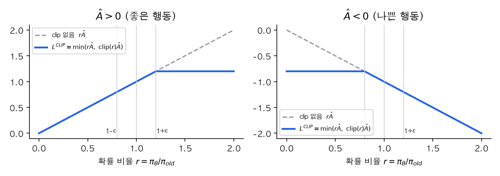
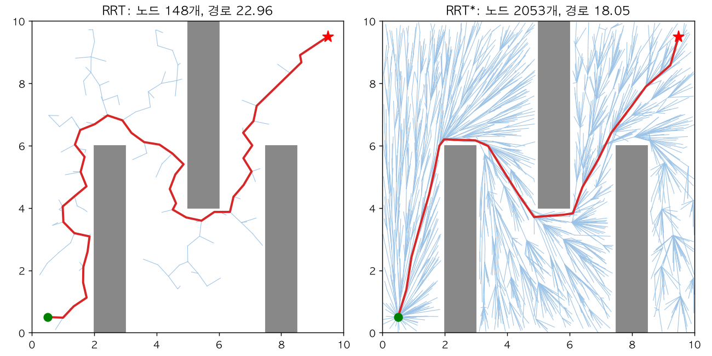

# 2교시 Physical AI 이론노트 (기존 강화학습)

> 대상: 강화학습 중심 Physical AI(MDP, 탐험-활용, 보상 설계, DQN·PPO·SAC·Actor-Critic, PyTorch 구현, RRT 경로 탐색, 학습 안정성 해석, 최신 로봇 학습 논문).
> 기본 범위 밖이지만 넣은 내용은 〔범위 밖·참고〕로 표시했다.
> PPO·SAC 숫자는 원 논문 PDF(1707.06347, 1801.01290)에서 직접 확인했다. 최신 논문 3편은 arXiv 초록과 본문 기준이다.
> 〔핵심〕 = 시험 전날 이것만 다시 볼 것.

## 0. 읽는 순서

### 핵심만 읽는 순서 (시험 전날)
1. 2장 MDP·벨만 방정식 → 3-3 MC·TD·SARSA·Q-learning 업데이트 식
2. 6-1 알고리즘 지도(표) → DQN(6-2) · Actor-Critic(6-4) · PPO(6-5) · SAC(6-6)의 "핵심 식 + 왜"
3. 4장 탐험 · 5장 보상 설계 · 7장 학습 안정성 진단표
4. 8장 RRT 순서와 성질 → 9장 최신 논문 3편 한 줄씩

---

## 1. 강화학습 큰 그림

### 1-1. 무엇을 하나
- **에이전트(agent)** 가 **환경(environment)** 에서 **상태(state) s** 를 보고 **행동(action) a** 를 하면, 환경이 **보상(reward) r** 과 다음 상태 s′를 준다. 이걸 반복하며 **누적 보상을 최대로 하는 행동 규칙(정책, policy) π** 를 배운다.


### 1-2. 지도학습과 다른 점 〔핵심〕
| | 지도학습 | 강화학습 |
|---|---|---|
| 정답 | 데이터마다 정답 라벨이 있음 | 정답 없음. **보상**이라는 점수만 |
| 피드백 시점 | 바로 | **늦게 올 수 있음**(지연 보상: 지금 행동이 100스텝 뒤 결과를 결정) |
| 데이터 | 고정된 데이터셋 | **내 정책이 데이터를 만든다** → 정책이 바뀌면 데이터 분포도 바뀜 |
| 데이터 독립성 | 샘플끼리 독립 가정 | 연속된 스텝은 **서로 강하게 상관** |
| 고유 문제 | | **탐험-활용 딜레마**, 신용 할당(credit assignment: 어떤 행동 덕분에 보상이 왔나) |

---

## 2. MDP와 벨만 방정식 〔핵심〕

### 2-1. MDP (Markov Decision Process, 마르코프 결정 과정)
```eq
MDP = (S, A, P, R, γ)
  S: 상태 집합 · A: 행동 집합
  P(s′ | s, a): 상태 전이 확률 (s에서 a를 하면 s′로 갈 확률)
  R(s, a): 보상 · γ ∈ [0, 1]: 할인율
```
- **마르코프 성질**: 다음 상태는 **지금 상태와 행동만으로** 정해진다. 과거 이력은 필요 없다. "지금 상태 안에 필요한 정보가 다 들어 있다."
  - 예: CartPole에서 각도만 주고 각속도를 안 주면 마르코프가 깨진다(같은 각도라도 넘어지는 중인지 서는 중인지 모름) → 관측을 여러 프레임 쌓거나(DQN Atari는 4프레임) RNN을 쓴다.
- **POMDP**(부분 관측 MDP): 센서가 상태 일부만 보여 줄 때. 로봇·Physical AI에서 흔하다.

### 2-2. 리턴과 할인율 γ
```eq
리턴 G_t = r_(t+1) + γ r_(t+2) + γ² r_(t+3) + …  =  Σ_k γ^k r_(t+k+1)
재귀식:  G_t = r_(t+1) + γ G_(t+1)
```
- γ의 뜻: **먼 미래 보상을 얼마나 덜 쳐 줄까**. γ = 0이면 눈앞 보상만, γ → 1이면 먼 미래까지 중시.
- γ < 1이면 끝없는 과제(continuing)에서도 리턴이 유한하다(보상이 최대 R_max면 G ≤ R_max/(1−γ)).
- **실효 시야(effective horizon)** ≈ 1/(1−γ). γ = 0.99면 약 100스텝 앞까지 본다.
- **에피소드형**(끝이 있음: 게임 한 판) vs **연속형**(끝이 없음: 공정 제어).

### 2-3. 가치 함수
```eq
상태 가치   V^π(s)    = E_π[ G_t | s_t = s ]          "s에서 π를 따르면 앞으로 얼마 받나"
행동 가치   Q^π(s, a) = E_π[ G_t | s_t = s, a_t = a ]  "s에서 a를 한 번 하고, 그 뒤 π를 따르면"
관계        V^π(s) = Σ_a π(a|s) Q^π(s, a)
이점        A^π(s, a) = Q^π(s, a) − V^π(s)              "평소보다 이 행동이 얼마나 더 좋나"
```

### 2-4. 벨만 방정식
```eq
벨만 기대 방정식 (정책 π를 평가)
  V^π(s)    = Σ_a π(a|s) Σ_(s′,r) p(s′, r | s, a) [ r + γ V^π(s′) ]
  Q^π(s, a) = Σ_(s′,r) p(s′, r | s, a) [ r + γ Σ_a′ π(a′|s′) Q^π(s′, a′) ]

벨만 최적 방정식 (가장 좋은 정책)
  V*(s)    = max_a Σ_(s′,r) p(s′, r | s, a) [ r + γ V*(s′) ]
  Q*(s, a) = Σ_(s′,r) p(s′, r | s, a) [ r + γ max_a′ Q*(s′, a′) ]
  최적 정책:  π*(s) = argmax_a Q*(s, a)      ← Q*만 알면 모델(P) 없이 행동을 고를 수 있음
```
- **쉬운 말**: "지금 가치 = 바로 받는 보상 + (할인된) 다음 상태의 가치". 큰 문제를 한 스텝짜리 작은 문제로 쪼개는 식.
- 기대 방정식은 **평균(Σ π)**, 최적 방정식은 **최댓값(max)**. 시험에서 둘을 구분하는 문제가 자주 나온다.

---

## 3. 표 형태 해법 (DP · MC · TD)

### 3-1. 모델이 있을 때: 동적 계획법 (DP)
- **정책 반복(policy iteration)**: ① 정책 평가(벨만 기대 방정식을 반복해 V^π 계산) → ② 정책 개선(π(s) ← argmax_a Q(s,a)) → 정책이 안 바뀔 때까지 반복.
- **가치 반복(value iteration)**: V(s) ← max_a Σ p [r + γV(s′)] 를 반복(평가를 한 번만 하고 바로 개선하는 셈).
- 한계: 전이 확률 P를 알아야 하고, 상태가 많으면 계산이 폭발(차원의 저주).
- 직접 돌려 본 결과 (`code/10_value_iteration.py`, FrozenLake 4×4 미끄러움, γ = 0.99): 가치 반복 324바퀴, 정책 반복 7번으로 **같은 V*·π***에 도달. 최적 정책의 실제 성공률 74.1%(2000판).

### 3-2. 모델 없이: 몬테카를로(MC)와 시간차(TD) 〔핵심〕
```eq
MC   :  V(s_t) ← V(s_t) + α [ G_t − V(s_t) ]                    ← 한 판이 끝나야 G_t를 앎
TD(0):  V(s_t) ← V(s_t) + α [ r_(t+1) + γ V(s_(t+1)) − V(s_t) ]  ← 한 스텝마다 업데이트
        TD 오차  δ_t = r_(t+1) + γ V(s_(t+1)) − V(s_t)
```
| | MC | TD |
|---|---|---|
| 목표값 | 실제 리턴 G_t | r + γV(s′) (**추정치로 추정치를 갱신 = 부트스트랩**) |
| 편향 | 없음 | 있음 (V(s′)가 틀릴 수 있으니) |
| 분산 | 큼 (끝까지 무작위가 쌓임) | 작음 (한 스텝 무작위만) |
| 언제 업데이트 | 에피소드 끝 | 매 스텝 (끝이 없는 과제도 가능) |
- 중간: **n-step TD**(n스텝 실제 보상 + 그 뒤 추정), **TD(λ)**·**GAE**(여러 n을 λ로 가중 평균, 6-5).

### 3-3. SARSA와 Q-learning 〔핵심〕
```eq
SARSA      :  Q(s, a) ← Q(s, a) + α [ r + γ Q(s′, a′) − Q(s, a) ]         a′ = 실제로 다음에 할 행동
Q-learning :  Q(s, a) ← Q(s, a) + α [ r + γ max_a′ Q(s′, a′) − Q(s, a) ]  최선의 행동 가정
Expected SARSA: r + γ Σ_a′ π(a′|s′) Q(s′, a′)  (〔참고〕)
```
| | SARSA | Q-learning |
|---|---|---|
| 종류 | **on-policy** (행동하는 정책 = 배우는 정책) | **off-policy** (행동은 ε-greedy, 배우는 건 greedy) |
| 이름 | (S, A, R, S′, A′) 다섯 개를 써서 | |
| 절벽 걷기(Sutton & Barto 예제 6.6) | 탐험 실수를 감안해 **절벽에서 떨어진 안전한 길** | 절벽 바로 옆 **최단 길** (탐험 중엔 자주 떨어짐) |
| 탐험 중 실제 성적 | 더 좋음 | 더 나쁨 |
- **직접 돌려 본 결과** (`code/01_q_learning_cliff.py`, ε = 0.1, α = 0.1, 1000판, 시드 10개): SARSA는 시드 10개 모두 한 줄 위로 돌아가는 15칸 경로, Q-learning은 10개 모두 절벽 옆 13칸 최단 경로. 탐험 포함 마지막 100판 평균 보상은 SARSA −21.8, Q-learning −50.5.
- **off-policy의 장점**: 과거 데이터·다른 정책의 데이터(리플레이 버퍼, 시연 데이터)로도 배울 수 있다 → DQN·SAC가 off-policy인 이유.

### 3-4. 함수 근사와 "치명적 삼총사" (deadly triad)
- 상태가 연속이거나 너무 많으면 표 대신 **신경망으로 Q(s,a)나 V(s)를 근사**한다.
- Sutton & Barto 11장: **함수 근사 + 부트스트랩 + off-policy 학습** 세 가지가 함께 있으면 학습이 **불안정·발산**할 수 있다. DQN이 바로 이 셋을 다 가진 경우 → 그래서 리플레이 버퍼·타깃 네트워크가 필요하다(6-2).

---

## 4. 탐험과 활용 (exploration vs exploitation) 〔핵심〕
- **활용**: 지금까지 가장 좋았던 행동을 한다. **탐험**: 더 좋은 게 있는지 다른 행동도 해 본다. 활용만 하면 처음에 운 좋았던 행동에 갇히고, 탐험만 하면 배운 걸 못 쓴다.

| 방법 | 어떻게 | 주로 쓰는 곳 |
|---|---|---|
| **ε-greedy** | 확률 ε로 무작위, 나머지는 greedy. 학습하며 ε를 점점 줄임(원 논문 DQN: 1.0 → 0.1로 100만 프레임, 평가 때 0.05) | DQN, 표 Q-learning |
| 볼츠만(softmax) | Q가 클수록 확률이 높게 뽑음(온도 τ로 조절) | 이산 행동 |
| **UCB** | Q(a) + c·√(ln t / N(a)): 덜 해 본 행동에 가산점 | 밴딧(Sutton & Barto 2장) |
| 낙관적 초기값 | Q를 크게 시작 → 해 보면 실망해서 다른 걸 시도 | 표 형태 |
| **확률적 정책 + 엔트로피 보너스** | 정책이 확률 분포라 저절로 탐험, 엔트로피(무작위 정도)를 손실에 더해 너무 빨리 확정되는 걸 막음 | **PPO**(c₂·엔트로피), **SAC**(α·엔트로피가 목적 자체에 들어감) |
| 행동에 잡음 | 결정적 정책 출력에 가우시안 잡음 | DDPG·TD3 〔참고〕 |
| 내적 보상(호기심) | 예측이 틀리는(새로운) 상태에 보너스 | 보상이 아주 드문 과제 〔참고〕 |

- 엔트로피 H(π(·|s)) = −Σ_a π(a|s) log π(a|s). 균등 분포일 때 최대, 한 행동만 고르면 0.
- 직접 돌려 본 결과 (`code/11_bandit.py`, 팔 10개, 1000번, 문제 300개 평균): 마지막 100번 동안 최적 팔을 고른 비율 greedy 30.0% · ε=0.01 63.4% · ε=0.1 78.0% · UCB(c=2) 85.0%. greedy는 처음 좋아 보인 팔에 갇힌다.

---

## 5. 보상 설계 (reward design) 〔핵심〕
> 범위: "시뮬레이션 환경에서 보상 함수를 직접 설계하며 정책 성능을 개선". 실습에서 가장 나올 가능성이 큰 부분.

### 5-1. 원칙
1. **원하는 결과에 보상을 준다. 방법에 주지 않는다.** "목표 도착 +1"은 결과, "오른쪽으로 가면 +0.1"은 방법(에이전트가 오른쪽만 왔다갔다할 수 있음).
2. **희소 보상(sparse)**: 성공할 때만 보상. 의도가 정확하지만 우연히 성공하기 전엔 배울 신호가 없다.
3. **조밀 보상(dense) / 보상 성형(shaping)**: 중간 진척에도 보상. 빨리 배우지만 **잘못 만들면 엉뚱한 행동을 최적으로 만든다**(보상 해킹).
4. **보상 해킹(reward hacking)**: 보상 식의 빈틈을 이용해 점수는 높은데 의도한 일은 안 하는 것.
   - 직접 돌려 본 예 (`code/08_reward_shaping_grid.py`): 목표 1칸 이내에 있으면 매 스텝 +0.1을 주자, 시드 5개 모두 **목표에 들어가지 않고 근처에서 맴돌았다**. 도착(+1, 판이 끝남)보다 근처에서 오래 버티며 0.1씩 받는 게 리턴이 크기 때문(γ = 0.99면 계속 받을 때 0.1/(1−0.99) = 10).
5. **잠재 기반 보상 성형 (potential-based shaping, Ng·Harada·Russell 1999)**

```eq
r′(s, a, s′) = r(s, a, s′) + γ Φ(s′) − Φ(s)        (Φ = 상태마다 정한 "잠재" 점수, 예: −목표까지 거리)
→ 이 형태로만 더하면 최적 정책이 바뀌지 않는다 (끝난 상태의 Φ는 0으로)
이유: 한 판 동안 더해진 성형 보상의 할인 합이 Σ γ^t [γΦ(s_(t+1)) − Φ(s_t)] = −Φ(s₀) + (마지막 항) 으로
      거의 상쇄돼서, 어느 정책을 써도 같은 값만큼 리턴이 이동할 뿐
```
   - 직접 돌려 본 결과: 잠재 기반 성형을 쓴 경우 시드 5개 모두 최단 14스텝 경로를 배웠다(성형 없이 희소 보상만 쓴 경우는 5개 중 1개가 16스텝).

### 5-2. 실제로 보상 짤 때 체크리스트
| 항목 | 설명 | 예 |
|---|---|---|
| 목표 항 | 성공·진척에 + | 목표 도착 +10, 목표 쪽으로 가까워진 거리 × k |
| 비용 항 | 아끼고 싶은 것에 − | 에너지 −c·‖a‖², 시간 −0.01/스텝 |
| 안전 항 | 피해야 할 것에 큰 − (+ 판 종료) | 충돌 −10 후 종료 |
| 가중치 | 항끼리 크기 균형. 한 항이 압도하면 나머지는 무시됨 | 항별 평균 크기를 로그로 찍어 확인 |
| 스텝당 벌점 함정 | 매 스텝 −1이고 실패하면 판이 끝나면 **일부러 빨리 실패**하는 게 이득이 될 수 있음 | 실패 벌점을 (남은 스텝 벌점 합)보다 크게 |
| 생존 보너스 함정 | 매 스텝 +1이면 **아무것도 안 하고 버티기**가 최적이 될 수 있음 | 진척 항과 함께 |
| 크기(scale) | 보상이 너무 크면 가치 손실이 폭발 | 정규화(running std), 클리핑(DQN Atari는 보상을 [−1, 1]로 자름) |
| 종료 처리 | **terminated**(진짜 끝: 미래 가치 0) vs **truncated**(시간 제한으로 잘림: 미래 가치를 이어서 추정) | 잘린 것을 끝으로 처리하면 가치가 과소평가됨 |
| 평가 | 학습은 설계 보상으로, 평가는 **원래 목표 지표**(성공률·도착 시간)로 | 설계 보상이 오르는데 성공률이 그대로면 해킹 의심 |

- 희소 보상이 너무 어려울 때 〔참고〕: 커리큘럼(쉬운 목표부터), 시연 데이터(모방학습), HER(Hindsight Experience Replay: 실패한 판의 실제 도착점을 "목표였던 것처럼" 다시 라벨링).

---

## 6. 주요 알고리즘 (DQN · Actor-Critic · PPO · SAC)

### 6-1. 알고리즘 지도 〔핵심〕
| 알고리즘 | 무엇을 배우나 | on/off-policy | 행동 공간 | 핵심 장치 |
|---|---|---|---|---|
| Q-learning | Q 표 | off | 이산 | max 타깃 |
| **DQN** | Q 신경망 | **off** | **이산만** | 리플레이 버퍼, 타깃 네트워크 |
| REINFORCE | 정책 | on | 둘 다 | 실제 리턴 G로 정책 경사 |
| **Actor-Critic (A2C)** | 정책 + V | on | 둘 다 | Critic이 이점 추정 → 분산 감소 |
| **PPO** | 정책 + V | **on** | **둘 다** | ratio clip, GAE, 같은 데이터 여러 epoch |
| DDPG·TD3 〔참고〕 | 결정적 정책 + Q | off | 연속 | 행동 잡음, (TD3) Q 두 개 |
| **SAC** | 확률적 정책 + Q 두 개 | **off** | **연속**(주로) | 최대 엔트로피, min Q, 재매개변수화 |

- **가치 기반**(DQN): Q를 배우고 argmax로 행동 → 연속 행동이면 max를 구하기 어려움.
- **정책 기반**(REINFORCE): 정책을 직접 배움 → 연속 행동 자연스러움, 분산 큼.
- **Actor-Critic**: 둘 다. 정책(Actor)을 가치(Critic)의 도움으로 배움. PPO·SAC 모두 이 틀.
- **on-policy vs off-policy**: on은 **지금 정책으로 모은 데이터만** 쓰고 버림(안정적, 데이터 효율 낮음). off는 **과거 데이터를 버퍼에 두고 재사용**(데이터 효율 높음, 불안정해지기 쉬움). 시뮬레이터가 빠르고 병렬이면 PPO, 실제 로봇처럼 데이터가 비싸면 SAC 같은 off-policy가 유리하다는 게 일반적인 선택 기준이다.

### 6-2. DQN (Deep Q-Network, Mnih 외 2015) 〔핵심〕
- **한 줄**: Q-learning의 Q 표를 신경망으로 바꾸고, 불안정을 막는 장치 두 개를 더했다.
```eq
손실 L(θ) = E_(s,a,r,s′)~버퍼 [ ( y − Q_θ(s, a) )² ]
타깃     y = r + γ (1 − done) · max_a′ Q_θ⁻(s′, a′)        θ⁻ = 타깃 네트워크 가중치
```
- **장치 ① 경험 재생 (experience replay)**: (s, a, r, s′, done)을 버퍼에 쌓고 **무작위로** 뽑아 학습. → 연속된 샘플의 상관을 끊고(지도학습처럼 독립에 가깝게), 한 경험을 여러 번 재사용.
- **장치 ② 타깃 네트워크 (target network)**: 타깃 y를 계산하는 망을 따로 두고 **C스텝마다만 복사**. → 정답(타깃)이 매 스텝 같이 움직이는 "자기 꼬리 쫓기"를 막음.
  - 직접 돌려 본 결과 (`02_dqn_cartpole.py`, 5만 스텝, 시드 3개): 타깃망을 쓰면 평가 점수 191.7·500·135.8(최대 500), **타깃망을 끄면 3개 모두 9.8**(학습 붕괴).
- 그 밖에: ε-greedy 탐험, Huber 손실(오차가 크면 선형 → 큰 오차에 덜 민감, 원 논문은 오차를 [−1, 1]로 자르는 것과 같은 효과), 기울기 클리핑.
- **개선판** 〔참고, 자주 묻는 것만〕
  - **Double DQN**: max가 잡음까지 골라서 Q를 **과대평가**하는 문제 → **고르기는 온라인망, 평가는 타깃망**: y = r + γ Q_θ⁻(s′, argmax_a′ Q_θ(s′, a′)).
  - **Dueling DQN**: Q(s,a) = V(s) + A(s,a) − 평균_a A(s,a). 행동과 무관한 상태 가치를 따로 배움.
  - **PER**(우선순위 리플레이): TD 오차가 큰 경험을 더 자주 뽑음(편향은 중요도 가중치로 보정).
  - **Rainbow**: 여러 개선(Double·Dueling·PER·n-step·분포형·Noisy Net)을 합친 것.
- **한계**: 이산 행동만(연속이면 max_a를 못 구함), 과대평가, 하이퍼파라미터에 민감(같은 설정에서도 시드마다 점수가 크게 다름, 위 결과 참고).

### 6-3. 정책 경사 (Policy Gradient)와 REINFORCE
```eq
목표: J(θ) = E_π[ G ] 를 최대화
정책 경사 정리:  ∇J(θ) = E_π[ ∇_θ log π_θ(a|s) · Q^π(s, a) ]
REINFORCE  :  ∇J ≈ Σ_t ∇_θ log π_θ(a_t|s_t) · G_t               (Q 대신 실제 리턴)
기준선 추가:  ∇J ≈ Σ_t ∇_θ log π_θ(a_t|s_t) · (G_t − b(s_t))     (b = 보통 V(s))
```
- **쉬운 말**: 해 본 행동 중 결과가 좋았던 것(G가 큼)은 확률을 올리고, 나빴던 것은 내린다. log π의 기울기는 "그 행동 확률을 올리는 방향".
- **기준선(baseline)** 을 빼도 기댓값(기울기 방향)은 그대로고 **분산만 줄어든다**. 모든 G가 양수여도 "평균보다 나았나"로 판단하게 됨.
- 원 식에는 γ^t 곱이 붙지만 실제 구현은 대부분 생략한다.
- 직접 돌려 본 결과 (`03_reinforce_cartpole.py`, 리턴 정규화를 기준선처럼 사용): 800판 뒤 최근 50판 평균 460.8.

### 6-4. Actor-Critic 〔핵심〕
```eq
Critic (가치):  V_w(s) 를 TD로 학습:   손실 = ( r + γ V_w(s′) − V_w(s) )²
Actor  (정책):  ∇J ≈ ∇_θ log π_θ(a|s) · δ,     δ = r + γ V_w(s′) − V_w(s)  (TD 오차 = 이점 추정)
```
- **쉬운 말**: Actor가 행동하고, Critic이 "평소 기대보다 잘했나(δ > 0)?"를 채점해 준다. REINFORCE의 G(한 판 끝까지의 무작위 결과) 대신 δ(한 스텝)를 써서 **분산이 작고 매 스텝 배울 수 있다**. 대신 Critic이 틀리면 편향이 생긴다.
- **A3C**(Mnih 외 2016): 여러 환경을 병렬로 돌려 데이터를 모으는 비동기 Actor-Critic. **A2C**는 그 동기(synchronous) 버전으로 널리 쓰인다.
- Actor와 Critic이 몸통 신경망을 **공유**하면 손실을 합쳐야 한다(PPO의 c₁·L^VF). 따로 두면 각각 학습.
- 직접 돌려 본 결과 (`04_actor_critic_cartpole.py`, 판마다 1-step TD 업데이트): 500판 근처 최근 50판 평균 235.5 → 600판 59.2 → 800판 141.8로 **오르내림이 컸다**. 1-step 이점은 Critic이 틀릴 때 정책이 흔들리기 쉽다 → 그래서 PPO는 GAE(여러 스텝 평균)·clip·여러 환경 데이터를 쓴다.

### 6-5. PPO (Proximal Policy Optimization, Schulman 외 2017) 〔핵심〕
- **한 줄**: 정책 경사를 쓰되, **한 번에 정책이 너무 많이 바뀌지 않게 ratio를 [1−ε, 1+ε]로 잘라서**, 같은 데이터로 여러 번(epoch) 안전하게 업데이트한다.
- 배경: 정책 경사는 보폭이 크면 정책이 무너지고, 그러면 나쁜 데이터를 모아서 회복이 어렵다. **TRPO**는 "KL 발산 ≤ δ"라는 제약으로 막았지만 2차 최적화라 복잡하다. PPO는 1차 최적화(Adam)만으로 비슷한 효과를 낸다.

```eq
확률 비율   r_t(θ) = π_θ(a_t | s_t) / π_θ_old(a_t | s_t)          (=1이면 정책이 그대로)
L^CLIP(θ) = Ê_t[ min( r_t(θ) Â_t ,  clip(r_t(θ), 1 − ε, 1 + ε) Â_t ) ]        ε = 0.2
전체 목적   L^(CLIP+VF+S)(θ) = Ê_t[ L^CLIP_t(θ) − c₁ L^VF_t(θ) + c₂ S[π_θ](s_t) ]    (최대화)
            L^VF = ( V_θ(s_t) − V_t^targ )²,   S = 엔트로피 보너스
코드에서는 부호를 바꿔 최소화:  loss = −L^CLIP + c₁·L^VF − c₂·엔트로피
```



- **clip을 그림으로 이해하기** 〔핵심〕
  - **Â > 0 (좋은 행동)**: 확률을 올리고 싶다(r ↑). 하지만 r이 1+ε를 넘으면 목적이 평평해져 **더 올려도 이득이 없다** → 과도한 업데이트 방지.
  - **Â < 0 (나쁜 행동)**: 확률을 내리고 싶다(r ↓). r이 1−ε 아래로 가면 평평 → 더 내려도 이득 없음.
  - **min을 쓰는 이유**: clip한 값과 안 한 값 중 **작은 쪽(비관적인 쪽)** 을 택한다. 그래서 정책이 **나빠지는 방향**의 변화는 잘리지 않고 그대로 벌을 받는다(예: Â > 0인데 r이 1−ε보다 작아진 경우).
- **GAE (Generalized Advantage Estimation)**: PPO가 쓰는 이점 추정
```eq
δ_t = r_t + γ V(s_(t+1)) − V(s_t)
Â_t = δ_t + (γλ) δ_(t+1) + (γλ)² δ_(t+2) + …       (구현: 뒤에서부터 Â_t = δ_t + γλ Â_(t+1))
λ = 0 → 1-step TD (편향↑ 분산↓),   λ = 1 → MC 리턴 − V (편향↓ 분산↑),   논문 값 λ = 0.95
```
- **알고리즘 순서** (논문 Algorithm 1): ① N개 액터가 π_old로 T스텝씩 모음 → ② Â 계산 → ③ NT개 데이터로 **K epoch, 미니배치 M** 으로 목적 최적화 → ④ θ_old ← θ → 반복.
- **논문 숫자** (원문 확인)
  - clip ε 비교(MuJoCo 정규화 점수): clip 없음 −0.39, ε = 0.1 → 0.76, **ε = 0.2 → 0.82 (최고)**, ε = 0.3 → 0.70. 적응형 KL 벌점은 0.68~0.74, 고정 KL은 0.62~0.72.
  - MuJoCo 표: Horizon T = **2048**, Adam **3×10⁻⁴**, epoch **10**, 미니배치 **64**, γ = **0.99**, λ = **0.95**.
  - MuJoCo 네트워크: 은닉층 **2개 × 64**, **tanh**, 가우시안 평균 출력 + 별도 표준편차, **정책과 가치 파라미터 공유 안 함, 엔트로피 보너스 안 씀**.
  - Atari 표: T = 128, Adam 2.5×10⁻⁴×α, epoch 3, 미니배치 32×8, 액터 8개, ε = 0.1×α, c₁ = 1, c₂ = 0.01 (α는 학습하며 1 → 0으로 선형 감소).
- **KL 벌점 버전** (논문의 다른 변형): L = Ê[r_t Â_t − β·KL[π_old, π_θ]], 업데이트 뒤 KL d를 재서 d < d_targ/1.5 이면 β ← β/2, d > d_targ × 1.5 이면 β ← β × 2.
- **구현에서 흔히 같이 쓰는 것**: 이점 정규화(미니배치 안에서 평균 0·표준편차 1), 기울기 클리핑(0.5), 직교 초기화, 학습률 감소.
- 직접 돌려 본 결과 (`05_ppo_discrete.py`, 논문 MuJoCo 하이퍼파라미터 그대로): CartPole에서 약 4만 스텝에 최근 20판 평균 497, 약 5만 스텝부터 500(최대) 유지.

### 6-6. SAC (Soft Actor-Critic, Haarnoja 외 2018) 〔핵심〕
- **한 줄**: **보상 + 엔트로피**를 함께 최대화하는 off-policy Actor-Critic. "잘하면서도 가능한 한 다양하게(무작위하게) 행동하라."
```eq
최대 엔트로피 목적:  J(π) = Σ_t E[ r(s_t, a_t) + α H(π(·|s_t)) ]      α = 온도(엔트로피의 중요도)
소프트 Q 타깃:      y = r + γ (1 − done) [ min(Q₁′, Q₂′)(s′, a′) − α log π(a′|s′) ],   a′ ~ π(·|s′)
정책 손실(최소화):   E_s[ α log π(ã|s) − min(Q₁, Q₂)(s, ã) ],    ã = tanh(μ + σ·ε), ε ~ N(0, I)
```
- **왜 엔트로피?** ① 탐험이 목적 안에 들어가 저절로 됨 ② 좋은 행동이 여러 개면 한쪽으로 쏠리지 않음 ③ 학습이 안정적(논문 초록: "매우 안정적이며 서로 다른 무작위 시드에서도 성능이 매우 비슷"). 단, 같은 논문이 보상 크기에는 민감하다고 밝힌다(아래).
- **원 논문(1801.01290) 구성** (원문 확인)
  - 소프트 상태 가치 V_ψ, 소프트 Q 함수 Q_θ, 정책 π_φ **세 가지를 학습**. Q의 타깃에 쓰는 **타깃 가치망 V_ψ̄** 는 지수 이동평균으로 천천히 따라감.
  - **Q 함수 두 개**를 따로 학습하고 **둘 중 작은 값(min)** 을 가치·정책 학습에 씀 → 과대평가(positive bias) 완화. "Q 하나로도 학습되지만 두 개가 특히 어려운 과제에서 학습을 크게 빠르게 했다."
  - 정책 경사는 **재매개변수화(reparameterization trick)** 로 계산 → 분산이 작은 추정. 행동을 "μ + σ·ε"로 쓰면 무작위성(ε)이 신경망 밖으로 빠져서 행동을 통해 Q의 기울기가 정책으로 흐른다.
  - 가우시안 샘플 u에 **tanh** 를 씌워 행동 범위를 제한하고, 로그 확률을 보정: log π(a|s) = log μ(u|s) − Σᵢ log(1 − tanh²(uᵢ)).
  - **온도 α 대신 보상 크기(reward scale)를 조절**: "보상 크기가 최적 정책의 온도 역할을 해서 SAC는 보상 크기에 특히 민감하다. 너무 작으면 정책이 거의 균등(무작위)해지고, 너무 크면 거의 결정적이 되어 탐험 부족으로 나쁜 지역해에 빠진다." 논문은 보상 크기가 "조정이 필요한 유일한 하이퍼파라미터"였다고 쓴다(환경별 5~20).
  - 표 1 하이퍼파라미터: Adam, 학습률 **3·10⁻⁴**, γ = **0.99**, 리플레이 버퍼 **10⁶**, 은닉층 **2개 × 256**, 미니배치 **256**, ReLU, 타깃 평활 계수 **τ = 0.005**, 타깃 업데이트 간격 1, 그래디언트 스텝 1.
  - 평가: 평균 행동(탐험 없는 결정적 행동)으로 평가하면 보통 리턴이 더 높다(그림 3a).
- **후속판(1812.05905, "SAC Algorithms and Applications")과 요즘 구현** 〔참고: 기준 논문은 원 논문〕
  - V 네트워크를 없애고 **타깃 Q 네트워크 두 개**(Polyak 평균 θ′ ← τθ + (1−τ)θ′)를 둠.
  - **α 자동 조절**: 목표 엔트로피 H̄ = −(행동 차원 수)를 정하고, J(α) = E[−α log π(a|s) − α H̄]를 최소화. 엔트로피가 목표보다 낮으면 α를 키워 더 탐험.
  - `code/07_sac_pendulum.py`가 이 방식이다.
- **PPO와 SAC 비교** 〔핵심〕

| | PPO | SAC |
|---|---|---|
| 데이터 | on-policy, 모은 뒤 버림 | off-policy, 리플레이 버퍼 재사용 → **샘플 효율 높음** |
| 정책 | 확률적 (이산·연속 모두) | 확률적 가우시안 + tanh (주로 연속) |
| 안정 장치 | ratio clip, GAE | min Q 두 개, 타깃망, 엔트로피 |
| 탐험 | 정책 무작위성 + 엔트로피 보너스(c₂) | 엔트로피가 목적 자체(α) |
| 잘 맞는 곳 | 빠른 병렬 시뮬레이터(대량 데이터) | 데이터가 비싼 곳(실제 로봇), 연속 제어 |

- 직접 돌려 본 결과 (Pendulum-v1, 시드 1개, 0에 가까울수록 좋음): SAC(`07_sac_pendulum.py`)는 **약 6천 스텝**에 최근 10판 평균 −227, 1.5만 스텝 뒤 평가 −209.9. PPO(`06_ppo_continuous.py`)는 **약 6만 스텝**에 평가 −172, 18만 스텝에 −164. → off-policy인 SAC가 같은 성능에 필요한 데이터가 약 10분의 1 (시드 1개라 대략적인 비교).

---

## 7. 보상 극대화·학습 안정성 해석 〔핵심〕
> 범위: "보상 극대화, 학습 안정성을 해석할 수 있는 능력". 학습 곡선과 로그를 보고 원인과 처방을 말할 수 있어야 한다.

### 7-1. 찍어 봐야 할 지표
| 지표 | 무엇을 보나 | 정상 모습 |
|---|---|---|
| 에피소드 리턴 (평균·표준편차, **시드 여러 개**) | 성능 | 오르다가 안정. 시드 사이 차이가 크면 불안정 |
| 에피소드 길이 | 생존·도착 시간 | 과제에 맞게(버티기면 ↑, 도착이면 ↓) |
| 가치 손실 / Q 값 크기 | Critic 상태 | Q가 계속 커지면 **과대평가·발산** 의심 (Q 최대 가능값 ≈ r_max/(1−γ)와 비교) |
| 정책 엔트로피 | 탐험 정도 | 천천히 감소. **급히 0으로** 떨어지면 너무 일찍 확정(조기 수렴) |
| 근사 KL (PPO) | 업데이트 크기 | 보통 0.01~0.02 수준 이하(구현 관행). 크면 보폭 과다 |
| clip 비율 (PPO) | ratio가 잘린 샘플 비율 | 낮게 유지. 크면 학습률·epoch 과다 |
| 설명 분산 EV (PPO) | Critic이 리턴을 얼마나 설명하나 = 1 − Var(리턴 − V)/Var(리턴) | 1에 가까울수록 좋음, 0 이하면 Critic이 못 배움 |
| α (SAC) | 온도 | 학습하며 줄어듦 |

### 7-2. 증상 → 원인 → 처방
| 증상 | 흔한 원인 | 처방 |
|---|---|---|
| 리턴이 전혀 안 오름 | 보상이 너무 희소, 탐험 부족, 버그(done 처리·부호) | 보상 성형(잠재 기반), ε·엔트로피↑, 무작위 정책 기준선과 비교, 작은 환경에서 먼저 확인 |
| 올랐다가 **급락**(붕괴) | 학습률 과다, 타깃망 없음, PPO에서 epoch·clip 과다 | 학습률↓, 타깃망·Polyak, clip ε↓, 기울기 클리핑 |
| 계속 출렁임 | 분산 큰 추정(REINFORCE·1-step AC), 배치 작음 | 기준선·GAE, 배치↑, 여러 환경 병렬 |
| Q 값이 끝없이 커짐 | 과대평가, 치명적 삼총사 | Double DQN, min of two Q, 타깃망, 보상 정규화 |
| 엔트로피가 금방 0 | 탐험 붕괴 | 엔트로피 계수↑(PPO c₂, SAC α 자동 조절) |
| 학습 리턴은 높은데 실제 목표 미달 | **보상 해킹** | 원래 목표 지표로 평가, 보상 항 다시 설계 |
| 시드마다 결과 다름 | 강화학습 원래 분산이 큼 | 시드 3~5개 평균 ± 표준편차로 보고 |
| 학습 땐 좋은데 평가 때 나쁨 | 평가 때도 탐험 중 / 정규화 통계 불일치 | 평가는 greedy·평균 행동, 관측 정규화 통계 고정 |

- 직접 돌려 본 예 (실습코드 결과): DQN에서 타깃망 끔 → 시드 3개 모두 9.8점으로 붕괴 / 같은 DQN 설정도 시드에 따라 135.8~500 / 1-step Actor-Critic은 235 → 59 → 141처럼 출렁임 / PPO는 KL 약 0.002~0.006, clip 비율 약 0.02~0.10에서 500점 유지.

---

## 8. 경로 탐색 (RRT 등)

### 8-1. 기본 말
- **구성 공간(C-space, configuration space)**: 로봇의 자세를 점 하나로 나타낸 공간(2D 이동 로봇이면 (x, y), 6축 팔이면 관절각 6개). 장애물과 겹치는 자세 = **C_obs**, 안전한 자세 = **C_free**. 경로 계획 = C_free 안에서 출발점과 목표점을 잇는 연속 경로 찾기 (LaValle 4장).
- **격자 탐색**: 공간을 칸으로 나눠 그래프 탐색. **Dijkstra**(가까운 순서로 확장, 최단 보장), **A***(f = g + h. g = 지금까지 비용, h = 남은 비용 추정. **h가 실제 비용을 넘지 않으면(admissible) 최단 보장**, h = 0이면 Dijkstra).
- 직접 돌려 본 결과 (`code/12_astar.py`, 7×10 미로): A*와 Dijkstra 모두 최단 19칸, 펼친 노드 44개 vs 48개(벽 때문에 크게 돌아가는 지도라 휴리스틱 이득이 작음).
- 한계: 차원이 높으면(로봇팔 6~7차원) 칸 수가 폭발 → **샘플링 기반** 방법(LaValle 5장).

### 8-2. RRT (Rapidly-exploring Random Tree, LaValle 1998) 〔핵심〕
```text
트리 T = {출발점}
반복:
  1. x_rand ← 공간에서 무작위 점 (확률 p_goal로는 목표점 자체: goal bias)
  2. x_near ← T에서 x_rand와 가장 가까운 노드
  3. x_new  ← x_near에서 x_rand 쪽으로 최대 한 걸음(η)만 이동   (steer)
  4. x_near → x_new 선분이 충돌 없으면 x_new를 T에 추가 (부모 = x_near)
  5. x_new가 목표 근처면 목표와 연결하고, 부모를 따라 거꾸로 올라가 경로 완성
```
- **왜 빨리 퍼지나 (보로노이 편향, Voronoi bias)**: 무작위 점은 "넓은 빈 공간 옆에 있는 노드"에 가장 가깝게 떨어질 확률이 크다(그 노드의 보로노이 영역이 넓으니까). 그래서 트리가 **아직 안 가 본 넓은 곳으로** 자연스럽게 뻗는다.
- **성질**: **확률적 완전성**(길이 있으면 반복할수록 찾을 확률이 1로 감) / **최적성 없음**: 경로가 지그재그이고, 반복을 늘려도 최단 경로로 수렴하지 않는다(Karaman·Frazzoli 2011).
- **하이퍼파라미터**: 걸음 크기 η(크면 빠르지만 좁은 통로를 못 지남, 작으면 느림), goal bias(5~10%가 흔함, 크면 장애물 앞에서 막힘), 목표 허용 거리, 충돌 검사 해상도.
- **변형**
  - **RRT***: 새 노드를 넣을 때 ① 반경 r 안 이웃 중 **비용이 가장 싼 부모**를 고르고 ② 이웃이 새 노드를 거치는 게 더 싸면 **다시 잇기(rewire)** → **점근적 최적**(반복할수록 최단 경로로 수렴). 대신 느림.
  - **RRT-Connect**: 출발·목표 양쪽에서 트리를 키워 서로 연결(양방향, 빠름).
  - **PRM** (Probabilistic Roadmap): 먼저 공간 전체에 점을 뿌려 길 지도(그래프)를 만들어 두고 여러 질의에 재사용(multi-query). RRT는 질의 하나에 트리 하나(single-query).
  - **Kinodynamic RRT**: 속도·가속도 제약이 있으면 "직선 steer" 대신 제어 입력을 넣어 시뮬레이션한 궤적으로 확장.
- 경로 다듬기: 뽑은 경로에서 두 점을 골라 직선으로 바로 이어도 충돌이 없으면 중간을 지움(shortcut).
- 직접 돌려 본 결과 (`09_rrt.py`, 10×10 평면, 장애물 3개, 걸음 0.5): RRT는 265번 반복·노드 148개로 경로 길이 22.96을 찾음. RRT*는 3000번 반복·노드 2053개로 18.05.



### 8-3. 경로 탐색과 강화학습의 차이
| | RRT·A* (계획) | 강화학습 |
|---|---|---|
| 필요한 것 | 지도·충돌 검사기(모델) | 환경과 상호작용(시뮬레이터) |
| 결과 | 한 번의 경로 | 어느 상태에서든 쓰는 정책 |
| 새 상황 | 다시 계획 | 학습한 범위 안에서 바로 반응 |
| 같이 쓰기 〔참고〕 | 전역 경로는 계획, 국소 회피·제어는 RL | |

---

## 9. Physical AI와 최신 논문 3편

### 9-1. 기본 개념 〔범위 밖·참고: 일반적인 뜻, 논문 이해용〕
- **Physical AI**: 실제 물리 세계에서 보고(센서) 움직이는(로봇·차량) AI를 넓게 부르는 말.
- **sim-to-real 격차**: 시뮬레이터에서 배운 정책이 실제에선 마찰·지연·센서 잡음 차이로 잘 안 되는 문제. 처방 = **도메인 무작위화**(시뮬레이터의 물리 값·조명 등을 무작위로 바꿔 가며 학습), 시스템 식별, 실제 데이터로 미세조정.
- **모방학습(imitation learning)**: 사람 시연을 따라 배움. **행동 복제(behavior cloning)** = 상태 → 시연 행동을 지도학습. 약점은 **분포 이동**(조금 벗어나면 시연에 없던 상태라 오차가 쌓임) → DAgger(전문가가 그 상태에서의 정답을 다시 라벨링).
- **VLA (Vision-Language-Action) 모델**: 이미지(Vision) + 언어 지시(Language)를 받아 로봇 행동(Action)을 내는 모델. 보통 사전학습된 **VLM**(비전-언어 모델) 위에 행동 출력을 붙인다. 행동 표현은 ① 숫자를 토큰으로 바꿔 다음 토큰 예측 ② 연속 값을 확산(diffusion)·**흐름 정합(flow matching)** 으로 생성. 한 번에 여러 스텝 행동을 내는 **행동 청크(action chunk)** 가 흔하다.

### 9-2. π0.5: a Vision-Language-Action Model with Open-World Generalization (2025, arXiv 2504.16054)
- **한 줄**: open-world VLA와 이종 데이터 공동학습.
- **문제**: 실험실 밖, **처음 보는 집**에서도 일하는 로봇을 만들려면 일반화가 필요하다.
- **방법**: π0를 바탕으로 **이종(서로 다른 종류) 데이터 공동학습(co-training)**: 여러 로봇의 데이터, 고수준 의미 예측(하위 작업 텍스트), 웹 데이터(캡션·VQA·물체 위치), 사물 검출 등을 한 모델에서 함께 학습. 초록은 이런 **지식 전이가 일반화에 필수**라고 주장한다.
- **계층적 추론**: 한 모델이 먼저 **고수준 하위 작업을 텍스트로 예측**하고(예: "접시를 집어"), 그 하위 작업을 조건으로 **저수준 행동 청크**를 낸다. 행동은 흐름 정합(flow matching)으로 생성.
- **두 단계 학습**: 사전학습은 이산 **FAST 행동 토큰**으로 다음 토큰 예측, 사후학습에서 흐름 정합 **행동 전문가(action expert)** 를 추가.
- **데이터 비중**: 서론에 따르면 1단계 학습 예제의 **97.6%가 "가정에서 일하는 이동형 로봇" 이외의 출처**다(다른 로봇·웹 등).
- **결과**: 처음 보는 집에서 부엌·침실 청소 같은 **10~15분짜리 긴 작업**을 수행. 초록은 이를 "종단간(end-to-end) 학습 시스템으로는 처음"이라고 쓴다.
- **강화학습과의 관계**: 이 논문의 주된 학습은 시연 데이터 기반 지도학습(모방학습)이다. RL 논문으로 착각하지 말 것.

### 9-3. Agentic-VLA: Efficient Online Adaptation for Vision-Language-Action Models (2026, arXiv 2605.22896)
- **한 줄**: 온라인 적응, reward synthesis, experience memory.
- **문제**: VLA는 새 환경 일반화가 약하고 데이터 효율이 낮다 → 배포 후 **온라인으로(직접 해 보며) 적응**시키고 싶다.
- **기반**: OpenVLA-OFT 모델을 **GRPO**로 강화학습(학습률 1e-5, 배치 32, 그룹 크기 8, LIBERO 시드 5개).
  - GRPO(Group Relative Policy Optimization) 〔참고: DeepSeek 계열에서 쓰인 방법〕: 같은 과제를 여러 번(그룹) 시도하고 **그룹 평균 대비 얼마나 잘했나**를 이점으로 쓴다 → Critic(가치망)이 필요 없다.
- **구성 요소 3개**
  1. **적응형 보상 합성 (Adaptive Reward Synthesis)**: 언어 모델이 지시를 **하위 목표(sub-goal)** 로 나눈다. 하위 목표 k마다 숙련도 c_k를 지수 이동평균으로 추적하고(c_k ← α·c_k + (1−α)·성공), 가중치 **w_k = 1 − c_k** 를 준다 → **아직 못하는 하위 목표에 보상을 더 줘서 커리큘럼처럼** 학습. 보상 R = Σ_k w_k·Δ_k(Δ_k = 진척도 비평가가 매긴 진척).
  2. **언어 안내 탐험 (Language-Guided Exploration)**: 무작위 탐험 대신 비전-언어 모델(비평가)이 짧은 **텍스트 조언**을 만들어 과제 지시 뒤에 붙인다. 탐험할 때만 쓰고, 보상이 오르면 조언 빈도를 줄인다.
  3. **경험 메모리 (Experience Memory)**: (과제 임베딩, 정책 가중치, 메타데이터)를 저장해 두고, 새 과제가 오면 **코사인 유사도 상위 3개**를 찾아 가중치를 softmax(온도 0.1)로 섞어 **초기값(warm start)** 으로 쓴다.
- **결과** (LIBERO, 본문 표 1): 평균 **97.8%** (Spatial 97.2, Object 98.6, Goal 97.4, Long 98.1). 기반 OpenVLA-OFT 89.2, 비교 방법 EVOLVE-VLA 95.8. 긴 작업(Long)은 SFT 85.8 → 98.1로 **+12.3%p**.
- **초록의 그 밖의 주장**: 1-shot 학습 +28.5%, 시연 없이 과제 간 전이 0% → 31.2%, 기존 온라인 적응보다 **수렴 2.4배 빠름**, 양팔 벤치마크 RoboTwin 2.0(어려운 설정 포함)에서도 향상.
- **범위와 연결**: "보상 설계"(보상을 자동으로 합성·가중), "탐험-활용"(언어 안내 탐험) — 2교시 개념이 최신 연구에서 어떻게 쓰이는지 보여 주는 예.

### 9-4. LeRobot: An Open-Source Library for End-to-End Robot Learning (2026, arXiv 2602.22818)
- **한 줄**: 데이터 수집부터 policy 학습·비동기 추론까지 E2E robot learning stack.
- **문제**: 로봇 학습 도구가 조각나 있고 비공개라 스택 일부만 다룬다.
- **무엇**: Hugging Face의 오픈소스 라이브러리 `lerobot`. 새 학습 방법을 제안하는 논문이 아니라 **스택 전체**를 다루는 라이브러리 논문이다.
  - **하드웨어·미들웨어**: 저가 로봇(SO-100/101, Koch, ALOHA-2, LeKiwi 등)의 모터 제어, **리더-팔로워 원격조작**(사람이 잡은 팔의 움직임을 로봇 팔이 따라 함)으로 시연 데이터 수집.
  - **데이터**: `LeRobotDataset` 통일 형식 + 스트리밍(`StreamingLeRobotDataset`). 2025년 9월 기준 기여자 2.2K+ 명이 이 형식으로 1.6만+ 개 데이터셋을 공유.
  - **정책 구현**: ACT, Diffusion Policy, VQ-BeT, TD-MPC, HIL-SERL, π0, SmolVLA 등.
  - **비동기 추론**: 정책이 다음 **행동 청크를 예측하는 동안 로봇은 이전 청크를 실행**(생산자-소비자 구조). 겹치는 청크는 사용자가 정하는 집계 함수로 합친다 → 추론 지연 때문에 로봇이 멈추는 시간을 줄임.
  - **평가**: LIBERO, Meta-World 시뮬레이션 벤치마크 지원.
- **범위와 연결**: "PyTorch 기반 구현"과 "시뮬레이션 환경 실험"을 실제 로봇 쪽으로 넓힌 도구.

---

## 10. 참고 자료 지도
| 자료 | 시험에 쓸 부분 |
|---|---|
| Sutton & Barto | 2장 밴딧(ε-greedy, UCB) · 3장 MDP · 4장 DP · 5장 MC · 6장 TD·SARSA·Q-learning(예제 6.6 절벽) · 11장 off-policy 근사의 불안정(치명적 삼총사) · 13장 정책 경사(REINFORCE, Actor-Critic) |
| PPO 논문 | 식 (7) L^CLIP, 식 (9) 전체 목적, 그림 1 clip 모양, 표 1 ε 비교, 표 3·5 하이퍼파라미터 |
| SAC 논문 | 최대 엔트로피 목적, V·Q·π 손실, Q 두 개 min, 재매개변수화, 부록 C tanh 보정, 그림 3 민감도(보상 크기·τ), 부록 D 하이퍼파라미터 |
| LaValle Planning Algorithms | 4장 구성 공간 · 5장 샘플링 기반 계획(RRT, PRM) |

## 11. 용어 정리 (풀이)
| 용어 | 풀이 |
|---|---|
| 정책 π(a\|s) | 상태에서 행동을 고르는 규칙(확률) |
| 부트스트랩 | 다른 추정값(V(s′))을 써서 지금 추정값을 갱신 |
| on-policy / off-policy | 지금 정책의 데이터만 쓰나 / 다른(과거) 정책의 데이터도 쓰나 |
| 이점 (advantage) | 이 행동이 평균(V)보다 얼마나 나은가 = Q − V |
| 타깃 네트워크 | 학습 목표를 계산하는, 천천히 따라오는 복사본 망 |
| Polyak 평균 | θ′ ← τθ + (1−τ)θ′, 타깃을 조금씩 따라가게 |
| 엔트로피 | 정책의 무작위 정도. 클수록 다양하게 행동 |
| 재매개변수화 | 샘플을 μ + σ·ε로 써서 무작위성을 밖으로 빼고 기울기를 통과시키는 기법 |
| 보상 성형 (shaping) | 학습을 돕기 위해 중간 보상을 더하는 것 |
| 보상 해킹 | 보상 식의 빈틈을 이용해 의도와 다른 행동으로 점수를 얻는 것 |
| C-space | 로봇 자세를 점으로 나타낸 공간 |
| 확률적 완전성 | 해가 있으면 시간이 지날수록 찾을 확률이 1로 감 |
| 점근적 최적성 | 시간이 지날수록 최적 해로 수렴 |
| 행동 청크 | 한 번에 예측하는 여러 스텝의 행동 묶음 |
