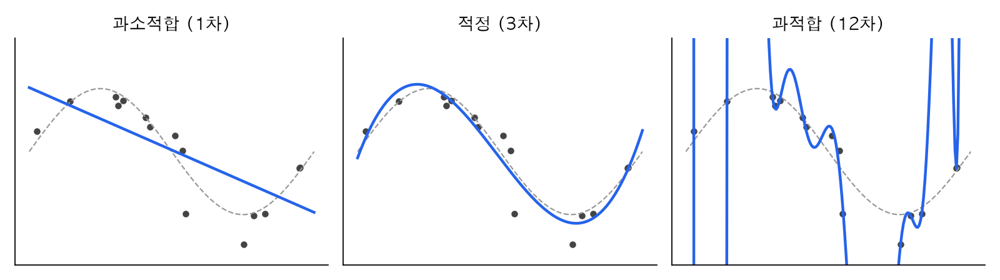
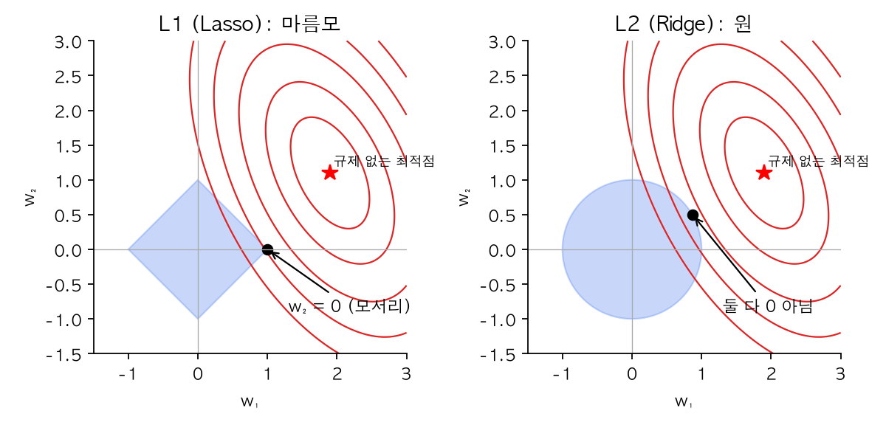
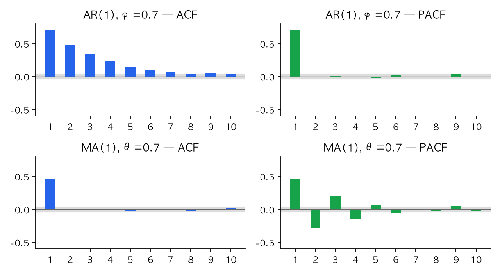
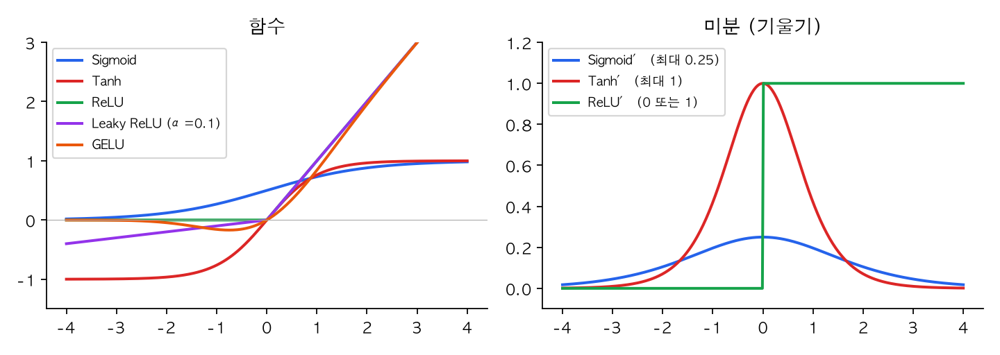

# 쉬운 설명본: 머신러닝·딥러닝

> **이 개념을 처음 보는 사람**도 읽을 수 있게 썼다. 처음부터 순서대로 읽으면 된다.
> 개념마다 같은 순서: **한 줄**(무엇인지) → **쉽게 풀면**(어떻게 하는지 순서대로, 작은 숫자 예) → **용어·식**(기호마다 뜻) → **시험 포인트** → **헷갈리는 짝**.
> 구성: 기초(0장) → 개념 A~F → 서술형 답안 쓰는 법과 코드 E1~E10 → 주관식 Q1~Q10 → 계산 문제 → 가리고 답하기 1~36 → 헷갈리는 짝.

### 읽는 순서
1. 0장과 개념 A~F를 처음부터 끝까지 한 번
2. 서술형 코드 E1~E10을 읽고, **E1·E2·E4·E10**은 자동완성 없는 곳에 직접 쳐 보기
3. 주관식 Q1~Q10: 답을 가리고 항목만이라도 먼저 써 본 뒤 모범답안과 비교
4. 계산 문제 → 가리고 답하기 1~36. 틀린 번호 표시
5. 다음 날 아침: 틀린 번호만 다시 + 헷갈리는 짝

---

## 0. 기초 중의 기초 (이것부터)

### 0-1. 머신러닝이 하는 일
**한 줄**: 예시 데이터를 보고 규칙을 스스로 찾아서, 처음 보는 데이터의 답을 맞히는 방법.

**쉽게 풀면**
1. 집 100채의 넓이·방 개수와 실제 가격을 컴퓨터에 보여 준다.
2. 컴퓨터는 "넓이가 크면 비싸다" 같은 규칙을 숫자로 찾아낸다.
3. 그 규칙으로 처음 보는 집의 가격을 예측한다.

**용어**
- **데이터**: 보통 표 모양. 한 줄(행) = 집 한 채 = **샘플**. 한 칸 종류(열) = 넓이·방 개수 같은 입력 정보 = **특성**(feature). 맞히려는 값(가격) = **정답**(label, target).
- **모델**: 입력을 넣으면 예측을 내는 계산식.
- **가중치**(weight, 파라미터): 모델 안의 숫자들. 예: "가격 = 넓이 × **300만** + **5천만**"에서 300만과 5천만. 학습 = 이 숫자를 좋은 값으로 맞추는 것.

### 0-2. 회귀와 분류
**한 줄**: 숫자를 맞히면 회귀, 종류를 맞히면 분류.

**쉽게 풀면**
- **회귀**(regression): 집값 3억 2천만 원처럼 **숫자**를 예측.
- **분류**(classification): "불량/정상"처럼 정해진 **종류**(클래스) 중 하나를 고르기. 종류가 2개면 **이진 분류**, 3개 이상이면 **다중 분류**.

**헷갈리는 짝**: 로지스틱 "회귀"는 이름만 회귀이고 실제로는 **분류** 모델이다(1-9).

### 0-3. 손실 (loss)
**한 줄**: 예측이 얼마나 틀렸는지를 숫자 하나로 나타낸 것. 학습은 이 숫자를 줄이는 일.

**쉽게 풀면**
- 정답 10, 예측 7이면 3만큼 틀렸다. 이런 틀림을 모든 샘플에서 모아 점수 하나로 만든 게 손실.
- 손실이 작을수록 좋은 모델.

**용어·식**
- **MSE**(평균 제곱 오차, 회귀용) = (정답 − 예측)²의 평균. 예: 틀림이 3과 1이면 (9 + 1) ÷ 2 = 5.
- **교차엔트로피**(cross-entropy, 분류용) = 모델이 **정답 클래스에 준 확률**이 낮을수록 큰 벌점. 정답에 확률 0.9를 줬으면 벌점 −log 0.9 ≈ 0.1(작음), 0.1을 줬으면 −log 0.1 ≈ 2.3(큼).

### 0-4. 학습 = 경사하강법 (gradient descent)
**한 줄**: 손실이 줄어드는 방향으로 가중치를 조금씩 고치기를 반복하는 방법.

**쉽게 풀면**
1. 가중치를 아무 값으로 시작한다.
2. 가중치를 아주 조금 키우면 손실이 늘어나는지 줄어드는지 계산한다. 이 값이 **기울기**(gradient).
3. 손실이 줄어드는 쪽(기울기의 **반대** 방향)으로 가중치를 조금 옮긴다.
4. 손실이 더 안 줄어들 때까지 2~3을 반복한다.
- 예: w를 키우면 손실이 커진다(기울기 = +4). 학습률 0.1이면 w ← w − 0.1 × 4, 즉 w를 0.4 줄인다.

**용어·식**: `가중치 ← 가중치 − 학습률 × 기울기`. **학습률**(learning rate) = 한 번에 얼마나 옮길지. 너무 크면 가장 낮은 점을 지나쳐 왔다 갔다 하거나 값이 폭주(발산)하고, 너무 작으면 오래 걸린다.

**시험 포인트**: 식에 마이너스가 붙는 이유 = 손실을 줄이려면 기울기 반대로 가야 해서.

### 0-5. 학습·검증·테스트 데이터
**한 줄**: 데이터를 세 덩어리로 나눠 배우기·고르기·최종 확인에 따로 쓴다.

**쉽게 풀면**
- **학습 데이터**: 모델이 가중치를 배우는 데 쓴다(보통 가장 큰 덩어리).
- **검증 데이터**: 설정(학습률, 모델 크기 등)을 고르고, 학습을 언제 멈출지 정하는 데 쓴다.
- **테스트 데이터**: 마지막에 딱 한 번, 처음 보는 데이터에서 성능을 잰다.

**시험 포인트**: 테스트 점수를 보고 모델을 고치면 테스트 데이터도 "이미 본 데이터"가 되어 실력을 실제보다 좋게 평가하게 된다.

### 0-6. 과적합과 과소적합
**한 줄**: 과적합 = 학습 데이터에만 너무 잘 맞고 새 데이터에 약함. 과소적합 = 학습 데이터도 제대로 못 맞춤.

**쉽게 풀면**
- **과적합**(overfitting): 모델이 학습 데이터의 우연한 잡음까지 외운 상태. 학습 데이터 오차는 아주 작은데 검증 데이터 오차는 크다.
- **과소적합**(underfitting): 모델이 너무 단순해 패턴을 못 잡은 상태. 학습·검증 오차가 둘 다 크다.
- 아래 그림: 점선이 진짜 패턴. 왼쪽(직선)은 너무 단순, 가운데가 적당, 오른쪽(12차 곡선)은 점마다 억지로 맞춰 들쭉날쭉.



**시험 포인트** (자주 나옴): "학습 손실은 계속 줄고 검증 손실은 오른다" → 과적합. 처방: 데이터 늘리기, 규제(1-7), Dropout·조기 종료(1-27), 모델 줄이기.

### 0-7. 파라미터와 하이퍼파라미터
**한 줄**: 학습으로 정해지는 숫자 = 파라미터, 사람이 미리 정하는 설정 = 하이퍼파라미터.

**쉽게 풀면**
- **파라미터**(가중치): 학습하면서 자동으로 바뀐다.
- **하이퍼파라미터**: 학습률, 트리 깊이, 규제 세기 λ, 층 개수처럼 학습 전에 사람이 정한다. 여러 값을 해 보고 **검증 데이터 점수**가 가장 좋은 것을 고른다.

---

## 1교시: 머신러닝·딥러닝 기초

## A. 데이터 다루기

### 1-1. 교차검증 (cross-validation, K-fold)
**한 줄**: 데이터를 K조각으로 나눠 검증을 K번 돌리고 평균을 내서, 점수를 더 믿을 만하게 만드는 방법.

**쉽게 풀면** (K = 5일 때)
1. 데이터를 5조각으로 나눈다.
2. 1번 조각으로 검증, 나머지 4조각으로 학습해 점수를 잰다.
3. 2번 조각으로 검증, 나머지로 학습 … 5번 조각까지 반복한다.
4. 점수 5개의 평균이 최종 점수.
- 검증을 한 번만 하면 어떤 데이터가 검증에 걸렸느냐에 따라 점수가 운에 좌우된다. 이걸 줄여 준다. 데이터가 적을 때 특히 유용.

**시험 포인트**
- **Stratified K-fold**: 조각마다 클래스 비율(예: 불량 5%)을 원래와 똑같이 유지. 불균형 데이터에 쓴다.
- **시계열은 섞지 않는다**: 과거로 학습하고 미래로 검증해야 한다. 미래 데이터로 학습하면 실제로는 불가능한 반칙이다.

### 1-2. 데이터 누수 (data leakage)
**한 줄**: 학습할 때 원래는 알 수 없는 정보가 학습에 섞여, 점수가 실제보다 좋게 나오는 실수.

**쉽게 풀면**
- 예: 표준화(1-4)할 때 평균·표준편차를 **전체 데이터**(테스트 포함)로 계산하면, 테스트 데이터 정보가 학습에 새어 들어간다.
- 올바른 순서:
  1. 먼저 학습/테스트로 나눈다.
  2. 평균·표준편차는 **학습 데이터로만** 계산해 저장한다(**fit**).
  3. 저장한 값으로 학습·테스트 데이터를 둘 다 변환한다(**transform**).
- 다른 예: 시계열에서 "내일 값"을 특성으로 쓰기, 오버샘플링(1-15)을 테스트 데이터까지 하기.

**시험 포인트**: "전체 데이터로 스케일러를 fit한 뒤 나누기" = 누수 (단골).

### 1-3. 편향과 분산 (bias-variance)
**한 줄**: 모델의 오차를 "모델이 너무 단순해서 생기는 오차(편향)"와 "학습 데이터에 따라 흔들려서 생기는 오차(분산)"로 나눈 것.

**쉽게 풀면**
- **편향**(bias)이 크다: 모델이 너무 단순해서, 데이터를 바꿔 학습시켜도 늘 비슷하게 틀린다. 예: 곡선 모양 데이터에 직선만 쓰는 경우 → 과소적합.
- **분산**(variance)이 크다: 학습 데이터가 조금만 바뀌어도 모델 모양이 크게 달라진다. 예: 0-6 그림의 12차 곡선 → 과적합.
- 모델을 복잡하게 할수록 편향은 줄고 분산은 는다. 그 사이 적당한 지점이 가장 좋다.

**식**: 새 데이터에서의 오차 = 편향² + 분산 + 줄일 수 없는 잡음.

**시험 포인트**: 규제를 세게 하면 모델이 단순해져 편향↑ 분산↓.

### 1-4. 피처 엔지니어링 (feature engineering)
**한 줄**: 모델이 잘 배우도록 입력 데이터를 다듬고, 쓸모 있는 입력을 새로 만드는 일.

**쉽게 풀면** (자주 하는 것)
- **표준화**(스케일링): 넓이(30~100)와 소득(수천만)처럼 크기가 다른 특성을 같은 기준으로 맞춘다. (값 − 평균) ÷ 표준편차 → 평균 0, 표준편차 1. (**표준편차** = 값들이 평균에서 평균적으로 얼마나 떨어져 있나)
- **원-핫 인코딩**: "서울/부산/대구" 같은 글자를 숫자로 바꾼다. 서울 = [1,0,0], 부산 = [0,1,0], 대구 = [0,0,1]. 그냥 1, 2, 3으로 바꾸면 "대구가 서울의 3배" 같은 엉뚱한 크기 관계가 생기기 때문.
- **결측값 채우기**: 빈칸을 평균이나 중앙값으로 채운다.
- **로그 변환**: 금액처럼 대부분 작은데 몇 개만 엄청 큰 값을 고르게 펴 준다.
- **파생 특성**: 날짜 → 요일, 불량 수 ÷ 생산 수 → 불량률처럼 새 특성을 만든다.

**시험 포인트**: 트리 모델은 "넓이 > 30?"처럼 크기 비교만 해서 **표준화가 필요 없다**. 선형 모델·신경망·거리 기반(k-NN)은 필요하다.

### 1-5. 모델 선택 (model selection)
**한 줄**: 여러 모델과 설정 중에서 검증 점수가 가장 좋은 것을 고르는 일.

**쉽게 풀면**
1. 후보를 정한다. 예: 선형 회귀, Random Forest, XGBoost / 트리 깊이 3, 5, 7.
2. 각각 학습시키고 교차검증 점수를 비교한다. 설정 조합을 다 해 보면 **그리드 서치**, 무작위로 일부만 해 보면 **랜덤 서치**.
3. 점수가 비슷하면 더 단순한 모델을 고른다(이해·관리가 쉽고 과적합 위험이 적음).

**시험 포인트**: 학습 점수로 고르면 과적합된 모델을 고르게 된다. 통계 모델 비교 지표 **AIC·BIC**는 작을수록 좋다(데이터를 잘 설명할수록 작아지고, 파라미터가 많으면 벌점. BIC가 벌점이 더 큼).

## B. 선형 모델

### 1-6. 선형 회귀 (linear regression)
**한 줄**: 입력 특성들에 가중치를 곱해 더한 값으로 숫자를 예측하는 가장 기본 모델.

**쉽게 풀면**
- 예측 = w₁ × 넓이 + w₂ × 방 개수 + b. 예: 가격 = 300만 × 넓이 + 1000만 × 방 개수 + 5000만.
- 학습 = 모든 집에서 (정답 − 예측)²의 평균(MSE)이 가장 작아지는 w와 b를 찾는 것. 그래프로 보면 점들 사이를 가장 잘 지나가는 직선 찾기(특성이 여러 개면 평면).
- 찾는 방법 두 가지:
  1. **정규방정식**: 공식 한 번으로 바로 계산. w = (XᵀX)⁻¹Xᵀy. 특성이 아주 많으면 계산이 무거워진다.
  2. **경사하강법**(0-4): 조금씩 고쳐 가며 찾는다.

**용어**
- X = 특성 표, y = 정답들, Xᵀ = 행과 열을 뒤바꾼 행렬, ⁻¹ = 역행렬(곱하면 1이 되는 행렬).
- **절편** b = 모든 특성이 0일 때의 예측값(직선이 세로축과 만나는 높이).
- **다중공선성**: 키(cm)와 키(inch)처럼 거의 같은 정보를 가진 특성이 함께 있으면 가중치가 불안정하게 크게 출렁이는 문제 → Ridge(1-8)로 완화.

**시험 포인트**: MSE의 기울기 = (2/n) × Xᵀ(예측 − 정답) (n = 샘플 수). **[서술형: E2]**

### 1-7. 규제 (regularization)
**한 줄**: 가중치가 너무 커지지 않도록 손실에 벌점을 더해 과적합을 막는 방법.

**쉽게 풀면**
- 과적합된 모델은 가중치가 아주 큰 경우가 많다. 그러면 입력이 조금만 바뀌어도 예측이 크게 출렁인다.
- 그래서 학습할 때 "손실 + λ × (가중치 크기)"를 줄이게 한다. 데이터도 잘 맞추면서 가중치도 작게 유지하라는 뜻.
- **λ**(람다, sklearn에서는 alpha) = 벌점 세기. 0이면 규제 없음, 크면 가중치가 더 작아지고 모델이 단순해진다(편향↑ 분산↓).

**시험 포인트**: 규제 전에 **표준화 필수**. 단위가 다르면(원 vs 억 원) 같은 영향이라도 가중치 크기가 달라져서 벌점이 불공평해진다.

### 1-8. Ridge(L2)와 Lasso(L1)
**한 줄**: 가중치 벌점을 제곱으로 주면 Ridge, 절댓값으로 주면 Lasso.

**쉽게 풀면**
- **Ridge**(L2 규제): 벌점 = λ × (w₁² + w₂² + …). 모든 가중치를 고르게 작게 만든다. 하지만 정확히 0까지는 거의 안 간다.
- **Lasso**(L1 규제): 벌점 = λ × (|w₁| + |w₂| + …). 쓸모없는 특성의 가중치를 **정확히 0**으로 만든다 → 그 특성은 아예 안 쓰는 셈 = **특성 선택**.
- 왜 Lasso만 0이 되나(그림): 규제는 "가중치가 이 영역 안에 있어야 한다"는 조건과 같다. 영역 모양이 L1은 마름모, L2는 원이다. 손실이 같은 점을 이은 선(빨간 타원, 등고선)이 이 영역에 처음 닿는 곳이 답인데, 마름모는 **꼭짓점(가중치 하나가 0인 점)**에서 닿기 쉽다.



**시험 포인트**: "계수를 정확히 0으로 만들어 특성 선택" = **Lasso**. Ridge는 공식으로 바로 풀리고(w = (XᵀX + λI)⁻¹Xᵀy, I = 대각선만 1인 행렬), Lasso는 반복 계산으로 푼다.

**헷갈리는 짝**: **L1 = Lasso = 절댓값 = 0 만듦** / **L2 = Ridge = 제곱 = 작게만**. 둘 다 쓰면 Elastic Net.

### 1-9. 로지스틱 회귀 (logistic regression)
**한 줄**: 선형 회귀처럼 점수를 계산한 뒤, 그 점수를 0~1 확률로 바꿔 분류하는 모델.

**쉽게 풀면**
1. 점수 z = w·x + b를 계산한다(선형 회귀와 같다).
2. z를 **시그모이드** 함수 1/(1 + e^(−z))에 넣으면 0~1 사이 값이 나온다. z가 크면 1에 가깝고, 작으면 0에 가깝고, z = 0이면 0.5.
3. 이 값을 "양성(예: 불량)일 확률"로 보고, 0.5보다 크면 양성으로 판정한다.
- 학습: 정답이 1인데 확률을 낮게 줬거나, 정답이 0인데 높게 줬으면 큰 벌점을 받는다(**이진 교차엔트로피**, BCE).

**시험 포인트**: 이름은 회귀지만 **분류** 모델. 기울기 = Xᵀ(확률 − 정답) ÷ n (선형 회귀와 같은 모양). **[서술형: E3]**

## C. 트리 모델

### 1-10. 결정트리 (decision tree)와 지니 불순도
**한 줄**: "예/아니오" 질문을 반복해 데이터를 나누고, 끝에서 답을 내는 모델.

**쉽게 풀면**
1. 모든 특성과 기준값으로 질문을 만들어 본다. 예: "넓이 > 30?", "역까지 10분 이내?"
2. 질문으로 나눈 뒤 양쪽이 **한 종류로 잘 모이는** 질문을 고른다. 예: 불량 50·정상 50을 나눴더니 한쪽은 불량 45·정상 5, 다른 쪽은 불량 5·정상 45 → 좋은 질문.
3. 나뉜 쪽마다 1~2를 반복한다.
4. 더 나눌 필요가 없거나 깊이 제한에 걸리면 멈추고, 맨 끝(**잎**, leaf)에서 다수결(분류)이나 평균(회귀)으로 답한다.

**용어·식**
- **지니 불순도** = 1 − (각 클래스 비율의 제곱을 모두 더한 값). 섞인 정도를 나타낸다.
  - 한 종류만 있으면 1 − 1 = 0(깨끗). 반반이면 1 − (0.5² + 0.5²) = 0.5.
  - 불량 45·정상 5면 비율 0.9·0.1 → 1 − (0.81 + 0.01) = 0.18.
- **엔트로피** = 섞인 정도를 재는 또 다른 기준(반반이면 1, 한 종류면 0).
- 질문 고르는 기준: 나눈 뒤 양쪽 지니를 **샘플 수 비율로 가중 평균**한 값이 가장 작은 질문.

**시험 포인트**: 너무 깊게 키우면 과적합 → 최대 깊이·잎의 최소 샘플 수를 제한. 표준화 불필요. **[서술형: E6]**

### 1-11. 앙상블 · 배깅 · Random Forest
**한 줄**: 여러 모델의 예측을 모아 평균·다수결을 내면 하나일 때보다 덜 틀린다는 원리를 쓴 방법들.

**쉽게 풀면**
- **앙상블**(ensemble) = 여러 모델을 합쳐 쓰는 것.
- **배깅**(bagging):
  1. 원래 데이터에서 같은 개수만큼 **중복을 허용해** 무작위로 뽑아 새 데이터를 여러 벌 만든다(**부트스트랩**). 어떤 샘플은 두 번 뽑히고 어떤 샘플은 안 뽑힌다.
  2. 데이터 한 벌마다 나무(결정트리)를 하나씩 학습시킨다.
  3. 예측할 때 모든 나무의 답을 평균(회귀)하거나 다수결(분류)한다.
- **Random Forest** = 배깅 + 나무를 만들며 **분할(노드)마다** 후보 특성 중 일부만 무작위로 보게 한다(분류는 보통 √특성 수 개). 강한 특성 하나가 모든 나무를 똑같이 만드는 걸 막아 나무들이 서로 덜 닮는다.
- 서로 다르게 틀리는 나무들을 평균하면 틀림이 상쇄되어 **분산이 줄어든다**.

**시험 포인트**
- 나무들을 **동시에(병렬로)** 만든다. 나무 수를 늘려도 과적합이 심해지지 않는다(계산만 늘어남).
- 부트스트랩에서 한 샘플이 안 뽑힐 확률은 약 **36.8%**. 안 뽑힌 샘플로 따로 검증할 수 있다 = **OOB**(Out-of-Bag) 오차.

### 1-12. 부스팅 · 그래디언트 부스팅 · XGBoost
**한 줄**: 모델을 하나씩 차례로 추가하면서, 새 모델이 앞 모델들이 틀린 부분을 보완하게 하는 방법.

**쉽게 풀면** (그래디언트 부스팅, 집값 예)
1. 처음 예측 = 모든 집의 평균 가격(예: 3억).
2. 집마다 **잔차** = 정답 − 예측을 구한다(예: 실제 3억 5천이면 +5천만).
3. 작은 나무 하나가 이 잔차를 맞추도록 학습한다.
4. 예측 ← 예측 + 학습률(예: 0.1) × 그 나무의 예측. 조금씩만 반영해야 과적합이 덜하다.
5. 새 잔차를 구해 3~4를 수백 번 반복한다.
- **AdaBoost**라는 다른 부스팅은 잔차 대신 **틀린 샘플의 가중치를 올려** 다음 모델이 그 샘플을 더 신경 쓰게 한다.
- "그래디언트"라는 이름: 제곱 오차에서는 잔차가 곧 손실의 음의 기울기라서. 다른 손실을 쓰면 그 손실의 음의 기울기를 맞춘다.
- **XGBoost** = 그래디언트 부스팅 + 나무가 너무 복잡해지지 않게 하는 벌점(잎 개수 벌점 γ, 잎 값 크기 벌점 λ) + 빈칸(결측값) 자동 처리 + 빠른 계산.

**용어·식** (계산 문제용)
- 잎 하나의 출력값 `w* = −G/(H + λ)`. G = 그 잎에 들어온 샘플들의 g 합, H = h 합. g = 1차 미분(기울기), h = 2차 미분(기울기가 얼마나 빨리 변하나). 제곱 오차면 g = 예측 − 정답, h = 1.
- 분할 이득 `Gain = ½[G_L²/(H_L+λ) + G_R²/(H_R+λ) − (G_L+G_R)²/(H_L+H_R+λ)] − γ` (L = 왼쪽, R = 오른쪽). 0보다 작으면 나누지 않는다. 숫자 예는 계산 문제 8·9번.

**시험 포인트**: 주로 **편향을 줄인다**. 나무를 차례로 만든다. 나무 수를 너무 늘리면 과적합 → 검증 점수가 나빠지면 멈춘다(조기 종료). 주요 설정: learning_rate(eta), max_depth(기본 6), subsample, colsample_bytree.

**헷갈리는 짝**: **배깅/Random Forest** = 동시에, 독립, **분산↓** / **부스팅/XGBoost** = 차례로, 앞 모델 오답 보완, **편향↓**.

## D. 평가 지표

### 1-13. MAE · MSE · RMSE (회귀 지표)
**한 줄**: 회귀 예측이 평균적으로 얼마나 틀렸는지 재는 지표들.

**쉽게 풀면** (오차 = 정답 − 예측. 예: 오차가 1, 1, 1, 9)
- **MAE** = 오차 크기의 평균 = (1 + 1 + 1 + 9) ÷ 4 = **3**.
- **MSE** = 오차 제곱의 평균 = (1 + 1 + 1 + 81) ÷ 4 = **21**.
- **RMSE** = MSE의 제곱근 = √21 ≈ **4.58**. 단위가 원래 값과 같아진다.
- 큰 오차(9) 하나 때문에 RMSE가 MAE보다 훨씬 커졌다. 제곱하면 큰 오차가 더 크게 반영되기 때문.

**시험 포인트**: 항상 RMSE ≥ MAE. 이상치가 많으면 MAE가 덜 흔들린다. 큰 실수가 치명적이면(설비 고장) RMSE로 평가.

**그 밖에**: **R²**(결정계수) = 1 − (모델의 오차 제곱합 ÷ 평균값으로만 찍었을 때의 오차 제곱합). 1이면 완벽, 0이면 평균으로 찍은 것과 같고, 테스트 데이터에선 음수도 가능. **MAPE** = 오차를 정답 대비 %로 낸 평균(정답이 0에 가까우면 값이 폭발).

### 1-14. 혼동행렬 · 정확도 · 정밀도 · 재현율 · F1 (분류 지표)
**한 줄**: 분류 결과를 맞음·틀림 네 칸으로 세고, 그걸로 여러 지표를 계산한다.

**쉽게 풀면** (불량 검출, 양성 = 불량)
- **혼동행렬** 네 칸:
  - **TP**: 불량을 불량이라고 맞힘
  - **FP**: 정상을 불량이라고 함(거짓 경보)
  - **FN**: 불량을 정상이라고 함(놓침)
  - **TN**: 정상을 정상이라고 맞힘
- **정확도** = 맞힌 것 ÷ 전체 = (TP + TN) ÷ 전체
- **정밀도** = TP ÷ (TP + FP) = 불량이라고 한 것 중 진짜 불량 비율 → 거짓 경보가 적을수록 높다
- **재현율** = TP ÷ (TP + FN) = 진짜 불량 중 잡아낸 비율 → 놓친 게 적을수록 높다
- **F1** = 2 × 정밀도 × 재현율 ÷ (정밀도 + 재현율) → 둘 중 하나라도 낮으면 F1도 낮다(조화평균)
- 예: TP 40, FP 10, FN 20, TN 930 → 정확도 970/1000 = 0.97, 정밀도 40/50 = 0.8, 재현율 40/60 ≈ 0.667, F1 ≈ 0.727.

**시험 포인트**
- **불균형 데이터에서 정확도는 속인다**: 불량이 1%뿐이면 "전부 정상"이라고만 해도 정확도 99%인데 재현율은 0.
- 양성으로 판정하는 기준(**임계값**)을 낮추면 더 많이 잡아서 재현율↑, 대신 거짓 경보가 늘어 정밀도↓.
- 놓치면 큰일(불량·질병) → 재현율 중시 / 거짓 경보가 비쌈(정상 메일을 스팸 처리) → 정밀도 중시.
- **ROC 곡선** = 판정 기준을 바꿔 가며 (거짓 경보 비율, 재현율)을 이은 선. **AUC** = 그 아래 넓이(0.5 = 찍기 수준, 1 = 완벽). 양성이 아주 드물면 **PR 곡선**(정밀도-재현율)이 차이를 더 잘 보여 준다.
- 다중 분류 F1: **macro** = 클래스별 F1의 단순 평균(작은 클래스도 똑같이 중요) / **micro** = 전체 개수를 합쳐 계산(샘플 하나에 라벨 하나면 정확도와 같음).
- **[서술형: E1]**

### 1-15. 불균형 데이터 대처
**한 줄**: 한 클래스가 아주 적을 때(불량 2%) 모델이 그 클래스를 무시하지 않게 하는 방법들.

**쉽게 풀면**
1. 지표를 정확도 대신 F1·재현율로 본다.
2. 데이터를 나눌 때 Stratified(1-1)로 비율을 유지한다.
3. **클래스 가중치**: 적은 클래스를 틀리면 손실에 더 큰 벌점을 준다.
4. **리샘플링**: 적은 클래스를 늘리거나(복제, 또는 **SMOTE** = 가까운 두 샘플 사이 지점에 새 샘플을 만들어 넣기), 많은 클래스를 줄인다.
5. 양성 판정 기준(임계값)을 조정한다.

**시험 포인트**: 리샘플링은 **학습 데이터에만**. 검증·테스트까지 바꾸면 점수가 부풀려진다(누수). **[서술형: E7 표준화도 같은 원칙]**

## E. 시계열

### 1-16. 시계열과 정상성 (stationarity)
**한 줄**: 정상성 = 시계열의 평균 높이와 흔들리는 폭이 시간이 지나도 변하지 않는 성질.

**쉽게 풀면**
- **시계열**: 시간 순서대로 쌓인 데이터(월별 판매량, 시간별 온도).
- **정상**인 예: 매달 판매량이 100 근처에서 ±10 정도로 오르내린다. 어느 구간을 잘라 봐도 비슷하다.
- **비정상**인 예:
  - **추세**: 해마다 판매량이 10씩 늘어난다 → 평균이 시간에 따라 변함.
  - **계절성**: 여름마다 치솟는다 → 시기에 따라 평균이 달라짐.
  - 흔들림이 커짐: 값이 커질수록 오르내림 폭도 커짐 → 분산이 변함.
- 정확한 조건 3개: ① 평균이 일정 ② 분산(흔들림 폭)이 일정 ③ 두 시점의 관계가 "언제냐"가 아니라 "몇 칸 떨어져 있냐"에만 달려 있음.

**시험 포인트**: ARIMA의 AR·MA 부분은 정상 시계열을 가정한다. 비정상이면 바꾼다: 추세 → **차분**, 계절 → **계절 차분**, 흔들림이 커짐 → **로그**. "값이 정규분포를 따른다"는 정상성 조건이 **아니다**.

### 1-17. 차분 (differencing) — ARIMA의 I
**한 줄**: 값 자체 대신 "직전보다 얼마나 변했나"로 바꾸는 것.

**쉽게 풀면**
- 원래 값: 100, 110, 120, 130 (계속 오르는 추세 → 비정상)
- 1차 차분: 110−100, 120−110, 130−120 = 10, 10, 10 → 일정해짐(정상).
- **계절 차분**: 이번 달 − 작년 같은 달(월별이면 12칸 전). 매년 반복되는 패턴을 없앤다.
- 차분을 몇 번 했는지가 ARIMA의 **d**.

**시험 포인트**: **랜덤워크**(오늘 값 = 어제 값 + 무작위 변화)는 비정상인데 한 번 차분하면 무작위 변화만 남아 정상 → ARIMA(0,1,0). 월별 계절 차분 = y_t − y_(t−12). **[서술형: E8]**

### 1-18. AR · MA · ARIMA
**한 줄**: AR은 과거 **값**으로, MA는 과거의 **예상 밖 변화(오차)**로 오늘 값을 설명하고, ARIMA는 차분 + AR + MA를 합친 모델.

**쉽게 풀면**
- **AR(p)** (자기회귀): 오늘 값 = 상수 + (가중치 × 어제 값) + … + (가중치 × p일 전 값) + 잡음. 예: AR(1)에서 가중치 0.7이면, 어제 평소보다 높았던 만큼의 70%가 오늘에도 이어진다.
- **MA(q)** (이동평균): 오늘 값 = 평균 + 오늘 잡음 + (가중치 × 어제의 예상 밖 변화) + … + (가중치 × q일 전의 예상 밖 변화). 예: 어제 갑자기 판매가 튀었다면 그 영향이 오늘까지 조금 남는다.
- **ARIMA(p, d, q)**: d번 차분해서 정상으로 만든 뒤 AR(p)와 MA(q)를 함께 써서 예측. 예측 후 차분을 되돌려(더해서) 원래 단위로 바꾼다.

**시험 포인트**: MA는 이름과 달리 "최근 값 평균 내기"가 **아니다**(과거 오차의 가중합). statsmodels(파이썬 통계 라이브러리)의 `ARIMA`로 차분 없이 맞추면 결과의 const는 절편이 아니라 **평균**이다(절편 = 평균 × (1 − φ들의 합), φ = AR 가중치). `AutoReg`는 const가 절편 그대로라 어느 클래스인지 확인.

### 1-19. ACF · PACF — 차수 고르기
**한 줄**: 오늘 값과 며칠 전 값이 얼마나 관련 있는지 그린 막대그래프. 모양을 보고 AR·MA의 p, q를 고른다.

**쉽게 풀면**
- **ACF**(자기상관 함수): 오늘과 k일 전이 얼마나 같이 움직이나(−1~1). 중간 날들을 거쳐 이어진 영향까지 다 포함된다. 예: 오늘이 어제를 닮고 어제가 그제를 닮으면, 오늘과 그제도 간접적으로 닮아 보인다.
- **PACF**(편자기상관 함수): 중간 날들의 영향을 빼고 오늘과 k일 전의 **직접적인** 관계만.



- 그림 읽기: AR(1)은 ACF가 천천히 줄어들고 PACF는 1칸 다음에 뚝 끊긴다. MA(1)은 반대로 ACF가 1칸 다음에 뚝 끊긴다. 회색 띠 안의 막대는 0과 다르다고 보기 어렵다(사실상 0).

**시험 포인트** (단골): AR(p) → **PACF가 p칸 다음에 끊김** / MA(q) → **ACF가 q칸 다음에 끊김** / 둘 다 서서히 줄면 ARMA. ACF가 아주 천천히 줄면 비정상 → 차분 먼저.

**외우는 법**: "**AR은 P**, **MA는 A**" (AR–PACF, MA–ACF).

### 1-20. 계절성 · SARIMA · 정상성 검정
**한 줄**: 정해진 주기로 반복되는 패턴이 계절성이고, 이를 다루는 모델이 SARIMA. 정상인지 숫자로 확인하는 게 검정.

**쉽게 풀면**
- **계절성**: 고정된 주기(요일, 월)로 반복. 주기가 일정하지 않은 경기 순환은 계절성이 아니다.
- **SARIMA(p,d,q)(P,D,Q)_s**: ARIMA에 "s칸 전"(월별이면 12개월 전)과의 관계를 따로 더한 모델. 대문자 P·D·Q가 계절 부분.
- **검정 읽는 법**: 검정마다 "기본 가정(귀무가설)"이 있고, **p값**이 0.05보다 작으면 그 기본 가정을 버린다(기각). (p값 = 기본 가정이 맞다면 이런 데이터가 나올 확률)
  - **ADF 검정**: 기본 가정 = "비정상이다". p < 0.05 → 비정상이 아니다 → **정상**.
  - **KPSS 검정**: 기본 가정 = "정상이다". p < 0.05 → **비정상**.
  - **Ljung-Box 검정**: 모델의 남은 오차(잔차)에 패턴이 남았는지 확인. 패턴 없는 잡음(**백색잡음**)이면 모델이 뽑을 것을 다 뽑은 것.

**헷갈리는 짝** (함정 1순위): **ADF와 KPSS는 기본 가정이 반대**.

## F. 딥러닝

### 1-21. 신경망 · DNN
**한 줄**: "입력에 가중치를 곱해 더하고 비틀기"를 여러 단계 쌓아 복잡한 관계를 배우는 모델.

**쉽게 풀면**
- **뉴런** 하나가 하는 일: (입력1 × 가중치1 + 입력2 × 가중치2 + … + 편향)을 계산하고, 활성화 함수(1-22)로 비틀어 출력한다.
- 뉴런 여러 개를 나란히 놓으면 **층**, 층을 여러 개 쌓으면 **심층 신경망**(DNN, MLP). 앞 층의 모든 출력이 다음 층의 모든 뉴런에 들어가서 "완전연결"이라고도 한다.
- 층을 지날수록 단순한 특징을 조합해 복잡한 특징을 만든다.

**시험 포인트**
- 활성화 함수가 **없으면** 층을 아무리 쌓아도 곱하고 더하기만 반복이라 결국 선형 모델 하나와 같다 → 비선형 활성화가 꼭 필요.
- 완전연결층 파라미터 수 = (입력 수 + 1) × 출력 수 (+1 = 출력마다 편향 하나). 예: 784 → 128이면 785 × 128 = 100,480개.
- **가중치 초기화**: 전부 0으로 시작하면 모든 뉴런이 똑같이 배워 의미가 없다 → 무작위로 시작. **Xavier**(sigmoid·tanh용, 분산 2/(입력 수 + 출력 수)), **He**(ReLU용, 분산 2/입력 수).

### 1-22. 활성화 함수 (activation function)
**한 줄**: 뉴런의 출력을 비틀어 주는 함수. 이게 있어야 신경망이 곡선 같은 복잡한 관계를 배운다.



**쉽게 풀면** (주요 4개)
- **Sigmoid**: 어떤 값이든 0~1로 눌러 준다. 확률을 낼 때 쓴다. 아주 크거나 작은 입력에서는 거의 평평해 기울기가 0에 가깝다.
- **Tanh**: −1~1로 눌러 준다. 0을 중심으로 대칭.
- **ReLU**: 음수면 0, 양수면 그대로(max(0, x)). 계산이 빠르고, 양수 쪽 기울기가 항상 1이라 깊은 망에서도 잘 배운다. 약점: 입력이 계속 음수면 출력·기울기가 0이라 영영 안 배우는 **죽은 ReLU**.
- **Softmax**: 점수 여러 개를 합이 1인 확률들로 바꾼다. 예: 점수 [2, 1, 0] → 약 [0.67, 0.24, 0.09]. 다중 분류의 마지막 층에 쓴다.

**시험 포인트**
- Sigmoid 기울기의 최댓값은 **0.25**. 층마다 이 이하의 값이 곱해지면 앞쪽 층으로 갈수록 기울기가 사라진다(**기울기 소실**).
- 마지막 층 짝: 회귀 = 활성화 없음 + MSE / 이진 분류 = Sigmoid + BCE / 다중 분류 = Softmax + 교차엔트로피.
- PyTorch `nn.CrossEntropyLoss`는 softmax가 **안에 들어 있다** → 모델 끝에 softmax를 또 넣지 않는다. 이진 분류용 `nn.BCEWithLogitsLoss`도 sigmoid가 안에 들어 있다.
- 그 밖에: **Leaky ReLU** = 음수 쪽도 아주 조금(예: 0.01배) 통과시켜 죽은 ReLU를 막음. **GELU** = 부드러운 ReLU(Transformer 계열 기본).

### 1-23. 역전파 (backpropagation)
**한 줄**: 손실을 줄이려면 각 가중치를 어느 쪽으로 얼마나 바꿔야 하는지(기울기)를, 출력 쪽부터 거꾸로 한 번에 계산하는 방법.

**쉽게 풀면**
1. **순전파**: 입력을 층 순서대로 통과시켜 예측과 손실을 계산한다.
2. 마지막 층에서 "이 출력을 조금 바꾸면 손실이 얼마나 바뀌나"를 구한다.
3. 그 값을 바로 앞 층으로 넘기며 "그럼 이 층의 가중치를 조금 바꾸면?"을 계산한다. 앞 층으로 갈 때마다 각 단계의 기울기를 곱해 나간다(**연쇄법칙**: 여러 단계가 이어진 계산의 기울기 = 단계별 기울기의 곱).
4. 맨 앞 층까지 가면 모든 가중치의 기울기가 나오고, 경사하강법으로 한꺼번에 고친다.

**시험 포인트**: softmax + 교차엔트로피에서 마지막 층의 기울기 = **예측 확률 − 정답(원-핫)**. 기울기의 모양은 항상 그 가중치와 같은 모양. **[서술형: E9]**

### 1-24. CNN (합성곱 신경망)
**한 줄**: 작은 필터를 이미지 위로 밀며 무늬를 찾는 신경망. 이미지에 강하다.

**쉽게 풀면**
- **필터**: 3×3 같은 작은 숫자판. 이미지의 한 부분(3×3칸)과 칸끼리 곱해 더하면 숫자 하나가 나온다. 필터를 한 칸씩 옮기며 이미지 전체에 반복하면 새 그림(특징 지도)이 생긴다. 이게 **합성곱**(convolution).
- 필터 하나 = 무늬 하나(가로선, 세로선, 모서리…)를 찾는 탐지기. 필터 값은 학습으로 정해진다.
- **가중치 공유**: 같은 필터를 이미지 모든 위치에 쓴다 → 파라미터가 적고, 물체가 어디 있든 같은 무늬를 찾는다.
- **풀링**(pooling): 2×2칸 중 가장 큰 값만 남겨 크기를 반으로 줄인다. 학습할 가중치가 없다.
- 층이 깊어질수록 한 칸이 보는 범위(**수용 영역**)가 넓어져 선 → 무늬 → 부품 → 물체 순으로 큰 특징을 본다.

**용어·식** (계산 단골)
- **패딩** = 가장자리에 0을 둘러 크기를 유지. **스트라이드** = 필터를 한 번에 몇 칸씩 옮기나.
- 출력 크기 = ⌊(입력 − 필터 + 2 × 패딩) ÷ 스트라이드⌋ + 1 (⌊ ⌋ = 소수점 버림).
  - 예 1: 입력 32, 필터 3, 패딩 1, 스트라이드 1 → 32 (크기 유지).
  - 예 2: 입력 32, 필터 3, 패딩 0, 스트라이드 2 → ⌊29/2⌋ + 1 = 15.
- 파라미터 수 = (필터 가로 × 세로 × 입력 채널 + 1) × 출력 채널(= 필터 개수). 예: 3×3 필터, 컬러 3채널 → 64개 = (27 + 1) × 64 = 1,792 (+1 = 필터마다 편향 하나).

### 1-25. RNN · LSTM · GRU
**한 줄**: 순서가 있는 데이터를 한 칸씩 읽으며 "지금까지 내용 요약"을 계속 갱신하는 신경망.

**쉽게 풀면**
- **RNN**(순환 신경망): 매 시점마다 (이번 입력 + 지금까지의 요약)을 받아 새 요약을 만든다. 이 요약이 **은닉 상태**. 모든 시점에서 같은 가중치를 쓴다.
- 문제: 순서가 길면 앞부분 정보가 흐려진다. 학습할 때도 기울기가 시점마다 곱해지면서 0에 가까워져(**기울기 소실**) 먼 과거와의 관계를 못 배운다. 반대로 너무 커지면 **기울기 폭발**.
- **LSTM**: 따로 길게 이어지는 기억 통로(**셀 상태**)를 두고, 문(게이트) 세 개로 조절한다 — 무엇을 지울지(망각 게이트), 무엇을 새로 적을지(입력 게이트), 무엇을 꺼낼지(출력 게이트). 기억이 곱셈이 아니라 **덧셈**으로 이어져 기울기가 덜 사라진다.
- **GRU**: 문을 두 개로 줄인 가벼운 LSTM. 성능은 비슷한 경우가 많다.

**시험 포인트**: 기울기 폭발 → **기울기 클리핑**(크기가 상한을 넘으면 잘라 줄임). 기울기 소실 → LSTM·GRU, ReLU, 좋은 초기화, **잔차 연결**(층 출력 = 입력 + 그 층이 계산한 변화량. ResNet. 더하기 길로 기울기가 그대로 전달됨).

### 1-26. 데이터 형태별 모델 고르기
| 데이터 | 1순위 | 이유 |
|---|---|---|
| **정형(표)** 데이터 | 트리 앙상블(XGBoost·RF), DNN | 열마다 뜻이 다르고 순서가 없음. 트리가 강한 기준선 |
| **이미지** | **CNN** | 가까운 픽셀끼리 관련 있고, 물체가 어디 있든 같은 물체 |
| **시계열·순서** | **RNN·LSTM·GRU**, ARIMA | 순서가 의미 있고 앞이 뒤에 영향 |

**헷갈리는 짝**: CNN = **공간**에서 가중치 공유 / RNN = **시간**에서 가중치 공유.

### 1-27. 과적합 방지 (Dropout · 규제 · 조기 종료 등)
**한 줄**: 모델이 학습 데이터를 외우지 않고 일반적인 규칙을 배우게 하는 방법들.

**쉽게 풀면**
- **Dropout**: 학습할 때 매번 뉴런 일부(확률 p, 예: 20%)를 무작위로 꺼 둔다. 특정 뉴런 몇 개에만 기대지 못하게 되어 과적합이 준다. **평가할 때는 끄지 않는다**(PyTorch는 학습 때 남은 값을 1/(1−p)배 키워 크기를 맞춰 둠) → 평가 전 `model.eval()` 필수.
- **L2 규제 / weight decay**: 가중치가 커지면 벌점(1-7). weight decay(가중치 감쇠) = 매 스텝 가중치를 조금씩 0 쪽으로 줄이는 것. Adam에서는 둘이 다르게 작동해서, 둘을 분리한 **AdamW**를 쓴다.
- **조기 종료**(early stopping): 검증 손실이 몇 번 연속 나빠지면 학습을 멈추고 가장 좋았던 때의 가중치로 되돌린다.
- **데이터 증강**: 이미지를 뒤집기·자르기·밝기 바꾸기로 데이터를 늘린 효과.
- **배치 정규화**(batch normalization): 층에 들어가는 값을 미니배치마다 평균 0·분산 1로 맞춰 학습을 안정시킨다(과적합 방지는 덤). 평가 때는 학습 중 모아 둔 평균을 쓰므로 이것도 `model.eval()` 필요. **층 정규화**(LayerNorm)는 배치가 아니라 샘플 하나 안에서 맞춘다(RNN·Transformer).

**시험 포인트**: "Dropout은 평가 때도 같은 확률로 끈다" → **틀린 말**.

### 1-28. 최적화: SGD · Momentum · Adam
**한 줄**: 경사하강법(0-4)으로 가중치를 고칠 때 한 걸음을 어떻게 정할지에 대한 방법들.

**쉽게 풀면**
- 한 걸음에 쓰는 데이터 양:
  - **배치 경사하강법** = 전체 데이터(정확하지만 느림)
  - **SGD** = 샘플 1개(빠르지만 방향이 들쭉날쭉)
  - **미니배치** = 32~256개 묶음(실제로 가장 많이 씀, 보통 이것도 SGD라 부름)
- **Momentum**: 지난 걸음들의 방향을 기억해 이어 간다. 같은 방향이 계속되면 점점 빨라지고, 방향이 왔다 갔다 하면 서로 상쇄돼 덜 흔들린다.
- **Adam**: Momentum처럼 기울기 방향의 평균(m)을 쓰고, 동시에 기울기 크기의 평균(v)으로 **가중치마다 보폭을 자동 조절**한다(기울기가 크게 흔들리는 가중치는 작게, 작은 것은 크게). m과 v는 **이동평균**(옛 값은 조금씩 잊고 최근 값에 무게를 둔 평균).
  - **편향 보정**: m, v가 0에서 시작해서 처음 몇 스텝은 실제보다 작게 나온다 → 나눠서 키워 준다.
  - 기본값: 학습률 0.001, β₁ 0.9, β₂ 0.999.
- **Adagrad**: 기울기 제곱을 계속 누적해서 보폭을 줄인다 → 오래 학습하면 보폭이 0에 가까워져 멈춤 → **RMSProp**이 누적 대신 이동평균을 써서 고침.

**시험 포인트**: Adam 편향 보정의 이유, AdamW = weight decay 분리, 학습률이 너무 크면 손실이 NaN(숫자가 아님, 발산). **[서술형: E5]**
- **학습률 스케줄**: 처음엔 크게, 점점 작게(계단식·코사인). 처음 몇 스텝만 작게 시작해 키우는 **워밍업**.

### 1-29. PyTorch 학습 루프 — 서술형 단골
**한 줄**: PyTorch로 신경망을 학습시키는 정해진 순서.

**쉽게 풀면** (미니배치마다 네 줄을 이 순서로)
1. `opt.zero_grad()` — 지난번 기울기 지우기 (PyTorch는 기울기를 **더해서 쌓기** 때문)
2. `loss = loss_fn(model(x), y)` — 예측하고 손실 계산
3. `loss.backward()` — 역전파로 기울기 계산
4. `opt.step()` — 가중치 업데이트
- 평가할 때는 두 가지: `model.eval()`(Dropout·배치 정규화를 평가 모드로) + `with torch.no_grad():`(기울기 계산 끄기).
- 데이터를 묶음으로 나눠 주는 것: `DataLoader(TensorDataset(X, y), batch_size=32, shuffle=True)`.

**[서술형: E10을 그대로 한 번 쳐 보기]**

### 1-30. 그 밖에 "등"에 들어갈 수 있는 모델 (한 줄씩)
| 모델 | 한 줄 | 시험 포인트 |
|---|---|---|
| **k-NN** | 가장 가까운 이웃 k개의 다수결·평균으로 예측 | 학습이 거의 없음(저장만), **스케일링 필수**, k가 작으면 과적합 |
| **SVM** | 두 무리 사이에 가장 넓은 빈 길(여백, margin)을 내는 경계를 찾음 | **커널**(데이터를 다른 공간으로 옮겨 곡선 경계를 직선처럼 다루는 기법)로 곡선 경계, C가 크면 여백 좁고 과적합 쪽 |
| **나이브 베이즈** | 특성들이 서로 독립이라고 단순하게 가정한 확률 계산 | 텍스트 분류 기준선 |
| **k-means** | 데이터를 가까운 것끼리 k개 무리로(정답 없이) | **비지도 학습**(정답 없이 데이터 구조만 찾기), k를 미리 정함, 시작점에 민감 |
| **PCA** | 데이터가 가장 넓게 퍼진 방향으로 축을 바꿔 차원(특성 개수) 줄이기 | 비지도, 스케일링 필수 |

---

## 서술형 답안 쓰는 법 (1·2교시 공통)
> 서술형은 "간단한 코딩 또는 Pseudo Code" 형태를 가정했다. 답은 입력란에 직접 타이핑한다고 보고 썼다.

1. **첫 줄에 결론**: "과적합입니다. 처방은 세 가지입니다."처럼.
2. **항목별로**: ① ② ③ 번호를 붙여 조건·요구사항마다 한 항목.
3. **식은 영어 글자로**: 그리스 문자가 안 쳐지면 `gamma`, `alpha`, `lambda`, `sqrt()`, `sum_t`, `max_a`처럼. 예: `y = r + gamma * (1 - done) * max_a Q_target(s', a)`
4. **코드는 핵심 줄만 정확히**: 함수 이름·반복문·업데이트 식이 맞으면 된다. import·print는 생략 가능하다고 한 줄 적어도 됨.
5. **의사코드(Pseudo Code)**: 파이썬처럼 들여쓰기 + 한국어 설명 섞어도 된다. 예: `for 각 특성 j: for 각 임계값 t: ...`

아래 코드는 모두 `code/easy_snippets.py`를 그대로 실은 것이고, `easy_snippets_check.py`로 손계산·PyTorch·이미 검증한 코드와 비교해 **26개 항목 모두 통과**했다.

## 서술형 코드 A. 1교시 (공통)

### E0. 첫머리 (불러오기)

▸ `easy_snippets.py` 1–10줄
```python
"""쉬운 설명본(00)의 서술형 대비 코드 — 외우기 쉬운 짧은 형태. 설명본에 이 파일이 그대로 실린다.
검증: python easy_snippets_check.py
"""
import heapq
import numpy as np
import torch
import torch.nn as nn
import torch.nn.functional as F
from torch.distributions import Categorical, Normal
from torch.utils.data import DataLoader, TensorDataset
```
- `numpy` = 숫자 배열 계산 도구, `torch` = PyTorch(딥러닝 도구), `heapq` = 우선순위 큐(넣은 것 중 가장 작은 값을 먼저 꺼내 주는 상자, A\*에서 씀). 1교시 numpy 답안은 `import numpy as np` 한 줄이면 된다.

### E1. 평가 지표 (MAE · RMSE · F1)

▸ `easy_snippets.py` 13–28줄
```python
# ── E1 평가 지표 ──
def mae(y, p):
    return np.mean(np.abs(y - p))


def rmse(y, p):
    return np.sqrt(np.mean((y - p) ** 2))


def f1(y, p):
    tp = np.sum((p == 1) & (y == 1))
    fp = np.sum((p == 1) & (y == 0))
    fn = np.sum((p == 0) & (y == 1))
    prec = tp / (tp + fp) if tp + fp else 0.0
    rec = tp / (tp + fn) if tp + fn else 0.0
    return 2 * prec * rec / (prec + rec) if prec + rec else 0.0
```
- `np.abs(y − p)` = 오차의 크기 → `np.mean` = 평균 → **MAE**.
- `(y − p) ** 2` → 평균 → `np.sqrt` = **RMSE** (제곱근은 **평균 낸 뒤에**).
- `(p == 1) & (y == 1)` = "예측도 1이고 정답도 1"인 칸 → `np.sum`으로 개수 = TP. FP·FN도 같은 방식.
- `if tp + fp else 0.0` = 분모가 0이면 0으로(양성 예측이 하나도 없을 때 오류 방지).
- **외울 것**: F1 = 2·P·R/(P+R). 확인 값: 오차 [1,1,1,9] → MAE 3, RMSE 4.583.

### E2. 선형 회귀 경사하강법

▸ `easy_snippets.py` 31–39줄
```python
# ── E2 선형 회귀 경사하강법 (lam > 0 이면 Ridge) ──
def linreg_gd(X, y, lr=0.1, epochs=1000, lam=0.0):
    n, d = X.shape
    w, b = np.zeros(d), 0.0
    for _ in range(epochs):
        err = X @ w + b - y
        w -= lr * ((2 / n) * X.T @ err + 2 * lam * w)
        b -= lr * (2 / n) * err.sum()
    return w, b
```
- `err = X @ w + b − y` = 예측 − 정답 (`@` = 행렬 곱).
- `(2/n) * X.T @ err` = MSE의 기울기. `+ 2 * lam * w` = Ridge 벌점의 기울기(lam = 0이면 그냥 선형 회귀). 절편 b에는 벌점 없음.
- `w −= lr * 기울기` = 기울기 **반대**로 한 걸음(0-4). (`a −= b` = a에서 b를 빼서 a에 다시 저장)
- **외울 것**: 기울기 = (2/n)·Xᵀ(예측 − 정답).

### E3. 로지스틱 회귀

▸ `easy_snippets.py` 42–54줄
```python
# ── E3 로지스틱 회귀 ──
def sigmoid(z):
    return 1 / (1 + np.exp(-z))


def logreg_gd(X, y, lr=0.5, epochs=500):
    n, d = X.shape
    w, b = np.zeros(d), 0.0
    for _ in range(epochs):
        p = sigmoid(X @ w + b)
        w -= lr * X.T @ (p - y) / n
        b -= lr * np.mean(p - y)
    return w, b
```
- `sigmoid` = 점수를 0~1 확률로.
- 기울기 = `X.T @ (p − y) / n` = 선형 회귀와 **같은 모양**(확률 − 정답).
- 예측은 `sigmoid(X @ w + b) > 0.5`이면 1.

### E4. softmax · 교차엔트로피

▸ `easy_snippets.py` 57–66줄
```python
# ── E4 softmax · 교차엔트로피 ──
def softmax(z):
    z = z - z.max(axis=1, keepdims=True)
    e = np.exp(z)
    return e / e.sum(axis=1, keepdims=True)


def cross_entropy(z, y):
    p = softmax(z)
    return -np.mean(np.log(p[np.arange(len(y)), y] + 1e-12))
```
- `z − z.max(...)` = 각 행의 최댓값을 빼서 exp(e의 거듭제곱)가 너무 커지지 않게(결과는 같음).
- `e / e.sum(...)` = 합이 1인 확률로.
- `p[np.arange(len(y)), y]` = 행마다 **정답 클래스의 확률**만 꺼내기. `−log`의 평균 = 교차엔트로피. `+1e-12` = log(0) 방지.

### E5. Adam 한 스텝

▸ `easy_snippets.py` 69–75줄
```python
# ── E5 Adam 한 스텝 ──
def adam_step(w, g, m, v, t, lr=1e-3, b1=0.9, b2=0.999, eps=1e-8):
    m = b1 * m + (1 - b1) * g
    v = b2 * v + (1 - b2) * g ** 2
    m_hat = m / (1 - b1 ** t)
    v_hat = v / (1 - b2 ** t)
    return w - lr * m_hat / (np.sqrt(v_hat) + eps), m, v
```
- `m` = 기울기의 이동평균(방향), `v` = 기울기 제곱의 이동평균(크기).
- `m_hat`, `v_hat` = **편향 보정**(처음엔 0에서 시작해 작으니 키움). **t는 1부터**.
- 마지막 줄 = `w − lr × m̂ / (√v̂ + eps)`.

### E6. 지니 불순도 · 최적 분할 (결정트리)

▸ `easy_snippets.py` 78–95줄
```python
# ── E6 지니 불순도 · 최적 분할 ──
def gini(labels):
    _, counts = np.unique(labels, return_counts=True)
    q = counts / counts.sum()
    return 1 - np.sum(q ** 2)


def best_split(X, y):
    best = (None, None, np.inf)
    for j in range(X.shape[1]):
        for t in np.unique(X[:, j]):
            left, right = y[X[:, j] <= t], y[X[:, j] > t]
            if len(left) == 0 or len(right) == 0:
                continue
            score = len(left) / len(y) * gini(left) + len(right) / len(y) * gini(right)
            if score < best[2]:
                best = (j, t, score)
    return best
```
- `gini` = 1 − Σ(클래스 비율)². `np.unique(..., return_counts=True)`로 클래스별 개수.
- `best_split` = 모든 특성 j × 모든 임계값 t를 다 해 보고, **왼쪽·오른쪽 지니의 샘플 비율 가중 평균**이 가장 작은 (j, t)를 고름. 한쪽이 비면 건너뜀.
- 의사코드로 쓸 때도 이 두 중 반복문과 "가중 평균이 최소"가 핵심.

### E7. K-fold · 표준화 (누수 없이)

▸ `easy_snippets.py` 98–107줄
```python
# ── E7 K-fold · 표준화 (누수 없이) ──
def kfold(n, k, seed=0):
    folds = np.array_split(np.random.default_rng(seed).permutation(n), k)
    for i in range(k):
        yield np.concatenate([folds[j] for j in range(k) if j != i]), folds[i]


def standardize(X_train, X_test):
    mean, std = X_train.mean(axis=0), X_train.std(axis=0) + 1e-12
    return (X_train - mean) / std, (X_test - mean) / std
```
- `kfold`: 0~n−1을 섞고(`permutation`) k조각으로 나눈 뒤, i번째 조각 = 검증, 나머지 = 학습. (시계열이면 섞지 않음)
- `standardize`: 평균·표준편차를 **학습 데이터로만** 구하고, 그 값으로 학습·테스트를 둘 다 변환 → 누수 없음.

### E8. 차분 · ACF

▸ `easy_snippets.py` 110–117줄
```python
# ── E8 차분 · ACF ──
def diff(y, lag=1):
    return y[lag:] - y[:-lag]


def acf(y, k):
    y = y - y.mean()
    return np.sum(y[k:] * y[:-k]) / np.sum(y * y)
```
- `y[lag:] − y[:-lag]` = 오늘 − lag일 전(lag = 12면 계절 차분).
- ACF = 평균을 뺀 뒤 "k칸 밀어 겹친 곱의 합 / 전체 제곱합".

### E9. 2층 신경망 역전파 (numpy)

▸ `easy_snippets.py` 120–133줄
```python
# ── E9 2층 신경망 역전파 ──
def mlp_grads(X, y, W1, b1, W2, b2):
    n = X.shape[0]
    a1 = X @ W1 + b1
    h1 = np.maximum(0, a1)
    p = softmax(h1 @ W2 + b2)
    loss = -np.mean(np.log(p[np.arange(n), y] + 1e-12))
    dz = p.copy()
    dz[np.arange(n), y] -= 1
    dz /= n
    dW2, db2 = h1.T @ dz, dz.sum(axis=0)
    da1 = (dz @ W2.T) * (a1 > 0)
    dW1, db1 = X.T @ da1, da1.sum(axis=0)
    return loss, (dW1, db1, dW2, db2)
```
- 순전파: `a1 = X W1 + b1` → ReLU → `h1 W2 + b2` → softmax → 손실.
- 역전파는 **뒤에서 앞으로**:
  1. `dz = p − 원-핫(정답)`을 n으로 나눔 (softmax + 교차엔트로피의 기울기)
  2. `dW2 = h1ᵀ · dz`, `db2 = dz의 합` (선형층 공식: 입력ᵀ × 출력 기울기)
  3. `da1 = (dz · W2ᵀ) × (a1 > 0)` (뒤로 전달 + ReLU 미분: 양수면 1, 아니면 0)
  4. `dW1 = Xᵀ · da1`, `db1 = da1의 합`
- 확인: PyTorch 자동 미분 결과와 4개 기울기 모두 같음.

### E10. PyTorch 학습 루프 (단골)

▸ `easy_snippets.py` 136–152줄
```python
# ── E10 PyTorch 학습 루프 ──
def train_torch(X, y, n_cls, epochs=20):
    model = nn.Sequential(nn.Linear(X.shape[1], 64), nn.ReLU(), nn.Dropout(0.2), nn.Linear(64, n_cls))
    opt = torch.optim.Adam(model.parameters(), lr=1e-3)
    loss_fn = nn.CrossEntropyLoss()
    loader = DataLoader(TensorDataset(X, y), batch_size=32, shuffle=True)
    for epoch in range(epochs):
        model.train()
        for xb, yb in loader:
            opt.zero_grad()
            loss = loss_fn(model(xb), yb)
            loss.backward()
            opt.step()
    model.eval()
    with torch.no_grad():
        acc = (model(X).argmax(dim=1) == y).float().mean().item()
    return model, acc
```
- 모델: `Linear → ReLU → Dropout → Linear` (마지막에 softmax 없음: `CrossEntropyLoss`가 안에 포함).
- `DataLoader(..., batch_size=32, shuffle=True)` = 32개씩 섞어서 꺼내 줌.
- 학습 4줄: **zero_grad → 손실 계산 → backward → step**.
- 평가: **`model.eval()` + `torch.no_grad()`**, `argmax(dim=1)` = 가장 큰 점수의 클래스 = 예측.

## 주관식 예상문제와 모범답안
> **실제 기출이 아니다.** 시나리오·조건·표가 주어지고 답을 직접 쓰는 형태를 가정해 만든 연습 문제다.  
> 푸는 법: 모범답안을 가리고 **항목 번호만이라도 먼저** 써 본 뒤 비교한다. 답은 "조건·요구사항 기준으로 핵심을 항목별로" 썼다.  

### 1교시 (공통)

**Q1. [지표 계산 + 코드]** 부품 불량 검출 모델을 1,000개에 적용한 결과다.

| | 실제 불량 | 실제 정상 |
|---|---|---|
| 예측 불량 | 45 | 15 |
| 예측 정상 | 5 | 935 |

요구: ① 정확도·정밀도·재현율·F1을 계산하라. ② 불량을 놓치면 손해가 크다면 어떤 지표를 중시하고 판정 기준을 어떻게 바꿀지 쓰라. ③ F1을 계산하는 함수를 작성하라.

> **모범답안**  
> ① TP 45, FP 15, FN 5, TN 935 → 정확도 980/1000 = **0.98**, 정밀도 45/60 = **0.75**, 재현율 45/50 = **0.90**, F1 = 2 × 0.75 × 0.9 ÷ 1.65 ≈ **0.818**.  
> ② **재현율**을 중시한다. 양성 판정 기준(임계값)을 **낮춰** 더 많이 불량으로 판정 → 재현율↑, 대신 정밀도↓.  
> ③ 서술형 코드 **E1**의 `f1` 함수.  

**Q2. [과적합 진단]** 학습 중 손실이 다음과 같았다.

| epoch | 1 | 5 | 10 | 15 | 20 |
|---|---|---|---|---|---|
| 학습 손실 | 0.90 | 0.50 | 0.30 | 0.15 | 0.05 |
| 검증 손실 | 0.95 | 0.55 | 0.42 | 0.48 | 0.60 |

요구: 상태를 진단하고 근거와 처방 3가지를 쓰라. 조기 종료를 의사코드로 쓰라.

> **모범답안**  
> ① **과적합**(10 epoch 이후). 근거: 학습 손실은 계속 줄지만 검증 손실은 10 epoch부터 오른다.  
> ② 처방: 조기 종료(검증 손실이 가장 낮았던 10 epoch의 가중치 사용) / Dropout·L2 규제(weight decay) / 데이터 증강·추가 / 모델 줄이기 중 3개.  
> ③ 의사코드:  
```text
best = 무한대, bad = 0
for epoch in 1 .. 최대:
    학습 1 epoch
    v = 검증 손실
    if v < best:  best = v,  bad = 0,  가중치 저장
    else:         bad = bad + 1
                  if bad >= patience: 중단
저장해 둔 가중치로 되돌림
```

**Q3. [데이터 누수 찾기]** 아래 전처리 코드의 문제점을 쓰고 고쳐라.
```python
scaler = StandardScaler().fit(X)
X_s = scaler.transform(X)
X_train, X_test = train_test_split(X_s)
```

> **모범답안**  
> ① 문제: 나누기 전에 **전체 데이터 X로 평균·표준편차를 계산(fit)**해서 테스트 데이터 정보가 학습에 새어 들어간다(데이터 누수) → 테스트 점수가 실제보다 좋게 나온다.  
> ② 고친 코드: 먼저 나누고, 학습 데이터로만 fit.  
```python
X_train, X_test = train_test_split(X)
scaler = StandardScaler().fit(X_train)
X_train_s = scaler.transform(X_train)
X_test_s = scaler.transform(X_test)
```

**Q4. [선형 회귀 경사하강법]** MSE를 줄이는 선형 회귀를 경사하강법으로 구현하라. Ridge로 바꾸려면 어디를 고치나?

> **모범답안**  
> ① 기울기: ∂MSE/∂w = (2/n) × Xᵀ(Xw + b − y), ∂MSE/∂b = (2/n) × Σ(Xw + b − y).  
> ② 코드: 서술형 코드 **E2** (`w -= lr * 기울기`를 반복).  
> ③ Ridge: w의 기울기에 **+ 2λw**를 더한다(절편 b에는 더하지 않음).  

**Q5. [PyTorch 학습 루프 빈칸]**
```python
for xb, yb in loader:
    ________①________
    loss = loss_fn(model(xb), yb)
    ________②________
    ________③________
```
요구: 빈칸을 채우고, 평가할 때 꼭 해야 할 두 가지를 쓰라.

> **모범답안**  
> ① `opt.zero_grad()` (지난 기울기 지우기) ② `loss.backward()` (역전파) ③ `opt.step()` (가중치 업데이트)  
> 평가 때: `model.eval()`(Dropout·배치 정규화를 평가 모드로) + `with torch.no_grad():`(기울기 계산 끄기).  
> 참고: 다중 분류에서 `nn.CrossEntropyLoss`를 쓰면 모델 끝에 softmax를 넣지 않는다.  

**Q6. [softmax 구현]** 수치적으로 안정한 softmax를 구현하고, 왜 그렇게 하는지 쓰라.

> **모범답안**  
> ① 코드: 서술형 코드 **E4**의 `softmax` (각 행에서 최댓값을 빼고 exp → 합으로 나눔).  
> ② 이유: exp(1000)처럼 큰 수는 넘쳐서(inf) 계산이 깨진다. 최댓값을 빼도 분자·분모에 같은 수가 곱해져 결과는 같고, 넘치지 않는다.  

**Q7. [결정트리 분할]** 지니 불순도로 결정트리의 최적 분할을 고르는 과정을 의사코드로 쓰라.

> **모범답안**  
```text
function 지니(라벨들):  return 1 − Σ (각 클래스 비율)²
function 최적분할(X, y):
    best = (없음, 없음, 무한대)
    for 각 특성 j:
        for 각 기준값 t (특성 j에 나온 값들):
            왼쪽 = y[X[:, j] <= t],  오른쪽 = y[X[:, j] > t]
            한쪽이 비면 건너뜀
            점수 = (왼쪽 개수/전체)×지니(왼쪽) + (오른쪽 개수/전체)×지니(오른쪽)
            if 점수 < best.점수:  best = (j, t, 점수)
    return best
```
> 핵심: 모든 특성 × 모든 기준값을 해 보고, 나눈 뒤 지니의 **샘플 비율 가중 평균**이 가장 작은 질문을 고른다(코드는 **E6**).  

**Q8. [시계열 절차]** 5년치 월별 판매량이 해마다 늘고, 매년 여름에 치솟는다. ARIMA 계열 모델을 세우는 절차를 쓰라.

> **모범답안**  
> ① 그래프로 추세·계절성·흔들림 크기를 확인한다.  
> ② 정상으로 만들기: 추세 → 1차 차분(d = 1), 12개월 주기 → 계절 차분(D = 1), 흔들림이 값과 함께 커지면 로그.  
> ③ ADF 검정으로 확인(p < 0.05면 정상).  
> ④ ACF·PACF로 p, q(계절 P, Q) 후보를 고른다(AR → PACF가 끊김, MA → ACF가 끊김).  
> ⑤ 후보 모델 중 AIC·BIC가 작은 것을 고른다 → 예: SARIMA(p,1,q)(P,1,Q)₁₂.  
> ⑥ 남은 오차(잔차)가 패턴 없는 잡음인지 Ljung-Box로 확인한다.  
> ⑦ 예측한 뒤 차분을 되돌려 원래 단위로 바꾼다. 검증은 시간순(과거로 학습, 미래로 검증).  

**Q9. [CNN 계산]** 입력 3×32×32 → Conv(16개, 3×3, 패딩 1, 스트라이드 1) → 2×2 최대 풀링 → Conv(32개, 3×3, 패딩 0). 최종 출력 크기와 각 층의 파라미터 수를 쓰라.

> **모범답안**  
> ① 크기: 32 유지 → 풀링으로 16 → 16 − 3 + 1 = 14 → 최종 **32×14×14**.  
> ② 파라미터: 첫 Conv (3×3×3 + 1) × 16 = **448**, 풀링 **0**, 둘째 Conv (3×3×16 + 1) × 32 = **4,640**.  

**Q10. [모델·지표 선택]** 공정 센서 데이터(표 형태, 특성 50개, 10만 행)로 불량(2%)을 예측하려 한다. 모델, 검증 방법, 평가 지표, 불균형 대처를 제안하라.

> **모범답안**  
> ① 모델: **트리 앙상블(XGBoost·Random Forest)**을 기준선으로. 표 데이터에 강하고 스케일링이 필요 없다.  
> ② 검증: **Stratified K-fold**(조각마다 불량 2% 유지). 시간 순서가 중요하면 시간순으로 나눈다.  
> ③ 지표: 정확도 대신 **재현율·F1·PR-AUC**(전부 정상이라고 해도 정확도 98%라서).  
> ④ 불균형: 클래스 가중치, **학습 데이터에만** 오버샘플링, 판정 기준(임계값) 조정.  
> ⑤ 누수 주의: 전처리 값은 학습 데이터로만 계산.  

## 계산 문제 모음 (손으로 풀어 보기)
> 객관식·서술형에서 숫자를 묻는 유형. 답과 풀이를 같이 적었다.

| # | 문제 | 풀이 → 답 |
|---|---|---|
| 1 | TP 30, FP 10, FN 20일 때 F1 | 정밀도 30/40 = 0.75, 재현율 30/50 = 0.6 → F1 = 2×0.75×0.6/1.35 = **0.667** (= 2TP/(2TP+FP+FN) = 60/90) |
| 2 | 오차 [2,2,2,2]와 [0,0,0,8]의 MAE·RMSE | 둘 다 MAE = **2**. RMSE는 앞 **2**, 뒤 √(64/4) = **4** → 큰 오차 하나가 RMSE만 키움 |
| 3 | 입력 64, 필터 5, 패딩 2, 스트라이드 2의 출력 크기 | ⌊(64 − 5 + 4)/2⌋ + 1 = ⌊31.5⌋ + 1 = **32** |
| 4 | 3×3 필터, 입력 16채널 → 출력 32채널의 파라미터 수 | (3×3×16 + 1) × 32 = 145 × 32 = **4,640** |
| 5 | 3×32×32 → Conv(16개, 3×3, 패딩 1) → 2×2 최대 풀링 → Conv(32개, 3×3, 패딩 0)의 출력 | 32 유지 → 16 → 16 − 3 + 1 = 14 → **32×14×14**. 파라미터 (27+1)×16 = **448**, (144+1)×32 = **4,640**, 풀링 0 |
| 6 | 완전연결층 784 → 128의 파라미터 수 | (784 + 1) × 128 = **100,480** |
| 7 | 지니: 클래스 비율 (0.5, 0.5)과 (0.8, 0.2) | 1 − 0.25 − 0.25 = **0.5** / 1 − 0.64 − 0.04 = **0.32** |
| 8 | XGBoost: 제곱 오차, 현재 예측 0, 정답 [1, 2, 3, 10], λ = 1. 한 잎의 값은? | g = 예측 − 정답 = [−1, −2, −3, −10], h = 1씩 → G = −16, H = 4 → 잎 값 = −G/(H + λ) = 16/5 = **3.2** |
| 9 | 8번을 {1,2,3} \| {10}으로 나눌 때 Gain | 잎 점수 G²/(H+λ): 왼쪽 36/4 = 9, 오른쪽 100/2 = 50, 부모 256/5 = 51.2 → ½(9 + 50 − 51.2) = **3.9 − γ** → γ = 5면 음수라 **안 나눔** |
| 10 | 부트스트랩에서 한 샘플이 안 뽑힐 확률 | (1 − 1/n)ⁿ → 1/e ≈ **36.8%** |
| 11 | Adam 첫 스텝의 이동 크기 | t = 1에서 m̂ = g, v̂ = g² → 이동 = 학습률 × g ÷ (g의 크기) ≈ **학습률만큼**(기울기 크기와 무관) |
| 12 | sigmoid 미분 최댓값과 10층을 지날 때 | 0.25, 0.25¹⁰ ≈ **0.000001** (가중치 영향은 빼고 최댓값끼리만 곱한 경우) → 기울기 소실 |
| 18 | statsmodels `ARIMA(order=(2,0,0))`: const 1.618, φ = [0.588, −0.187]. 절편 c는? | ARIMA의 const는 평균 μ → c = μ(1 − φ₁ − φ₂) = 1.618 × 0.599 ≈ **0.969** |
| 19 | AR(1) y_t = φy_(t−1) + 잡음이 정상이려면 | **\|φ\| < 1** (φ = 1이면 랜덤워크 = 비정상) |

## 가리고 답하기 (자가점검 78문항)
> 오른쪽 칸을 손이나 종이로 가리고 답해 본다. 틀린 번호만 표시해 두고 내일 아침에 그것만 다시.

### 1교시
| # | 질문 | 답 |
|---|---|---|
| 1 | 과적합의 증상 | 학습 손실↓, 검증 손실↑ |
| 2 | 과적합 처방 4가지 | 데이터↑, 규제(L1·L2), Dropout, 조기 종료 (+모델 축소) |
| 3 | 계수를 정확히 0으로 만드는 규제 | L1 (Lasso) |
| 4 | 규제 전에 꼭 할 전처리 | 표준화 |
| 5 | 스케일링이 필요 없는 모델 | 트리 계열 (결정트리·RF·XGBoost) |
| 6 | 데이터 누수의 대표 예 | 전체 데이터로 스케일러를 fit한 뒤 나누기 |
| 7 | 배깅이 주로 줄이는 것 | 분산 |
| 8 | 부스팅이 주로 줄이는 것 | 편향 |
| 9 | RF에서 노드마다 보는 특성 수(분류 관행) | √(특성 수) |
| 10 | OOB 비율 | 약 36.8% |
| 11 | XGBoost 잎 값 | −G/(H + λ) |
| 12 | XGBoost Gain이 음수면 | 나누지 않음 (γ가 문턱) |
| 13 | RMSE와 MAE 크기 관계 | 항상 RMSE ≥ MAE |
| 14 | 정밀도 식 | TP/(TP + FP) |
| 15 | 재현율 식 | TP/(TP + FN) |
| 16 | 불균형 데이터에서 믿으면 안 되는 지표 | 정확도 |
| 17 | 정상성 3조건 | 평균 일정, 분산 일정, 공분산이 간격에만 의존 |
| 18 | AR(p)를 알아보는 법 | PACF가 p 다음에 끊김 |
| 19 | MA(q)를 알아보는 법 | ACF가 q 다음에 끊김 |
| 20 | ADF의 기본 가정(귀무가설) | 비정상 (단위근이 있다) |
| 21 | KPSS의 기본 가정 | 정상 |
| 22 | 랜덤워크를 ARIMA로 | (0, 1, 0) |
| 23 | 월별 계절 차분 | y_t − y_(t−12) |
| 24 | 활성화 함수 없이 층을 쌓으면 | 선형 모델 하나와 같음 |
| 25 | sigmoid 미분의 최댓값 | 0.25 |
| 26 | 다중 분류 출력층과 손실 | softmax + 교차엔트로피 (PyTorch는 CrossEntropyLoss에 logit 그대로) |
| 27 | CNN 출력 크기 식 | ⌊(W − K + 2P)/S⌋ + 1 |
| 28 | 합성곱 파라미터 수 식 | (K·K·C_in + 1) × C_out |
| 29 | 풀링층 파라미터 수 | 0 |
| 30 | RNN 기울기 소실 처방 | LSTM·GRU (+ReLU, 좋은 초기화, 잔차 연결) |
| 31 | 기울기 폭발 처방 | 기울기 클리핑 |
| 32 | Dropout은 평가 때 | 끄지 않음 (model.eval()) |
| 33 | Adam 편향 보정이 필요한 이유 | m, v가 0에서 시작해 초반 값이 작게 치우침 |
| 34 | AdamW가 고친 것 | weight decay를 기울기와 분리 |
| 35 | PyTorch 학습 4줄 순서 | zero_grad → 손실 → backward → step |
| 36 | 정형 / 이미지 / 시계열 1순위 모델 | 트리 앙상블 / CNN / RNN·LSTM (또는 ARIMA) |

## 부록: 헷갈리는 짝 한 장 (내일 아침용)

| 짝 | 왼쪽 | 오른쪽 |
|---|---|---|
| 회귀 vs 분류 | 숫자 맞히기 | 종류 맞히기 (로지스틱 "회귀"는 분류) |
| 과적합 vs 과소적합 | 학습↓ 검증↑ (외운 학생) | 둘 다 큼 (공부 안 한 학생) |
| 편향 vs 분산 | 조준이 틀림 (단순 모델) | 손이 떨림 (복잡 모델) |
| L1 vs L2 | Lasso, 절댓값, **정확히 0** (특성 선택) | Ridge, 제곱, 작게만 |
| 배깅 vs 부스팅 | 동시에, **분산↓** (Random Forest) | 차례로, 앞 모델 오답 보완, **편향↓** (XGBoost) |
| MAE vs RMSE | 이상치에 둔감 | 큰 오차에 큰 벌, 항상 RMSE ≥ MAE |
| 정밀도 vs 재현율 | 경보 중 진짜 비율 (거짓 경보↓) | 진짜 중 잡은 비율 (놓침↓) |
| AR vs MA | 과거 **값** | 과거 **충격(오차)** |
| ACF vs PACF | **MA**(q)가 q에서 끊김 | **AR**(p)가 p에서 끊김 |
| ADF vs KPSS | 기본 가정 = 비정상 | 기본 가정 = 정상 |
| CNN vs RNN | 공간에서 가중치 공유 (이미지) | 시간에서 가중치 공유 (순서) |
| 기울기 소실 vs 폭발 | ReLU, LSTM, 잔차 연결 | 기울기 클리핑 |
| Dropout 학습 vs 평가 | 확률 p로 끔 | **끄지 않음** (model.eval()) |
| SGD vs Adam | 한 보폭 | 방향마다 보폭 자동 + 편향 보정 |
