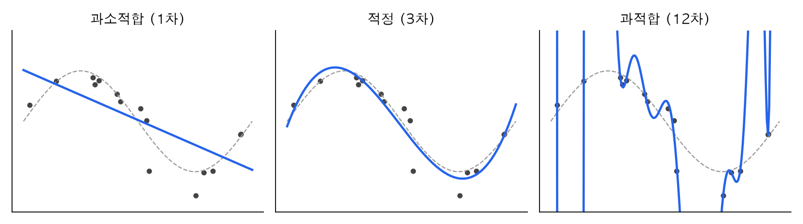
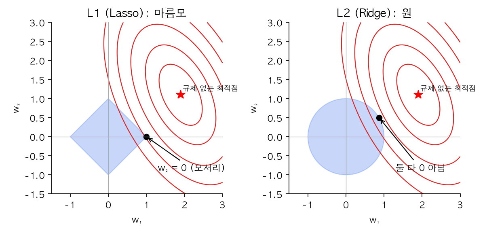
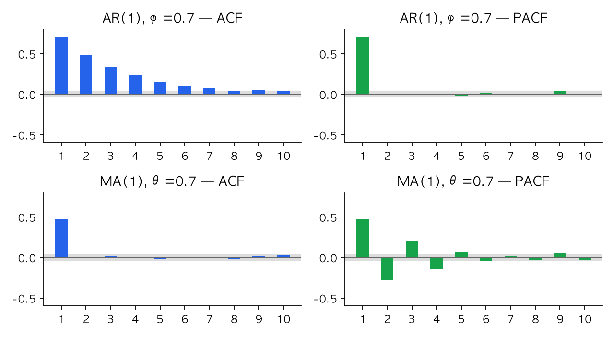
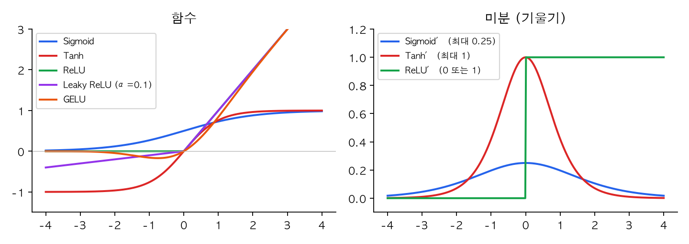

# 1교시 공통 공부노트 (AI/ML · 딥러닝)

> 대상: 머신러닝·딥러닝 기초(객관식·주관식 대비, 주관식은 간단한 코딩·의사코드).
> 기본 범위 밖이지만 넣은 내용은 〔범위 밖·참고〕로 표시했다.
> 〔핵심〕 = 시험 전날 이것만 다시 볼 것.

## 0. 읽는 순서

### 핵심만 읽는 순서 (시험 전날)
1. 2-3 Lasso와 Ridge 비교표 → 3-4 RF와 XGBoost 비교표
2. 5장 평가 지표 공식과 계산 예제
3. 6-5 ACF·PACF로 차수 고르는 표 → 6-6 정상성 검정
4. 8-1 데이터 형태별 모델 고르기 → 9장 활성화 함수 표 → 10장 과적합 방지 표 → 11장 Adam 공식
5. 12장 주관식 코드 (특히 12-2·12-3·12-6·12-8·12-9·12-10·12-12·12-15를 손으로 한 번씩)

---

## 1. 머신러닝 기본 틀 (모든 문제의 바탕)

### 1-1. 학습·검증·테스트 나누기 〔핵심〕
- **학습(train) 데이터**: 모델이 가중치를 배우는 데 쓴다.
- **검증(validation) 데이터**: 하이퍼파라미터(사람이 정하는 값, 예: 트리 깊이·학습률)를 고르고, 언제 학습을 멈출지 정할 때 쓴다.
- **테스트(test) 데이터**: 마지막에 딱 한 번, 처음 보는 데이터에서 성능이 얼마인지 잴 때만 쓴다. 테스트 점수를 보고 모델을 다시 고치면 테스트도 사실상 검증 데이터가 돼 버린다.

### 1-2. 과소적합과 과적합 〔핵심〕
| | 과소적합(underfitting) | 과적합(overfitting) |
|---|---|---|
| 쉬운 말 | 너무 단순해서 학습 데이터도 못 맞춤 | 학습 데이터의 잡음까지 외워서 새 데이터에 약함 |
| 증상 | 학습 오차↑, 검증 오차↑ | 학습 오차↓, 검증 오차↑ (둘 사이 간격이 큼) |
| 처방 | 모델을 키움, 특성 추가, 규제 줄임, 더 오래 학습 | 데이터 늘림, 규제(L1·L2·Dropout), 모델 줄임, 조기 종료 |

### 1-3. 편향-분산 분해 (bias-variance)
제곱 오차 기준으로 새 데이터에서의 기대 오차는 세 덩어리로 나뉜다.

```eq
기대 오차 = 편향² + 분산 + 줄일 수 없는 잡음(σ²)
```

- **편향(bias)**: 모델이 너무 단순해서 생기는 체계적인 빗나감 → 과소적합 쪽.
- **분산(variance)**: 학습 데이터가 조금만 바뀌어도 예측이 크게 출렁이는 정도 → 과적합 쪽.
- 모델을 복잡하게 하면 편향은 줄고 분산은 늘어난다. 규제(λ)를 키우면 그 반대.



### 1-4. 교차검증 (cross-validation)
- **K-fold**: 데이터를 K조각으로 나누고, 한 조각씩 돌아가며 검증에 쓰고 나머지로 학습 → K번 점수의 평균. 데이터가 적을 때 점수가 덜 흔들린다.
- **Stratified K-fold**: 분류에서 각 조각의 클래스 비율을 원래와 같게 유지. 불균형 데이터에서 쓴다.
- **시계열은 섞으면 안 된다**: 과거로 학습하고 미래로 검증해야 한다(TimeSeriesSplit: 학습 구간을 점점 늘리며 바로 다음 구간으로 검증).

### 1-5. 데이터 누수 (data leakage) 〔핵심〕
학습할 때 알 수 없는 정보가 학습에 섞여 점수가 부풀려지는 것.
- 스케일러·결측 대체값을 **전체 데이터로 fit** 하면 누수 → **학습 데이터로만 fit**, 검증·테스트에는 transform만.
- 시계열에서 미래 값으로 만든 특성(예: 내일 평균)을 쓰면 누수.
- 타깃 인코딩(범주별 정답 평균)을 같은 데이터에서 계산하면 누수 → 교차검증 안에서 계산.

---

## 2. 선형 회귀 (Linear · Ridge · Lasso)

### 2-1. 선형 회귀 (Linear Regression)
- **한 줄**: 입력 특성에 가중치를 곱해 더한 값으로 숫자를 예측한다.

```eq
예측:  ŷ = w₁x₁ + w₂x₂ + … + w_p x_p + b  =  wᵀx + b
손실:  MSE = (1/n) Σᵢ (yᵢ − ŷᵢ)²       (최소제곱법, OLS)
닫힌 해(정규방정식):  w = (XᵀX)⁻¹ Xᵀy      (XᵀX가 역행렬이 있을 때)
경사하강법:  ∂MSE/∂w = (2/n) Xᵀ(Xw − y),   w ← w − η · 기울기
```

- **정규방정식 vs 경사하강법**: 특성 수 p가 작으면 정규방정식이 한 번에 답을 준다. p가 매우 크면 (XᵀX)⁻¹ 계산이 비싸서(약 p³) 경사하강법을 쓴다.
- **다중공선성(multicollinearity)**: 특성끼리 거의 같은 정보를 가지면(예: 키(cm)와 키(inch)) XᵀX가 역행렬에 가까이 없어져 가중치가 크게 출렁인다. → Ridge가 해결책.
- **추론용 가정** (계수의 p값·신뢰구간을 믿으려면): 선형성, 오차의 독립성, 등분산성, 오차의 정규성. 예측만 할 때는 덜 중요하다.
- **R²(결정계수)** = 1 − SS_res/SS_tot = 1 − Σ(y−ŷ)²/Σ(y−ȳ)². 1이면 완벽, 0이면 평균으로 찍은 것과 같음. 테스트 데이터에서는 **음수도 나올 수 있다**(평균보다 못한 모델).

### 2-2. 규제(Regularization)가 하는 일
손실에 "가중치가 크면 벌점"을 더해서 가중치를 작게 만든다. 가중치가 작으면 입력이 조금 바뀌어도 예측이 덜 출렁인다 → 분산↓, 과적합↓.

```eq
Ridge (L2):  손실 = Σ(y − ŷ)² + λ Σⱼ wⱼ²
Lasso (L1):  손실 = Σ(y − ŷ)² + λ Σⱼ |wⱼ|
Elastic Net: 손실 = Σ(y − ŷ)² + λ₁ Σ|wⱼ| + λ₂ Σ wⱼ²
Ridge 닫힌 해:  w = (XᵀX + λI)⁻¹ Xᵀy     ← λI를 더해서 항상 역행렬이 생김
```

- λ(sklearn에서는 `alpha`)가 클수록 가중치가 0 쪽으로 더 눌린다. λ=0이면 그냥 선형 회귀.
- 절편 b에는 보통 벌점을 주지 않는다.
- **스케일링 필수**: 벌점이 가중치 크기에 걸리므로, 단위가 큰 특성(원)과 작은 특성(억 원)이 섞이면 불공평해진다 → 표준화(평균 0, 표준편차 1) 후 적용.
- sklearn 목적함수 참고: `Ridge`는 ‖y−Xw‖² + α‖w‖², `Lasso`는 (1/(2n))‖y−Xw‖² + α‖w‖₁ (Lasso만 1/(2n)이 붙어서 같은 alpha라도 세기가 다르다).

### 2-3. Lasso와 Ridge 비교 〔핵심〕
| | Ridge (L2) | Lasso (L1) |
|---|---|---|
| 벌점 | 가중치 제곱합 | 가중치 절댓값 합 |
| 가중치 모양 | 전부 작아지지만 **정확히 0은 거의 안 됨** | 일부가 **정확히 0** → 특성 선택 효과 |
| 닫힌 해 | 있음 (XᵀX + λI)⁻¹Xᵀy | 없음 (좌표하강법 등으로 풂) |
| 비슷한 특성 여러 개 | 가중치를 나눠 가짐 | 그중 하나만 남기고 나머지 0 (어느 걸 남길지 불안정) |
| 언제 | 특성이 다 조금씩 쓸모 있을 때, 다중공선성 | 쓸모없는 특성이 많아 골라내고 싶을 때 |

**왜 L1만 0을 만드나 (그림으로)**: 규제는 "가중치가 이 영역 안에 있어야 한다"는 제약과 같다. L2 영역은 원, L1 영역은 마름모(모서리가 축 위에 있음). 손실의 등고선(타원)이 영역에 처음 닿는 점이 답인데, 마름모는 **모서리(어떤 wⱼ = 0인 점)** 에서 닿기 쉽다.



### 2-4. 로지스틱 회귀 〔범위 밖·참고: "등"에 들어갈 수 있는 기본 분류 모델〕
- 이름은 회귀지만 **분류** 모델. 선형 점수 z = wᵀx + b를 시그모이드로 0~1 확률로 바꾼다.

```eq
p = σ(z) = 1 / (1 + e^(−z))
손실(이진 교차엔트로피, BCE) = −(1/n) Σ [ y log p + (1−y) log(1−p) ]
기울기:  ∂손실/∂w = (1/n) Xᵀ(p − y)       ← 선형 회귀 기울기와 모양이 같다
```

- 결정 경계는 직선(초평면). 0.5 기준을 바꾸면 정밀도·재현율이 바뀐다(5-3).

---

## 3. 트리 기반 모델 (결정트리 · Random Forest · XGBoost)

### 3-1. 결정트리 (Decision Tree)
- **한 줄**: "특성 A가 3보다 큰가?" 같은 질문을 반복해서 데이터를 나누고, 끝(잎)에서 다수결(분류)이나 평균(회귀)으로 답한다.
- **어떤 질문으로 나눌까**: 나눈 뒤 각 쪽이 최대한 **순수(한 클래스만 남음)** 해지는 질문을 고른다.

```eq
지니 불순도(Gini) = 1 − Σₖ pₖ²          (pₖ = 그 노드에서 클래스 k 비율)
엔트로피(Entropy) = − Σₖ pₖ log₂ pₖ
정보 이득 = 부모 불순도 − (자식 불순도의 가중 평균, 가중치 = 자식 샘플 비율)
회귀 트리: 분산(MSE)이 가장 많이 줄어드는 질문을 고름
```

- 예: 반반(0.5, 0.5)이면 지니 0.5·엔트로피 1, 한 클래스만(1, 0)이면 둘 다 0.
- 장점: 해석 쉬움, **스케일링 불필요**(대소 비교만 하니까), 범주·비선형 관계 처리.
- 단점: 깊게 키우면 학습 데이터를 다 외워 **과적합**, 데이터가 조금 바뀌면 트리 모양이 크게 바뀜(분산 큼).
- 과적합 막기: `max_depth`(최대 깊이), `min_samples_leaf`(잎 최소 샘플 수), 가지치기(pruning).

### 3-2. Random Forest = 배깅(Bagging) + 특성 무작위 선택
- **한 줄**: 서로 조금씩 다른 트리를 수백 개 만들어 **투표(분류)·평균(회귀)** 한다.
- 다르게 만드는 방법 두 가지
  1. **부트스트랩(bootstrap)**: 학습 데이터에서 같은 크기로 **중복을 허용해** 뽑아 트리마다 다른 데이터를 준다.
  2. **노드마다 특성 일부만 후보로**: 분류는 √p개가 관행(p = 전체 특성 수). 강한 특성 하나가 모든 트리를 똑같이 만드는 걸 막는다.
- 효과: 트리 하나하나는 분산이 크지만, 서로 덜 닮은 트리를 평균하면 **분산이 줄어든다**. 편향은 거의 그대로.
- **OOB(Out-of-Bag) 오차**: 부트스트랩에서 한 샘플이 안 뽑힐 확률 = (1 − 1/n)ⁿ ≈ 1/e ≈ 36.8%. 각 트리가 못 본 샘플로 채점하면 따로 검증셋 없이 성능을 추정할 수 있다.
- 트리끼리 독립이라 **병렬 학습** 가능. 트리 수를 늘려도 과적합이 심해지지 않는다(계산만 늘어남).
- 특성 중요도: 불순도 감소 합(빠르지만 값 종류가 많은 특성을 과대평가하는 경향) / 순열 중요도(permutation: 그 특성을 섞었을 때 성능이 얼마나 떨어지나).

### 3-3. 부스팅(Boosting)과 XGBoost
- **한 줄**: 트리를 **순서대로** 하나씩 추가하는데, 새 트리는 **앞 트리들이 틀린 것**을 보완하도록 배운다. AdaBoost는 틀린 샘플의 가중치를 올리고, 그래디언트 부스팅은 손실의 음의 기울기(제곱 오차면 **잔차**)를 맞춘다.

```eq
Gradient Boosting:  F_m(x) = F_(m−1)(x) + η · h_m(x)
  h_m 은 "음의 기울기(pseudo-residual)" rᵢ = −∂L(yᵢ, F(xᵢ))/∂F(xᵢ) 를 맞추는 작은 트리
  제곱 오차면 rᵢ = yᵢ − F(xᵢ)  (그냥 잔차)
  η = 학습률(shrinkage). 작게 하고 트리 수를 늘리면 보통 일반화가 좋아진다
```

- 배깅은 분산을 줄이고, 부스팅은 **편향을 줄인다**(약한 모델을 차례로 보완).
- **XGBoost** (eXtreme Gradient Boosting, 공식 튜토리얼 "Introduction to Boosted Trees" 기준)
  - 목적함수 = 손실 + **트리 복잡도 벌점**

```eq
Obj = Σᵢ l(yᵢ, ŷᵢ) + Σₖ Ω(fₖ),     Ω(f) = γT + ½ λ Σⱼ wⱼ²
      (T = 잎 개수, wⱼ = 잎 j의 출력값)
t번째 트리: 손실을 2차 테일러 근사 →  Σᵢ [ gᵢ f(xᵢ) + ½ hᵢ f(xᵢ)² ] + Ω(f)
      gᵢ = 손실의 1차 미분, hᵢ = 2차 미분 (현재 예측에서)
잎 j의 최적 출력:   wⱼ* = − Gⱼ / (Hⱼ + λ)      (Gⱼ, Hⱼ = 잎 j에 속한 g, h의 합)
분할 이득:  Gain = ½ [ G_L²/(H_L+λ) + G_R²/(H_R+λ) − (G_L+G_R)²/(H_L+H_R+λ) ] − γ
      → Gain이 0보다 작으면(=γ보다 이득이 작으면) 나누지 않음 (가지치기 효과)
예: l = ½(y−ŷ)² 이면 g = ŷ − y, h = 1 ·  로지스틱 손실이면 g = p − y, h = p(1−p)
```

  - 그 밖의 특징: 결측값이 있으면 **왼쪽·오른쪽 중 나은 기본 방향을 학습**(sparsity-aware), 행·열 샘플링(subsample, colsample_bytree), 병렬 분할 탐색, 조기 종료(early stopping).
  - 주요 하이퍼파라미터 (괄호 = 기본값)

| 파라미터 | 뜻 | 키우면 |
|---|---|---|
| `eta` = `learning_rate` (0.3) | 트리 하나의 반영 비율 | 빨리 맞추지만 과적합 쉬움 |
| `max_depth` (6) | 트리 최대 깊이 | 복잡↑ 과적합↑ |
| `min_child_weight` (1) | 잎의 h 합 최솟값 | 보수적(덜 나눔) |
| `gamma` = `min_split_loss` (0) | 분할에 필요한 최소 이득 | 보수적 |
| `lambda` (1) / `alpha` (0) | 잎 출력의 L2 / L1 벌점 | 보수적 |
| `subsample` (1) / `colsample_bytree` (1) | 트리마다 쓸 행 / 열 비율 | 낮추면 무작위성↑ 과적합↓ |
| `n_estimators` (sklearn API 100) | 트리 개수 | 많으면 과적합 가능 → 조기 종료로 정함 |

### 3-4. Random Forest와 XGBoost 비교 〔핵심〕
| | Random Forest | XGBoost (부스팅) |
|---|---|---|
| 트리 만드는 방식 | **동시에·독립적으로** (배깅) | **차례로**, 앞 트리의 오차를 이어 받음 |
| 주로 줄이는 것 | 분산 | 편향 |
| 트리 모양 | 깊은 트리 | 얕은 트리(기본 깊이 6) 여러 개 |
| 트리 수 늘리면 | 과적합 거의 안 늘어남 | 과적합 가능 → 조기 종료 |
| 튜닝 | 적게 해도 잘 됨 | 학습률·깊이 등 튜닝 영향 큼 |
| 공통 | 스케일링 불필요, 정형(표) 데이터에서 강함, 특성 중요도 제공 | |

---

## 4. 피처 엔지니어링과 모델 선택

### 4-1. 피처 엔지니어링 (feature engineering) = 모델이 쓰기 좋게 입력을 다듬고 만드는 일
| 할 일 | 방법 | 주의 |
|---|---|---|
| 결측값 | 평균·중앙값 대체, "결측 여부" 표시 특성 추가, 트리 모델은 그대로 둬도 됨(XGBoost) | 대체값은 학습 데이터로만 계산 |
| 스케일링 | 표준화 z = (x − μ)/σ, Min-Max (x − min)/(max − min) | 선형·신경망·거리 기반(k-NN, SVM)은 필요, **트리는 불필요** |
| 범주형 | 원-핫 인코딩(순서 없음), 순서 인코딩(낮음<중간<높음), 타깃 인코딩 | 원-핫은 범주가 많으면 차원 폭발 |
| 치우친 분포 | 로그 변환 log(1+x) | 금액·개수처럼 오른쪽 꼬리가 긴 값 |
| 파생 특성 | 날짜 → 요일·월·휴일, 비율(불량 수/생산 수), 구간화 | 업무 지식이 가장 큰 힘 |
| 시계열 특성 | 과거값(lag: y_(t−1), y_(t−7)), 이동평균(rolling) | **미래 값이 들어가면 누수** |
| 이상치 | 클리핑, 로버스트 스케일링(중앙값·IQR) | 진짜 이상(고장)인지 잡음인지 먼저 확인 |
| 특성 선택 | Lasso, 트리 중요도, 상관 높은 특성 제거 | |

### 4-2. 모델 선택 (model selection)
- 기준은 **검증 점수**(교차검증 평균). 학습 점수로 고르면 과적합 모델을 고르게 된다.
- 하이퍼파라미터 탐색: 그리드 서치(모든 조합), 랜덤 서치(무작위 조합, 중요한 파라미터가 몇 개뿐일 때 효율적), 베이지안 최적화(앞 결과를 보고 다음 후보를 고름).
- 비슷한 점수면 **단순한 모델**(해석·유지보수 쉬움).
- 데이터 형태로 먼저 거르기: 표 데이터 → 트리 앙상블이 강한 기준선, 이미지 → CNN, 순서·시계열 → ARIMA·RNN 계열(8-1).
- 정보 기준(통계 모델): AIC = 2k − 2 ln L, BIC = k ln n − 2 ln L (k = 파라미터 수, L = 우도). **작을수록 좋음**, BIC가 복잡한 모델에 벌점을 더 크게 준다.

---

## 5. 평가 지표 (MAE · RMSE · F1 등) 〔핵심〕

### 5-1. 회귀 지표
```eq
MAE  = (1/n) Σ |yᵢ − ŷᵢ|                 (평균 절대 오차)
MSE  = (1/n) Σ (yᵢ − ŷᵢ)²
RMSE = √MSE                              (단위가 y와 같음)
MAPE = (100/n) Σ |yᵢ − ŷᵢ| / |yᵢ|        (%)  ← y가 0 근처면 폭발
R²   = 1 − Σ(yᵢ − ŷᵢ)² / Σ(yᵢ − ȳ)²
```

| | MAE | RMSE |
|---|---|---|
| 큰 오차 | 오차 크기 그대로 반영 | **제곱하므로 큰 오차에 더 큰 벌** |
| 이상치 | 덜 민감 | 민감 |
| 이 지표를 최소로 하는 상수 예측 | 중앙값 | 평균 |
| 크기 관계 | **항상 RMSE ≥ MAE** (모든 오차 크기가 같을 때만 같음) | |

- 예: 오차가 [1, 1, 1, 9] → MAE = 12/4 = 3, RMSE = √((1+1+1+81)/4) = √21 ≈ 4.58. 큰 오차 하나가 RMSE를 끌어올린다.
- 고르는 기준: 큰 오차 한 번이 치명적이면(설비 고장, 안전) RMSE, 오차를 고르게 보고 싶거나 이상치가 많으면 MAE.

### 5-2. 분류 지표와 혼동행렬
| | 실제 양성 | 실제 음성 |
|---|---|---|
| **예측 양성** | TP (맞게 양성) | FP (거짓 경보) |
| **예측 음성** | FN (놓침) | TN (맞게 음성) |

```eq
정확도 Accuracy   = (TP + TN) / 전체
정밀도 Precision  = TP / (TP + FP)      "양성이라고 한 것 중 진짜 양성 비율"
재현율 Recall     = TP / (TP + FN)      "진짜 양성 중 잡아낸 비율" (= 민감도, TPR)
F1               = 2·P·R / (P + R) = 2TP / (2TP + FP + FN)    (P와 R의 조화평균)
특이도 Specificity = TN / (TN + FP),    FPR = FP / (FP + TN) = 1 − 특이도
```

- **계산 예제** (불량 검출, 1000개 중 불량 60개): TP = 40, FN = 20, FP = 10, TN = 930
  - 정확도 = 970/1000 = **0.97** (높아 보이지만)
  - 정밀도 = 40/50 = **0.80**, 재현율 = 40/60 ≈ **0.667**
  - F1 = 2·0.8·0.667/(0.8+0.667) = 80/110 ≈ **0.727**
  - 모든 걸 "정상"이라고 찍어도 정확도는 940/1000 = 0.94 → **불균형 데이터에서 정확도는 속인다**. 그래서 F1·재현율을 본다.
- **조화평균을 쓰는 이유**: 둘 중 하나가 낮으면 F1도 낮게 나온다(P = 1, R = 0.01이면 산술평균 0.505, F1 ≈ 0.02).
- **임계값(threshold)**: 양성 판정 기준을 낮추면 재현율↑ 정밀도↓, 높이면 반대. 놓치면 큰일(불량·질병) → 재현율 중시, 거짓 경보가 비쌈(스팸에 정상 메일) → 정밀도 중시.
- **불균형 데이터 대처** 〔핵심〕
  1. 지표: 정확도 대신 F1·재현율·PR-AUC.
  2. 분할: Stratified K-fold로 조각마다 클래스 비율 유지(1-4).
  3. 클래스 가중치: 적은 클래스의 오류에 더 큰 벌점(sklearn `class_weight="balanced"`, PyTorch `nn.CrossEntropyLoss(weight=…)`).
  4. 리샘플링: 적은 클래스 늘리기(복제, SMOTE = 가까운 두 샘플 사이에 새 샘플을 합성) 또는 많은 클래스 줄이기. **학습 데이터에만** 적용한다(검증·테스트까지 바꾸면 점수가 부풀려짐 = 누수).
  5. 임계값 조정: 검증 데이터에서 원하는 재현율·F1이 나오는 임계값을 고른다.
- **ROC 곡선**: 임계값을 바꾸며 (FPR, TPR)을 그린 곡선. **AUC** = 무작위 양성 하나가 무작위 음성 하나보다 높은 점수를 받을 확률(0.5 = 찍기, 1 = 완벽).
- **PR 곡선**(정밀도-재현율): 양성이 아주 드물 때 ROC보다 차이를 잘 보여 준다.
- **다중 클래스 F1**: macro = 클래스별 F1의 단순 평균(작은 클래스도 똑같이 중요), weighted = 샘플 수로 가중 평균, micro = 전체 TP·FP·FN을 합쳐 계산(한 샘플에 라벨 하나인 다중 분류에선 micro F1 = 정확도).

---

## 6. 시계열과 ARIMA

### 6-1. 정상성 (stationarity) 〔핵심〕
- **쉬운 말**: 시간이 흘러도 "통계적 성격"이 그대로인 시계열. 어느 구간을 잘라 봐도 평균·흔들림 정도가 비슷하다.
- **약정상성(weak stationarity)의 3조건**
  1. 평균이 시간에 따라 일정
  2. 분산이 시간에 따라 일정
  3. 공분산 Cov(y_t, y_(t+k))가 **시점 t가 아니라 시차 k에만** 의존
- **비정상의 흔한 모습**: 추세(계속 오름), 계절성(매년 여름에 높음), 분산이 커짐(값이 클수록 흔들림도 큼).
- **왜 중요**: AR·MA 모델은 정상 시계열을 가정한다. 비정상이면 과거 패턴이 미래에 그대로 반복된다고 볼 수 없다.
- **정상으로 만드는 법**: 추세 → **차분**, 계절성 → **계절 차분**, 분산 증가 → **로그 변환**.
- 예: **랜덤워크** y_t = y_(t−1) + ε_t 는 비정상(분산이 시간에 따라 커짐). 한 번 차분하면 y_t − y_(t−1) = ε_t (백색잡음)으로 정상.
- **백색잡음(white noise)**: 평균 0, 분산 일정, 서로 상관 없는 잡음. 잔차가 백색잡음이면 모델이 뽑을 패턴을 다 뽑은 것.

### 6-2. AR(p) — 자기회귀 (AutoRegressive)
```eq
y_t = c + φ₁ y_(t−1) + φ₂ y_(t−2) + … + φ_p y_(t−p) + ε_t
```
- **쉬운 말**: 오늘 값을 **내 과거 값들**의 가중합으로 설명. "어제 많이 팔렸으면 오늘도 많이."
- AR(1)이 정상이려면 |φ₁| < 1. φ₁ = 1이면 랜덤워크(단위근, unit root) → 비정상.

### 6-3. MA(q) — 이동평균 (Moving Average)
```eq
y_t = μ + ε_t + θ₁ ε_(t−1) + … + θ_q ε_(t−q)
```
- **쉬운 말**: 오늘 값을 **과거의 예측 오차(충격)들**의 가중합으로 설명. "어제 갑작스런 충격이 오늘까지 조금 남는다."
- 이름과 달리 "최근 값 평균 내기(이동평균 평활)"와는 다른 것. 시험 함정.
- 유한한 MA는 항상 정상. (MA(1)은 |θ₁| < 1일 때 가역(invertible))

### 6-4. I(d) — 차분 (Integrated)과 ARIMA(p, d, q)
```eq
1차 차분:   y'_t = y_t − y_(t−1)          (추세 제거)
2차 차분:   y''_t = y'_t − y'_(t−1)
계절 차분:  y_t − y_(t−s)                 (s = 주기, 월별 자료면 12)
ARIMA(p, d, q) = d번 차분한 시계열에 ARMA(p, q)를 적용
SARIMA(p, d, q)(P, D, Q)_s = 계절 부분(P, D, Q, 주기 s)을 따로 추가
```
- 예: ARIMA(0,1,0) = 랜덤워크, ARIMA(1,1,0) = 차분한 값에 AR(1).
- 예측할 때는 차분한 값을 예측한 뒤 **다시 더해서(적분해서) 원래 단위로 되돌린다** → 그래서 이름이 Integrated.
- 차분을 너무 많이 하면(과차분) 오히려 불필요한 상관이 생긴다. 보통 d는 0~2.

### 6-5. 차수 (p, q) 고르기 — ACF와 PACF 〔핵심〕
- **ACF (자기상관함수)**: y_t와 y_(t−k)의 상관. 중간 시점의 영향이 다 섞여 있음.
- **PACF (편자기상관함수)**: 중간 시점(1…k−1)의 영향을 뺀 뒤 y_t와 y_(t−k)의 순수한 상관.

| 모델 | ACF | PACF |
|---|---|---|
| **AR(p)** | 천천히 줄어듦(지수 감소·진동) | **p 이후 뚝 끊김** |
| **MA(q)** | **q 이후 뚝 끊김** | 천천히 줄어듦 |
| ARMA(p, q) | 천천히 줄어듦 | 천천히 줄어듦 → AIC·BIC로 고름 |

- 외우는 법: "**AR은 P**ACF가 끊기고, **MA는 A**CF가 끊긴다" (AR–PACF, MA–ACF).
- ACF가 아주 천천히(거의 직선으로) 줄면 비정상 신호 → 차분 먼저.
- 계절 주기 s의 배수(12, 24, …)에서 ACF가 튀면 계절성 → 계절 차분·SARIMA.



### 6-6. 검정과 진단
| 검정 | 귀무가설 (H₀) | p < 0.05 이면 |
|---|---|---|
| **ADF** (Augmented Dickey-Fuller) | 단위근이 있다 = **비정상** | 기각 → 정상으로 봄 |
| **KPSS** | **정상**이다 | 기각 → 비정상으로 봄 |
| **Ljung-Box** (잔차) | 잔차에 자기상관 없음(백색잡음) | 기각 → 모델이 패턴을 덜 뽑음 |

- ADF와 KPSS는 귀무가설이 **반대**다. 시험 함정 1순위.

### 6-7. Box-Jenkins 절차 (ARIMA 만드는 순서)
1. 그림 그리기 → 추세·계절성·분산 변화 확인
2. 정상화: 로그 변환, 차분(d), 계절 차분(D) → ADF/KPSS로 확인
3. 식별: ACF·PACF로 p, q 후보 고르기
4. 추정: 후보 모델 적합, AIC·BIC 비교
5. 진단: 잔차가 백색잡음인지(Ljung-Box, 잔차 ACF)
6. 예측: 차분을 되돌려 원래 단위로

### 6-8. 계절성 (seasonality)
- **고정된 주기**로 반복되는 패턴(요일, 월, 분기). 주기가 일정하지 않은 오르내림(경기 순환)은 계절성이 아니라 순환(cycle).
- **분해(decomposition)**: 가법 y = 추세 + 계절 + 잔차 (계절 폭이 일정), 승법 y = 추세 × 계절 × 잔차 (값이 클수록 계절 폭도 커짐 → 로그를 씌우면 가법이 됨).
- 처리: 계절 차분, SARIMA의 계절 항, 또는 머신러닝에서 "월·요일" 특성.

- statsmodels로 ARIMA·SARIMA를 돌리는 코드와 AR을 손으로(최소제곱) 맞추는 코드는 **12-14**(둘 다 실행 확인). statsmodels `ARIMA` 결과의 `const`는 절편 c가 아니라 **평균 μ**라는 함정도 거기에(`AutoReg`는 절편 그대로).

---

## 7. 신경망 기본

### 7-1. 뉴런과 층
```eq
한 층:   h = f(W x + b)          (W = 가중치 행렬, b = 편향, f = 활성화 함수)
2층 신경망:  ŷ = W₂ · f(W₁ x + b₁) + b₂
```
- **활성화 함수가 없으면** 층을 아무리 쌓아도 W₂W₁x = (한 개의 행렬)x → **선형 모델 하나와 같다**. 비선형 활성화가 있어야 복잡한 경계를 배운다.
- **역전파(backpropagation)**: 출력 쪽 손실의 기울기를 **연쇄법칙(chain rule)** 으로 입력 쪽 층까지 거꾸로 전달해 모든 가중치의 기울기를 한 번에 구하는 방법.
- **파라미터 수 (완전연결층)** = (입력 수 + 1) × 출력 수. 예: 784 → 128 층 = (784+1)×128 = 100,480.

### 7-2. 가중치 초기화
- 전부 0으로 시작하면 모든 뉴런이 똑같이 배운다(대칭이 안 깨짐) → 무작위 초기화.
- **Xavier(Glorot)**: 분산 = 2/(n_in + n_out). sigmoid·tanh에 맞춤.
- **He(Kaiming)**: 분산 = 2/n_in. ReLU에 맞춤(ReLU가 절반을 0으로 만드니까 2배).

### 7-3. 기울기 소실·폭발 처방 한눈에 〔핵심〕
| 처방 | 어떻게 막나 | 자세히 |
|---|---|---|
| ReLU 계열 활성화 | 양수 쪽 미분이 1이라 곱해도 작아지지 않음(sigmoid·tanh는 양 끝에서 포화) | 9장 |
| He·Xavier 초기화 | 층마다 출력 분산이 유지되게 시작 | 7-2 |
| 배치·층 정규화 | 층 입력 분포를 일정하게 | 10장 |
| **잔차 연결 (residual connection, ResNet)** | 층 출력을 **y = x + F(x)** 로. 더하기 경로로 기울기가 앞 층까지 그대로 전달 → 매우 깊은 망도 학습(ResNet 152층). Transformer도 쓴다 | — |
| LSTM·GRU | RNN에서 셀 상태의 덧셈 경로 + 게이트 | 8-4 |
| 기울기 클리핑 | **폭발** 처방: 기울기 크기가 상한을 넘으면 잘라 줄임 | 8-4, 11-3 |

---

## 8. DNN · CNN · RNN

### 8-1. 데이터 형태별 모델 고르기 〔핵심〕
| 데이터 | 특징 | 1순위 | 이유 |
|---|---|---|---|
| **정형(표)** | 열마다 뜻이 다르고 순서 의미 없음 | 트리 앙상블(XGBoost·RF), DNN(MLP) | 표 데이터는 트리 모델이 강한 기준선. DNN은 특성 간 위치 관계를 가정하지 않음 |
| **이미지** | 가까운 픽셀끼리 관련, 물체가 어디 있든 같은 물체 | **CNN** (데이터 많으면 ViT) | 지역 연결 + 가중치 공유 → 파라미터 적고 위치가 바뀌어도 같은 특징을 잡음 |
| **시계열·순서** | 순서가 의미, 앞이 뒤에 영향 | **RNN·LSTM·GRU**, 1D-CNN, Transformer, (통계) ARIMA | 시점마다 같은 가중치로 과거 정보를 은닉 상태에 누적 |

### 8-2. DNN (MLP, 완전연결 신경망)
- 모든 입력이 다음 층의 모든 뉴런에 연결. 입력을 **평평한 벡터**로 본다.
- 이미지에 쓰면: 28×28 이미지를 784개 숫자로 펴서 넣음 → 픽셀의 이웃 관계를 잃고, 큰 이미지면 파라미터가 폭발.

### 8-3. CNN (합성곱 신경망)
- **합성곱(convolution)**: 작은 필터(예: 3×3)를 이미지 위로 밀면서 곱해 더한다. 필터 하나 = 특징 하나(가장자리, 질감…).
- **지역 연결**: 출력 한 칸은 입력의 작은 영역만 본다.
- **가중치 공유**: 같은 필터를 이미지 모든 위치에 쓴다 → 파라미터 수가 이미지 크기와 무관, 물체가 옮겨가도 같은 특징을 잡음(평행이동 등변성).
- **풀링(pooling)**: 2×2 최대 풀링 = 2×2 칸에서 가장 큰 값만 남김 → 크기를 절반으로, 작은 위치 변화에 둔감. **파라미터 없음**.
- 층이 깊어질수록 가장자리 → 무늬 → 부품 → 물체처럼 점점 큰 특징을 본다(수용 영역 증가).

```eq
출력 크기:  O = ⌊ (W − K + 2P) / S ⌋ + 1        (W = 입력 크기, K = 필터, P = 패딩, S = 스트라이드)
합성곱 층 파라미터 수 = (K × K × C_in + 1) × C_out      (+1 = 필터마다 편향 1개)
```
- 예 1: 32×32 입력, K=3, P=1, S=1 → (32−3+2)/1+1 = **32** (크기 유지, "same" 패딩)
- 예 2: 32×32 입력, K=3, P=0, S=2 → ⌊29/2⌋+1 = **15**
- 예 3: 3×3 필터, 입력 채널 3(RGB) → 출력 채널 64: (3·3·3 + 1)·64 = **1,792개**

### 8-4. RNN (순환 신경망)
```eq
h_t = tanh( W_x x_t + W_h h_(t−1) + b )        ← 모든 시점에서 같은 W_x, W_h를 씀
y_t = W_y h_t
```
- **은닉 상태 h_t** = 지금까지 본 내용의 요약(메모리).
- **BPTT**(Backpropagation Through Time): 시간 축으로 펼쳐서 역전파.
- **문제**: 긴 시퀀스에서 기울기가 매 시점 W_h와 tanh 미분을 계속 곱해지며 **사라지거나(소실) 폭발**한다 → 먼 과거를 잘 못 배움.
- **처방**: 폭발 → 기울기 클리핑(gradient clipping), 소실 → **LSTM·GRU**.
- **LSTM**: 셀 상태 c_t라는 "컨베이어 벨트"를 두고 게이트로 조절
  - 망각 게이트 f: 지난 기억을 얼마나 지울까 · 입력 게이트 i: 새 정보를 얼마나 넣을까 · 출력 게이트 o: 기억을 얼마나 내보낼까
  - c_t = f ⊙ c_(t−1) + i ⊙ g,  h_t = o ⊙ tanh(c_t)  (⊙ = 원소별 곱). 더하기로 이어져서 기울기가 덜 사라진다.
- **GRU**: 게이트 2개(업데이트 z, 리셋 r), 셀 상태 없이 h만. LSTM보다 가볍고 성능은 비슷한 경우가 많음.
- 파라미터 수: 기본 RNN = h(d + h + 1), LSTM = 게이트 4개라서 4h(d + h + 1) (d = 입력 차원, h = 은닉 크기). PyTorch는 편향을 두 벌(b_ih, b_hh) 둬서 RNN = h(d + h + 2), LSTM = 4h(d + h + 2) (예: d=10, h=20이면 PyTorch RNN 640개, LSTM 2,560개, 실행 확인).

### 8-5. 한눈 비교
| | DNN | CNN | RNN |
|---|---|---|---|
| 입력을 보는 방식 | 평평한 벡터 | 격자(이미지), 지역 | 순서, 한 시점씩 |
| 가중치 공유 | 없음 | **공간**에서 공유 | **시간**에서 공유 |
| 강점 | 정형 데이터, 단순 | 이미지·공간 패턴 | 시계열·순서 |
| 약점 | 구조 정보 무시 | 긴 거리 관계 약함 | 병렬화 어려움, 기울기 소실 |

---

## 9. 활성화 함수 〔핵심〕
| 함수 | 식 | 출력 범위 | 미분 | 특징 |
|---|---|---|---|---|
| **Sigmoid** | 1/(1+e^(−x)) | (0, 1) | σ(1−σ), **최대 0.25** | 확률 출력(이진). 깊은 층에서 기울기 소실, 출력이 0 중심 아님 |
| **Tanh** | (eˣ−e^(−x))/(eˣ+e^(−x)) | (−1, 1) | 1 − tanh², 최대 1 | 0 중심. 양 끝에서 포화 → 소실 |
| **ReLU** | max(0, x) | [0, ∞) | x>0이면 1, x<0이면 0 | 계산 빠름, 양수 쪽 소실 없음. **죽은 ReLU**(계속 음수면 영원히 0) |
| **Leaky ReLU** | x>0: x, x<0: αx (α≈0.01) | (−∞, ∞) | 1 또는 α | 죽은 ReLU 완화 |
| **GELU** | x·Φ(x) (Φ = 표준정규 누적분포) | 약 (−0.17, ∞) | 부드러움 | Transformer 계열 기본 |
| **Softmax** | e^(zᵢ)/Σⱼ e^(zⱼ) | (0,1), 합 1 | | 다중 분류 출력층 |



- **출력층 짝 맞추기** (자주 나옴)

| 문제 | 출력층 | 손실 | PyTorch |
|---|---|---|---|
| 회귀 | 활성화 없음(선형) | MSE (또는 MAE·Huber) | `nn.MSELoss` |
| 이진 분류 | Sigmoid | BCE | `nn.BCEWithLogitsLoss` (**sigmoid를 안에 포함** → 모델은 logit 출력) |
| 다중 분류 | Softmax | 교차엔트로피 | `nn.CrossEntropyLoss` (**log-softmax를 안에 포함** → 모델에 softmax 넣지 말 것) |

- softmax + 교차엔트로피의 logit에 대한 기울기 = **p − y** (예측 확률 − 정답 원-핫). 깔끔해서 함께 쓴다.
- softmax 계산할 때 수치 안정을 위해 **최댓값을 빼고** exp: e^(zᵢ − max z). 결과는 같다.

---

## 10. 과적합 방지 (Dropout · Regularization 등) 〔핵심〕
| 방법 | 어떻게 | 포인트 |
|---|---|---|
| **Dropout** | 학습 때 뉴런을 확률 p로 무작위로 끔 | 매번 다른 작은 망을 학습하는 앙상블 효과, 특정 뉴런 의존을 막음. PyTorch `nn.Dropout(p)`의 p = **끄는 확률**. 학습 때 남은 값을 1/(1−p)배 키우고(inverted dropout), **평가 때는 끄지 않음** → `model.eval()` 필수 |
| **L2 규제 / Weight decay** | 손실 + λΣw² (또는 매 스텝 w를 조금씩 줄임) | SGD에선 둘이 같음. **Adam에선 다름** → 가중치 감쇠를 분리한 **AdamW** |
| **L1 규제** | 손실 + λΣ\|w\| | 희소한(0 많은) 가중치 |
| **조기 종료** (early stopping) | 검증 손실이 patience 번 동안 안 좋아지면 멈추고 가장 좋던 가중치로 | 가장 간단하고 효과적 |
| **데이터 증강** (augmentation) | 이미지 뒤집기·자르기·밝기, 시계열 잡음 추가 | 데이터를 늘린 효과 |
| **배치 정규화** (BatchNorm) | 미니배치마다 층 입력을 평균 0·분산 1로 맞추고 γ, β로 다시 조절 | 주목적은 학습 안정·가속, 규제 효과는 부수적. 학습 땐 배치 통계, **평가 땐 누적 평균** → `model.eval()` |
| 모델 줄이기 / 데이터 늘리기 | 층·뉴런 수 줄이기 | 근본 처방 |

- LayerNorm(층 정규화) 〔참고〕: 배치가 아니라 **샘플 하나 안에서** 정규화 → 배치 크기와 무관, RNN·Transformer에서 씀.

---

## 11. 최적화 알고리즘 (SGD · Momentum · Adam) 〔핵심〕

### 11-1. 경사하강법 3종
| | 한 번 업데이트에 쓰는 데이터 | 특징 |
|---|---|---|
| 배치 경사하강법 | 전체 | 안정적이지만 느리고 메모리 큼 |
| **SGD** (확률적) | 1개 | 빠르지만 출렁임 큼(출렁임이 얕은 골짜기를 빠져나오는 데 도움이 되기도) |
| **미니배치** | 32~256개 등 | 실제로 가장 많이 씀. 보통 "SGD"라고 하면 이것 |

```eq
기본:      w ← w − η · g                      (g = 손실의 기울기, η = 학습률)
Momentum:  v ← μ v + g,   w ← w − η v         (μ ≈ 0.9, PyTorch SGD 방식)
           → 공처럼 관성을 받아 같은 방향이면 가속, 지그재그는 상쇄
Adagrad:   s ← s + g²,           w ← w − η g / (√s + ε)
           → 기울기 제곱을 계속 누적 → 보폭이 계속 줄어 오래 학습하면 거의 멈춤 (드물게 나오는 특성엔 유리)
RMSProp:   s ← β s + (1−β) g²,   w ← w − η g / (√s + ε)
           → 누적 대신 이동평균이라 Adagrad처럼 보폭이 0으로 줄지 않음
           → 기울기가 큰 방향은 보폭을 줄이고 작은 방향은 키움 (파라미터마다 다른 보폭, Adagrad·RMSProp·Adam 공통)
```

### 11-2. Adam = Momentum + RMSProp + 편향 보정
```eq
m ← β₁ m + (1 − β₁) g          (1차: 기울기의 이동평균, 방향)
v ← β₂ v + (1 − β₂) g²         (2차: 기울기 제곱의 이동평균, 크기)
m̂ = m / (1 − β₁ᵗ),   v̂ = v / (1 − β₂ᵗ)     (편향 보정: 처음엔 m, v가 0에서 시작해 작게 나오니 키움)
w ← w − η · m̂ / (√v̂ + ε)
PyTorch 기본값: lr = 1e-3, β₁ = 0.9, β₂ = 0.999, ε = 1e-8
```
- **장점**: 학습률을 대충 정해도 잘 됨, 파라미터마다 보폭 자동 조절, 희소한 기울기에 강함.
- **SGD+Momentum과 비교**: Adam은 초반 수렴이 빠르고 튜닝이 쉽다. 일부 이미지 분류 연구에서는 잘 튜닝한 SGD가 일반화가 더 좋다는 보고도 있다(항상 그런 건 아님).
- **AdamW**: weight decay를 기울기와 섞지 않고 w ← w − η·λ·w 로 따로 적용. Adam에서 L2를 손실에 넣으면 적응적 보폭 때문에 규제가 고르게 안 걸리는 문제를 고침.

### 11-3. 학습률 (learning rate)
- 너무 크면 손실이 출렁이거나 **발산(NaN)**, 너무 작으면 아주 느림·나쁜 곳에 머묾.
- 스케줄러: 계단식 감소(StepLR), 코사인 감소, **워밍업**(처음 몇 스텝은 작게 시작해 키움).
- 손실이 NaN이면: 학습률 낮추기, 기울기 클리핑, 입력 정규화, log(0) 같은 계산 확인.

---

## 12. 주관식 대비 — 손으로 써 볼 코드와 줄별 설명 〔핵심〕
> 1교시 주관식 = "간단한 코딩 또는 Pseudo Code"(메일). 이 장의 코드는 `code/common_drills.py`(numpy), `common_arima.py`(시계열), `common_torch_loop.py`(PyTorch) 세 파일을 **첫 줄부터 끝까지 빠짐없이 그대로** 실은 것이다(조각마다 파일 이름·줄 번호 표시).
> 모든 함수는 `common_drills_check.py`로 scikit-learn·PyTorch·statsmodels·손계산 값과 비교해 확인했다(19개 항목 모두 통과). "이렇게 물을 수 있다"는 예상이다(기출 아님).

### 12-1. 첫머리

▸ `common_drills.py` 1–4줄
```python
"""1교시 주관식 대비 코드 (numpy만 사용). 노트 12장에 이 파일이 그대로 실린다.
검증: python common_drills_check.py
"""
import numpy as np
```
- numpy 하나만 쓴다. 답안 첫 줄 `import numpy as np`를 빼먹지 말 것.

### 12-2. 평가 지표 · 혼동행렬
**이렇게 물을 수 있다**: "MAE·RMSE 함수를 작성하라", "혼동행렬을 세고 정밀도·재현율·F1을 계산하라", "분모가 0인 경우를 처리하라".

▸ `common_drills.py` 7–30줄
```python
# ── 12-2 평가 지표 · 혼동행렬 ──────────────────────────────────────────
def mae(y, p):
    return np.mean(np.abs(y - p))


def rmse(y, p):
    return np.sqrt(np.mean((y - p) ** 2))


def confusion(y, p):
    """이진 분류 혼동행렬 칸 4개 (y = 정답, p = 예측, 둘 다 0/1 배열)"""
    tp = np.sum((p == 1) & (y == 1))
    fp = np.sum((p == 1) & (y == 0))
    fn = np.sum((p == 0) & (y == 1))
    tn = np.sum((p == 0) & (y == 0))
    return tp, fp, fn, tn


def precision_recall_f1(y, p):
    tp, fp, fn, tn = confusion(y, p)
    prec = tp / (tp + fp) if tp + fp else 0.0          # 양성 예측이 없으면 0
    rec = tp / (tp + fn) if tp + fn else 0.0
    f1 = 2 * prec * rec / (prec + rec) if prec + rec else 0.0
    return prec, rec, f1
```
- `np.abs(y − p)` → 평균 = MAE. `(y − p) ** 2` → 평균 → `np.sqrt` = RMSE. **제곱근은 평균 뒤에** 씌운다(각 오차에 씌우면 MAE가 됨).
- `(p == 1) & (y == 1)`: 예측도 1, 정답도 1인 칸 = TP. `&`는 원소별 AND(파이썬 `and`를 배열에 쓰면 오류).
- `confusion`이 (TP, FP, FN, TN)을 돌려주고, `precision_recall_f1`이 그걸로 세 지표를 계산.
- `if tp + fp else 0.0`: 양성 예측이 하나도 없으면 분모 0 → 0으로(sklearn 기본 동작과 같음).
- 확인: 오차 [1, 1, 1, 9] → MAE 3.000, RMSE 4.583 / 5-2 예제(TP 40, FP 10, FN 20) → 정밀도 0.800, 재현율 0.667, F1 0.727. 혼동행렬까지 sklearn과 같음.
- 주의: sklearn `confusion_matrix(y, p)`는 [[TN, FP], [FN, TP]] 순서로 준다(행 = 정답, 열 = 예측, 0이 먼저).

### 12-3. 선형 회귀: 경사하강법 · 정규방정식 (Ridge 포함)
**이렇게 물을 수 있다**: "MSE 기울기를 쓰고 경사하강법을 구현하라", "Ridge로 바꾸려면 어디를 고치나", "정규방정식으로 풀어라".

▸ `common_drills.py` 33–54줄
```python
# ── 12-3 선형 회귀: 경사하강법 · 정규방정식 (Ridge 포함) ─────────────────
def linreg_gd(X, y, lr=0.1, epochs=1000, lam=0.0):
    """MSE + lam·Σw² 를 경사하강법으로 최소화 (lam > 0 이면 Ridge)"""
    n, d = X.shape
    w, b = np.zeros(d), 0.0
    for _ in range(epochs):
        err = X @ w + b - y                     # 예측 − 정답
        gw = (2 / n) * X.T @ err + 2 * lam * w  # MSE 기울기 + L2 벌점 기울기 (절편엔 벌점 없음)
        gb = (2 / n) * err.sum()
        w -= lr * gw
        b -= lr * gb
    return w, b


def linreg_normal(X, y, lam=0.0):
    """정규방정식: w = (XᵀX + λI)⁻¹ Xᵀy. 1 열을 붙여 절편을 첫 번째 가중치로."""
    n = X.shape[0]
    Xb = np.c_[np.ones(n), X]
    I = np.eye(Xb.shape[1])
    I[0, 0] = 0.0                               # 절편에는 벌점을 주지 않음
    wb = np.linalg.solve(Xb.T @ Xb + lam * I, Xb.T @ y)
    return wb[1:], wb[0]                        # (가중치, 절편)
```
- `X @ w + b`: (n×d)(d,) → (n,) 예측. `@` = 행렬 곱.
- `err = 예측 − 정답`: 이 부호로 두면 기울기에 마이너스가 안 붙는다.
- `gw = (2/n)·Xᵀ·err`: MSE = (1/n)Σerr²를 w로 미분한 값. `+ 2·lam·w`: Ridge 벌점 λΣw²의 미분. **절편 b에는 벌점 없음**.
- `w −= lr·gw`: 기울기 반대 방향으로 이동(최소화).
- 정규방정식: `np.c_[np.ones(n), X]`로 1 열을 붙여 절편을 첫 가중치로 만들고, (XᵀX + λI)w = Xᵀy를 `np.linalg.solve`로 푼다(`inv`로 역행렬을 직접 구하는 것보다 수치적으로 안정). `I[0, 0] = 0`: 절편 칸에는 λ를 더하지 않음.
- **λ 크기 함정**: GD 함수는 MSE(**평균**)에 λΣw²를 더하고, 정규방정식·sklearn `Ridge`는 오차 **합**에 λΣw²를 더한다. 그래서 같은 문제가 되려면 GD 쪽 λ = (정규방정식 λ)/n. 실제로 GD(λ = 10/200) = 정규방정식(λ = 10) = sklearn `Ridge(alpha=10)`으로 확인.
- 확인: 참값 (b, w) = (3, [2, −1, 0.5]) 데이터에서 GD와 정규방정식 모두 b 2.996, w [1.991, −1.01, 0.505].

### 12-4. 로지스틱 회귀
**이렇게 물을 수 있다**: "시그모이드와 BCE 기울기로 로지스틱 회귀를 구현하라".

▸ `common_drills.py` 57–72줄
```python
# ── 12-4 로지스틱 회귀 ─────────────────────────────────────────────────
def sigmoid(z):
    return 1 / (1 + np.exp(-z))


def logreg_gd(X, y, lr=0.5, epochs=500):
    """이진 교차엔트로피(BCE)를 경사하강법으로 최소화"""
    n, d = X.shape
    w, b = np.zeros(d), 0.0
    for _ in range(epochs):
        p = sigmoid(X @ w + b)                  # 양성 확률
        gw = X.T @ (p - y) / n                  # BCE 기울기 (선형 회귀와 같은 모양)
        gb = np.mean(p - y)
        w -= lr * gw
        b -= lr * gb
    return w, b
```
- `sigmoid(X @ w + b)`: 선형 점수를 0~1 확률로.
- BCE를 w로 미분하면 `Xᵀ(p − y)/n` — 시그모이드 미분과 로그 미분이 상쇄돼 **선형 회귀 기울기와 같은 모양**(외울 것).
- 예측은 `sigmoid(...) > 0.5`면 1. 확인: 선형으로 나뉘는 데이터에서 정확도 1.000.

### 12-5. 표준화 (누수 없이)
**이렇게 물을 수 있다**: "학습·테스트 데이터에 표준화를 올바르게 적용하는 코드를 쓰라", "무엇이 데이터 누수인가".

▸ `common_drills.py` 75–83줄
```python
# ── 12-5 표준화 (누수 없이: 학습 데이터로만 fit) ─────────────────────────
class Standardizer:
    def fit(self, X):
        self.mean = X.mean(axis=0)
        self.std = X.std(axis=0) + 1e-12        # 0으로 나누기 방지
        return self

    def transform(self, X):
        return (X - self.mean) / self.std
```
- `fit`: **학습 데이터로만** 열마다 평균·표준편차를 계산해 저장. `transform`: 저장한 값으로 (X − 평균)/표준편차.
- 사용 순서: `sc = Standardizer().fit(X_train)` → `sc.transform(X_train)`, `sc.transform(X_test)`. 테스트 데이터로 다시 fit하거나 전체로 fit하면 누수(1-5).
- `+ 1e-12`: 값이 전부 같은 열(표준편차 0)에서 0으로 나누기 방지.
- 확인: 결과가 sklearn `StandardScaler`와 같음(sklearn도 모집단 표준편차, 즉 n으로 나눈 값을 씀).

### 12-6. 결정트리 분할: 지니 불순도 · 최적 분할
**이렇게 물을 수 있다**: "결정트리가 분할 기준을 고르는 과정을 의사코드로 쓰라".
```text
function GINI(labels):
    return 1 − Σ_k (count(k) / len(labels))²

function BEST_SPLIT(X, y):
    best = (None, None, +∞)
    for each feature j:
        for each threshold t in unique values of X[:, j]:
            left  = y[X[:, j] <= t];  right = y[X[:, j] > t]
            if left or right is empty: continue
            score = len(left)/len(y) * GINI(left) + len(right)/len(y) * GINI(right)
            if score < best.score: best = (j, t, score)
    return best
```

▸ `common_drills.py` 86–104줄
```python
# ── 12-6 결정트리 분할: 지니 불순도 · 최적 분할 ─────────────────────────
def gini(labels):
    _, counts = np.unique(labels, return_counts=True)
    q = counts / counts.sum()
    return 1 - np.sum(q ** 2)


def best_split(X, y):
    """모든 특성 × 모든 임계값 중 자식 지니의 가중 평균이 가장 작은 분할"""
    best = (None, None, np.inf)                 # (특성 번호, 임계값, 점수)
    for j in range(X.shape[1]):
        for t in np.unique(X[:, j]):
            left, right = y[X[:, j] <= t], y[X[:, j] > t]
            if len(left) == 0 or len(right) == 0:
                continue
            score = len(left) / len(y) * gini(left) + len(right) / len(y) * gini(right)
            if score < best[2]:
                best = (j, t, score)
    return best
```
- `np.unique(labels, return_counts=True)`: 클래스별 개수 → 비율 q → 1 − Σq².
- 모든 특성 × 모든 후보 임계값을 다 해 보고, **나눈 뒤 불순도의 가중 평균**이 가장 작은 것을 고른다(= 정보 이득 최대. 부모 불순도는 어떤 분할이든 같아서 비교에서 빠져도 됨).
- 가중치 = 자식 샘플 비율: 샘플 1개짜리 순수한 잎을 만드는 분할이 부당하게 좋아 보이지 않게.
- 이 과정을 자식마다 재귀로 반복하고, 깊이 제한·최소 샘플 수에 걸리면 잎으로 멈춘다.
- 확인: "특성 1 > 0.3"으로 정답을 만든 데이터에서 특성 1, 임계값 0.3, 점수 0(완전히 순수)을 찾음.

### 12-7. K-fold 나누기
**이렇게 물을 수 있다**: "K-fold 교차검증의 인덱스를 나누는 코드를 작성하라".

▸ `common_drills.py` 107–114줄
```python
# ── 12-7 K-fold 나누기 ─────────────────────────────────────────────────
def kfold_indices(n, k, seed=0):
    idx = np.random.default_rng(seed).permutation(n)     # 시계열이면 섞지 않는다
    folds = np.array_split(idx, k)
    for i in range(k):
        val = folds[i]
        train = np.concatenate([folds[j] for j in range(k) if j != i])
        yield train, val
```
- `permutation(n)`: 0~n−1을 섞음(시계열이면 **섞지 않고** 시간순).
- `np.array_split`: 나누어떨어지지 않아도 거의 같은 크기로(10개를 3개로 → 4, 3, 3).
- i번째 조각 = 검증, 나머지를 이어 붙인 것 = 학습. `yield`로 하나씩 돌려줌.
- 확인: n = 10, k = 3 → (학습 6, 검증 4), (7, 3), (7, 3). 검증 조각끼리 겹치지 않고 전체를 덮음.

### 12-8. 그래디언트 부스팅 (원리를 코드로)
**이렇게 물을 수 있다**: "그래디언트 부스팅의 학습 과정을 의사코드로 쓰라", "왜 잔차를 맞추나".

▸ `common_drills.py` 117–150줄
```python
# ── 12-8 그래디언트 부스팅 (제곱 오차, 깊이 1 트리 = stump) ──────────────
def fit_stump(X, r):
    """잔차 r을 가장 잘 맞추는 '질문 하나짜리 트리': 왼쪽·오른쪽 각각 평균으로 예측"""
    best = (None, None, 0.0, 0.0, np.inf)       # (특성, 임계값, 왼쪽 값, 오른쪽 값, 제곱 오차)
    for j in range(X.shape[1]):
        for t in np.unique(X[:, j])[:-1]:       # 마지막 값은 오른쪽이 비므로 제외
            left = X[:, j] <= t
            lv, rv = r[left].mean(), r[~left].mean()
            sse = np.sum((r[left] - lv) ** 2) + np.sum((r[~left] - rv) ** 2)
            if sse < best[4]:
                best = (j, t, lv, rv, sse)
    return best[:4]


def predict_stump(stump, X):
    j, t, lv, rv = stump
    return np.where(X[:, j] <= t, lv, rv)


def gradient_boosting(X, y, n_trees=100, lr=0.1):
    """F₀ = 평균,  F_m = F_(m−1) + lr · (잔차 y − F_(m−1) 에 맞춘 stump)"""
    f0 = y.mean()
    F = np.full(len(y), f0)
    stumps = []
    for _ in range(n_trees):
        r = y - F                               # 제곱 오차의 음의 기울기 = 잔차
        s = fit_stump(X, r)
        F += lr * predict_stump(s, X)
        stumps.append(s)
    return f0, stumps


def gb_predict(f0, stumps, X, lr=0.1):
    return f0 + lr * sum(predict_stump(s, X) for s in stumps)
```
- `fit_stump`: 질문 하나짜리 트리(깊이 1). 잔차 r을 가장 잘 맞추는(왼쪽·오른쪽 각각 평균으로 예측했을 때 제곱 오차가 최소인) 특성·임계값을 찾음.
- `gradient_boosting`
  1. 시작 F₀ = y 평균(상수 예측).
  2. 매 단계 잔차 r = y − F 계산. 손실 ½(y − F)²의 F에 대한 **음의 기울기가 바로 잔차**라서 "그래디언트" 부스팅.
  3. 잔차에 stump를 맞추고, 학습률 lr만큼만 더함: F ← F + lr·stump(x). 조금씩 더해야 과적합이 덜함(shrinkage).
- `gb_predict`: F₀ + lr × (모든 stump 예측의 합).
- XGBoost와의 관계: 제곱 오차면 g = −잔차, h = 1이라 XGBoost 잎 가중치 −G/(H + λ)가 λ = 0일 때 **잔차 평균**이 된다 → 위 stump의 잎 값과 같다. XGBoost는 여기에 λ·γ 규제와 2차 미분을 더한 것(3-3).
- 확인: 비선형 데이터에서 평균 예측 MSE 6.173 → stump 200개 MSE 0.070.

### 12-9. XGBoost 잎 가중치 · 분할 이득 (손계산)
**이렇게 물을 수 있다**: "g, h가 주어졌을 때 잎 가중치와 Gain을 계산하라", "γ가 이 값이면 분할하나".

▸ `common_drills.py` 153–163줄
```python
# ── 12-9 XGBoost 잎 가중치 · 분할 이득 ──────────────────────────────────
def xgb_leaf_weight(g, h, lam=1.0):
    """w* = −G / (H + λ)"""
    return -g.sum() / (h.sum() + lam)


def xgb_gain(g_left, h_left, g_right, h_right, lam=1.0, gamma=0.0):
    """Gain = ½[G_L²/(H_L+λ) + G_R²/(H_R+λ) − (G_L+G_R)²/(H_L+H_R+λ)] − γ"""
    GL, HL, GR, HR = g_left.sum(), h_left.sum(), g_right.sum(), h_right.sum()
    score = lambda G, H: G ** 2 / (H + lam)
    return 0.5 * (score(GL, HL) + score(GR, HR) - score(GL + GR, HL + HR)) - gamma
```
- **손계산 예제** (검증 파일과 같은 숫자): 정답 y = [1, 2, 3, 10], 현재 예측 0, 손실 ½(y − ŷ)² → g = ŷ − y = [−1, −2, −3, −10], h = [1, 1, 1, 1], λ = 1.
  - 한 잎일 때: G = −16, H = 4 → w* = −(−16)/(4 + 1) = **3.2**
  - {1, 2, 3} | {10}으로 나누면: G_L = −6, H_L = 3 → 36/4 = 9 · G_R = −10, H_R = 1 → 100/2 = 50 · 부모 256/5 = 51.2
  - Gain = ½(9 + 50 − 51.2) − γ = **3.9 − γ** → γ = 0이면 나눔, γ = 5면 Gain < 0이라 **나누지 않음**.
- `score = G²/(H + λ)`: 잎 하나의 "좋음" 점수. 분할 이득 = (두 자식 점수 합 − 부모 점수)/2 − γ.

### 12-10. Softmax · 교차엔트로피
**이렇게 물을 수 있다**: "수치적으로 안정한 softmax를 구현하라", "교차엔트로피를 구현하라".

▸ `common_drills.py` 166–175줄
```python
# ── 12-10 softmax · 교차엔트로피 ────────────────────────────────────────
def softmax(z):                                 # z: (배치, 클래스)
    z = z - z.max(axis=1, keepdims=True)        # 수치 안정 (결과는 같음)
    e = np.exp(z)
    return e / e.sum(axis=1, keepdims=True)


def cross_entropy(z, y):                        # y: 정답 클래스 번호 (배치,)
    p = softmax(z)
    return -np.mean(np.log(p[np.arange(len(y)), y] + 1e-12))
```
- `z − max`: exp(1000)은 넘침(inf). 행마다 최댓값을 빼도 softmax 값은 같고(분자·분모에 같은 e^(−max)가 곱해짐) 넘치지 않는다. 확인: [1000, 1001]에서도 유한한 값.
- `keepdims=True`: (배치, 1) 모양을 유지해 브로드캐스팅이 행 단위로.
- `p[np.arange(len(y)), y]`: 각 행에서 **정답 클래스 확률만** 뽑기(고급 인덱싱). `+1e-12`는 log(0) 방지.
- 확인: PyTorch `nn.CrossEntropyLoss`와 소수 6자리까지 같음.

### 12-11. Adam 한 스텝
**이렇게 물을 수 있다**: "Adam 업데이트 식을 코드로 쓰라".

▸ `common_drills.py` 178–185줄
```python
# ── 12-11 Adam 한 스텝 ─────────────────────────────────────────────────
def adam_step(w, g, m, v, t, lr=1e-3, b1=0.9, b2=0.999, eps=1e-8):
    m = b1 * m + (1 - b1) * g                   # 1차: 기울기 이동평균
    v = b2 * v + (1 - b2) * g ** 2              # 2차: 기울기 제곱 이동평균
    m_hat = m / (1 - b1 ** t)                   # 편향 보정 (t는 1부터)
    v_hat = v / (1 - b2 ** t)
    w = w - lr * m_hat / (np.sqrt(v_hat) + eps)
    return w, m, v
```
- m(기울기 평균)·v(기울기 제곱 평균) 갱신 → **편향 보정**(초반에 0 쪽으로 쏠린 값을 키움) → m̂/(√v̂ + ε)만큼 이동.
- **t는 1부터** 센다(t = 0이면 1 − β⁰ = 0으로 나눔).
- 확인: f(w) = w², w₀ = 5, lr 0.05로 10스텝 → 4.501748. `torch.optim.Adam`과 소수 6자리까지 같음.

### 12-12. 2층 신경망 순전파 · 역전파 (numpy)
**이렇게 물을 수 있다**: "은닉층 하나인 신경망의 역전파를 직접 구현하라", "softmax + 교차엔트로피의 출력층 기울기는?".

▸ `common_drills.py` 188–208줄
```python
# ── 12-12 2층 신경망 순전파 · 역전파 (numpy) ─────────────────────────────
def mlp_forward_backward(X, y, W1, b1, W2, b2):
    """X(n,d) → ReLU 은닉층 → softmax 출력, 교차엔트로피 손실과 모든 기울기"""
    n = X.shape[0]
    # 순전파
    a1 = X @ W1 + b1                            # (n, h)
    h1 = np.maximum(0, a1)                      # ReLU
    z = h1 @ W2 + b2                            # (n, k) logit
    p = softmax(z)
    loss = -np.mean(np.log(p[np.arange(n), y] + 1e-12))
    # 역전파 (연쇄법칙, 출력 → 입력 순서)
    dz = p.copy()
    dz[np.arange(n), y] -= 1                    # softmax + CE 의 기울기 = p − 정답(원-핫)
    dz /= n                                     # 평균 손실이므로 n으로 나눔
    dW2 = h1.T @ dz
    db2 = dz.sum(axis=0)
    dh1 = dz @ W2.T                             # 은닉층으로 전달
    da1 = dh1 * (a1 > 0)                        # ReLU 미분: 양수면 1, 아니면 0
    dW1 = X.T @ da1
    db1 = da1.sum(axis=0)
    return loss, (dW1, db1, dW2, db2)
```
- 모양(shape): X (n, d) → W1 (d, h) → 은닉 (n, h) → W2 (h, k) → logit (n, k). 편향은 (h,), (k,)로 행마다 더해짐(브로드캐스팅).
- **순전파**: a1 = XW1 + b1 → h1 = ReLU(a1) → z = h1W2 + b2 → p = softmax(z) → 손실 = 평균 −log p(정답).
- **역전파** (연쇄법칙, 뒤에서 앞으로):
  1. `dz = p − 원-핫(y)` 를 n으로 나눔: softmax + 교차엔트로피를 logit으로 미분한 결과(9장). 평균 손실이라 /n.
  2. `dW2 = h1ᵀ·dz`, `db2 = dz를 행 방향으로 합`: 선형층 y = xW + b의 기울기 공식(입력ᵀ × 출력 기울기).
  3. `dh1 = dz·W2ᵀ`: 은닉층 출력으로 기울기 전달.
  4. `da1 = dh1 × (a1 > 0)`: ReLU 미분(양수면 1, 아니면 0) — 원소별 곱.
  5. `dW1 = Xᵀ·da1`, `db1 = da1 합`.
- 기울기 모양은 항상 **파라미터와 같은 모양**(dW1이 (d, h)). 모양이 안 맞으면 전치(ᵀ)를 빠뜨린 것.
- 확인: 손실과 기울기 4개(dW1, db1, dW2, db2)가 모두 PyTorch autograd 결과와 같음.

### 12-13. 차분 · ACF
**이렇게 물을 수 있다**: "1차 차분·계절 차분 코드를 쓰라", "시차 k의 자기상관을 계산하라".

▸ `common_drills.py` 211–219줄
```python
# ── 12-13 차분 · ACF ──────────────────────────────────────────────────
def diff(y, lag=1):
    return y[lag:] - y[:-lag]                   # lag=12면 계절 차분


def acf(y, k):
    """시차 k의 표본 자기상관"""
    y = y - y.mean()
    return np.sum(y[k:] * y[:-k]) / np.sum(y * y)
```
- `y[lag:] − y[:-lag]`: y_t − y_(t−lag). 결과 길이는 lag만큼 짧아진다.
- ACF: 평균을 뺀 뒤 "k칸 밀어 겹친 곱의 합 / 전체 제곱합". 분모를 전체 기준으로 두는 것이 표준 표본 ACF 정의(statsmodels `acf`와 같은 값으로 확인).
- 확인: 랜덤워크의 시차 1 ACF 0.999(비정상: 거의 1) → 1차 차분 후 −0.008(백색잡음: 거의 0).

### 12-14. AR(p) 최소제곱 적합 · 예측과 statsmodels ARIMA
**이렇게 물을 수 있다**: "AR(p) 계수를 최소제곱으로 추정하는 코드를 쓰라", "ARIMA/SARIMA로 12개월 예측하는 코드를 쓰라".

▸ `common_drills.py` 222–238줄
```python
# ── 12-14 AR(p) 최소제곱 적합과 예측 ────────────────────────────────────
def fit_ar(y, p):
    """y_t = c + φ₁y_(t−1) + … + φ_p y_(t−p) + ε 를 최소제곱으로 추정"""
    rows = [y[p - i - 1:len(y) - i - 1] for i in range(p)]     # i번째 열 = y_(t−1−i)
    X = np.column_stack([np.ones(len(y) - p)] + rows)
    coef, *_ = np.linalg.lstsq(X, y[p:], rcond=None)
    return coef[0], coef[1:]                    # (c, [φ₁ … φ_p])


def forecast_ar(y, c, phi, steps):
    hist = list(y[-len(phi):])
    out = []
    for _ in range(steps):
        nxt = c + sum(phi[i] * hist[-1 - i] for i in range(len(phi)))   # 예측값을 다시 입력으로
        out.append(nxt)
        hist.append(nxt)
    return np.array(out)
```
- `fit_ar`: 설계 행렬의 열 = [1, y_(t−1), …, y_(t−p)], 목표 = y_t. 즉 **AR은 "과거 값을 특성으로 쓴 선형 회귀"** 다. `np.linalg.lstsq`로 최소제곱 풀이.
- `rows`의 i번째 열 `y[p−i−1 : n−i−1]`: 목표 y[p:]와 길이가 같도록 i+1칸 밀린 값.
- `forecast_ar`: 한 스텝 예측값을 다시 입력으로 넣어 여러 스텝 예측(재귀 예측). 멀리 갈수록 오차가 쌓인다.


▸ `common_arima.py` 1–15줄
```python
"""1교시 6-8 · 12-14: ARIMA를 손으로(AR 최소제곱) 그리고 statsmodels로
실행: python common_arima.py
"""
import numpy as np
from statsmodels.tsa.arima.model import ARIMA
from statsmodels.tsa.stattools import adfuller
from common_drills import fit_ar, forecast_ar

rng = np.random.default_rng(0)

# ① AR(2) 시계열 만들기:  y_t = 1.0 + 0.6·y_(t−1) − 0.2·y_(t−2) + ε_t
n, c, phi = 2000, 1.0, np.array([0.6, -0.2])
y = np.zeros(n)
for t in range(2, n):
    y[t] = c + phi[0] * y[t - 1] + phi[1] * y[t - 2] + rng.normal()
```

▸ `common_arima.py` 17–27줄
```python
# ② 손으로: 최소제곱 AR(2)
c_hat, phi_hat = fit_ar(y, 2)
print(f"손으로 AR(2): c = {c_hat:.3f}, φ = {np.round(phi_hat, 3)}   (참값 c = 1.0, φ = [0.6, -0.2])")

# ③ statsmodels: 같은 AR(2) = ARIMA(2, 0, 0)
res = ARIMA(y, order=(2, 0, 0)).fit()
mu = res.params[0]                                  # 주의: ARIMA의 const는 절편 c가 아니라 평균 μ (AutoReg는 절편)
print(f"statsmodels: 평균 μ = {mu:.3f} → 절편 c = μ(1 − φ₁ − φ₂) = {mu * (1 - res.params[1] - res.params[2]):.3f}, "
      f"φ = {np.round(res.params[1:3], 3)}")
print("다음 3스텝 예측 — 손으로:", np.round(forecast_ar(y, c_hat, phi_hat, 3), 3),
      "/ statsmodels:", np.round(res.forecast(3), 3))
```

▸ `common_arima.py` 29–36줄
```python
# ④ 계절성 있는 월별 시계열: 추세 + 12개월 주기 + 잡음 → SARIMA
months = np.arange(144)
sales = 100 + 0.5 * months + 10 * np.sin(2 * np.pi * months / 12) + rng.normal(0, 2, 144)
print(f"ADF p값 — 원래 {adfuller(sales)[1]:.3f}, 1차+계절 차분 후 {adfuller(np.diff(sales[12:] - sales[:-12]))[1]:.3f}")
y_train, y_test = sales[:132], sales[132:]
model = ARIMA(y_train, order=(1, 1, 1), seasonal_order=(1, 1, 1, 12)).fit()
pred = model.forecast(steps=12)
print(f"SARIMA(1,1,1)(1,1,1,12) 12개월 예측 MAE = {np.mean(np.abs(pred - y_test)):.2f}  (잡음 표준편차 2)")
```
- `from statsmodels.tsa.arima.model import ARIMA`: ARIMA(p, d, q)·SARIMA 모두 이 클래스. `order=(p, d, q)`, `seasonal_order=(P, D, Q, s)`.
- `.fit()` → 결과 객체. `.params`: 추정한 계수, `.forecast(steps=k)`: k스텝 예측.
- **함정**: d = 0일 때 statsmodels **`ARIMA`** 결과의 `const`는 절편 c가 아니라 **평균 μ**. AR(p)에서 c = μ(1 − φ₁ − … − φ_p). (같은 라이브러리의 `AutoReg`는 const가 절편 c 그대로 → 클래스를 확인)
- `adfuller(x)[1]`: ADF 검정의 p값(6-6). 귀무가설 = 비정상.
- 실행 결과:

```text
손으로 AR(2): c = 0.971, φ = [ 0.588 -0.187]   (참값 c = 1.0, φ = [0.6, -0.2])
statsmodels: 평균 μ = 1.618 → 절편 c = μ(1 − φ₁ − φ₂) = 0.969, φ = [ 0.588 -0.187]
다음 3스텝 예측 — 손으로: [0.283 1.258 1.658] / statsmodels: [0.28  1.255 1.655]
ADF p값 — 원래 0.826, 1차+계절 차분 후 0.012
SARIMA(1,1,1)(1,1,1,12) 12개월 예측 MAE = 1.79  (잡음 표준편차 2)
```
  - 손으로 짠 최소제곱과 statsmodels(최대우도)가 거의 같은 계수·예측.
  - 추세 + 12개월 주기 데이터: 원래는 ADF p = 0.826(비정상) → 1차 차분 + 계절 차분 뒤 0.012(정상).
  - SARIMA 12개월 예측 MAE 1.79: 잡음 크기(표준편차 2) 수준까지 맞춤.

### 12-15. PyTorch 학습 루프 (데이터 · DataLoader · 조기 종료까지)
**이렇게 물을 수 있다**: "빈칸 채우기: zero_grad / backward / step", "평가할 때 해야 하는 두 가지는?", "DataLoader를 만들어 미니배치 학습을 구현하라", "조기 종료를 구현하라".

▸ `common_torch_loop.py` 1–17줄
```python
"""1교시 12-15: PyTorch 학습 루프 (데이터 만들기 · DataLoader · 학습 · 검증 · 조기 종료까지 단독 실행)
실행: python common_torch_loop.py
"""
import torch
import torch.nn as nn
from torch.utils.data import TensorDataset, DataLoader

torch.manual_seed(0)

# ① 예시 데이터: 특성 10개, 클래스 3개 (실전에서는 numpy 배열을 torch.tensor로 바꿔 쓰면 됨)
X = torch.randn(1200, 10)
y = (X[:, 0] + X[:, 1] > 0).long() + (X[:, 2] > 1).long()      # 정답 0, 1, 2 (정수, long)
X_tr, y_tr, X_va, y_va = X[:1000], y[:1000], X[1000:], y[1000:]

# ② DataLoader: 미니배치로 잘라 주고, 학습용은 매 epoch마다 섞음
train_loader = DataLoader(TensorDataset(X_tr, y_tr), batch_size=32, shuffle=True)
val_loader = DataLoader(TensorDataset(X_va, y_va), batch_size=256)
```
- 예시 데이터는 난수로 만든 것. 실전에서는 numpy 배열을 `torch.tensor(X, dtype=torch.float32)`로 바꿔 쓴다. 분류 정답은 **정수(long)** 여야 `CrossEntropyLoss`에 들어간다.
- `TensorDataset(X, y)`: (특성, 정답) 쌍을 묶음. `DataLoader(…, batch_size=32, shuffle=True)`: 32개씩 잘라 주고 학습용은 epoch마다 섞음. 검증용은 섞을 필요 없음.


▸ `common_torch_loop.py` 19–23줄
```python
# ③ 모델 · 손실 · 옵티마이저
d, n_cls, epochs = 10, 3, 30
model = nn.Sequential(nn.Linear(d, 64), nn.ReLU(), nn.Dropout(0.2), nn.Linear(64, n_cls))
loss_fn = nn.CrossEntropyLoss()                 # softmax를 안에 포함 → 모델 끝에 softmax 넣지 않음
opt = torch.optim.AdamW(model.parameters(), lr=1e-3, weight_decay=1e-2)
```
- `nn.Sequential`: 층을 순서대로. 마지막 층 출력 = logit(클래스 수만큼).
- `CrossEntropyLoss`는 **log-softmax + NLL을 내부에 포함** → 모델 끝에 softmax를 또 넣으면 안 됨.
- `AdamW(weight_decay=1e-2)`: 가중치 감쇠를 분리한 Adam(10장, 11-2).


▸ `common_torch_loop.py` 25–56줄
```python
best_val, best_state, patience, bad = float("inf"), None, 5, 0
for epoch in range(epochs):
    # ④ 학습
    model.train()                               # Dropout·BatchNorm 학습 모드
    for xb, yb in train_loader:
        opt.zero_grad()                         # 기울기 초기화 (안 하면 누적됨)
        loss = loss_fn(model(xb), yb)           # 순전파 + 손실
        loss.backward()                         # 역전파
        opt.step()                              # 가중치 업데이트

    # ⑤ 검증
    model.eval()                                # 평가 모드 (Dropout 끔)
    total, correct, val_loss = 0, 0, 0.0
    with torch.no_grad():                       # 기울기 계산 끔
        for xb, yb in val_loader:
            out = model(xb)
            val_loss += loss_fn(out, yb).item() * len(yb)
            correct += (out.argmax(dim=1) == yb).sum().item()
            total += len(yb)
    val_loss /= total

    # ⑥ 조기 종료: 검증 손실이 patience번 연속 안 좋아지면 멈추고 가장 좋던 가중치로
    if val_loss < best_val:
        best_val, bad = val_loss, 0
        best_state = {k: v.clone() for k, v in model.state_dict().items()}
    else:
        bad += 1
        if bad >= patience:
            break

model.load_state_dict(best_state)
print(f"멈춘 epoch {epoch + 1}, 최저 검증 손실 {best_val:.4f}, 마지막 검증 정확도 {correct / total:.3f}")
```
- 학습 4줄 순서: **zero_grad → forward(손실) → backward → step**. PyTorch는 기울기를 **더해서** 쌓으므로 매번 비운다.
- `model.train()` / `model.eval()`: Dropout(학습 때만 끔)·BatchNorm(배치 통계 vs 누적 통계) 동작 스위치. 평가 때 빼먹으면 매번 결과가 달라짐.
- `torch.no_grad()`: 평가 때 계산 그래프를 안 만들어 메모리·속도 절약.
- `.item()`: 숫자 하나짜리 텐서를 파이썬 숫자로(그래프 참조를 끊음). `out.argmax(dim=1)`: 가장 큰 logit = 예측 클래스.
- `loss × len(yb)`를 더하고 전체 개수로 나눔: 마지막 배치 크기가 달라도 정확한 평균.
- **조기 종료**: 검증 손실이 좋아지면 가중치를 `clone()`해 저장, `patience`번 연속 안 좋아지면 멈춤. 끝나면 `load_state_dict`로 가장 좋던 가중치로 되돌림. (`clone` 없이 저장하면 계속 바뀌는 같은 텐서를 가리켜 의미가 없음.)
- 실행 결과: 30 epoch 동안 조기 종료 조건에 걸리지 않고 끝까지 학습, 최저 검증 손실 0.2086, 마지막 검증 정확도 0.940.

---

## 13. 그 밖에 "등"에 들어갈 수 있는 모델 〔범위 밖·참고: 기본 범위 밖, 한 줄씩만〕
| 모델 | 한 줄 | 시험 포인트 |
|---|---|---|
| k-NN | 가장 가까운 k개 이웃의 다수결·평균 | 학습이 없음(저장만), 스케일링 필수, k 작으면 과적합 |
| SVM | 두 클래스 사이 여백(margin)을 최대로 하는 경계 | 커널로 비선형, C 크면 여백 좁고 과적합 쪽 |
| 나이브 베이즈 | 특성이 서로 독립이라 가정한 베이즈 분류 | 텍스트 분류 기준선 |
| k-means | 군집 중심과의 거리로 k개 묶음 | 비지도, k를 미리 정함, 초기값 민감 |
| PCA | 분산이 가장 큰 방향으로 축을 바꿔 차원 축소 | 스케일링 필수, 비지도 |

---

## 14. 참고 자료 지도 (참고 자료에서 볼 곳)
> 장·절 번호는 공식 목차로 확인했다(Deep Learning = deeplearningbook.org 목차, PRML = Microsoft 연구소 공개 PDF의 목차).

| 자료 | 1교시에 쓸 부분 |
|---|---|
| XGBoost 공식 튜토리얼 | "Introduction to Boosted Trees": 목적함수, 2차 근사, 잎 가중치 w* = −G/(H+λ), 분할 이득 Gain (이 노트 3-3, 12-9) |
| Bishop, *PRML* | 3장 Linear Models for Regression (3.1.4 Regularized least squares = Ridge·Lasso) · 4장 Linear Models for Classification (4.3.2 Logistic regression) · 5장 Neural Networks (5.3 Error Backpropagation, 5.5 Regularization in Neural Networks) · 14장 Combining Models (14.2 Committees = 배깅, 14.3 Boosting, 14.4 Tree-based Models) |
| Goodfellow 외, *Deep Learning* | 5장 Machine Learning Basics (5.2 과소·과적합, 5.3 하이퍼파라미터·검증 세트, 5.4 추정량의 편향·분산) · 6장 Deep Feedforward Networks (6.3 은닉 유닛 = 활성화 함수, 6.5 역전파) · 7장 Regularization (7.1 노름 벌점 = L1·L2, 7.4 데이터 증강, 7.8 조기 종료, 7.11 배깅, 7.12 Dropout) · 8장 Optimization (8.3 SGD·모멘텀, 8.4 초기화, 8.5 적응적 학습률 = Adagrad·RMSProp·Adam, 배치 정규화도 8장) · 9장 Convolutional Networks (9.2 동기 = 지역 연결·가중치 공유, 9.3 풀링) · 10장 Recurrent Nets (10.7 장기 의존성 문제, 10.10 LSTM·게이트 RNN) |
| ARIMA | 두 책의 중심 주제가 아니다 → 이 노트 6장과 12-14 |

---

## 15. 용어 정리 (풀이)
| 용어 | 풀이 |
|---|---|
| 하이퍼파라미터 | 사람이 학습 전에 정하는 값 (학습률, 트리 깊이, λ) |
| 규제 (regularization) | 모델이 너무 복잡해지지 않게 손실에 벌점을 더하는 것 |
| 배깅 (bagging) | Bootstrap AGGregatING. 중복 허용 표본으로 여러 모델을 만들어 평균 |
| 부스팅 (boosting) | 앞 모델의 오차를 다음 모델이 이어 받아 차례로 보완 |
| 잔차 (residual) | 정답 − 예측 |
| 정상성 (stationarity) | 시간이 흘러도 평균·분산·자기상관 구조가 일정 |
| 단위근 (unit root) | AR 계수가 1인 상태, 랜덤워크처럼 충격이 사라지지 않음 → 비정상 |
| 백색잡음 (white noise) | 평균 0, 분산 일정, 서로 상관없는 잡음 |
| 수용 영역 (receptive field) | CNN 출력 한 칸이 입력에서 보는 범위 |
| 기울기 소실 (vanishing gradient) | 역전파 중 기울기가 0에 가까워져 앞쪽 층이 거의 안 배움 |
| logit | softmax·sigmoid에 들어가기 전의 점수 |
