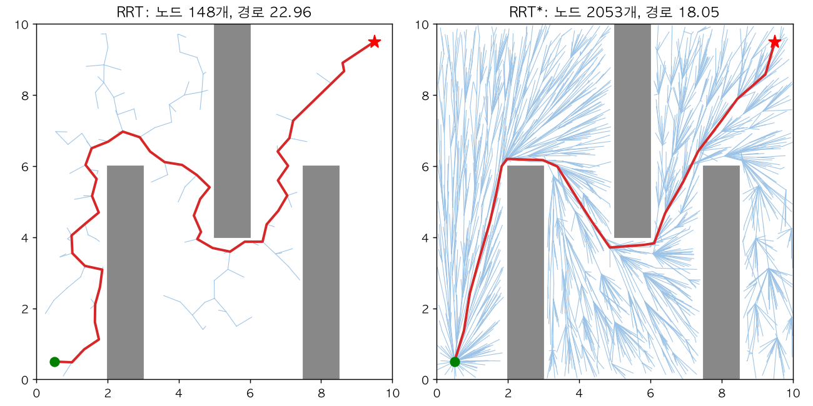
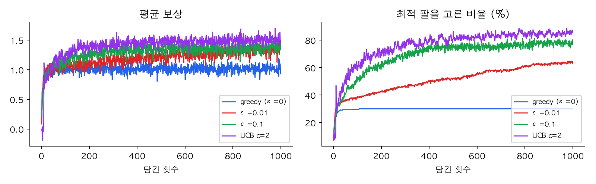
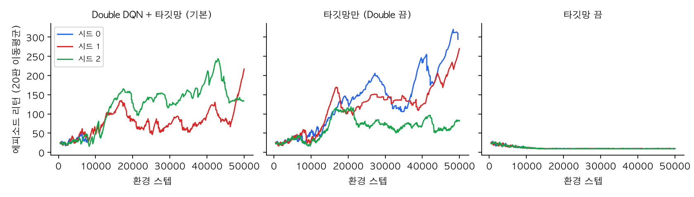
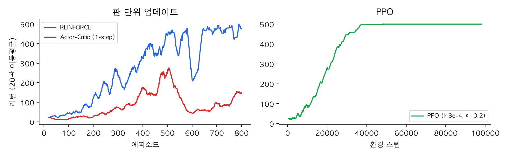
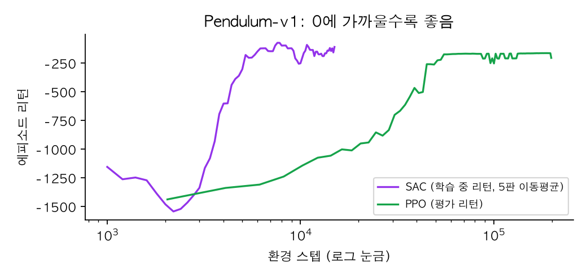

# 3교시 실습노트 (Physical AI 실습: 코드 + 줄별 설명)

> 강화학습 실습. 아래 코드는 모두 `code/` 폴더의 파일을 **첫 줄부터 마지막 줄까지 빠짐없이 그대로 가져온 것**이고(조각마다 파일 이름과 줄 번호 표시), 직접 실행해 결과를 확인했다(확인 환경: Python 3.12, torch 2.15.0, gymnasium 1.4.0, 맥 CPU).
> 실제 시험 문제·환경은 알려지지 않았다. "시험에서 이렇게 나올 수 있다"는 모두 **예상**이다.
> 〔핵심〕 = 시험 전 반드시 손으로 한 번 써 볼 것.

## 0. 실습 범위와 준비

### 0-1. 실습 범위
- 시뮬레이션 환경에서 보상 함수를 설계하며 정책 성능을 개선하는 실험, PyTorch 구현, RRT 등 경로 탐색, 보상 극대화와 학습 안정성 해석.

### 0-2. 시험장 환경은 모른다 → 이렇게 대비
- 실습 환경(인터넷·라이브러리·GPU)은 모른다고 가정한다.
- 그래서 목표 = **인터넷과 문서 없이 빈 파일에서 짤 수 있게**. 아래 16장 "빈 파일 뼈대"를 외운다.
- gymnasium이 없으면: 00의 `GridEnv`처럼 환경 클래스를 직접 만들면 된다(reset·step만 있으면 됨). 08·09는 numpy만 쓴다.
- 처음 30초에 확인할 것: `python -c "import torch, gymnasium; print(torch.__version__, gymnasium.__version__)"`

### 0-3. 파일 목록과 직접 돌려 본 결과
| 파일 | 내용 | 결과 (직접 실행) |
|---|---|---|
| `00_gym_basics.py` | gymnasium API, 내 환경 만들기, 보상 Wrapper | check_env 통과, 성형 보상 +0.097 / −0.102 |
| `01_q_learning_cliff.py` | 표 Q-learning vs SARSA | SARSA 안전한 길 / Q-learning 최단 길 (시드 10개 모두) |
| `02_dqn_cartpole.py` 〔핵심〕 | DQN + Double DQN | 평가 191.7 / 500 / 135.8 (시드 3개), 타깃망 끄면 모두 9.8 |
| `03_reinforce_cartpole.py` | REINFORCE | 800판 뒤 최근 50판 평균 460.8 |
| `04_actor_critic_cartpole.py` 〔핵심〕 | Actor-Critic (1-step TD) | 235 → 59 → 141 출렁임 |
| `05_ppo_discrete.py` 〔핵심〕 | PPO + GAE (이산) | 약 4만 스텝에 497, 약 5만 스텝부터 500 유지 |
| `06_ppo_continuous.py` | PPO (연속, 가우시안) | Pendulum −952 → −164 (18만 스텝) |
| `07_sac_pendulum.py` 〔핵심〕 | SAC (Q 두 개, α 자동) | 6천 스텝에 −227, 평가 −209.9 |
| `08_reward_shaping_grid.py` 〔핵심〕 | 보상 4종 비교 | 근처 보너스 → 5개 시드 모두 맴돎(해킹) |
| `09_rrt.py` 〔핵심〕 | RRT, RRT\* | RRT 길이 22.96 / RRT\* 18.05 |
| `common_drills.py` · `common_arima.py` · `common_torch_loop.py` | 1교시 주관식 코드 (1교시 노트 12장에 전부 실림) | `common_drills_check.py` 19개 항목 모두 통과 |
| `10_value_iteration.py` 〔핵심〕 | 가치 반복·정책 반복 (FrozenLake) | 두 방법 같은 답, 최적 정책 성공률 74.1% |
| `11_bandit.py` | greedy·ε-greedy·UCB 밴딧 | 최적 팔 비율 30.0%(greedy) / 78.0%(ε 0.1) / 85.0%(UCB) |
| `12_astar.py` | A\* vs Dijkstra 격자 탐색 | 둘 다 최단 19칸, 펼친 노드 44 vs 48 |
| `skeletons_check.py` | 16장 빈 파일 뼈대 검증 | DQN 뼈대 평가 337.6, 가치 반복·UCB·A\* 뼈대도 원본과 같은 답 |

### 0-4. 공부 순서
**먼저 `05_RL실험_상황별_대처표.md`(언제 무엇을 할지 판단 기준)를 외우고**, 그다음 아래 순서로 코드를 본다.

1장 문법표 → 05 PPO → 02 DQN → 07 SAC → 04 Actor-Critic → 08 보상 설계 → 09 RRT → 10 가치 반복 → 11 밴딧 → 12 A\* → 00·01·03·06 → 15장 곡선 해석 → 16장 뼈대 외우기

---

## 1. 꼭 아는 PyTorch·gymnasium 문법 〔핵심〕
| 코드 | 뜻 | 강화학습에서 쓰는 곳 |
|---|---|---|
| `obs, info = env.reset(seed=0)` | 판 시작. **두 개** 반환 | 매 판 시작 |
| `obs, r, terminated, truncated, info = env.step(a)` | 한 스텝. **다섯 개** 반환 | 매 스텝 |
| `terminated` / `truncated` | 진짜 끝(성공·실패) / 시간 제한으로 잘림 | 타깃에서 미래 가치를 0으로 할지 결정 |
| `env.action_space.n`, `env.action_space.shape[0]` | 이산 행동 수 / 연속 행동 차원 | 신경망 출력 크기 |
| `env.action_space.low/high` | 연속 행동 범위 | tanh 스케일, clip |
| `torch.as_tensor(x, dtype=torch.float32)` | numpy → 텐서 | 관측을 신경망에 넣을 때 |
| `with torch.no_grad():` | 기울기 계산 끔 | 행동 고르기, 타깃 계산 |
| `.detach()` | 이 값 뒤로는 기울기를 안 흘림 | 이점(advantage)·타깃을 상수로 |
| `q(s).gather(1, a.unsqueeze(1)).squeeze(1)` | 행마다 a번째 열만 뽑기 | DQN에서 Q(s, a) |
| `.max(1).values`, `.argmax(1)` | 행마다 최댓값 / 그 위치 | max Q, greedy 행동 |
| `Categorical(logits=z)` | 이산 확률 분포 (softmax 내장) | 이산 정책 |
| `Normal(mu, std)` | 가우시안 분포 | 연속 정책 |
| `dist.sample()` / `dist.rsample()` | 뽑기(기울기 없음) / 재매개변수화 뽑기(기울기 있음) | PPO는 sample, **SAC는 rsample** |
| `dist.log_prob(a)`, `dist.entropy()` | log π(a\|s), 엔트로피 | 정책 손실, 탐험 보너스 |
| `.sum(-1)` | 마지막 차원 합 | 연속 행동은 차원별 log_prob를 **합산** |
| `target.load_state_dict(net.state_dict())` | 가중치 통째로 복사 | 타깃망 hard update |
| `pt.mul_(1 - tau).add_(tau * p)` | θ′ ← (1−τ)θ′ + τθ | 타깃망 soft(Polyak) update |
| `opt.zero_grad(); loss.backward(); opt.step()` | 기울기 초기화 → 역전파 → 업데이트 | 모든 학습 |
| `nn.utils.clip_grad_norm_(params, 0.5)` | 기울기 크기 제한 | 학습 폭주 방지 |
| `F.mse_loss`, `F.smooth_l1_loss` | 제곱 오차 / Huber 손실 | 가치·Q 학습 |

---

## 2. `00_gym_basics.py` — 환경 다루기와 보상 Wrapper 〔핵심〕
**시험에서 이렇게 나올 수 있다**: "주어진 시뮬레이션 환경을 무작위 정책으로 돌려 보라", "환경 클래스를 완성하라", "보상 함수를 바꾸는 Wrapper를 작성하라".

### 2-0. 첫머리 (파일 설명·불러오기)

▸ `00_gym_basics.py` 1–7줄
```python
"""00. gymnasium 기본 API + 내 환경 만들기 + 보상 Wrapper
실행: python 00_gym_basics.py
"""
import numpy as np
import gymnasium as gym
from gymnasium import spaces
from gymnasium.utils.env_checker import check_env
```
- `"""…"""`: 파일 설명(독스트링). 답안에는 없어도 된다.
- `import numpy as np`: 배열 계산. `import gymnasium as gym`: 강화학습 환경 표준 라이브러리(예전 이름 gym).
- `from gymnasium import spaces`: 관측·행동 공간 정의용(`Box` = 연속 값, `Discrete` = 정수 몇 개 중 하나).
- `check_env`: 내가 만든 환경이 규칙을 지키는지 검사하는 함수.

### 2-1. 이미 있는 환경 한 판 돌리기

▸ `00_gym_basics.py` 9–23줄
```python
# ── 1) 이미 있는 환경을 무작위 행동으로 한 판 돌리기 ──────────────────
env = gym.make("CartPole-v1")
print("관측 공간:", env.observation_space)       # Box(4,) : 카트 위치·속도, 막대 각도·각속도
print("행동 공간:", env.action_space)            # Discrete(2) : 0=왼쪽, 1=오른쪽
obs, info = env.reset(seed=0)                    # reset은 (관측, 정보) 두 개를 돌려줌
total, steps = 0.0, 0
while True:
    action = env.action_space.sample()           # 무작위 행동
    obs, reward, terminated, truncated, info = env.step(action)   # step은 5개를 돌려줌
    total += reward
    steps += 1
    if terminated or truncated:                  # terminated=실패/성공으로 끝, truncated=시간 제한으로 잘림
        break
print(f"무작위 정책: {steps}스텝, 보상 합 {total}")
env.close()
```
- `gym.make("CartPole-v1")`: 환경 만들기. CartPole = 카트를 좌우로 밀어 막대를 세우는 과제. 매 스텝 +1, 막대가 쓰러지거나 카트가 벗어나면 끝, 최대 500스텝.
- `observation_space` = Box(4,): 연속 값 4개(카트 위치·속도, 막대 각도·각속도). `action_space` = Discrete(2).
- `env.reset(seed=0)`: **관측과 정보(info) 두 개**를 준다. seed로 재현성 확보.
- `env.step(action)`: **다섯 개**를 준다. 옛 gym(0.25 이전)은 4개(`done` 하나)였다 → 시험 환경이 옛 버전이면 `obs, r, done, info = env.step(a)`.
- `terminated or truncated`일 때 판을 끝낸다. 결과: 무작위 정책은 19스텝(보상 19)에서 쓰러짐.

### 2-2. 내 환경을 gym.Env 규칙대로 만들기

▸ `00_gym_basics.py` 26–54줄
```python
# ── 2) 내 환경을 gym.Env 규칙대로 만들기 ─────────────────────────────
class GridEnv(gym.Env):
    """n×n 격자. (0,0)에서 출발해 (n-1,n-1)에 도착하면 성공."""

    def __init__(self, n=5, max_steps=50):
        super().__init__()
        self.n, self.max_steps = n, max_steps
        self.observation_space = spaces.Box(0, n - 1, shape=(2,), dtype=np.float32)
        self.action_space = spaces.Discrete(4)
        self.moves = np.array([[-1, 0], [1, 0], [0, -1], [0, 1]])   # 위·아래·왼·오
        self.goal = np.array([n - 1, n - 1])

    def reset(self, seed=None, options=None):
        super().reset(seed=seed)                  # self.np_random 시드 설정
        self.pos = np.array([0, 0])
        self.t = 0
        return self.pos.astype(np.float32), {}

    def step(self, action):
        self.pos = np.clip(self.pos + self.moves[action], 0, self.n - 1)   # 벽 밖으로 못 나감
        self.t += 1
        terminated = bool((self.pos == self.goal).all())                  # 목표 도착 = 진짜 끝
        truncated = self.t >= self.max_steps                               # 시간 초과 = 잘림
        reward = 1.0 if terminated else -0.01                              # 도착 +1, 매 스텝 −0.01
        return self.pos.astype(np.float32), reward, terminated, truncated, {}


check_env(GridEnv())                              # 규칙(반환 형식·공간)을 지켰는지 자동 검사
print("GridEnv check_env 통과")
```
- `observation_space`, `action_space`를 **반드시** 정의한다(학습 코드가 신경망 입력·출력 크기를 여기서 읽음).
- `reset`: `super().reset(seed=seed)`로 내부 난수(`self.np_random`)를 시드에 맞춘 뒤, 시작 상태와 빈 info를 반환.
- `step`: ① 상태 변화(벽 밖으로 못 나가게 `np.clip`) ② **terminated**(목표 도착 = 진짜 끝) ③ **truncated**(시간 초과) ④ **보상**(도착 +1, 매 스텝 −0.01 → 빨리 가도록) ⑤ 다섯 개 반환.
- 관측을 `float32`로 맞추는 이유: `Box(..., dtype=np.float32)`와 dtype이 다르면 `check_env`가 경고·오류를 낸다.
- `check_env`: 반환 형식·공간 정의가 규칙에 맞는지 자동 검사. 시험에서 환경을 직접 만들면 꼭 돌려 볼 것.

### 2-3. Wrapper로 보상만 바꾸기 (잠재 기반 성형)

▸ `00_gym_basics.py` 57–92줄
```python
# ── 3) Wrapper로 보상만 바꾸기 (환경 코드는 그대로) ──────────────────
class DistanceShaping(gym.Wrapper):
    """잠재 기반 보상 설계: r' = r + γΦ(s') − Φ(s),  Φ(s) = −(목표까지 맨해튼 거리)"""

    def __init__(self, env, gamma=0.99, scale=0.1):
        super().__init__(env)
        self.gamma, self.scale = gamma, scale

    def phi(self, obs):
        return -self.scale * np.abs(obs - self.env.unwrapped.goal).sum()

    def reset(self, **kwargs):
        obs, info = self.env.reset(**kwargs)
        self.last_phi = self.phi(obs)
        return obs, info

    def step(self, action):
        obs, r, terminated, truncated, info = self.env.step(action)
        phi_next = 0.0 if terminated else self.phi(obs)      # 끝난 상태의 Φ는 0
        shaped = r + self.gamma * phi_next - self.last_phi
        self.last_phi = phi_next
        info["original_reward"] = r                           # 원래 보상은 따로 기록 (평가용)
        return obs, shaped, terminated, truncated, info


env = DistanceShaping(GridEnv())
obs, _ = env.reset(seed=0)
obs, r, term, trunc, info = env.step(3)                       # 오른쪽 = 목표 쪽으로 한 칸
print(f"목표 쪽으로 한 칸: 설계 보상 {r:+.3f} (원래 {info['original_reward']:+.2f})")
obs, r, term, trunc, info = env.step(2)                       # 왼쪽 = 목표 반대
print(f"반대로 한 칸:     설계 보상 {r:+.3f} (원래 {info['original_reward']:+.2f})")

# 상태가 필요 없는 보상 변환은 RewardWrapper가 더 간단
class ScaleReward(gym.RewardWrapper):
    def reward(self, reward):
        return 0.1 * reward
```
- **Wrapper**: 원래 환경 코드를 건드리지 않고 겉을 감싸 동작을 바꾼다. 보상 설계 실험에 가장 깔끔한 방법.
- `phi(obs)` = −0.1 × (목표까지 맨해튼 거리). 목표에 가까울수록 Φ가 크다(0에 가까움).
- `step`에서 `shaped = r + γ·Φ(s′) − Φ(s)`: **잠재 기반 성형 공식** 그대로. 끝난 상태(terminated)는 Φ = 0으로 둔다(최적 정책 불변 조건).
- `self.last_phi`: 이전 상태의 Φ를 기억해 두는 변수. reset에서 초기화하는 걸 잊으면 첫 스텝 보상이 틀린다.
- `info["original_reward"]`: 원래 보상을 따로 남겨 **평가는 원래 목표로** 한다(설계 보상으로 평가하면 해킹을 못 잡음).
- 결과: 목표 쪽으로 한 칸 → +0.097, 반대로 한 칸 → −0.102 (원래 보상은 둘 다 −0.01).
- `gym.RewardWrapper`는 `reward(self, reward)`만 바꾸면 되지만 **상태를 못 본다** → 거리처럼 상태가 필요한 보상은 `gym.Wrapper`의 `step`을 고쳐야 한다.

---

## 3. `01_q_learning_cliff.py` — 표 Q-learning vs SARSA
**시험에서 이렇게 나올 수 있다**: "Q-learning 업데이트 한 줄을 채워라", "SARSA로 바꿔라", "ε-greedy 함수를 작성하라", "두 방법이 다른 경로를 배우는 이유를 설명하라".

### 3-0. 첫머리

▸ `01_q_learning_cliff.py` 1–5줄
```python
"""01. 표 형태 Q-learning vs SARSA (CliffWalking, Sutton & Barto 예제 6.6)
실행: python 01_q_learning_cliff.py
"""
import numpy as np
import gymnasium as gym
```
- 표 형태라 신경망이 필요 없다 → numpy와 gymnasium만.

### 3-1. ε-greedy

▸ `01_q_learning_cliff.py` 8–12줄
```python
def eps_greedy(Q, s, eps, rng):
    """확률 eps로 무작위 행동(탐험), 나머지는 Q가 가장 큰 행동(활용)."""
    if rng.random() < eps:
        return int(rng.integers(Q.shape[1]))
    return int(np.argmax(Q[s]))
```
- 확률 ε로 무작위 행동(탐험), 나머지는 Q가 가장 큰 행동(활용).
- `rng = np.random.default_rng(seed)`로 만든 난수를 넘겨받아 재현 가능하게.

### 3-2. 학습 루프 (두 방법의 차이는 타깃 한 줄)

▸ `01_q_learning_cliff.py` 15–36줄
```python
def train(method, episodes=1000, alpha=0.1, gamma=1.0, eps=0.1, seed=0):
    env = gym.make("CliffWalking-v1")            # 4×12 격자, 매 스텝 −1, 절벽 −100(출발점으로)
    rng = np.random.default_rng(seed)
    Q = np.zeros((env.observation_space.n, env.action_space.n))   # 상태 48 × 행동 4
    returns = []
    for ep in range(episodes):
        s, _ = env.reset(seed=seed + ep)
        a = eps_greedy(Q, s, eps, rng)
        G, done = 0.0, False
        while not done:
            s2, r, terminated, truncated, _ = env.step(a)
            G += r
            done = terminated or truncated
            a2 = eps_greedy(Q, s2, eps, rng)       # 다음에 실제로 할 행동
            if method == "sarsa":                  # on-policy: 실제로 할 행동 a2의 Q
                target = r + gamma * Q[s2, a2] * (not terminated)
            else:                                  # Q-learning, off-policy: 가장 좋은 행동의 Q
                target = r + gamma * np.max(Q[s2]) * (not terminated)
            Q[s, a] += alpha * (target - Q[s, a])  # TD 오차만큼 조금 이동
            s, a = s2, a2
        returns.append(G)
    return Q, np.array(returns)
```
- `CliffWalking-v1`: 4×12 격자, 매 스텝 −1, 절벽에 빠지면 −100 받고 출발점으로(판은 계속). 상태 48개, 행동 4개(위·오른쪽·아래·왼쪽).
- `Q = np.zeros((48, 4))`: 상태 × 행동 표.
- **SARSA 타깃**: `r + γ·Q[s2, a2]` — 다음에 **실제로 할 행동 a2**(ε-greedy로 뽑음)의 Q. 그래서 on-policy.
- **Q-learning 타깃**: `r + γ·max Q[s2]` — **가장 좋은 행동**의 Q. 실제 행동과 상관없음 → off-policy.
- `* (not terminated)`: 목표에 도착해 끝났으면 미래 가치 0.
- `Q[s, a] += alpha * (target − Q[s, a])`: TD 오차의 α만큼만 이동.
- `s, a = s2, a2`: SARSA는 뽑아 둔 a2를 다음 스텝에 **그대로 실행**해야 한다(다시 뽑으면 SARSA가 아님).
- γ = 1: 끝이 있는 과제라 할인 없이 써도 됨(Sutton & Barto 예제와 같음). α = 0.1, 1000판: α = 0.5로 했을 때는 잘 안 가 보는 모서리 칸의 Q가 덜 배워져 greedy 경로가 벽에 막히는 시드가 있었다 → α를 낮추고 판을 늘림.

### 3-3. 학습된 Q로 경로 그리기·실행부

▸ `01_q_learning_cliff.py` 39–61줄
```python
def greedy_path(Q):
    """학습된 Q로 탐험 없이 갔을 때의 길을 격자에 그림."""
    env = gym.make("CliffWalking-v1")
    s, _ = env.reset(seed=0)
    grid = [["." for _ in range(12)] for _ in range(4)]
    for c in range(1, 11):
        grid[3][c] = "C"                           # 절벽
    for _ in range(100):
        r_, c_ = divmod(s, 12)
        grid[r_][c_] = "*"
        s, _, term, trunc, _ = env.step(int(np.argmax(Q[s])))
        if term or trunc:
            break
    grid[3][11] = "G"
    return "\n".join("".join(row) for row in grid)


if __name__ == "__main__":
    for m in ["sarsa", "qlearning"]:
        Q, R = train(m)
        np.savetxt(f"results/cliff_{m}.txt", R)
        print(f"[{m}] 마지막 100판 평균 보상(탐험 포함): {R[-100:].mean():.1f}")
        print(greedy_path(Q), "\n")
```
- `greedy_path`: 탐험 없이 `argmax Q`로만 움직이며 지나간 칸을 `*`로 표시. 상태 번호 s → (행, 열) = `divmod(s, 12)`(한 줄에 12칸).
- 맨 아래 줄 1~10열이 절벽(`C`), (3, 11)이 목표(`G`).
- `range(100)`: Q가 덜 배워져 벽에 계속 부딪히면 영원히 안 끝나므로 최대 100스텝(α = 0.5일 때 실제로 이런 시드가 있었다).
- `if __name__ == "__main__":` 이 파일을 직접 실행할 때만 도는 부분. 두 방법을 학습하고 판별 보상을 `results/`에 저장, 평균 보상과 경로를 출력.

### 3-4. 결과
```text
[sarsa] 마지막 100판 평균 보상(탐험 포함): −21.8 (시드 10개 평균)
............
************        ← 절벽에서 한 줄 떨어진 안전한 길 (15칸)
*..........*
*CCCCCCCCCCG

[qlearning] 마지막 100판 평균 보상(탐험 포함): −50.5
............
............
************        ← 절벽 바로 옆 최단 길 (13칸)
*CCCCCCCCCCG
```
- **해석**: Q-learning은 "탐험 안 할 때의 최적"을 배워 최단 경로를 고르지만, 학습 중에는 ε = 0.1로 무작위 행동을 하다 절벽에 자주 떨어져 **실제 받은 보상은 더 나쁘다**. SARSA는 "내가 가끔 실수한다"는 것까지 Q에 반영해 안전한 길을 고른다.

---

## 4. `02_dqn_cartpole.py` — DQN 〔핵심〕
**시험에서 이렇게 나올 수 있다**: "리플레이 버퍼를 구현하라", "타깃 y를 계산하라", "타깃망 업데이트를 넣어라", "Double DQN으로 바꿔라", "학습이 불안정한 이유를 설명하라".

### 4-0. 첫머리 (불러오기)

▸ `02_dqn_cartpole.py` 1–11줄
```python
"""02. DQN (+ Double DQN) — CartPole-v1
핵심 3가지: ① Q 신경망  ② 경험 재생 버퍼  ③ 타깃 네트워크
실행: python 02_dqn_cartpole.py            (Double DQN 끄기: --no-double, 타깃망 끄기: --no-target)
"""
import argparse
import random
import numpy as np
import torch
import torch.nn as nn
import torch.nn.functional as F
import gymnasium as gym
```
- `argparse`: 명령줄 인자(`--steps 80000`, `--no-target` 등)로 실험 조건을 바꾸려고.
- `random`: ε-greedy 탐험 난수. `numpy`: 버퍼 배열. `torch.nn`: 신경망 층, `torch.nn.functional as F`: 손실 함수(`F.smooth_l1_loss`).

### 4-1. 인자와 하이퍼파라미터

▸ `02_dqn_cartpole.py` 13–29줄
```python
p = argparse.ArgumentParser()
p.add_argument("--steps", type=int, default=50_000)
p.add_argument("--no-double", action="store_true")
p.add_argument("--no-target", action="store_true")
p.add_argument("--seed", type=int, default=0)
p.add_argument("--lr", type=float, default=1e-3)
p.add_argument("--target-every", type=int, default=500)
args = p.parse_args()

# ── 하이퍼파라미터 ──
GAMMA, LR, BATCH = 0.99, args.lr, 128
BUFFER, LEARN_START, TARGET_EVERY = 50_000, 1_000, args.target_every
EPS_START, EPS_END, EPS_DECAY_STEPS = 1.0, 0.05, 15_000

random.seed(args.seed); np.random.seed(args.seed); torch.manual_seed(args.seed)
env = gym.make("CartPole-v1")
obs_dim, n_act = env.observation_space.shape[0], env.action_space.n
```
- `GAMMA 0.99`: 약 100스텝 앞까지 본다(1/(1−γ)).
- `LR 1e-3`, `BATCH 128`: 시드 하나로 한 번씩 비교해 봤을 때 2.5e-4·5e-4보다 1e-3이 나았다(설정마다 결과 차이가 컸음).
- `BUFFER 50,000`: 버퍼 크기. `LEARN_START 1,000`: 처음 1000스텝은 쌓기만 하고 학습 안 함(데이터가 너무 적으면 같은 샘플만 반복).
- `TARGET_EVERY 500`: 500스텝마다 타깃망 복사.
- ε: 1.0 → 0.05로 15,000스텝 동안 **선형 감소**.
- 시드 세 군데(`random`, `numpy`, `torch`)를 모두 고정해야 재현된다.

### 4-2. Q 신경망

▸ `02_dqn_cartpole.py` 32–42줄
```python
class QNet(nn.Module):
    """상태 → 행동마다 Q값 하나씩 (출력 개수 = 행동 개수)"""
    def __init__(self, obs_dim, n_act, hidden=128):
        super().__init__()
        self.net = nn.Sequential(
            nn.Linear(obs_dim, hidden), nn.ReLU(),
            nn.Linear(hidden, hidden), nn.ReLU(),
            nn.Linear(hidden, n_act))

    def forward(self, x):
        return self.net(x)
```
- 입력 = 상태(4), 출력 = **행동 수만큼의 Q값**(2). 한 번 계산으로 모든 행동의 Q를 얻으니 max·argmax가 쉽다.
- 출력층에 활성화 없음: Q값은 음수·큰 수 모두 가능.

### 4-3. 리플레이 버퍼 〔핵심〕

▸ `02_dqn_cartpole.py` 45–63줄
```python
class ReplayBuffer:
    """(s, a, r, s', done)을 원형 배열에 저장하고 무작위로 꺼냄"""
    def __init__(self, cap, obs_dim):
        self.s = np.zeros((cap, obs_dim), np.float32)
        self.a = np.zeros(cap, np.int64)
        self.r = np.zeros(cap, np.float32)
        self.s2 = np.zeros((cap, obs_dim), np.float32)
        self.d = np.zeros(cap, np.float32)
        self.cap, self.i, self.size = cap, 0, 0

    def add(self, s, a, r, s2, d):
        self.s[self.i], self.a[self.i], self.r[self.i], self.s2[self.i], self.d[self.i] = s, a, r, s2, d
        self.i = (self.i + 1) % self.cap               # 다 차면 가장 오래된 것부터 덮어씀
        self.size = min(self.size + 1, self.cap)

    def sample(self, n):
        idx = np.random.randint(0, self.size, n)
        return (torch.as_tensor(self.s[idx]), torch.as_tensor(self.a[idx]), torch.as_tensor(self.r[idx]),
                torch.as_tensor(self.s2[idx]), torch.as_tensor(self.d[idx]))
```
- 미리 크기 `cap`인 numpy 배열 5개를 만들어 둔다(리스트에 append보다 빠르고 메모리 일정).
- `add`: `self.i` 위치에 쓰고 `(i + 1) % cap`으로 이동 → **원형 버퍼**: 다 차면 가장 오래된 것부터 덮어씀.
- `self.size`: 지금까지 찬 개수. 샘플링은 `0 ~ size−1`에서만.
- `sample`: **무작위 인덱스**로 뽑음 → 연속 스텝 사이 상관을 끊는 것이 버퍼의 핵심 목적.
- `collections.deque(maxlen=N)` + `random.sample`로 짜도 된다(빈 파일에서 빠르게 쓰기엔 그게 더 짧음, 16장).

### 4-4. 네트워크·옵티마이저 준비

▸ `02_dqn_cartpole.py` 66–70줄
```python
q = QNet(obs_dim, n_act)
q_target = QNet(obs_dim, n_act)
q_target.load_state_dict(q.state_dict())                # 처음엔 똑같이 복사
opt = torch.optim.Adam(q.parameters(), lr=LR)
buf = ReplayBuffer(BUFFER, obs_dim)
```
- 타깃망은 **같은 구조**로 만들고 `load_state_dict`로 가중치를 똑같이 복사해서 시작.
- 옵티마이저에는 **온라인망 `q`의 파라미터만** 넣는다. 타깃망은 학습하지 않고 복사로만 바뀐다.

### 4-5. 행동 선택과 저장

▸ `02_dqn_cartpole.py` 72–91줄
```python
obs, _ = env.reset(seed=args.seed)
ep_ret, ep_returns, log = 0.0, [], []
for step in range(1, args.steps + 1):
    # ① ε-greedy 행동 선택 (ε는 선형으로 줄임)
    eps = max(EPS_END, EPS_START - (EPS_START - EPS_END) * step / EPS_DECAY_STEPS)
    if random.random() < eps:
        action = random.randrange(n_act)            # 시드 고정된 난수로 (재현 가능)
    else:
        with torch.no_grad():
            action = int(q(torch.as_tensor(obs)).argmax())

    # ② 환경 한 스텝 + 버퍼 저장
    next_obs, r, terminated, truncated, _ = env.step(action)
    buf.add(obs, action, r, next_obs, float(terminated))   # 시간 잘림(truncated)은 끝이 아님 → 0으로 저장
    obs, ep_ret = next_obs, ep_ret + r
    if terminated or truncated:
        ep_returns.append(ep_ret)
        log.append((step, ep_ret))
        obs, _ = env.reset()
        ep_ret = 0.0
```
- ε 식: `max(끝값, 시작값 − (시작−끝) × step/감소스텝)` → 선형으로 줄다가 0.05에서 멈춤.
- greedy 행동은 `torch.no_grad()` 안에서: 행동 고를 때는 기울기가 필요 없다.
- `random.randrange(n_act)`: 처음에 `env.action_space.sample()`을 썼더니 이 난수는 시드가 안 걸려서 **같은 시드인데 결과가 달랐다**(459점 vs 338점). 시드 고정된 `random`으로 바꿔 재현성 확보(같은 설정 두 번 → 98.9점 두 번).
- `buf.add(..., float(terminated))`: **terminated만** done으로 저장. CartPole은 500스텝에서 truncated로 잘리는데, 그건 실패가 아니라서 미래 가치를 0으로 하면 안 된다.

### 4-6. 학습 한 스텝 · 타깃망 복사 · 기록 〔핵심〕

▸ `02_dqn_cartpole.py` 93–120줄
```python
    # ③ 학습: 버퍼에서 무작위 배치
    if step >= LEARN_START:
        s, a, r_b, s2, d = buf.sample(BATCH)
        q_sa = q(s).gather(1, a.unsqueeze(1)).squeeze(1)          # 내가 한 행동의 Q(s,a)
        with torch.no_grad():
            tnet = q if args.no_target else q_target
            if args.no_double:
                next_q = tnet(s2).max(1).values                      # DQN: 타깃망이 고르고 평가
            else:
                a2 = q(s2).argmax(1, keepdim=True)                   # Double: 온라인망이 고르고
                next_q = tnet(s2).gather(1, a2).squeeze(1)           #         타깃망이 평가
            y = r_b + GAMMA * (1 - d) * next_q                        # 끝난 상태면 미래 가치 0
        loss = F.smooth_l1_loss(q_sa, y)                              # Huber 손실
        opt.zero_grad()
        loss.backward()
        nn.utils.clip_grad_norm_(q.parameters(), 10.0)
        opt.step()

    # ④ 타깃망 주기적 복사 (hard update)
    if not args.no_target and step % TARGET_EVERY == 0:
        q_target.load_state_dict(q.state_dict())

    if step % 5000 == 0:
        recent = np.mean(ep_returns[-20:]) if ep_returns else 0
        print(f"step {step:6d} | 최근 20판 평균 {recent:6.1f} | ε {eps:.2f}")

tag = "dqn" + ("_nodouble" if args.no_double else "") + ("_notarget" if args.no_target else "") + f"_s{args.seed}"
np.savetxt(f"results/{tag}.txt", np.array(log))
```
- `q(s).gather(1, a.unsqueeze(1)).squeeze(1)`: Q(s, ·) 표(배치×2)에서 **실제로 한 행동 a의 열만** 뽑음. `a.unsqueeze(1)`로 (배치,) → (배치, 1) 모양을 맞추는 게 포인트.
- 타깃 계산은 `torch.no_grad()`: 타깃은 정답 역할이라 기울기를 흘리지 않는다.
- **일반 DQN**: `tnet(s2).max(1).values` — 타깃망이 고르고 평가.
- **Double DQN**: `a2 = q(s2).argmax(...)`(온라인망이 고르기) → `tnet(s2).gather(1, a2)`(타깃망이 평가). 고르는 망과 평가하는 망을 나눠 **과대평가를 줄임**.
- `y = r + γ(1 − d)·next_q`: d = 1(진짜 끝)이면 미래 가치 0.
- `F.smooth_l1_loss`: Huber 손실. 오차가 1보다 크면 선형이라 큰 오차 하나에 기울기가 폭발하지 않음.
- `clip_grad_norm_(…, 10.0)`: 기울기 크기 상한.
- 타깃망 복사: `step % 500 == 0`마다 통째로(hard update). SAC처럼 매 스텝 조금씩(soft) 해도 된다.
- `step % 5000 == 0`: 5000스텝마다 최근 20판 평균과 ε를 출력(학습이 되고 있는지 확인용).
- `tag`, `np.savetxt`: 설정 이름(예: `dqn_notarget_s0`)으로 (스텝, 판 리턴) 기록을 저장 → 15장 학습 곡선 그림에 사용.

### 4-7. 평가 (탐험 없이)

▸ `02_dqn_cartpole.py` 122–134줄
```python
# ⑤ 평가: 탐험 없이(greedy) 10판
eval_env = gym.make("CartPole-v1")
scores = []
for i in range(10):
    o, _ = eval_env.reset(seed=1000 + i)
    done, total = False, 0.0
    while not done:
        with torch.no_grad():
            o, r, te, tr, _ = eval_env.step(int(q(torch.as_tensor(o)).argmax()))
        total += r
        done = te or tr
    scores.append(total)
print(f"평가(탐험 없음) 10판 평균: {np.mean(scores):.1f} (최대 500)")
```
- 평가 때는 ε 없이 argmax만. 학습용 환경과 **다른 환경 객체·다른 시드**로 평가.

### 4-8. 결과와 해석
- 타깃망 있음(기본, Double DQN): 평가 191.7 / 500 / 135.8 (시드 0, 1, 2).
- **타깃망 끔: 세 시드 모두 9.8** → 무작위(약 20)보다도 못한 정책으로 붕괴. 타깃이 매 스텝 같이 움직여 "자기 꼬리 쫓기"가 되면서 발산한 것(15장 그림).
- Double 끔(타깃망만): 500 / 238.9 / 83.3. 이 실험(시드 3개, 5만 스텝)에서는 Double DQN의 이점이 뚜렷이 보이지 않았다 → **시드 3개로는 결론 내리기 어렵다**는 것도 해석 포인트.
- DQN은 **같은 설정에서도 시드마다 점수가 크게 다르다**. 그래서 결과는 여러 시드의 평균 ± 표준편차로 말해야 한다.

---

## 5. `03_reinforce_cartpole.py` — REINFORCE (정책 경사의 기본)
**시험에서 이렇게 나올 수 있다**: "할인 리턴 G_t를 계산하는 코드를 작성하라", "정책 경사 손실을 작성하라", "기준선의 역할을 설명하라".

### 5-1. 첫머리

▸ `03_reinforce_cartpole.py` 1–9줄
```python
"""03. REINFORCE (몬테카를로 정책 경사) — CartPole-v1
한 판을 끝까지 해 본 뒤, 잘 된 행동의 확률은 올리고 못 된 행동의 확률은 내린다.
실행: python 03_reinforce_cartpole.py
"""
import numpy as np
import torch
import torch.nn as nn
import gymnasium as gym
from torch.distributions import Categorical
```
- `from torch.distributions import Categorical`: 이산 확률 분포(행동 뽑기·log 확률 계산).

### 5-2. 학습 루프

▸ `03_reinforce_cartpole.py` 11–47줄
```python
GAMMA, LR, EPISODES, SEED = 0.99, 1e-3, 800, 0
torch.manual_seed(SEED)
env = gym.make("CartPole-v1")
policy = nn.Sequential(nn.Linear(4, 128), nn.ReLU(), nn.Linear(128, 2))   # 출력 = 행동별 logit
opt = torch.optim.Adam(policy.parameters(), lr=LR)

returns_log = []
for ep in range(EPISODES):
    obs, _ = env.reset(seed=SEED + ep)
    log_probs, rewards = [], []
    while True:
        dist = Categorical(logits=policy(torch.as_tensor(obs)))   # logit → 확률 분포
        a = dist.sample()                                         # 확률대로 행동 뽑기 (탐험이 저절로 됨)
        log_probs.append(dist.log_prob(a))                        # log π(a|s) 저장 (기울기 연결됨)
        obs, r, terminated, truncated, _ = env.step(a.item())
        rewards.append(r)
        if terminated or truncated:
            break

    # 뒤에서부터 할인 누적 보상 G_t = r_t + γ G_(t+1)
    G, Gs = 0.0, []
    for r in reversed(rewards):
        G = r + GAMMA * G
        Gs.insert(0, G)
    Gs = torch.tensor(Gs)
    Gs = (Gs - Gs.mean()) / (Gs.std() + 1e-8)      # 정규화 = 기준선(baseline) 역할 → 분산 감소

    loss = -(torch.stack(log_probs) * Gs).sum()     # 경사 "상승"을 위해 음수를 붙여 최소화
    opt.zero_grad()
    loss.backward()
    opt.step()

    returns_log.append(sum(rewards))
    if (ep + 1) % 100 == 0:
        print(f"episode {ep + 1:4d} | 최근 50판 평균 {np.mean(returns_log[-50:]):6.1f}")

np.savetxt("results/reinforce.txt", np.array(returns_log))
```
- 정책망 출력 = **logit**(softmax 전 점수). `Categorical(logits=…)`이 softmax를 대신 해 준다.
- `dist.sample()`: 확률대로 뽑으니 **탐험이 저절로** 된다(ε 필요 없음).
- `log_probs`에 `dist.log_prob(a)`를 **기울기가 연결된 채로** 모은다(판이 끝난 뒤 한꺼번에 역전파).
- 할인 리턴: **뒤에서부터** `G = r + γG`. 앞에서부터 계산하면 O(T²)이고 틀리기 쉽다.
- `(Gs − 평균) / 표준편차`: 리턴 정규화. 평균을 빼는 것이 **기준선(baseline)** 역할 → 평균보다 나은 행동만 확률이 오르고, 분산이 준다.
- `loss = −Σ log π(a|s)·G`: 우리는 J를 **최대화**하고 싶은데 옵티마이저는 **최소화**하므로 음수.
- `returns_log`: 판마다 원래 보상 합(정규화 전)을 기록, 100판마다 최근 50판 평균 출력, 끝나면 `results/reinforce.txt`로 저장.
- 결과: 800판 뒤 최근 50판 평균 460.8. 다만 한 판 전체의 무작위 결과(G)를 쓰니 곡선이 출렁인다(15장 그림).

---

## 6. `04_actor_critic_cartpole.py` — Actor-Critic 〔핵심〕
**시험에서 이렇게 나올 수 있다**: "TD 타깃과 이점(δ)을 계산하라", "Actor 손실과 Critic 손실을 각각 작성하라", "왜 advantage에 detach를 하나".

### 6-1. 첫머리

▸ `04_actor_critic_cartpole.py` 1–10줄
```python
"""04. Actor-Critic (1-step TD 이점) — CartPole-v1
Actor = 정책 π(a|s), Critic = 상태 가치 V(s).  이점 A ≈ δ = r + γV(s') − V(s)
실행: python 04_actor_critic_cartpole.py
"""
import numpy as np
import torch
import torch.nn as nn
import torch.nn.functional as F
import gymnasium as gym
from torch.distributions import Categorical
```
- REINFORCE와 같은 불러오기 + `F`(MSE 손실).

### 6-2. 학습 루프

▸ `04_actor_critic_cartpole.py` 12–51줄
```python
GAMMA, LR_A, LR_C, EPISODES, SEED = 0.99, 1e-3, 5e-3, 800, 0
torch.manual_seed(SEED)
env = gym.make("CartPole-v1")
actor = nn.Sequential(nn.Linear(4, 128), nn.ReLU(), nn.Linear(128, 2))
critic = nn.Sequential(nn.Linear(4, 128), nn.ReLU(), nn.Linear(128, 1))
opt_a = torch.optim.Adam(actor.parameters(), lr=LR_A)
opt_c = torch.optim.Adam(critic.parameters(), lr=LR_C)

returns_log = []
for ep in range(EPISODES):
    obs, _ = env.reset(seed=SEED + ep)
    S, A, R, S2, T = [], [], [], [], []
    while True:
        with torch.no_grad():
            a = Categorical(logits=actor(torch.as_tensor(obs))).sample().item()
        obs2, r, terminated, truncated, _ = env.step(a)
        S.append(obs); A.append(a); R.append(r); S2.append(obs2); T.append(float(terminated))
        obs = obs2
        if terminated or truncated:
            break

    S, S2 = torch.as_tensor(np.array(S)), torch.as_tensor(np.array(S2))
    A, R, T = torch.as_tensor(A), torch.as_tensor(R, dtype=torch.float32), torch.as_tensor(T)

    v = critic(S).squeeze(1)                                   # V(s)
    with torch.no_grad():
        target = R + GAMMA * critic(S2).squeeze(1) * (1 - T)   # TD 타깃 (끝난 상태면 미래 0)
    critic_loss = F.mse_loss(v, target)                        # Critic: V(s)를 타깃에 맞춤
    advantage = (target - v).detach()                          # δ = 이점 추정 (Actor 쪽엔 상수로)
    log_prob = Categorical(logits=actor(S)).log_prob(A)
    actor_loss = -(log_prob * advantage).mean()                # 이점이 +면 그 행동 확률↑

    opt_c.zero_grad(); critic_loss.backward(); opt_c.step()
    opt_a.zero_grad(); actor_loss.backward(); opt_a.step()

    returns_log.append(R.sum().item())
    if (ep + 1) % 100 == 0:
        print(f"episode {ep + 1:4d} | 최근 50판 평균 {np.mean(returns_log[-50:]):6.1f}")

np.savetxt("results/actor_critic.txt", np.array(returns_log))
```
- Actor(정책)와 Critic(가치 V)을 **따로** 만들고 옵티마이저도 따로. Critic 학습률(5e-3)을 Actor(1e-3)보다 크게: Critic이 먼저 정확해져야 Actor가 올바른 신호를 받는다(흔한 관행).
- 한 판 동안 (s, a, r, s′, terminated)를 모은 뒤 한 번에 계산(배치로 빠르게).
- `target = R + γ·V(s′)·(1 − T)`: **TD 타깃**. `no_grad`로 계산해 상수 취급.
- `critic_loss = MSE(V(s), target)`: Critic은 V(s)를 타깃에 맞춤.
- `advantage = (target − v).detach()`: **δ = r + γV(s′) − V(s)** = 이점 추정. `detach` 안 하면 Actor 손실의 기울기가 Critic으로도 흘러 Critic이 "Actor 손실을 줄이는 쪽"으로 엉뚱하게 바뀐다.
- `actor_loss = −mean(log π(a|s)·δ)`: δ > 0(기대보다 잘함)이면 그 행동 확률을 올림.
- terminated만 (1 − T)에 넣는다: 500스텝 잘림(truncated)은 끝이 아니므로 V(s′)를 이어서 씀.
- `np.array(S)`로 리스트를 한 번에 배열로 만든 뒤 텐서로(리스트 안 배열을 바로 텐서로 바꾸면 느리고 경고가 남).
- 마지막 줄들: 판 리턴 기록·출력·`results/actor_critic.txt` 저장.
- 결과: 500판 근처 235.5 → 600판 59.2 → 800판 141.8. **1-step 이점은 Critic이 틀리면 정책이 흔들린다**. 처방 = n-step·GAE, 여러 환경 병렬(A2C), 정책 변화 제한(PPO).

---

## 7. `05_ppo_discrete.py` — PPO 〔핵심〕
**시험에서 이렇게 나올 수 있다**: "GAE를 구현하라", "clip 손실을 작성하라", "ratio를 계산하라", "KL·clip 비율·엔트로피를 보고 학습 상태를 해석하라", "clip ε·학습률을 바꿔 결과를 비교하라".

### 7-0. 첫머리

▸ `05_ppo_discrete.py` 1–10줄
```python
"""05. PPO (clip) + GAE — CartPole-v1 (이산 행동)
순서: ① 정책으로 N스텝 모으기 → ② GAE로 이점 계산 → ③ 같은 데이터로 K epoch 미니배치 업데이트(clip)
실행: python 05_ppo_discrete.py            (학습률 바꾸기: --lr 3e-3)
"""
import argparse
import numpy as np
import torch
import torch.nn as nn
import gymnasium as gym
from torch.distributions import Categorical
```
- `Categorical`: 이산 정책 분포. `argparse`: `--lr`, `--clip`으로 설정을 바꿔 비교 실험.

### 7-1. 설정·시드·환경

▸ `05_ppo_discrete.py` 12–25줄
```python
p = argparse.ArgumentParser()
p.add_argument("--steps", type=int, default=100_000)
p.add_argument("--lr", type=float, default=3e-4)
p.add_argument("--clip", type=float, default=0.2)
p.add_argument("--seed", type=int, default=0)
args = p.parse_args()

N_STEPS, EPOCHS, MINIBATCH = 2048, 10, 64         # PPO 논문 MuJoCo 표와 같은 값
GAMMA, LAM, CLIP = 0.99, 0.95, args.clip
ENT_COEF, VF_COEF, MAX_GRAD = 0.01, 0.5, 0.5

torch.manual_seed(args.seed); np.random.seed(args.seed)
env = gym.make("CartPole-v1")
obs_dim, n_act = env.observation_space.shape[0], env.action_space.n
```
- `N_STEPS 2048, EPOCHS 10, MINIBATCH 64, GAMMA 0.99, LAM 0.95` = **PPO 논문 MuJoCo 표와 같은 값**(원문 확인), `CLIP 0.2` = 논문에서 가장 좋았던 값.
- `ENT_COEF 0.01`: 엔트로피 보너스 계수(c₂, 논문 Atari 값). `VF_COEF 0.5`: 가치 손실 계수(c₁, 구현 관행). `MAX_GRAD 0.5`: 기울기 클리핑(구현 관행).
- `torch.manual_seed`, `np.random.seed`: 재현성. `obs_dim`(4), `n_act`(2): 신경망 입력·출력 크기를 환경에서 읽음.

### 7-2. 네트워크

▸ `05_ppo_discrete.py` 28–49줄
```python
def layer(i, o, std=np.sqrt(2)):
    """직교 초기화 (PPO 구현에서 흔히 쓰는 방식). 정책 마지막 층은 0.01로 작게 → 처음엔 거의 균등 확률"""
    l = nn.Linear(i, o)
    nn.init.orthogonal_(l.weight, std)
    nn.init.zeros_(l.bias)
    return l


class ActorCritic(nn.Module):
    def __init__(self):
        super().__init__()
        self.actor = nn.Sequential(layer(obs_dim, 64), nn.Tanh(), layer(64, 64), nn.Tanh(), layer(64, n_act, 0.01))
        self.critic = nn.Sequential(layer(obs_dim, 64), nn.Tanh(), layer(64, 64), nn.Tanh(), layer(64, 1, 1.0))

    def value(self, x):
        return self.critic(x).squeeze(-1)

    def act(self, x, action=None):
        dist = Categorical(logits=self.actor(x))
        if action is None:
            action = dist.sample()
        return action, dist.log_prob(action), dist.entropy()
```
- `layer`: **직교 초기화**(PPO 구현에서 흔한 방식). 정책 마지막 층은 std 0.01로 아주 작게 → 처음엔 모든 행동 확률이 거의 같음(고른 탐험으로 시작).
- 은닉층 64 × 2, **tanh**: 논문 MuJoCo 설정과 같은 모양. Actor와 Critic은 **파라미터를 공유하지 않음**(논문 MuJoCo도 공유 안 함).
- `act(x, action=None)`: 행동을 안 주면 새로 뽑고(데이터 모을 때), 주면 그 행동의 log_prob를 다시 계산(업데이트 때 새 정책 기준 확률). 함수 하나로 두 용도.

### 7-3. 롤아웃 모으기

▸ `05_ppo_discrete.py` 52–83줄
```python
model = ActorCritic()
opt = torch.optim.Adam(model.parameters(), lr=args.lr, eps=1e-5)

# 롤아웃 저장 공간
b_obs = torch.zeros(N_STEPS, obs_dim)
b_act = torch.zeros(N_STEPS, dtype=torch.long)
b_logp, b_rew, b_done, b_val = (torch.zeros(N_STEPS) for _ in range(4))

obs, _ = env.reset(seed=args.seed)
ep_ret, log, step = 0.0, [], 0
n_updates = args.steps // N_STEPS
for update in range(n_updates):
    # ① 현재 정책(π_old)으로 N_STEPS 모으기
    for t in range(N_STEPS):
        o = torch.as_tensor(obs, dtype=torch.float32)
        with torch.no_grad():
            a, logp, _ = model.act(o)
            v = model.value(o)
        next_obs, r, terminated, truncated, _ = env.step(a.item())
        step += 1
        ep_ret += r
        if truncated and not terminated:
            # 시간 제한으로 잘린 것은 "끝"이 아님 → 다음 상태 가치를 보상에 더해 부트스트랩
            with torch.no_grad():
                r += GAMMA * model.value(torch.as_tensor(next_obs, dtype=torch.float32)).item()
        b_obs[t], b_act[t], b_logp[t], b_val[t] = o, a, logp, v
        b_rew[t], b_done[t] = r, float(terminated or truncated)
        obs = next_obs
        if terminated or truncated:
            log.append((step, ep_ret))
            ep_ret = 0.0
            obs, _ = env.reset()
```
- `Adam(lr=3e-4, eps=1e-5)`: 논문 학습률 3e-4. eps를 1e-5로 키우는 건 구현 관행.
- 미리 크기 N_STEPS인 텐서를 만들어 채움: 관측, 행동, **옛 정책의 log_prob(b_logp)**, 보상, 끝 여부, 가치.
- 데이터 모을 때는 `no_grad`: 이때의 log_prob·V는 "옛 정책(π_old)" 값으로 **고정**되어야 한다.
- **잘림(truncated) 처리**: 시간 제한으로 잘렸으면 `r += γ·V(next_obs)`로 미래 가치를 보상에 더해 둔 뒤 done = 1로 처리. 이렇게 하면 GAE 계산을 바꾸지 않고도 부트스트랩이 된다. (잘림을 그냥 실패처럼 처리하면 500스텝 버틴 상태의 가치를 낮게 배움.)
- `log`에는 원래 보상 합(`ep_ret`)을 기록 — 부트스트랩을 더한 값이 아님.

### 7-4. GAE 계산 〔핵심〕

▸ `05_ppo_discrete.py` 85–96줄
```python
    # ② GAE(λ): δ_t = r_t + γV(s_(t+1)) − V(s_t),  Â_t = δ_t + γλ Â_(t+1)
    with torch.no_grad():
        last_v = model.value(torch.as_tensor(obs, dtype=torch.float32))
    adv = torch.zeros(N_STEPS)
    gae = 0.0
    for t in reversed(range(N_STEPS)):
        next_v = last_v if t == N_STEPS - 1 else b_val[t + 1]
        nonterm = 1.0 - b_done[t]                      # 판이 끝났으면 다음 판 값을 끌어오지 않음
        delta = b_rew[t] + GAMMA * next_v * nonterm - b_val[t]
        gae = delta + GAMMA * LAM * nonterm * gae
        adv[t] = gae
    ret = adv + b_val                                  # Critic 학습 목표 (= λ-return)
```
- `last_v`: 마지막 스텝 다음 상태의 가치(롤아웃이 판 중간에 끊겼을 때 이어 붙이기용).
- **뒤에서부터** 반복: `δ_t = r_t + γ·V(s_(t+1))·(1−done) − V(s_t)`, `Â_t = δ_t + γλ·(1−done)·Â_(t+1)`.
- `nonterm`: 판이 끝난 지점에서 다음 판의 값을 끌어오지 않게 끊는다. 빠뜨리면 다른 판끼리 이점이 섞이는 버그.
- `ret = adv + b_val`: Critic의 학습 목표(λ-리턴). Â = 리턴 − V 이므로 리턴 = Â + V.

### 7-5. PPO 업데이트 〔핵심〕

▸ `05_ppo_discrete.py` 98–122줄
```python
    # ③ 같은 데이터로 EPOCHS번, 미니배치로 나눠 업데이트
    kls, clipfracs = [], []
    for epoch in range(EPOCHS):
        perm = torch.randperm(N_STEPS)
        for start in range(0, N_STEPS, MINIBATCH):
            idx = perm[start:start + MINIBATCH]
            _, new_logp, entropy = model.act(b_obs[idx], b_act[idx])
            log_ratio = new_logp - b_logp[idx]
            ratio = log_ratio.exp()                                    # r_t(θ) = π_θ / π_old
            mb_adv = (adv[idx] - adv[idx].mean()) / (adv[idx].std() + 1e-8)   # 이점 정규화

            surr1 = ratio * mb_adv
            surr2 = torch.clamp(ratio, 1 - CLIP, 1 + CLIP) * mb_adv
            policy_loss = -torch.min(surr1, surr2).mean()               # L^CLIP (최대화 → 음수)
            value_loss = ((model.value(b_obs[idx]) - ret[idx]) ** 2).mean()
            loss = policy_loss + VF_COEF * value_loss - ENT_COEF * entropy.mean()

            opt.zero_grad()
            loss.backward()
            nn.utils.clip_grad_norm_(model.parameters(), MAX_GRAD)
            opt.step()

            with torch.no_grad():                                       # 진단용 지표
                kls.append(((ratio - 1) - log_ratio).mean().item())     # 근사 KL
                clipfracs.append(((ratio - 1).abs() > CLIP).float().mean().item())
```
- `randperm`으로 섞고 64개씩 미니배치 → 2048/64 = 32번 × 10 epoch = **같은 데이터로 320번 업데이트**. 이렇게 재사용해도 clip이 정책을 너무 멀리 못 가게 막아 준다.
- `ratio = exp(new_logp − old_logp)`: 확률의 비율을 **로그 차이의 exp**로 계산(확률을 직접 나누는 것보다 수치적으로 안정).
- 이점 정규화(미니배치 평균 0, 표준편차 1): 보상 크기와 무관하게 학습 보폭을 일정하게(구현 관행).
- `policy_loss = −min(ratio·Â, clip(ratio, 1−ε, 1+ε)·Â).mean()`: **L^CLIP**을 최대화 → 음수를 최소화.
- `value_loss`: (V(s) − ret)². `loss = 정책 + 0.5·가치 − 0.01·엔트로피`(엔트로피는 클수록 좋으니 빼기).
- 진단 지표(기울기 없이 계산):
  - **근사 KL** = mean((ratio − 1) − log ratio): 새 정책이 옛 정책에서 얼마나 멀어졌나(항상 0 이상인 추정식).
  - **clip 비율** = |ratio − 1| > ε 인 샘플 비율: clip이 실제로 작동한 비율.

### 7-6. 로그 해석

▸ `05_ppo_discrete.py` 124–129줄
```python
    ev = 1 - torch.var(ret - b_val) / (torch.var(ret) + 1e-8)          # 설명 분산 (1에 가까울수록 Critic 좋음)
    recent = np.mean([r for _, r in log[-20:]]) if log else 0
    print(f"update {update + 1:3d} | step {step:6d} | 최근 20판 {recent:6.1f} | "
          f"KL {np.mean(kls):.4f} | clipfrac {np.mean(clipfracs):.3f} | entropy {entropy.mean().item():.3f} | EV {ev:.2f}")

np.savetxt(f"results/ppo_lr{args.lr:g}_clip{args.clip:g}_s{args.seed}.txt", np.array(log))
```
- **설명 분산 EV** = 1 − Var(ret − V)/Var(ret): Critic이 리턴을 얼마나 설명하나. 1에 가까우면 좋고 0 이하면 Critic이 거의 못 배운 것.
- 업데이트마다 한 줄 출력, 끝나면 (스텝, 판 리턴)을 `results/ppo_lr…_clip…_s….txt`로 저장(설정별 파일 이름).
- 실제 로그 (마지막 부분):
```text
update  44 | step  90112 | 최근 20판  500.0 | KL 0.0049 | clipfrac 0.069 | entropy 0.382 | EV 0.43
update  48 | step  98304 | 최근 20판  500.0 | KL 0.0032 | clipfrac 0.032 | entropy 0.317 | EV 0.17
```
  - 리턴 500 유지 = 과제 해결. KL 0.002~0.006·clip 비율 0.02~0.10 = 업데이트 보폭이 작고 안정적.
  - 엔트로피 0.3대 = 아직 확률적(최대는 ln2 ≈ 0.69). 0으로 급락하지 않았으니 탐험 붕괴 아님.
  - EV가 0.1~0.4로 낮은 편: CartPole은 거의 모든 스텝 보상이 +1이고 500에서 잘려서, 리턴 분산이 작고 잘림 근처 값 예측이 어렵다 → 이 과제에선 EV가 낮아도 정책은 잘 배울 수 있다.

---

## 8. `06_ppo_continuous.py` — PPO 연속 행동 (전체 코드)
**시험에서 이렇게 나올 수 있다**: "이산 PPO를 연속 행동 환경에 맞게 고쳐라". 05와 같은 부분은 짧게, 달라지는 곳은 자세히.

### 8-1. 첫머리·설정·환경

▸ `06_ppo_continuous.py` 1–19줄
```python
"""06. PPO 연속 행동 버전 — Pendulum-v1
05_ppo_discrete.py와 달라지는 곳만 바꿈: Categorical → Normal(가우시안), log_prob·entropy를 행동 차원으로 합산, 행동 범위 자르기
실행: python 06_ppo_continuous.py
"""
import numpy as np
import torch
import torch.nn as nn
import gymnasium as gym
from torch.distributions import Normal

TOTAL, N_STEPS, EPOCHS, MINIBATCH = 200_000, 2048, 10, 64
GAMMA, LAM, CLIP, LR, ENT_COEF, VF_COEF, MAX_GRAD = 0.99, 0.95, 0.2, 3e-4, 0.0, 0.5, 0.5
SEED = 0
torch.manual_seed(SEED)

env = gym.make("Pendulum-v1")
env = gym.wrappers.NormalizeReward(env, gamma=GAMMA)    # 보상 크기 정규화 (학습 안정)
obs_dim, act_dim = env.observation_space.shape[0], env.action_space.shape[0]
low, high = env.action_space.low, env.action_space.high  # [-2, 2]
```
- `from torch.distributions import Normal`: 연속 행동용 가우시안 분포(05의 `Categorical` 대신).
- 하이퍼파라미터는 05와 같고 `ENT_COEF = 0.0`(PPO 논문 MuJoCo 설정처럼 엔트로피 보너스 없음), 총 20만 스텝.
- `NormalizeReward`: 보상을 리턴의 이동 표준편차로 나눠 크기를 맞춤. Pendulum 보상(−16~0)이 커서 가치 손실이 폭주하는 걸 막는다.
- `act_dim = action_space.shape[0]`(= 1): 연속 행동은 개수(n)가 아니라 **차원 수**. `low`, `high` = [−2], [2].

### 8-2. 네트워크 (가우시안 정책)

▸ `06_ppo_continuous.py` 22–36줄
```python
class ActorCritic(nn.Module):
    def __init__(self):
        super().__init__()
        self.mu = nn.Sequential(nn.Linear(obs_dim, 64), nn.Tanh(), nn.Linear(64, 64), nn.Tanh(), nn.Linear(64, act_dim))
        self.log_std = nn.Parameter(torch.zeros(act_dim))     # 상태와 무관한 학습 가능한 표준편차
        self.critic = nn.Sequential(nn.Linear(obs_dim, 64), nn.Tanh(), nn.Linear(64, 64), nn.Tanh(), nn.Linear(64, 1))

    def value(self, x):
        return self.critic(x).squeeze(-1)

    def act(self, x, action=None):
        dist = Normal(self.mu(x), self.log_std.exp())
        if action is None:
            action = dist.sample()
        return action, dist.log_prob(action).sum(-1), dist.entropy().sum(-1)   # 차원별 값을 합산
```
- **Categorical → Normal**: 신경망이 평균 μ를 내고, 표준편차 σ와 함께 가우시안에서 행동을 뽑는다.
- `log_std = nn.Parameter(zeros)`: 상태와 무관한 학습 가능한 log σ(논문 MuJoCo의 "variable standard deviations"). log로 두는 이유: σ = exp(log σ)는 항상 양수. 처음 σ = 1.
- `.sum(-1)`: 행동 차원이 여러 개면 **차원별 log_prob를 더해야** 결합 확률(독립 가정)의 로그가 된다. 이걸 빼먹으면 ratio가 차원별로 계산되는 버그. 엔트로피도 합산.

### 8-3. 롤아웃 모으기

▸ `06_ppo_continuous.py` 39–63줄
```python
model = ActorCritic()
opt = torch.optim.Adam(model.parameters(), lr=LR, eps=1e-5)
b_obs, b_act = torch.zeros(N_STEPS, obs_dim), torch.zeros(N_STEPS, act_dim)
b_logp, b_rew, b_done, b_val = (torch.zeros(N_STEPS) for _ in range(4))

obs, _ = env.reset(seed=SEED)
log, step = [], 0
for update in range(TOTAL // N_STEPS):
    # ① 롤아웃 모으기
    for t in range(N_STEPS):
        o = torch.as_tensor(obs, dtype=torch.float32)
        with torch.no_grad():
            a, logp, _ = model.act(o)
            v = model.value(o)
        a_env = np.clip(a.numpy(), low, high)              # 환경에는 범위 안으로 자른 값을 보냄
        next_obs, r, terminated, truncated, info = env.step(a_env)
        step += 1
        if truncated and not terminated:
            with torch.no_grad():
                r += GAMMA * model.value(torch.as_tensor(next_obs, dtype=torch.float32)).item()
        b_obs[t], b_act[t], b_logp[t], b_val[t] = o, a, logp, v   # 버퍼에는 자르기 전 a (log_prob 일치)
        b_rew[t], b_done[t] = r, float(terminated or truncated)
        obs = next_obs
        if terminated or truncated:
            obs, _ = env.reset()
```
- 버퍼 `b_act`의 모양이 (N_STEPS, act_dim): 연속 행동은 벡터.
- 환경에는 `np.clip`으로 범위([−2, 2]) 안 값을 보내지만, **버퍼에는 자르기 전 a를 저장**: log_prob를 자르기 전 값으로 계산했으니 업데이트 때도 같은 값이어야 ratio가 맞다.
- Pendulum은 200스텝에서 항상 truncated(실패 종료 없음) → 매 판 끝에 `r += γ·V(next_obs)` 부트스트랩이 들어간다.

### 8-4. GAE

▸ `06_ppo_continuous.py` 65–75줄
```python
    # ② GAE (05와 같음)
    with torch.no_grad():
        last_v = model.value(torch.as_tensor(obs, dtype=torch.float32))
    adv, gae = torch.zeros(N_STEPS), 0.0
    for t in reversed(range(N_STEPS)):
        next_v = last_v if t == N_STEPS - 1 else b_val[t + 1]
        nonterm = 1.0 - b_done[t]
        delta = b_rew[t] + GAMMA * next_v * nonterm - b_val[t]
        gae = delta + GAMMA * LAM * nonterm * gae
        adv[t] = gae
    ret = adv + b_val
```
- 05의 7-4와 완전히 같다.

### 8-5. PPO 업데이트

▸ `06_ppo_continuous.py` 77–88줄
```python
    # ③ PPO 업데이트 (05와 같음)
    for epoch in range(EPOCHS):
        perm = torch.randperm(N_STEPS)
        for start in range(0, N_STEPS, MINIBATCH):
            idx = perm[start:start + MINIBATCH]
            _, new_logp, entropy = model.act(b_obs[idx], b_act[idx])
            ratio = (new_logp - b_logp[idx]).exp()
            mb_adv = (adv[idx] - adv[idx].mean()) / (adv[idx].std() + 1e-8)
            policy_loss = -torch.min(ratio * mb_adv, torch.clamp(ratio, 1 - CLIP, 1 + CLIP) * mb_adv).mean()
            value_loss = ((model.value(b_obs[idx]) - ret[idx]) ** 2).mean()
            loss = policy_loss + VF_COEF * value_loss - ENT_COEF * entropy.mean()
            opt.zero_grad(); loss.backward(); nn.utils.clip_grad_norm_(model.parameters(), MAX_GRAD); opt.step()
```
- 05의 7-5와 같다(진단 지표 계산만 생략). `model.act(b_obs[idx], b_act[idx])`가 저장된 행동의 **새 정책 log_prob 합**을 돌려준다.

### 8-6. 평가와 저장

▸ `06_ppo_continuous.py` 90–103줄
```python
    # 평가: 정규화 안 된 원래 보상으로, 평균 행동(탐험 없음) 3판
    ev_env, scores = gym.make("Pendulum-v1"), []
    for i in range(3):
        o2, _ = ev_env.reset(seed=100 + i); done, tot = False, 0.0
        while not done:
            with torch.no_grad():
                a_ = model.mu(torch.as_tensor(o2, dtype=torch.float32)).numpy()
            o2, r_, te, tr, _ = ev_env.step(np.clip(a_, low, high)); tot += r_; done = te or tr
        scores.append(tot)
    log.append((step, np.mean(scores)))
    if (update + 1) % 10 == 0:
        print(f"update {update + 1:3d} | step {step:6d} | 평가 평균 {np.mean(scores):8.1f} | std {model.log_std.exp().mean().item():.3f}")

np.savetxt("results/ppo_continuous.txt", np.array(log))
```
- 평가는 **정규화 안 된 원래 환경**(`gym.make("Pendulum-v1")`)에서, 탐험 없이 **평균 행동 μ**로 3판.
- 10업데이트마다 평가 리턴과 현재 σ 출력, 끝나면 `results/ppo_continuous.txt` 저장.
- 결과: 평가 리턴 −952(2만 스텝) → −512(4만) → −172(6만) → −164(18만). σ는 1.0 → 0.6으로 줄어듦(점점 확신).

---

## 9. `07_sac_pendulum.py` — SAC 〔핵심〕
**시험에서 이렇게 나올 수 있다**: "tanh 가우시안 정책의 log_prob 보정을 구현하라", "소프트 Q 타깃을 계산하라", "정책 손실을 작성하라", "Polyak 업데이트를 작성하라", "α 자동 조절을 설명하라".

### 9-0. 첫머리

▸ `07_sac_pendulum.py` 1–11줄
```python
"""07. SAC (Soft Actor-Critic) — Pendulum-v1 (연속 행동)
요즘 표준 구현(후속 논문 1812.05905 방식): Q 두 개 + 타깃 Q(Polyak) + 온도 α 자동 조절.
원 논문(1801.01290)과의 차이: 원 논문은 V 네트워크와 타깃 V를 따로 두고, α 대신 보상 크기(reward scale)를 조절.
실행: python 07_sac_pendulum.py
"""
import numpy as np
import torch
import torch.nn as nn
import torch.nn.functional as F
import gymnasium as gym
from torch.distributions import Normal
```
- `Normal`: 가우시안 정책. `F`: Q 손실(`F.mse_loss`).

### 9-1. 설정·행동 범위·MLP 함수

▸ `07_sac_pendulum.py` 13–25줄
```python
TOTAL, LEARN_START, BATCH, BUFFER = 15_000, 1_000, 256, 100_000
GAMMA, TAU, LR = 0.99, 0.005, 3e-4                  # 원 논문 표 1과 같은 값
SEED = 0
torch.manual_seed(SEED); np.random.seed(SEED)

env = gym.make("Pendulum-v1")
obs_dim, act_dim = env.observation_space.shape[0], env.action_space.shape[0]
act_scale = torch.tensor((env.action_space.high - env.action_space.low) / 2, dtype=torch.float32)  # 2
act_bias = torch.tensor((env.action_space.high + env.action_space.low) / 2, dtype=torch.float32)   # 0


def mlp(i, o, h=256):
    return nn.Sequential(nn.Linear(i, h), nn.ReLU(), nn.Linear(h, h), nn.ReLU(), nn.Linear(h, o))
```
- `GAMMA 0.99, TAU 0.005, LR 3e-4, BATCH 256` = SAC 원 논문 표 1과 같은 값(원문 확인). 버퍼는 논문 10⁶ 대신 10⁵(이 과제는 1.5만 스텝뿐이라 충분).
- `act_scale = (high − low)/2 = 2`, `act_bias = (high + low)/2 = 0`: tanh 출력(−1~1)을 실제 범위(−2~2)로 바꾸는 값.
- `mlp(i, o)`: 입력 i → 256 → 256 → 출력 o, ReLU(논문 표 1: 은닉층 2개 × 256, ReLU). Q 네트워크 4개를 이 함수로 만든다.

### 9-2. 정책 (tanh 가우시안) 〔핵심〕

▸ `07_sac_pendulum.py` 28–46줄
```python
class Actor(nn.Module):
    """가우시안 정책 + tanh로 범위 제한"""
    def __init__(self):
        super().__init__()
        self.body = nn.Sequential(nn.Linear(obs_dim, 256), nn.ReLU(), nn.Linear(256, 256), nn.ReLU())
        self.mu = nn.Linear(256, act_dim)
        self.log_std = nn.Linear(256, act_dim)

    def forward(self, s):
        h = self.body(s)
        mu, log_std = self.mu(h), self.log_std(h).clamp(-20, 2)   # 표준편차가 너무 작거나 크지 않게
        dist = Normal(mu, log_std.exp())
        u = dist.rsample()                         # 재매개변수화: u = μ + σ·ε  (기울기가 μ, σ로 흐름)
        y = torch.tanh(u)
        action = y * act_scale + act_bias
        # tanh 변환에 따른 확률 보정: log π(a|s) = log N(u) − Σ log(scale·(1 − tanh²u))
        log_prob = dist.log_prob(u).sum(-1) - torch.log(act_scale * (1 - y.pow(2)) + 1e-6).sum(-1)
        mean_action = torch.tanh(mu) * act_scale + act_bias          # 평가용(탐험 없음)
        return action, log_prob, mean_action
```
- 신경망이 **μ와 log σ 둘 다** 출력(상태마다 다른 σ). `clamp(−20, 2)`: σ가 0이나 무한대로 가지 않게.
- `dist.rsample()`: **재매개변수화**. 내부적으로 u = μ + σ·ε(ε ~ N(0,1)). 그래서 u → 행동 → Q로 이어지는 **기울기가 μ, σ까지 흐른다**. `sample()`을 쓰면 기울기가 끊겨 정책이 안 배운다(가장 흔한 버그).
- `tanh(u)`: 행동을 (−1, 1)로 제한 후 scale·bias로 실제 범위로.
- **log_prob 보정**: 변수를 tanh로 바꿨으니 확률 밀도도 바뀐다(변수 변환 공식). log π(a|s) = log N(u) − Σ log(scale·(1 − tanh²u)). `+1e-6`은 log(0) 방지. 원 논문 부록 C 식에 행동 스케일 항이 더해진 형태.
- `mean_action = tanh(μ)·scale`: 평가할 때 쓰는 결정적 행동(논문 그림 3a: 평균 행동으로 평가하면 보통 더 높음).

### 9-3. Q 두 개 + 타깃 Q 두 개 + α + 리플레이 버퍼

▸ `07_sac_pendulum.py` 49–62줄
```python
actor = Actor()
q1, q2 = mlp(obs_dim + act_dim, 1), mlp(obs_dim + act_dim, 1)
q1_t, q2_t = mlp(obs_dim + act_dim, 1), mlp(obs_dim + act_dim, 1)
q1_t.load_state_dict(q1.state_dict()); q2_t.load_state_dict(q2.state_dict())
opt_actor = torch.optim.Adam(actor.parameters(), lr=LR)
opt_q = torch.optim.Adam(list(q1.parameters()) + list(q2.parameters()), lr=LR)
log_alpha = torch.zeros(1, requires_grad=True)       # α = exp(log_alpha) > 0 이 되도록
opt_alpha = torch.optim.Adam([log_alpha], lr=LR)
target_entropy = -float(act_dim)                     # 목표 엔트로피 = −(행동 차원 수)

# 리플레이 버퍼 (numpy 배열)
S = np.zeros((BUFFER, obs_dim), np.float32); A = np.zeros((BUFFER, act_dim), np.float32)
R = np.zeros(BUFFER, np.float32); S2 = np.zeros((BUFFER, obs_dim), np.float32); T = np.zeros(BUFFER, np.float32)
ptr, size = 0, 0
```
- Q 입력 = [상태, 행동]을 이어 붙인 것(연속 행동이라 DQN처럼 "행동마다 출력"이 불가능).
- Q 두 개를 **한 옵티마이저**로 같이 학습(손실을 더해서). 타깃 Q 두 개는 복사로 시작.
- `log_alpha`를 학습: α = exp(log α)라서 항상 양수. 목표 엔트로피 = −(행동 차원 수) = −1.
- 리플레이 버퍼: DQN(02)의 클래스 대신 numpy 배열 5개 + `ptr`(다음에 쓸 위치), `size`(찬 개수)로 간단히. `ptr = (ptr + 1) % BUFFER`로 원형 덮어쓰기.

### 9-4. 데이터 모으기

▸ `07_sac_pendulum.py` 64–81줄
```python
obs, _ = env.reset(seed=SEED)
ep_ret, log = 0.0, []
for step in range(1, TOTAL + 1):
    if step < LEARN_START:
        action = np.random.uniform(env.action_space.low, env.action_space.high)   # 처음엔 무작위로 버퍼 채우기
    else:
        with torch.no_grad():
            action = actor(torch.as_tensor(obs).unsqueeze(0))[0][0].numpy()
    next_obs, r, terminated, truncated, _ = env.step(action)
    S[ptr], A[ptr], R[ptr], S2[ptr], T[ptr] = obs, action, r, next_obs, float(terminated)
    ptr, size = (ptr + 1) % BUFFER, min(size + 1, BUFFER)
    obs, ep_ret = next_obs, ep_ret + r
    if terminated or truncated:
        log.append((step, ep_ret))
        if len(log) % 10 == 0:
            print(f"step {step:6d} | 최근 10판 평균 {np.mean([x for _, x in log[-10:]]):8.1f} | α {log_alpha.exp().item():.3f}")
        obs, _ = env.reset()
        ep_ret = 0.0
```
- 처음 1000스텝은 **균등 무작위 행동**으로 버퍼를 채운다(초기 정책이 한쪽으로 치우친 데이터만 모으는 걸 방지).
- 그 뒤엔 `actor(...)[0]`: rsample한 **확률적 행동**으로 탐험(ε 같은 별도 장치 없음).
- 버퍼에 `float(terminated)`만 done으로. Pendulum은 실패 종료가 없어 항상 0 → 항상 부트스트랩.

### 9-5. 업데이트 4단계 〔핵심〕

▸ `07_sac_pendulum.py` 83–112줄
```python
    if step >= LEARN_START:
        idx = np.random.randint(0, size, BATCH)
        s, a, r_b, s2, d = (torch.as_tensor(x[idx]) for x in (S, A, R, S2, T))
        alpha = log_alpha.exp().detach()

        # ① Q 학습: y = r + γ(1−d)[ min(Q1', Q2')(s', a') − α log π(a'|s') ],  a' ~ π(·|s')
        with torch.no_grad():
            a2, logp2, _ = actor(s2)
            sa2 = torch.cat([s2, a2], 1)
            q_next = torch.min(q1_t(sa2), q2_t(sa2)).squeeze(1) - alpha * logp2
            y = r_b + GAMMA * (1 - d) * q_next
        sa = torch.cat([s, a], 1)
        q_loss = F.mse_loss(q1(sa).squeeze(1), y) + F.mse_loss(q2(sa).squeeze(1), y)
        opt_q.zero_grad(); q_loss.backward(); opt_q.step()

        # ② 정책 학습: 최소화  E[ α log π(a|s) − min(Q1, Q2)(s, a) ],  a는 rsample (재매개변수화)
        a_pi, logp, _ = actor(s)
        sa_pi = torch.cat([s, a_pi], 1)
        actor_loss = (alpha * logp - torch.min(q1(sa_pi), q2(sa_pi)).squeeze(1)).mean()
        opt_actor.zero_grad(); actor_loss.backward(); opt_actor.step()

        # ③ 온도 α 자동 조절: 엔트로피가 목표보다 낮으면 α↑ (더 탐험), 높으면 α↓
        alpha_loss = -(log_alpha.exp() * (logp.detach() + target_entropy)).mean()
        opt_alpha.zero_grad(); alpha_loss.backward(); opt_alpha.step()

        # ④ 타깃 Q를 천천히 따라가게 (Polyak 평균): θ' ← τθ + (1−τ)θ'
        with torch.no_grad():
            for net, tgt in ((q1, q1_t), (q2, q2_t)):
                for p_, pt in zip(net.parameters(), tgt.parameters()):
                    pt.mul_(1 - TAU).add_(TAU * p_)
```
- **① Q 학습**: 다음 행동 a′는 **지금 정책에서 새로 뽑는다**(버퍼에 있는 행동이 아님). 타깃 = r + γ(1−d)[min(Q₁′, Q₂′)(s′, a′) − α log π(a′|s′)]. "− α log π"가 엔트로피 보너스(log π가 작을수록 = 무작위할수록 가치가 큼).
- **② 정책 학습**: 손실 = mean(α·log π(ã|s) − min(Q₁, Q₂)(s, ã)). Q가 큰 행동 쪽으로, 동시에 엔트로피는 크게. 여기서 Q의 기울기가 행동 ã를 거쳐 정책으로 흐르므로 ã는 반드시 rsample.
  - 정책 손실의 backward가 Q 파라미터에도 기울기를 남기지만, 다음 Q 업데이트 전에 `opt_q.zero_grad()`가 지운다. Q 파라미터는 `opt_actor`에 없으니 정책 업데이트로 Q가 바뀌지도 않는다.
- **③ α 학습**: 손실 = −mean(α·(log π + 목표 엔트로피)). 지금 엔트로피(−log π의 평균)가 목표보다 **낮으면 α를 키워** 더 탐험하게 한다.
- **④ 타깃 Q 소프트 업데이트**: θ′ ← (1−τ)θ′ + τθ, τ = 0.005 → 타깃이 아주 천천히 따라감. `with torch.no_grad()` 안에서 `mul_`·`add_`(제자리 연산).

### 9-6. 저장과 평가

▸ `07_sac_pendulum.py` 114–125줄
```python
np.savetxt("results/sac.txt", np.array(log))

# 평가: 평균 행동으로 5판
scores = []
for i in range(5):
    o, _ = env.reset(seed=500 + i); done, tot = False, 0.0
    while not done:
        with torch.no_grad():
            a_ = actor(torch.as_tensor(o).unsqueeze(0))[2][0].numpy()
        o, r, te, tr, _ = env.step(a_); tot += r; done = te or tr
    scores.append(tot)
print(f"평가(평균 행동) 5판 평균: {np.mean(scores):.1f}  (Pendulum은 0에 가까울수록 좋음, 대략 −200 안팎이면 잘 세움)")
```
- 평가는 `actor(...)[2]` = **평균 행동** tanh(μ)·scale로 5판(탐험 없음). 학습 중 기록은 `results/sac.txt`.

### 9-7. 결과
```text
step   2000 | 최근 10판 평균  -1319.7 | α 0.757
step   4000 | 최근 10판 평균   -971.4 | α 0.492
step   6000 | 최근 10판 평균   -226.9 | α 0.339
...
step  14000 | 최근 10판 평균   -167.2 | α 0.068
평가(평균 행동) 5판 평균: -209.9
```
- 약 6천 스텝 만에 막대를 세움. 같은 과제에서 PPO는 약 6만 스텝 → **off-policy(버퍼 재사용)의 샘플 효율**.
- α가 0.76 → 0.07로 줄어듦: 초반엔 탐험을 많이, 잘하게 되면 탐험을 줄임(자동 조절이 의도대로 동작).

---

## 10. `08_reward_shaping_grid.py` — 보상 설계 비교 〔핵심〕
**시험에서 이렇게 나올 수 있다**: "주어진 환경에서 보상 함수를 설계해 학습을 빠르게 하라", "이 보상이 왜 의도와 다른 행동을 만드는지 설명하라", "잠재 기반 성형을 구현하라".

### 10-0. 첫머리 (설명)

▸ `08_reward_shaping_grid.py` 1–8줄
```python
"""08. 보상 설계 비교 — 같은 격자, 같은 Q-learning, 보상만 4가지
  sparse    : 도착 +1, 나머지 0                      → 신호가 드물어 느림
  step      : 매 스텝 −0.01, 도착 +1                 → 빨리 도착하도록 재촉
  potential : sparse + γΦ(s') − Φ(s), Φ = −거리      → 빨라지고 최적 정책은 그대로 (Ng 외 1999)
  near_bonus: sparse + 목표 1칸 이내면 매 스텝 +0.1   → 보상 해킹: 도착 안 하고 근처에서 맴돎
실행: python 08_reward_shaping_grid.py
"""
import numpy as np
```
- 독스트링에 보상 4종의 정의와 예상 결과를 적어 둠. numpy만 사용(gymnasium 없이도 실행).

### 10-1. 환경과 보상 4종

▸ `08_reward_shaping_grid.py` 10–36줄
```python
N, MAX_STEPS, GAMMA = 8, 100, 0.99
GOAL = (N - 1, N - 1)
MOVES = [(-1, 0), (1, 0), (0, -1), (0, 1)]


def dist(s):
    return abs(s[0] - GOAL[0]) + abs(s[1] - GOAL[1])


def step_env(s, a):
    r_, c_ = s[0] + MOVES[a][0], s[1] + MOVES[a][1]
    s2 = (min(max(r_, 0), N - 1), min(max(c_, 0), N - 1))
    return s2, s2 == GOAL                                  # (다음 상태, 도착=종료)


def reward(mode, s, s2, done):
    base = 1.0 if done else 0.0
    if mode == "sparse":
        return base
    if mode == "step":
        return base - 0.01
    if mode == "potential":
        phi = lambda x: -dist(x) / (2 * (N - 1))          # 거리를 0~−1로 맞춘 잠재함수
        phi_next = 0.0 if done else phi(s2)                # 끝난 상태의 Φ = 0
        return base + GAMMA * phi_next - phi(s)
    if mode == "near_bonus":
        return base + (0.1 if (not done and dist(s2) <= 1) else 0.0)
```
- 8×8 격자, (0,0) → (7,7), 최단 14스텝, 판당 최대 100스텝.
- `sparse`: 도착 +1만. `step`: 매 스텝 −0.01 추가(빨리 가라). `potential`: Φ = −거리/14, r + γΦ(s′) − Φ(s), 끝 상태 Φ = 0. `near_bonus`: 목표 1칸 이내면 매 스텝 +0.1(**일부러 넣은 나쁜 설계**).

### 10-2. 학습과 평가

▸ `08_reward_shaping_grid.py` 39–64줄
```python
def run(mode, episodes=300, alpha=0.5, eps=0.1, seed=0):
    rng = np.random.default_rng(seed)
    Q = np.zeros((N, N, 4))
    first_success = None
    for ep in range(episodes):
        s = (0, 0)
        for t in range(MAX_STEPS):
            a = int(rng.integers(4)) if rng.random() < eps else int(rng.choice(np.flatnonzero(Q[s] == Q[s].max())))
            s2, done = step_env(s, a)
            r = reward(mode, s, s2, done)
            target = r + GAMMA * (0.0 if done else Q[s2].max())   # 시간 잘림은 끝이 아니므로 부트스트랩
            Q[s][a] += alpha * (target - Q[s][a])
            s = s2
            if done:
                if first_success is None:
                    first_success = ep
                break
    # 학습 끝난 뒤 탐험 없이 한 판: 도착했나, 몇 스텝?
    s, steps, reached = (0, 0), 0, False
    for t in range(MAX_STEPS):
        s, done = step_env(s, int(np.argmax(Q[s])))
        steps += 1
        if done:
            reached = True
            break
    return first_success, reached, steps
```
- Q-learning(α 0.5, ε 0.1, 300판). 동점이면 무작위로 고름(`rng.choice(np.flatnonzero(Q[s] == Q[s].max()))`) → 처음에 Q가 전부 0일 때 한 방향으로만 가는 걸 막음.
- 시간 잘림(100스텝)은 끝이 아니므로 부트스트랩.
- 평가는 **원래 목표**(도착했나, 몇 스텝?)로 — 설계 보상 점수가 아님.

### 10-3. 실행부

▸ `08_reward_shaping_grid.py` 67–72줄
```python
if __name__ == "__main__":
    print(f"{N}×{N} 격자, 최단 거리 {2 * (N - 1)}스텝, 시드 5개")
    for mode in ["sparse", "step", "potential", "near_bonus"]:
        res = [run(mode, seed=s) for s in range(5)]
        fs = [r[0] for r in res]
        print(f"{mode:10s} | 처음 도착한 판: {fs} | 학습 후 도착: {[r[1] for r in res]} | 학습 후 스텝: {[r[2] for r in res]}")
```
- 보상 방식 4개 × 시드 5개를 돌리고, 방식마다 "처음 도착한 판 번호 / 학습 후 도착했나 / 학습 후 스텝 수"를 출력.

### 10-4. 결과와 해석
```text
8×8 격자, 최단 거리 14스텝, 시드 5개
sparse     | 처음 도착한 판: [1, 2, 0, 19, 4]  | 학습 후 도착: 전부 True  | 학습 후 스텝: [14, 14, 14, 14, 16]
step       | 처음 도착한 판: [0, 2, 3, 2, 3]   | 학습 후 도착: 전부 True  | 학습 후 스텝: [14, 14, 14, 14, 14]
potential  | 처음 도착한 판: [0, 1, 0, 47, 1]  | 학습 후 도착: 전부 True  | 학습 후 스텝: [14, 14, 14, 14, 14]
near_bonus | 처음 도착한 판: [1, 1, 5, 10, 8]  | 학습 후 도착: 전부 False | 학습 후 스텝: [100, 100, 100, 100, 100]
```
- **near_bonus = 보상 해킹**: 도착은 몇 번 했지만 결국 **도착하지 않고 근처에서 맴도는 정책**을 배움. 도착하면 +1 받고 판이 끝나지만, 근처에 머물면 매 스텝 0.1씩 계속 받는 게 리턴이 더 크다(γ = 0.99면 0.1/(1−γ) = 10 ≫ 1).
- **potential**: 시드 5개 모두 최단 14스텝 = 최적 정책을 바꾸지 않음(이론대로). 
- **sparse**: 시드 하나는 16스텝(최단 아님) — 신호가 드물면 300판으로는 다듬기가 덜 됨.
- 처음 도착한 판 번호는 이 작은 격자에서 방식 간 차이가 일정하지 않았다(potential도 시드 하나는 47판). 격자가 작아 희소 보상으로도 금방 우연히 도착하기 때문. **"성형이 항상 빠르다"고 말하지 말 것** — 확실한 결론은 ① 잠재 기반은 최적 경로 유지 ② 잘못된 성형은 해킹.
- 보상 설계 실습 답안 쓰는 순서: ① 원래 목표 지표 정하기(성공률·도착 스텝) ② 희소 보상으로 기준선 ③ 잠재 기반 성형 추가 ④ 비용·안전 항 추가 ⑤ **원래 지표로 비교**(시드 여러 개) ⑥ 해킹 여부 확인(설계 보상은 오르는데 원래 지표가 그대로인지).

---

## 11. `09_rrt.py` — RRT와 RRT\* 〔핵심〕
**시험에서 이렇게 나올 수 있다**: "RRT의 steer·nearest·충돌 검사 함수를 작성하라", "경로를 역추적하라", "RRT\*로 바꿔라", "goal bias·step 크기의 영향을 설명하라".

### 11-0. 첫머리

▸ `09_rrt.py` 1–6줄
```python
"""09. RRT와 RRT* — 2D 평면 경로 탐색 (numpy만 사용)
RRT : 무작위 점을 찍고 → 가장 가까운 노드에서 → 그쪽으로 한 걸음(step) → 충돌 없으면 트리에 추가
RRT*: + 주변 반경 안에서 비용이 가장 싼 부모 고르기 + 주변 노드 다시 잇기(rewire) → 경로가 점점 짧아짐
실행: python 09_rrt.py        (그림 저장: results/rrt.png)
"""
import numpy as np
```
- numpy만 사용(그림은 실행부에서 matplotlib이 있으면 그림).

### 11-1. 지도와 충돌 검사

▸ `09_rrt.py` 8–25줄
```python
W, H = 10.0, 10.0
OBSTACLES = [(2, 0, 1, 6), (5, 4, 1, 6), (7.5, 0, 1, 6)]   # 사각형 (x, y, 너비, 높이)
START, GOAL = np.array([0.5, 0.5]), np.array([9.5, 9.5])


def point_free(p, margin=0.1):
    if not (0 <= p[0] <= W and 0 <= p[1] <= H):
        return False
    for (x, y, w, h) in OBSTACLES:
        if x - margin <= p[0] <= x + w + margin and y - margin <= p[1] <= y + h + margin:
            return False
    return True


def edge_free(p, q, res=0.05):
    """두 점 사이 선분을 잘게 나눠 모든 점이 장애물 밖인지 확인"""
    n = max(2, int(np.ceil(np.linalg.norm(q - p) / res)))
    return all(point_free(p + (q - p) * t) for t in np.linspace(0, 1, n))
```
- 장애물 = 사각형 3개(x, y, 너비, 높이). `margin = 0.1`: 장애물에 너무 붙지 않게 여유.
- `edge_free`: 두 점 사이 선분을 0.05 간격으로 잘게 나눠 **모든 점**이 장애물 밖인지 확인. 끝점만 검사하면 장애물을 **뚫고 지나가는** 선분을 못 잡는다(흔한 버그).

### 11-2. 경로 역추적

▸ `09_rrt.py` 28–37줄
```python
def path_from(nodes, parent, i):
    path = []
    while i != -1:
        path.append(nodes[i])
        i = parent[i]
    return np.array(path[::-1])


def path_length(path):
    return float(np.sum(np.linalg.norm(np.diff(path, axis=0), axis=1)))
```
- 각 노드는 **부모 번호**만 기억한다. 목표 노드에서 부모를 따라 출발점(부모 −1)까지 올라간 뒤 뒤집으면 경로.
- 경로 길이 = 연속한 점 사이 거리의 합.

### 11-3. RRT 본체

▸ `09_rrt.py` 40–66줄
```python
def rrt(step=0.5, goal_bias=0.1, goal_tol=0.5, max_iter=5000, seed=0):
    rng = np.random.default_rng(seed)
    nodes, parent = [START.copy()], [-1]
    for it in range(max_iter):
        # ① 샘플: 가끔(goal_bias)은 목표점 자체를 찍어서 목표 쪽으로 끌어당김
        x_rand = GOAL.copy() if rng.random() < goal_bias else rng.uniform([0, 0], [W, H])
        # ② 가장 가까운 노드
        arr = np.array(nodes)
        i_near = int(np.argmin(np.linalg.norm(arr - x_rand, axis=1)))
        x_near = arr[i_near]
        # ③ 그쪽으로 최대 step만큼 이동 (steer)
        d = x_rand - x_near
        dlen = np.linalg.norm(d)
        if dlen < 1e-9:
            continue
        x_new = x_near + d / dlen * min(step, dlen)
        # ④ 충돌 검사 후 추가
        if not edge_free(x_near, x_new):
            continue
        nodes.append(x_new)
        parent.append(i_near)
        # ⑤ 목표에 충분히 가까우면 연결하고 끝
        if np.linalg.norm(x_new - GOAL) <= goal_tol and edge_free(x_new, GOAL):
            nodes.append(GOAL.copy())
            parent.append(len(nodes) - 2)
            return path_from(nodes, parent, len(nodes) - 1), nodes, parent, it + 1
    return None, nodes, parent, max_iter
```
- ① 샘플: 확률 10%는 목표점 자체(goal bias), 나머지는 지도 전체에서 균등 무작위.
- ② 최근접: 모든 노드와 거리 계산 후 argmin. 노드가 많으면 KD-tree를 쓰지만 시험 규모에선 이걸로 충분.
- ③ steer: 방향 단위벡터 × min(걸음, 거리). 무작위 점이 가까우면 그 점까지만.
- ④ 선분 충돌 검사 통과 시에만 추가, 부모 = 최근접 노드.
- ⑤ 새 노드가 목표 0.5 이내이고 목표까지 직선이 비어 있으면 목표를 붙이고 종료.

### 11-4. RRT\* (부모 고르기 + 다시 잇기)

▸ `09_rrt.py` 69–110줄
```python
def rrt_star(step=0.5, goal_bias=0.1, goal_tol=0.5, radius=1.2, max_iter=3000, seed=0):
    rng = np.random.default_rng(seed)
    nodes, parent, cost = [START.copy()], [-1], [0.0]
    goal_idx = None
    for it in range(max_iter):
        x_rand = GOAL.copy() if rng.random() < goal_bias else rng.uniform([0, 0], [W, H])
        arr = np.array(nodes)
        dists = np.linalg.norm(arr - x_rand, axis=1)
        i_near = int(np.argmin(dists))
        d = x_rand - arr[i_near]
        dlen = np.linalg.norm(d)
        if dlen < 1e-9:
            continue
        x_new = arr[i_near] + d / dlen * min(step, dlen)
        if not edge_free(arr[i_near], x_new):
            continue
        # ① 부모 고르기: 반경 안 이웃 중 (그 노드까지 비용 + 거리)가 가장 작은 것
        near = np.flatnonzero(np.linalg.norm(arr - x_new, axis=1) <= radius)
        best_p, best_c = i_near, cost[i_near] + np.linalg.norm(x_new - arr[i_near])
        for j in near:
            c = cost[j] + np.linalg.norm(x_new - arr[j])
            if c < best_c and edge_free(arr[j], x_new):
                best_p, best_c = int(j), c
        nodes.append(x_new); parent.append(best_p); cost.append(best_c)
        new_i = len(nodes) - 1
        # ② 다시 잇기(rewire): 이웃이 x_new를 거쳐 가는 게 더 싸면 부모를 x_new로 바꿈
        for j in near:
            c = best_c + np.linalg.norm(arr[j] - x_new)
            if c < cost[j] and edge_free(x_new, arr[j]):
                parent[j] = new_i
                cost[j] = c            # (간단 버전: 자손 비용은 즉시 갱신하지 않음)
        # ③ 목표 연결: 찾은 뒤에도 멈추지 않고 계속 → 더 짧은 길로 개선
        if np.linalg.norm(x_new - GOAL) <= goal_tol and edge_free(x_new, GOAL):
            c_goal = best_c + np.linalg.norm(GOAL - x_new)
            if goal_idx is None or c_goal < cost[goal_idx]:
                if goal_idx is None:
                    nodes.append(GOAL.copy()); parent.append(new_i); cost.append(c_goal)
                    goal_idx = len(nodes) - 1
                else:
                    parent[goal_idx], cost[goal_idx] = new_i, c_goal
    path = path_from(nodes, parent, goal_idx) if goal_idx is not None else None
    return path, nodes, parent
```
- `cost[i]`: 출발점에서 노드 i까지 트리 경로 길이.
- **① 부모 고르기**: 반경 1.2 안 이웃 중 "이웃 비용 + 이웃→새 노드 거리"가 가장 작고 충돌 없는 노드를 부모로.
- **② 다시 잇기(rewire)**: 이웃 j가 "새 노드를 거쳐 가는 비용"이 지금보다 작으면 j의 부모를 새 노드로 바꿈.
- **③ 목표를 찾아도 멈추지 않음**: 반복할수록 더 싼 연결로 목표의 부모를 바꿈 → 경로가 점점 짧아짐(점근적 최적).
- 간단 버전의 한계: rewire 후 그 자손들의 cost를 바로 갱신하지 않는다(정확한 구현은 자손 비용도 같은 차이만큼 줄여 줌). 반경도 원 논문은 노드 수에 따라 줄어드는 식을 쓰지만 여기선 고정값.

### 11-5. 실행부와 그림

▸ `09_rrt.py` 113–138줄
```python
if __name__ == "__main__":
    p1, n1, par1, iters = rrt()
    p2, n2, par2 = rrt_star()
    print(f"RRT : {iters}번 반복, 노드 {len(n1)}개, 경로 길이 {path_length(p1):.2f}")
    print(f"RRT*: 3000번 반복, 노드 {len(n2)}개, 경로 길이 {path_length(p2):.2f}")
    try:
        import matplotlib
        matplotlib.use("Agg")
        import matplotlib.pyplot as plt
        from matplotlib.patches import Rectangle
        plt.rcParams["font.family"] = "AppleGothic"
        fig, axes = plt.subplots(1, 2, figsize=(10, 5))
        for ax, (path, nodes, parent, title) in zip(axes, [(p1, n1, par1, "RRT"), (p2, n2, par2, "RRT*")]):
            for (x, y, w, h) in OBSTACLES:
                ax.add_patch(Rectangle((x, y), w, h, color="#888"))
            for i, pi in enumerate(parent):
                if pi >= 0:
                    ax.plot([nodes[i][0], nodes[pi][0]], [nodes[i][1], nodes[pi][1]], color="#9cc3e6", lw=0.6)
            ax.plot(path[:, 0], path[:, 1], color="#d62728", lw=2.2)
            ax.plot(*START, "go", ms=8); ax.plot(*GOAL, "r*", ms=12)
            ax.set_xlim(0, W); ax.set_ylim(0, H); ax.set_aspect("equal")
            ax.set_title(f"{title}: 노드 {len(nodes)}개, 경로 {path_length(path):.2f}")
        plt.tight_layout(); plt.savefig("results/rrt.png", dpi=130)
        print("그림 저장: results/rrt.png")
    except ImportError:
        pass
```
- RRT·RRT\*를 한 번씩 돌려 반복 수·노드 수·경로 길이를 출력.
- `try: import matplotlib … except ImportError`: matplotlib이 없어도 계산 결과는 나오게.
- `matplotlib.use("Agg")`: 화면 없이 파일로만 그림 저장. `Rectangle`: 장애물 사각형. 트리 간선은 각 노드와 그 부모를 잇는 선, 경로는 빨간 굵은 선.

### 11-6. 결과

- RRT: 265번 반복, 노드 148개, 경로 22.96 — **빨리 찾지만 지그재그**.
- RRT\*: 3000번 반복, 노드 2053개, 경로 18.05 — **오래 걸리지만 매끈하고 짧음**. 트리 모양도 출발점에서 부채꼴로 뻗는 "최단 경로 나무"에 가까워짐.

---

## 12. `10_value_iteration.py` — 가치 반복 · 정책 반복 (MDP를 모델로 풀기) 〔핵심〕
**시험에서 이렇게 나올 수 있다**: "전이 확률이 주어진 MDP에서 가치 반복을 구현하라", "정책 평가·정책 개선 함수를 작성하라", "가치 반복과 정책 반복의 차이를 설명하라".

### 12-1. 첫머리와 환경

▸ `10_value_iteration.py` 1–12줄
```python
"""10. 가치 반복 · 정책 반복 (전이 확률을 아는 MDP를 동적 계획법으로 풀기) — FrozenLake-v1 (4×4, 미끄러움)
환경의 전이 확률을 그대로 쓴다:  env.unwrapped.P[s][a] = [(확률, 다음 상태, 보상, 끝났나), ...]
실행: python 10_value_iteration.py
"""
import numpy as np
import gymnasium as gym

GAMMA, THETA = 0.99, 1e-8                         # 할인율, 수렴 판정 기준

env = gym.make("FrozenLake-v1", map_name="4x4", is_slippery=True)
P = env.unwrapped.P
nS, nA = env.observation_space.n, env.action_space.n   # 16, 4 (0=왼 1=아래 2=오른 3=위)
```
- `FrozenLake-v1` 4×4, 미끄러움: 지도 S(출발)·F(얼음)·H(구멍: 빠지면 끝, 보상 0)·G(목표: 보상 1). 미끄러워서 **의도한 방향 1/3, 양옆 방향 각 1/3** 확률로 움직인다(전이표에서 직접 확인). 판당 최대 100스텝.
- `env.unwrapped.P`: 전이표. `P[s][a]` = [(확률, 다음 상태, 보상, 끝났나), …]. `unwrapped` = `gym.make`가 씌운 겉 Wrapper(시간 제한 등)를 벗긴 원래 환경.
  - 예: `P[0][1]`(출발점에서 아래) = [(1/3, 0, 0, False), (1/3, 4, 0, False), (1/3, 1, 0, False)] → 왼쪽(벽이라 제자리)·아래·오른쪽으로 각 1/3.
- `THETA = 1e-8`: 한 바퀴 동안 가장 크게 바뀐 값이 이보다 작으면 수렴으로 본다.
- 행동 번호: 0 = 왼쪽, 1 = 아래, 2 = 오른쪽, 3 = 위.

### 12-2. 한 상태의 행동 가치 (벨만 식 한 줄)

▸ `10_value_iteration.py` 15–21줄
```python
def q_from_v(V, s):
    """상태 s에서 행동별 Q(s, a) = Σ p · [r + γ V(s′)]  (끝나는 전이면 미래 가치 0)"""
    q = np.zeros(nA)
    for a in range(nA):
        for prob, s2, r, done in P[s][a]:
            q[a] += prob * (r + GAMMA * V[s2] * (not done))
    return q
```
- Q(s, a) = Σ p·[r + γV(s′)]: 일어날 수 있는 결과마다 (확률 × (보상 + 할인된 다음 가치))를 더한 **기댓값**.
- `(not done)`: 구멍·목표에 들어가 끝나는 전이면 그 뒤 가치 0.
- 이 함수 하나를 가치 반복·정책 평가·정책 개선이 같이 쓴다.

### 12-3. 가치 반복

▸ `10_value_iteration.py` 24–37줄
```python
def value_iteration():
    V = np.zeros(nS)
    it = 0
    while True:
        it += 1
        delta = 0.0
        for s in range(nS):
            v_new = q_from_v(V, s).max()                  # 벨만 최적 방정식: 행동 중 최댓값
            delta = max(delta, abs(v_new - V[s]))
            V[s] = v_new                                  # 제자리 갱신 (바로 다음 상태 계산에 씀)
        if delta < THETA:                                 # 가장 크게 바뀐 값도 아주 작으면 수렴
            break
    pi = np.array([q_from_v(V, s).argmax() for s in range(nS)])   # V*에서 greedy 정책 뽑기
    return V, pi, it
```
- 모든 상태에서 **V(s) ← max_a Q(s, a)** (벨만 최적 방정식)를 반복.
- `delta`: 한 바퀴 동안 가장 크게 바뀐 양. THETA보다 작으면 멈춤.
- 제자리 갱신(새 값을 같은 바퀴의 다음 상태 계산에 바로 씀): 배열을 두 벌 두고 바퀴마다 바꾸는 방식보다 보통 빨리 수렴한다(Sutton & Barto 4장).
- 끝나면 V\*에서 **greedy로 정책을 뽑는다**: π\*(s) = argmax_a Q(s, a).

### 12-4. 정책 반복 (평가 → 개선 반복)

▸ `10_value_iteration.py` 40–62줄
```python
def policy_evaluation(pi, V):
    """정책 π를 고정하고 V^π 계산: 벨만 기대 방정식을 수렴할 때까지 반복"""
    while True:
        delta = 0.0
        for s in range(nS):
            v_new = q_from_v(V, s)[pi[s]]                 # 결정적 정책: Σ_a π(a|s) Q(s,a) = Q(s, π(s))
            delta = max(delta, abs(v_new - V[s]))
            V[s] = v_new
        if delta < THETA:
            return V


def policy_iteration():
    pi = np.zeros(nS, dtype=int)                          # 아무 정책(전부 '왼쪽')에서 시작
    V = np.zeros(nS)
    rounds = 0
    while True:
        rounds += 1
        V = policy_evaluation(pi, V)                      # ① 평가
        new_pi = np.array([q_from_v(V, s).argmax() for s in range(nS)])   # ② 개선 (greedy)
        if np.array_equal(new_pi, pi):                    # 정책이 더 안 바뀌면 최적
            return V, pi, rounds
        pi = new_pi
```
- **정책 평가**: 정책을 고정하고 V(s) ← Q(s, π(s)) (벨만 **기대** 방정식. 결정적 정책이라 Σ_a π(a|s)Q가 한 항)를 수렴할 때까지.
- **정책 개선**: 새 V로 상태마다 greedy 행동을 다시 고른다.
- 정책이 더 이상 안 바뀌면 최적(정책 개선 정리). 평가를 이전 V에서 이어서 시작하면 빨라진다.

### 12-5. 실제로 해 보기와 실행부

▸ `10_value_iteration.py` 65–89줄
```python
def success_rate(pi, episodes=2000, seed=0):
    """정책대로 실제로 해 보고 목표 도착 비율 재기"""
    e = gym.make("FrozenLake-v1", map_name="4x4", is_slippery=True)
    wins = 0.0
    for i in range(episodes):
        s, _ = e.reset(seed=seed + i)
        done = False
        while not done:
            s, r, term, trunc, _ = e.step(int(pi[s]))
            done = term or trunc
        wins += r                                         # 목표 도착 때만 r = 1
    return wins / episodes


if __name__ == "__main__":
    V1, pi1, it = value_iteration()
    V2, pi2, rounds = policy_iteration()
    arrows = np.array(["←", "↓", "→", "↑"])
    desc = ["".join(c.decode() for c in row) for row in env.unwrapped.desc]
    print("지도 (S 출발, F 얼음, H 구멍, G 목표):", " / ".join(desc))
    print(f"가치 반복: {it}번 반복 / 정책 반복: {rounds}번 (평가 → 개선)")
    print(f"두 방법 V 최대 차이 {np.abs(V1 - V2).max():.1e}, 정책 같음: {np.array_equal(pi1, pi2)}")
    print("V*:\n", V1.reshape(4, 4).round(3))
    print("π*:\n", arrows[pi1].reshape(4, 4))
    print(f"최적 정책 성공률(2000판): {success_rate(pi1):.3f}  /  무작위가 아닌 '전부 오른쪽' 정책: {success_rate(np.full(nS, 2)):.3f}")
```
- 계산한 정책대로 2000판을 실제로 해서 목표 도착 비율을 잰다(모델로 계산한 정책이 맞는지 시뮬레이션으로 확인).
- `env.unwrapped.desc`: 지도 글자(바이트 배열) → 문자열로 바꿔 출력. `arrows[pi1]`: 행동 번호를 화살표로.

### 12-6. 결과와 해석
```text
지도 (S 출발, F 얼음, H 구멍, G 목표): SFFF / FHFH / FFFH / HFFG
가치 반복: 324번 반복 / 정책 반복: 7번 (평가 → 개선)
두 방법 V 최대 차이 3.3e-09, 정책 같음: True
V*:
 [[0.542 0.499 0.471 0.457]
 [0.558 0.    0.358 0.   ]
 [0.592 0.643 0.615 0.   ]
 [0.    0.742 0.863 0.   ]]
π*:
 [['←' '↑' '↑' '↑']
 ['←' '←' '←' '←']
 ['↑' '↓' '←' '←']
 ['←' '→' '↓' '←']]
최적 정책 성공률(2000판): 0.741  /  무작위가 아닌 '전부 오른쪽' 정책: 0.029
```
- 두 방법이 같은 V\*·π\*에 도달(차이 3.3e-9 = 수렴 기준 수준).
- 가치 반복은 바퀴 수가 많고(324) 한 바퀴가 가볍다. 정책 반복은 바깥 반복이 적지만(7) 매번 평가를 수렴까지 돌린다.
- 출발점과 그 아래 칸에서 '←'(벽 쪽)를 고르는 이유: 벽 쪽으로 밀면 제자리에 있거나 위·아래로만 미끄러져서 구멍(2행 2열)으로 갈 확률이 0이다. 미끄러운 환경의 최적 정책은 **느려도 안전한** 모양.
- V\*(출발) = 0.542인데 성공률은 0.741인 이유: V는 γ = 0.99로 **할인한** 기대 리턴이라 오래 걸려 도착하면 작게 쳐진다. 성공률은 할인 없는 도착 확률.
- 구멍·목표 칸의 V = 0: 도착하는 순간 판이 끝나 그 뒤 보상이 없다(목표 보상 1은 목표로 **들어가는 전이**에서 받음).

---

## 13. `11_bandit.py` — 탐험-활용: greedy · ε-greedy · UCB 〔핵심〕
**시험에서 이렇게 나올 수 있다**: "ε-greedy와 UCB 행동 선택을 작성하라", "증분 평균 업데이트를 쓰라", "greedy가 왜 나쁜지 설명하라".

### 13-1. 첫머리와 동점 처리

▸ `11_bandit.py` 1–11줄
```python
"""11. 탐험-활용: 10개 팔 밴딧에서 greedy · ε-greedy · UCB 비교 (Sutton & Barto 2장 실험과 같은 설정)
실행: python 11_bandit.py
"""
import numpy as np

K, STEPS, RUNS = 10, 1000, 300                    # 팔 10개, 1000번 당기기, 300번 반복 평균


def argmax_random(x, rng):
    """최댓값이 여러 개면 그중 무작위 (항상 첫 번째를 고르면 편향)"""
    return int(rng.choice(np.flatnonzero(x == x.max())))
```
- 밴딧 = 상태가 하나뿐인 강화학습. 팔(행동) 10개, 팔마다 보상 평균이 다르고 에이전트는 모른다.
- `RUNS = 300`: 서로 다른 무작위 문제 300개를 풀어 평균(한 번만 하면 운에 따라 너무 다름).
- `argmax_random`: 최댓값이 여러 개면 그중 무작위. 처음엔 Q가 전부 0이라 `np.argmax`만 쓰면 항상 0번 팔부터 고르는 편향이 생긴다.

### 13-2. 실험 함수

▸ `11_bandit.py` 14–34줄
```python
def run(method, eps=0.0, c=2.0, seed=0):
    rng = np.random.default_rng(seed)
    avg_reward, best_ratio = np.zeros(STEPS), np.zeros(STEPS)
    for _ in range(RUNS):
        q_true = rng.normal(0, 1, K)              # 팔마다 진짜 평균 보상 (에이전트는 모름)
        best = int(np.argmax(q_true))
        Q, N = np.zeros(K), np.zeros(K)           # 추정 가치, 당긴 횟수
        for t in range(1, STEPS + 1):
            if method == "ucb":
                if (N == 0).any():
                    a = int(np.flatnonzero(N == 0)[0])                # 안 당겨 본 팔부터 한 번씩
                else:
                    a = argmax_random(Q + c * np.sqrt(np.log(t) / N), rng)   # 덜 당긴 팔에 가산점
            else:
                a = int(rng.integers(K)) if rng.random() < eps else argmax_random(Q, rng)
            r = rng.normal(q_true[a], 1)          # 보상 = 진짜 평균 + 잡음
            N[a] += 1
            Q[a] += (r - Q[a]) / N[a]             # 증분 평균: 새 평균 = 옛 평균 + (새 값 − 옛 평균)/n
            avg_reward[t - 1] += r
            best_ratio[t - 1] += (a == best)
    return avg_reward / RUNS, best_ratio / RUNS
```
- `q_true ~ N(0, 1)`: 문제마다 팔 10개의 진짜 평균을 새로 뽑음. 보상 = 진짜 평균 + N(0, 1) 잡음(Sutton & Barto 2장 설정).
- **ε-greedy**: 확률 ε로 무작위 팔, 아니면 추정 Q가 가장 큰 팔.
- **UCB**: 안 당겨 본 팔을 먼저 한 번씩 → 그 뒤 **Q(a) + c·√(ln t / N(a))** 가 가장 큰 팔. 덜 당긴 팔(N 작음)일수록 가산점이 커서 저절로 탐험하고, 많이 당길수록 가산점이 줄어 활용으로 넘어간다.
- **증분 평균**: Q ← Q + (r − Q)/N. 지금까지 받은 보상을 다 저장하지 않고 평균을 갱신(Sutton & Barto 식 2.3). 환경이 변하면 1/N 대신 고정 α를 쓴다.
- `avg_reward`, `best_ratio`: 시점별 평균 보상과 최적 팔을 고른 비율을 300개 문제에 걸쳐 더한 뒤 평균.

### 13-3. 실행부

▸ `11_bandit.py` 37–44줄
```python
if __name__ == "__main__":
    results = {}
    for name, kw in [("greedy (ε=0)", dict(method="eps", eps=0.0)), ("ε=0.01", dict(method="eps", eps=0.01)),
                     ("ε=0.1", dict(method="eps", eps=0.1)), ("UCB c=2", dict(method="ucb", c=2.0))]:
        r, b = run(**kw)
        results[name] = (r, b)
        print(f"{name:13s} | 마지막 100번 평균 보상 {r[-100:].mean():.3f} | 최적 팔 고른 비율 {b[-100:].mean() * 100:5.1f}%")
    np.savez("results/bandit.npz", **{k.replace(" ", "_"): np.stack(v) for k, v in results.items()})
```
- 네 방법을 같은 시드로 돌려 마지막 100번의 평균 보상·최적 팔 비율을 출력하고 `results/bandit.npz`로 저장(그림용).

### 13-4. 결과와 해석
```text
greedy (ε=0)  | 마지막 100번 평균 보상 1.017 | 최적 팔 고른 비율  30.0%
ε=0.01        | 마지막 100번 평균 보상 1.330 | 최적 팔 고른 비율  63.4%
ε=0.1         | 마지막 100번 평균 보상 1.372 | 최적 팔 고른 비율  78.0%
UCB c=2       | 마지막 100번 평균 보상 1.506 | 최적 팔 고른 비율  85.0%
```

- **greedy**: 처음 몇 번 좋아 보인 팔에 갇혀 최적 팔을 30%만 고름 → 탐험이 없으면 더 좋은 팔을 영영 모른다.
- **ε = 0.1**: 빨리 좋아지지만 끝까지 10%는 무작위라 최적 팔 비율에 한계가 있다. **ε = 0.01**: 느리게 오르지만 아주 오래 하면 결국 ε = 0.1을 앞선다(Sutton & Barto 그림 2.2의 설명. 이 실험의 1000번 안에서는 아직 뒤짐).
- **UCB**: "불확실한 팔에 기회를 준다"는 체계적 탐험이라 이 실험에서 가장 좋았다. 다만 상태가 많은 일반 강화학습에는 그대로 쓰기 어렵다(Sutton & Barto 2.7절).

---

## 14. `12_astar.py` — A\* 격자 경로 탐색 〔핵심〕
**시험에서 이렇게 나올 수 있다**: "A\*를 구현하라", "휴리스틱이 admissible이어야 하는 이유", "Dijkstra와의 차이".

### 14-1. 첫머리와 지도

▸ `12_astar.py` 1–15줄
```python
"""12. A* 격자 경로 탐색 (+ 휴리스틱 0 = Dijkstra와 비교) — 표준 라이브러리 heapq만 사용
실행: python 12_astar.py
"""
import heapq

GRID = [
    "S....#....",
    ".##..#.##.",
    "..#....#..",
    "..#.####..",
    "..#....#..",
    "..####.#..",
    ".......#.G",
]
ROWS, COLS = len(GRID), len(GRID[0])
```
- `heapq`: 파이썬 표준 우선순위 큐(가장 작은 값부터 꺼냄). 설치할 것 없음.
- 지도: `S` 출발, `G` 목표, `#` 벽, `.` 빈칸. 7행 × 10열.

### 14-2. 보조 함수 (위치 찾기·이웃·휴리스틱)

▸ `12_astar.py` 18–33줄
```python
def find(ch):
    for r, row in enumerate(GRID):
        if ch in row:
            return (r, row.index(ch))


def neighbors(node):
    r, c = node
    for dr, dc in [(-1, 0), (1, 0), (0, -1), (0, 1)]:                  # 상하좌우 4방향
        nr, nc = r + dr, c + dc
        if 0 <= nr < ROWS and 0 <= nc < COLS and GRID[nr][nc] != "#":
            yield (nr, nc)


def manhattan(a, b):
    return abs(a[0] - b[0]) + abs(a[1] - b[1])        # 4방향 이동에서 실제 비용보다 크지 않음(admissible)
```
- `neighbors`: 상하좌우 4칸 중 지도 안이고 벽이 아닌 칸만 `yield`로 하나씩 돌려줌.
- `manhattan`: |행 차이| + |열 차이|. 4방향 이동에서는 실제 남은 비용보다 **크지 않다(admissible)** → A\*가 최단 경로를 보장. (대각선 이동이 허용되면 맨해튼은 과대평가가 될 수 있어 다른 휴리스틱을 써야 함.)

### 14-3. A\* 본체

▸ `12_astar.py` 36–62줄
```python
def astar(start, goal, h):
    open_heap = [(h(start, goal), 0, start)]           # (f = g + h, g, 노드) — f가 작은 것부터 꺼냄
    g = {start: 0}                                      # 출발점에서 각 노드까지 지금까지 찾은 최소 비용
    parent = {start: None}
    closed = set()                                      # 확정된(다시 볼 필요 없는) 노드
    expanded = 0
    while open_heap:
        f, g_cur, node = heapq.heappop(open_heap)
        if node in closed:                              # 더 비싼 옛 기록이면 건너뜀
            continue
        closed.add(node)
        expanded += 1
        if node == goal:
            break
        for nb in neighbors(node):
            ng = g_cur + 1                              # 한 칸 이동 비용 1
            if ng < g.get(nb, float("inf")):            # 더 싼 길을 찾았으면 갱신
                g[nb] = ng
                parent[nb] = node
                heapq.heappush(open_heap, (ng + h(nb, goal), ng, nb))
    if goal not in parent:
        return None, expanded
    path, node = [], goal
    while node is not None:                             # 부모를 따라 거꾸로 올라감
        path.append(node)
        node = parent[node]
    return path[::-1], expanded
```
- 힙에 **(f = g + h, g, 노드)** 를 넣는다. 튜플은 앞 값부터 비교하므로 f가 가장 작은 노드가 먼저 나온다.
- `g`: 출발점에서 각 노드까지 지금까지 찾은 최소 비용. `parent`: 경로 역추적용.
- `closed`: 한 번 꺼내 확정된 노드. 같은 노드가 더 비싼 값으로 힙에 남아 있을 수 있어서(갱신할 때마다 새로 넣으니까) 꺼낼 때 `closed`면 건너뛴다.
- 이웃마다 `ng = g + 1`이 기존보다 작으면 갱신하고 힙에 넣는다(완화, relaxation).
- 목표를 꺼내는 순간 멈춘다. 그 뒤 `parent`를 따라 거꾸로 올라가 경로를 만든다(RRT의 역추적과 같은 방식).
- `h = 0`을 넘기면 그대로 **Dijkstra**가 된다.

### 14-4. 실행부와 결과

▸ `12_astar.py` 65–74줄
```python
if __name__ == "__main__":
    S, G = find("S"), find("G")
    path_a, exp_a = astar(S, G, manhattan)
    path_d, exp_d = astar(S, G, lambda a, b: 0)        # h = 0 → Dijkstra
    print(f"A*      : 경로 {len(path_a) - 1}칸, 펼친 노드 {exp_a}개")
    print(f"Dijkstra: 경로 {len(path_d) - 1}칸, 펼친 노드 {exp_d}개")
    grid = [list(row) for row in GRID]
    for (r, c) in path_a[1:-1]:
        grid[r][c] = "*"
    print("\n".join("".join(row) for row in grid))
```
```text
A*      : 경로 19칸, 펼친 노드 44개
Dijkstra: 경로 19칸, 펼친 노드 48개
S****#****
.##.*#*##*
..#.***#.*
..#.####.*
..#....#.*
..####.#.*
.......#.G
```
- 둘 다 같은 최단 19칸(휴리스틱이 admissible이라 A\*도 최단).
- 펼친 노드는 A\* 44개 vs Dijkstra 48개. 이 지도는 벽 때문에 목표 반대쪽으로 크게 돌아가야 해서 휴리스틱의 이득이 작았다. 열린 공간일수록 A\*가 목표 쪽만 펼쳐 차이가 커진다.

---

## 15. 학습 곡선 해석 (실제 결과) 〔핵심〕

### 15-1. DQN: 타깃망의 역할

- 오른쪽(타깃망 끔): 세 시드 모두 시작(약 20)보다 **낮아져** 10 근처에 붙음 → 학습 붕괴. 원인: 타깃이 Q와 같은 망이라 업데이트할 때마다 정답도 같이 움직임(치명적 삼총사의 불안정).
- 왼쪽·가운데: 오르긴 하지만 시드마다 모양이 크게 다르고 중간에 떨어졌다 오르기도 함 → DQN은 분산이 크다. 이 그림의 학습 곡선은 ε = 0.05 탐험이 섞인 값이라 평가(greedy) 점수보다 낮다.

### 15-2. CartPole: REINFORCE · Actor-Critic · PPO

- REINFORCE: 오르지만 출렁임이 큼(한 판 전체 리턴을 쓰는 높은 분산).
- 1-step Actor-Critic: 올랐다가 **크게 무너졌다가** 다시 오름 → Critic 오차가 정책을 흔듦.
- PPO: 꾸준히 올라 500에서 유지 → clip(보폭 제한) + GAE(분산·편향 절충) + 여러 epoch 재사용의 효과.

### 15-3. Pendulum: SAC vs PPO

- 가로축이 **로그 눈금**. SAC는 수천 스텝, PPO는 수만 스텝에서 −200 근처에 도달.
- 같은 결과에 필요한 데이터 양 = 샘플 효율. 실제 로봇처럼 데이터가 비싸면 off-policy(SAC)가 유리한 이유.

---

## 16. 빈 파일에서 쓰는 뼈대 (외우기용) 〔핵심〕
> 시험장에서 바로 쓸 수 있게 가장 짧은 형태. 설명은 위 장들 참고.

### 16-1. DQN 뼈대
```python
import random, collections, numpy as np, torch, torch.nn as nn, torch.nn.functional as F, gymnasium as gym
env = gym.make("CartPole-v1"); nS, nA = env.observation_space.shape[0], env.action_space.n
mk = lambda: nn.Sequential(nn.Linear(nS, 128), nn.ReLU(), nn.Linear(128, 128), nn.ReLU(), nn.Linear(128, nA))
q, qt = mk(), mk(); qt.load_state_dict(q.state_dict())
opt = torch.optim.Adam(q.parameters(), lr=1e-3); buf = collections.deque(maxlen=50000)
s, _ = env.reset(seed=0)
for t in range(50000):
    eps = max(0.05, 1 - t / 15000)
    a = random.randrange(nA) if random.random() < eps else q(torch.as_tensor(s)).argmax().item()
    s2, r, term, trunc, _ = env.step(a); buf.append((s, a, r, s2, float(term)))
    s = env.reset()[0] if (term or trunc) else s2
    if len(buf) >= 1000:
        S, A, R, S2, D = map(lambda x: torch.as_tensor(np.array(x), dtype=torch.float32), zip(*random.sample(buf, 128)))
        qsa = q(S).gather(1, A.long().unsqueeze(1)).squeeze(1)
        with torch.no_grad():
            y = R + 0.99 * (1 - D) * qt(S2).gather(1, q(S2).argmax(1, keepdim=True)).squeeze(1)  # Double
        loss = F.smooth_l1_loss(qsa, y); opt.zero_grad(); loss.backward(); opt.step()
    if t % 500 == 0: qt.load_state_dict(q.state_dict())
```
- 이 뼈대도 실행 확인함(`code/skeletons_check.py`, 5만 스텝 뒤 평가 10판 평균 337.6).

### 16-2. PPO 핵심 두 덩어리 (GAE + clip 손실)
```python
# GAE (뒤에서부터)
adv, gae = torch.zeros(T), 0.0
for t in reversed(range(T)):
    nv = last_v if t == T - 1 else val[t + 1]
    delta = rew[t] + gamma * nv * (1 - done[t]) - val[t]
    gae = delta + gamma * lam * (1 - done[t]) * gae
    adv[t] = gae
ret = adv + val

# clip 손실 (미니배치)
ratio = (new_logp - old_logp).exp()
a_n = (adv_mb - adv_mb.mean()) / (adv_mb.std() + 1e-8)
pg = -torch.min(ratio * a_n, ratio.clamp(1 - clip, 1 + clip) * a_n).mean()
vl = ((V(obs_mb) - ret_mb) ** 2).mean()
loss = pg + 0.5 * vl - 0.01 * entropy.mean()
```

### 16-3. SAC 핵심 네 줄
```python
with torch.no_grad():                                   # ① Q 타깃
    a2, lp2 = pi(s2); y = r + g * (1 - d) * (torch.min(q1t(s2, a2), q2t(s2, a2)) - alpha * lp2)
q_loss = F.mse_loss(q1(s, a), y) + F.mse_loss(q2(s, a), y)
a_pi, lp = pi(s)                                        # ② 정책 (rsample!)
pi_loss = (alpha * lp - torch.min(q1(s, a_pi), q2(s, a_pi))).mean()
alpha_loss = -(log_alpha.exp() * (lp.detach() + target_ent)).mean()   # ③ α
for p, pt in zip(q1.parameters(), q1t.parameters()): pt.data.mul_(1 - tau).add_(tau * p.data)   # ④ Polyak
```

### 16-4. tanh 가우시안 log_prob
```python
dist = Normal(mu, log_std.clamp(-20, 2).exp())
u = dist.rsample(); y = torch.tanh(u); a = y * scale + bias
logp = dist.log_prob(u).sum(-1) - torch.log(scale * (1 - y.pow(2)) + 1e-6).sum(-1)
```

### 16-5. RRT 핵심
```python
x_rand = goal if rng.random() < 0.1 else rng.uniform(lo, hi)
i = np.argmin(np.linalg.norm(np.array(nodes) - x_rand, axis=1)); x_near = nodes[i]
d = x_rand - x_near; dist = np.linalg.norm(d)
if dist > 1e-9:                                   # 같은 점이면 0으로 나누기 방지 (빠뜨리면 NaN 노드)
    x_new = x_near + d / dist * min(step, dist)
    if edge_free(x_near, x_new): nodes.append(x_new); parent.append(i)
```

### 16-6. 가치 반복
```python
V = np.zeros(nS)
while True:
    delta = 0.0
    for s in range(nS):
        q = [sum(p * (r + g * V[s2] * (not d)) for p, s2, r, d in P[s][a]) for a in range(nA)]
        delta = max(delta, abs(max(q) - V[s])); V[s] = max(q)
    if delta < 1e-8: break
pi = [int(np.argmax([sum(p * (r + g * V[s2] * (not d)) for p, s2, r, d in P[s][a]) for a in range(nA)])) for s in range(nS)]
```

### 16-7. ε-greedy · UCB · 증분 평균
```python
a = int(rng.integers(K)) if rng.random() < eps else int(np.argmax(Q))                          # ε-greedy
a = int(np.argmin(N)) if (N == 0).any() else int(np.argmax(Q + c * np.sqrt(np.log(t) / N)))   # UCB
N[a] += 1; Q[a] += (r - Q[a]) / N[a]                                                           # 증분 평균
```

### 16-8. A\*
```python
heap, g, parent, closed = [(h(S), 0, S)], {S: 0}, {S: None}, set()
while heap:
    f, gc, u = heapq.heappop(heap)
    if u in closed: continue
    closed.add(u)
    if u == G: break
    for v in neighbors(u):
        if gc + 1 < g.get(v, float("inf")):
            g[v], parent[v] = gc + 1, u
            heapq.heappush(heap, (gc + 1 + h(v), gc + 1, v))
```
- 16-6~16-8도 `skeletons_check.py`에서 원본 파일과 같은 답이 나오는지 확인함.

---

## 17. 자주 틀리는 곳 체크리스트 〔핵심〕
| 실수 | 증상 | 고치는 법 |
|---|---|---|
| `optimizer.zero_grad()` 빠뜨림 | 기울기가 누적돼 폭주 | 매 업데이트 첫 줄 |
| 타깃을 `no_grad`/`detach` 없이 계산 | 타깃까지 움직여 불안정 | 타깃·이점은 상수로 |
| truncated를 terminated처럼 처리 | 시간 제한 근처 가치 과소평가 | done엔 terminated만, 잘림은 부트스트랩 |
| `gather`에서 a 모양 (B,) 그대로 | 차원 오류 | `a.unsqueeze(1)`, 결과 `.squeeze(1)` |
| `CrossEntropyLoss`·`Categorical(logits=)`에 softmax 한 값 넣음 | 확률이 이상하게 평평 | logit을 그대로 |
| 연속 행동 log_prob를 합산 안 함 | ratio가 차원별로 계산됨 | `.sum(-1)` |
| SAC에서 `sample()` 사용 | 정책이 안 배움 | `rsample()` |
| tanh 쓰고 log_prob 보정 안 함 | 엔트로피·α가 틀어짐 | − Σ log(1 − tanh²u) |
| 클리핑한 행동을 버퍼에 저장(PPO) | ratio 불일치 | 버퍼엔 원래 a |
| GAE에서 done으로 끊지 않음 | 판끼리 이점이 섞임 | `(1 − done)` 곱하기 |
| 평가 때도 탐험 | 성능 과소평가 | greedy / 평균 행동 |
| 시드 하나로 결론 | 우연을 결론으로 착각 | 시드 3~5개 평균 ± 표준편차 |
| `env.action_space.sample()`만 쓰고 시드 고정했다고 생각 | 같은 시드인데 결과가 다름 | `action_space.seed(s)` 또는 시드 고정한 난수 |
| 엣지 충돌 검사 안 함(RRT) | 장애물을 뚫는 경로 | 선분을 잘게 나눠 검사 |
